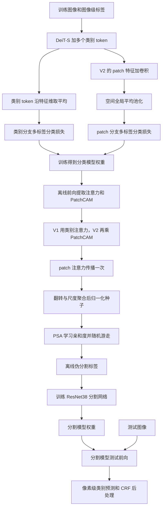
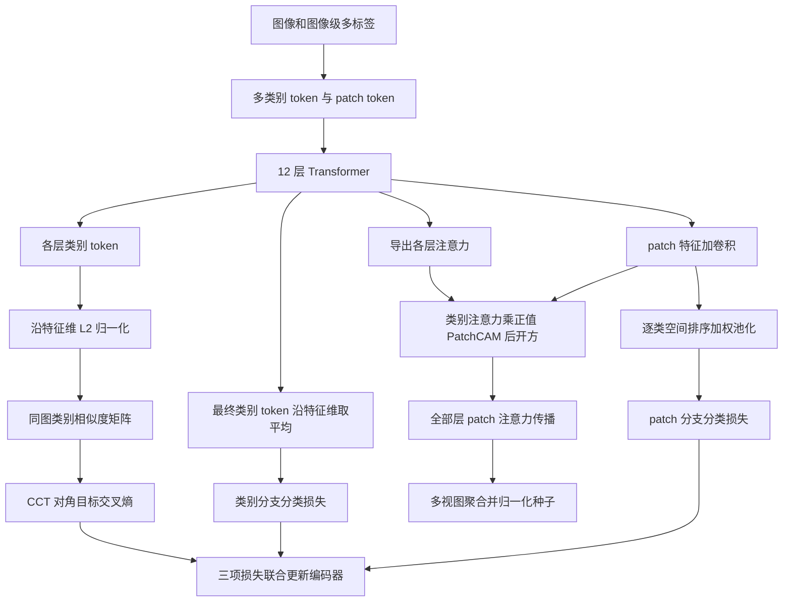
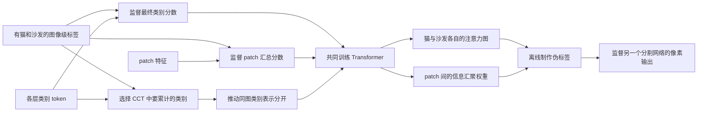

# 01 · MCTformer 与 MCTformer+ 的 Method 回顾

MCTformer 用图像级多标签训练 DeiT-S，把每个类别分配给一个可学习的 class token，再从这些 token 对图像 patch 的注意力中取出定位图。训练时更新 Transformer、类别 token 和相关分类分支，随后离线生成定位种子、制作伪标签，再训练独立的分割网络。贯穿全文的例子是一张“猫坐在沙发上”的照片，训练标签只告诉模型“有猫、有沙发”，物体的位置需要由模型自己学出来。

本文先讲 CVPR 2022 的 MCTformer-V1、V2，再讲 TPAMI 2024 的 MCTformer+。会议版以官方历史代码为依据，扩展版以作者公开的扩展论文全文与官方 Plus 代码为依据，具体版本及访问边界见文末。[会议论文](https://openaccess.thecvf.com/content/CVPR2022/html/Xu_Multi-Class_Token_Transformer_for_Weakly_Supervised_Semantic_Segmentation_CVPR_2022_paper.html) · [扩展论文](https://arxiv.org/abs/2308.03005)

## 先看会议版的整体流程



V1 具备类别 token 分支。V2 在同一个 Transformer 上增加 patch 分类分支，两个分支共享输入和编码器。定位图制作阶段使用训练好的模型进行无梯度前向，后续分割网络读入已经存盘的伪标签。官方代码将这些阶段放在不同脚本里。[2022 年运行入口](https://github.com/xulianuwa/MCTformer/blob/96065977f38ec07cff3dea7295555d5141502c2d/run_psa.sh) · [分割训练](https://github.com/xulianuwa/MCTformer/blob/96065977f38ec07cff3dea7295555d5141502c2d/seg/train_seg.py)

### 结合原论文图 2 看 V1 的两条输出路径

结合下面的原论文框架图，把前面 Mermaid 中的类别训练、注意力提取和一次 patch 传播对应起来。


图为 CVPR 2022 会议版 Figure 2，图片自带原文图注，复用原论文笔记中的本地资源。[来源笔记](<../MCTformer/MCTformer_paper_notes.md>)

**先沿上半部从左向右读。** 输入 RGB 图像被切成网格，黄色条表示 patch token，红色条表示额外可学习的类别 token，紫色条表示加入的位置编码 PE。它们一起进入重复 $L$ 次的编码块。框内的 Norm、Multi-Head Attention、MLP 和残差箭头说明类别 token 与 patch token 在同一个编码器中交换信息。右侧只画出了输出类别 token 到 Average Pooling、Class scores 的路径，对应后文第 3 小节的特征维平均。输入图像由数据提供，类别 token、位置编码和编码器参数在分类训练中更新。

**再看下半部虚线框。** 左侧叠放的方片表示多层、多头注意力，经 Fusion 后画成一张 token 间矩阵。矩阵中橙色区域由类别行指向 patch 列，每行恢复图像网格后得到一类定位图。蓝色区域由 patch 行指向 patch 列，保留位置之间的信息汇聚权重。橙色热图与蓝色亲和度各走一条箭头进入 Refinement，右端输出传播后的类别图。这个下半部对应训练完成后的无梯度种子导出，随后才能接 Mermaid 中的 PSA 和分割网络训练。

| 原图中的位置 | 与本文讲解、代码的对应 |
| --- | --- |
| 红色输出 token → Average Pooling | “用类别 token 自己的平均值，把类别含义绑定到固定位置”，对应 `MCTformerV1.forward_features/forward` |
| 橙色矩阵区域 → Reshape | “一张注意力矩阵提供两类空间信息”中的 `A[:, :C, C:]`，恢复每类二维空间图 |
| 蓝色矩阵区域 → Refinement | `A[:, C:, C:]` 提供传播矩阵，`generate_attention_maps_ms` 完成一次左乘、视图聚合和保存 |

读图时记住三个细节。其一，Average Pooling 沿每个 token 的特征维求平均，类别位置仍然保留，猫与沙发各有自己的分数。其二，图中 Fusion 概括了多层多头聚合，当前实现中类别图使用最后 3 层，patch 传播使用全部 12 层，具体层数要接着看后文第 5 小节。其三，右侧热图属于定位种子阶段，完整伪标签还要经过前面 Mermaid 画出的后续离线处理。

用“猫坐在沙发上”回忆这张图时，可以先找猫 token 那一行橙色权重，把它排回网格，再让各目标 patch 按蓝色矩阵汇总猫类响应。分类监督把猫这个类别绑定到固定 token，空间网格和传播矩阵负责把这种判断展开到图像位置。

## 顺着会议版的数据走一遍

### 1. 先把图像变成 patch token，再加上固定类别顺序的 token

VOC 有 20 个前景类别，分类标签是长度为 20 的向量。猫和沙发两个位置取 1，其余取 0。分类模型相应设置 20 个类别 token，背景通道由后续伪标签处理引入。

默认训练尺寸为 $224\times224$，patch 大小为 $16\times16$，得到 $14\times14=196$ 个 patch。`PatchEmbed` 用步长为 16、卷积核为 16 的卷积做 patch 投影，每个 patch 对应一个 384 维向量。加入类别 token 后，输入形状为 $B\times216\times384$。类别 token 排在前 20 个位置，后 196 个位置保持图像网格顺序。对于其他图像尺寸，patch 数为 $M=\lfloor H/16\rfloor\lfloor W/16\rfloor$，patch 位置编码会相应插值。[PatchEmbed 与注意力实现](https://github.com/xulianuwa/MCTformer/blob/355a4aa7075efe001f90fcc7eb1a289ab796695b/vision_transformer.py) · [会议版模型](https://github.com/xulianuwa/MCTformer/blob/355a4aa7075efe001f90fcc7eb1a289ab796695b/models.py)

按 `run.sh → main.py` 的初始化路径，作者复制 ImageNet 预训练 DeiT 的单个 class token，得到 20 个初始类别 token，对应位置编码也复制。后续训练通过每个位置对应的类别监督，使它们逐渐学出不同含义。类别 token、位置编码、编码器都参与优化。新增 V2 卷积头单独初始化。[会议版训练入口及预训练加载](https://github.com/xulianuwa/MCTformer/blob/355a4aa7075efe001f90fcc7eb1a289ab796695b/main.py)

### 2. 一张注意力矩阵提供两类空间信息

DeiT-S 有 12 个编码块，每块有 6 个注意力头。一个头的维度为 $d_h=384/6=64$，其权重为

$$
A^{(l,h)}=\operatorname{softmax}_{\mathrm{key}}
\left(Q^{(l,h)}K^{(l,h)\top}/\sqrt{d_h}\right).
$$

Softmax 沿最后一维，也就是被关注的 key token 维进行。每个 query 会把权重分给全部类别 token 和全部 patch token。把注意力堆起来，得到 $12\times B\times6\times(C+M)\times(C+M)$，再对 6 个头求平均。代码按类别 token 在前的顺序，取出两个区域。

| 注意力切片，使用从 0 开始的索引 | 形状 | 对“猫坐在沙发上”的含义 |
| --- | --- | --- |
| `A[:, :C, C:]` | $B\times C\times M$ | 猫 token、沙发 token 各自关注哪些 patch |
| `A[:, C:, C:]` | $B\times M\times M$ | 某个目标 patch 更新时，从哪些源 patch 汇入信息 |

例如猫 token 那一行含有 196 个数，把它恢复成 $14\times14$，就得到猫类的定位图。Patch-to-patch 注意力则记录 patch 之间的信息汇聚权重，可以用来传播定位响应。该矩阵带有方向性，数值由整张图像的 token 交互决定。[Attention.forward 与 Block.forward](https://github.com/xulianuwa/MCTformer/blob/355a4aa7075efe001f90fcc7eb1a289ab796695b/vision_transformer.py)

### 3. 用类别 token 自己的平均值，把类别含义绑定到固定位置

设最后一层类别 token 为 $T_{\mathrm{cls}}\in\mathbb{R}^{B\times C\times D}$。第 $c$ 类的分类 logit 为

$$
z_{bc}=\frac{1}{D}\sum_{d=1}^{D}T_{\mathrm{cls}}[b,c,d].
$$

这里平均掉的是 384 维特征，保留 20 个类别位置。猫类得分直接来自猫 token，沙发类得分直接来自沙发 token。这样，图像级标签就能持续要求各位置完成对应类别的判断。官方子类直接使用最后一个 block 的输出进行平均，具体路径见 `MCTformerV1.forward_features/forward`。[会议版类别分支](https://github.com/xulianuwa/MCTformer/blob/355a4aa7075efe001f90fcc7eb1a289ab796695b/models.py)

分类采用 `multilabel_soft_margin_loss`，等价于对各类别独立使用 sigmoid 后计算二元交叉熵，再对类别及批次取平均。

$$
\mathcal{L}_{\mathrm{cls}}=
-\frac{1}{BC}\sum_{b,c}
\left[y_{bc}\log\sigma(z_{bc})+(1-y_{bc})\log(1-\sigma(z_{bc}))\right].
$$

一张图像可以同时包含猫和沙发，所以两个 logit 都能得到正监督。损失经过类别 token 回传到编码器，注意力通过分类训练得到间接约束。图像级标签提供“有没有”的监督，模型仍需要从统计关联中学习“在哪里”。[train_one_epoch](https://github.com/xulianuwa/MCTformer/blob/355a4aa7075efe001f90fcc7eb1a289ab796695b/engine.py)

### 4. V2 再让 patch 特征完成一次相同的分类任务

V2 把最后一层 patch token 恢复成 $B\times384\times14\times14$，通过一个输出通道为 $C$ 的卷积得到 $F\in\mathbb{R}^{B\times C\times14\times14}$。这里按官方源码采用 $3\times3$ 卷积、步长 1、padding 1。随后沿两个空间维做 GAP，得到第二组 $B\times C$ 分类 logit。

两个分类分支各自计算一份上述损失，总损失为

$$
\mathcal{L}_{\mathrm{V2}}=
\mathcal{L}_{\mathrm{cls-class}}+
\mathcal{L}_{\mathrm{cls-patch}}.
$$

猫 token 要完成猫类判断，同时 patch 特征上的猫通道也要完成猫类判断。两份监督共同更新共享编码器，让两种定位信息能够配合。它们通过共享特征和相同标签相互影响，代码中的目标函数就是这两项分类损失之和。[V2 模型及卷积头](https://github.com/xulianuwa/MCTformer/blob/355a4aa7075efe001f90fcc7eb1a289ab796695b/models.py) · [两项损失](https://github.com/xulianuwa/MCTformer/blob/355a4aa7075efe001f90fcc7eb1a289ab796695b/engine.py)

### 结合原论文图 3 看 V2 的双分类与定位融合

把 V1 的注意力路径保留，再接上刚才的 patch 分类分支，就能顺着下面的原图读出 V2。


图为 CVPR 2022 会议版 Figure 3，复用原论文笔记中的本地架构图，图内附有原始图注。[来源笔记](<../MCTformer/MCTformer_paper_notes.md>)

**上半部先看训练。** 左侧的红色类别 token、黄色 patch token 和紫色位置编码一起通过 Transformer Encoder。输出按 token 类型分流。红色类别 token 经 Average Pooling 产生类别分数，接 $\mathcal L_{\mathrm{cls-class}}$。黄色 patch token 经 Reshape 恢复 $N	imes N	imes D$ 网格，再经 CONV 变为 $N	imes N	imes C$，GAP 把每类空间响应汇总成另一路类别分数，接 $\mathcal L_{\mathrm{cls-patch}}$。两份图像级损失共同更新同一个编码器及各自涉及的可训练参数，CONV 也在这条分类路径中学习。

**下半部再看导出。** 编码器向下提供 MCT Attention 和 PatchAffinity，卷积特征向下提供 PatchCAM。图中的圆圈乘号把 MCT Attention 与 PatchCAM 按类别、按位置相乘，得到 Fusion maps。最下方从 PatchAffinity 引出的长线把 patch 间权重送到融合图的细化步骤，最终到达 Refined fusion maps。读到这里，就能接上下一小节的 $U_c=S_c\odot P_c$ 和 $\widetilde U_c=RU_c$。热图导出时模型设为评估模式，整段种子生成关闭梯度。

| 原图模块 | 在现有文字与代码中找什么 |
| --- | --- |
| Reshape → CONV → GAP | 上一小节的 V2 附加分支，以及“类别监督和 V2 的附加分支”代码中的 `restore_grid`、`conv3x3`、`patch_scores.mean` |
| MCT Attention × PatchCAM | 下一小节的类别注意力与正值卷积响应融合，代码中对应 `class_map * relu(patch_scores.detach())` |
| PatchAffinity → Refined fusion maps | “V2 生成单个视图的种子”中的 `patch_affinity @ fused`，其后才接翻转、尺度聚合与归一化 |

读图时容易混在一起的三处可以按执行阶段记。第一，图中两个 Class scores 都是图像级类别预测，使用同一份猫、沙发标签计算各自的损失。第二，图中的 CONV 只概括卷积操作，本文引用的官方实现具体使用 $3	imes3$ 卷积，尺寸与 padding 见前一小节。第三，卷积分支同时服务于分类训练和热图导出，训练用的 `patch_scores` 保留梯度，生成定位图时另取 `detach` 副本。原图把空间响应绘成彩色热图，数值计算顺序则按后文代码追踪，先取正响应并融合、再传播、最后聚合归一化。

仍以猫和沙发为例，猫 token 给出猫关注的区域，patch 分支的猫通道给出局部猫类响应。两者在相同网格位置相乘后，由 patch 注意力汇总到其他位置。这样回看 Mermaid，就能把“两份分类损失”放到训练段，把“相乘与传播”放到离线导出段，再继续走向伪标签与独立分割模型。

### 5. 训练完成后，才开始提取和传播定位响应

官方会议版示例用最后 3 层的 class-to-patch 注意力。代码先在头维求平均，再在选定层上求和，得到每类空间图 $S_c$。V1 直接使用 $S_c$。V2 还取卷积特征的正响应 $P_c=\operatorname{ReLU}(F_c)$，逐位置相乘得到融合图

$$
U_c=S_c\odot P_c.
$$

猫 token 和猫通道在同一位置都有响应时，融合值才能保留下来。相乘可以抑制一侧独有的杂散响应，也可能压低只有一侧发现的物体部分。因此这是一种利用互补证据的经验设计。[V2.forward](https://github.com/xulianuwa/MCTformer/blob/355a4aa7075efe001f90fcc7eb1a289ab796695b/models.py)

接着从全部 12 层提取 patch-to-patch 子矩阵并求和，得到 $R\in\mathbb{R}^{B\times M\times M}$。对每个类别的列向量做一次矩阵乘法

$$
\widetilde U_c(i)=\sum_{j=1}^{M}R(i,j)U_c(j).
$$

目标位置 $i$ 汇总源位置 $j$ 的响应。如果猫的躯干 patch 对猫头 patch 有较大注意力，猫头处已有的猫响应就能影响躯干处。一次传播也可能把响应带到相关背景，实际效果取决于学到的注意力。

这里有三个与执行顺序直接相关的细节。类别图选最后 3 层，传播矩阵使用全部 12 层。裁出的 patch 子矩阵直接参与乘法，代码保留其原始权重尺度。V2 先将类别注意力与 ReLU 后的卷积图相乘，再做 patch 传播，最终的 min-max 归一化放在翻转与尺度聚合之后。论文用归一化地图表述方法，这里采用上述源码顺序。[generate_attention_maps_ms](https://github.com/xulianuwa/MCTformer/blob/355a4aa7075efe001f90fcc7eb1a289ab796695b/engine.py)

生成种子的整个函数带有 `@torch.no_grad()`，内部设为 `model.eval()`。每个尺度同时处理原图和水平翻转图，传播并上采样到原图大小后，把翻转图翻回来。使用图像标签把缺席类别置零，然后累加各视图，逐类执行

$$
\operatorname{Norm}(V_c)=
\frac{V_c-\min V_c}{\max V_c-\min V_c+10^{-8}}.
$$

归一化结果以“类别索引到二维响应图”的字典保存。会议版提供的定位脚本设置尺度为 1.0，同时仍有水平翻转视图。生成训练集种子时用已知图像标签筛类别，最终分割测试由另一个网络完成。[视图构造](https://github.com/xulianuwa/MCTformer/blob/355a4aa7075efe001f90fcc7eb1a289ab796695b/datasets.py) · [脚本配置](https://github.com/xulianuwa/MCTformer/blob/355a4aa7075efe001f90fcc7eb1a289ab796695b/run.sh)

## 从定位种子走到分割模型

会议论文在 VOC 上继续使用 PSA 制作伪分割标签。官方 2022 年 10 月提交补齐了相应脚本，数据依次经过以下步骤。

1. 对前景种子构造背景分数 $(1-\max_c V_c)^\alpha$，分别使用 $\alpha=1$ 和 $12$，经过 CRF 得到两套响应。
2. `VOC12AffDataset` 组合两套结果，形成可靠前景、可靠背景及值为 255 的忽略区域，再从局部位置对产生“同类前景”“同类背景”“异类”亲和度监督。任一端为忽略区域的有效性由对应 mask 控制。
3. 独立训练 ResNet38 AffinityNet。三类损失分别归一化后，按背景正对 $1/4$、前景正对 $1/4$、负对 $1/2$ 加权。
4. `infer_aff.py` 将预测亲和度逐元素取 8 次方，按列归一化为转移矩阵，连续平方 6 次得到 $T^{64}$。加入默认背景分数 0.39 的种子图降采样到步长 8，右乘该矩阵，上采样并逐像素取最大通道，输出伪标签 PNG。

上述背景阈值和随机游走参数来自被读取脚本的默认值。Transformer 内部的一次 patch 传播先改善种子，PSA 再通过独立学习的亲和度做离线传播，两个阶段在不同分辨率和模型上执行。[CRF 种子生成](https://github.com/xulianuwa/MCTformer/blob/96065977f38ec07cff3dea7295555d5141502c2d/engine.py) · [亲和度标签](https://github.com/xulianuwa/MCTformer/blob/96065977f38ec07cff3dea7295555d5141502c2d/psa/voc12/data.py) · [亲和度训练](https://github.com/xulianuwa/MCTformer/blob/96065977f38ec07cff3dea7295555d5141502c2d/psa/train_aff.py) · [随机游走](https://github.com/xulianuwa/MCTformer/blob/96065977f38ec07cff3dea7295555d5141502c2d/psa/infer_aff.py)

分割模型采用 ResNet38 特征和带空洞卷积的分割头，VOC 输出含背景的 21 个通道。`train_seg.py` 读取伪标签，用像素交叉熵训练，忽略值为 255 的像素。分割损失只更新分割模型，分类器与伪标签生成之间通过磁盘文件衔接。测试脚本对各尺度的分割输出沿类别维 softmax，再逐位置逐通道取各尺度最大概率，最后可接 CRF 和 argmax。[分割网络](https://github.com/xulianuwa/MCTformer/blob/96065977f38ec07cff3dea7295555d5141502c2d/seg/network/resnet38_seg.py) · [分割训练](https://github.com/xulianuwa/MCTformer/blob/96065977f38ec07cff3dea7295555d5141502c2d/seg/train_seg.py) · [分割推理](https://github.com/xulianuwa/MCTformer/blob/96065977f38ec07cff3dea7295555d5141502c2d/seg/infer_seg.py)

## 对照会议版官方代码

以下均为保留数据流的等价整理，变量名为便于阅读重新命名。

### 类别监督和 V2 的附加分支

```python
class_tokens, patch_tokens, attentions = encoder(image)
class_logits = class_tokens.mean(dim=-1)
loss = multilabel_loss(class_logits, image_labels)

# V2 增加这一条可训练分支
patch_grid = restore_grid(patch_tokens)
patch_scores = conv3x3(patch_grid)
patch_logits = patch_scores.mean(dim=(-2, -1))
loss = loss + multilabel_loss(patch_logits, image_labels)
```

`encoder` 在这里对应 `forward_features`，`multilabel_loss` 对应多标签 soft margin loss。用于计算 `patch_logits` 的 `patch_scores` 保留梯度。实际源码另从它 `detach().clone()` 出一份生成定位图，该副本承担热图导出路径。[models.py](https://github.com/xulianuwa/MCTformer/blob/355a4aa7075efe001f90fcc7eb1a289ab796695b/models.py) · [engine.py](https://github.com/xulianuwa/MCTformer/blob/355a4aa7075efe001f90fcc7eb1a289ab796695b/engine.py)

### V2 生成单个视图的种子

```python
# attention 的形状为 L × B × heads × tokens × tokens
head_average = attention.mean(dim=2)
class_map = head_average[-3:, :, :C, C:].sum(dim=0)
class_map = class_map.reshape(B, C, grid_h, grid_w)
fused = class_map * relu(patch_scores.detach())

patch_affinity = head_average[:, :, C:, C:].sum(dim=0)
refined = patch_affinity[:, None] @ fused.reshape(B, C, M, 1)
refined = refined.reshape(B, C, grid_h, grid_w)
```

这段对应 `MCTformerV2.forward` 和 `generate_attention_maps_ms`，其中 `M=grid_h*grid_w`。从 $M\times M$ 左乘 $M\times1$ 的方向可以看出，每个目标 patch 收集其他 patch 的类别响应。翻转对齐、视图聚合与 min-max 归一化接在这段之后。[模型输出定位图](https://github.com/xulianuwa/MCTformer/blob/355a4aa7075efe001f90fcc7eb1a289ab796695b/models.py) · [传播与保存](https://github.com/xulianuwa/MCTformer/blob/355a4aa7075efe001f90fcc7eb1a289ab796695b/engine.py)

## 期刊扩展版 MCTformer+

### 扩展关系与读取范围

作者在 arXiv 条目中明确将 MCTformer+ 标为 MCTformer 的期刊扩展。该工作正式发表于 IEEE TPAMI 2024 年第 46 卷第 12 期，8380–8395 页，2024 年 5 月 23 日上线，DOI 为 `10.1109/TPAMI.2024.3404422`。本节实际读取的是作者公开的 arXiv v1 方法全文，以及官方仓库中 2023 年上传的 Plus 实现。正式出版记录由作者机构页面和 PubMed 核实，出版终稿与公开预印本之间的逐字变化未作核对。[作者扩展声明](https://arxiv.org/abs/2308.03005) · [UWA 出版记录](https://research-repository.uwa.edu.au/en/publications/mctformer-multi-class-token-transformer-for-weakly-supervised-sem/) · [PubMed 记录](https://pubmed.ncbi.nlm.nih.gov/38781059/)

MCTformer+ 承接 V2 的双分类分支，着重改善两处。一处让同图中不同类别 token 的表示更容易区分，另一处调整 patch 分支将空间响应汇总为分类分数的方式。[扩展论文第三节](https://arxiv.org/html/2308.03005v1#S3)



### 结合扩展原论文图 4 看 MCTformer+ 的新增位置

结合下面的扩展版原图，把本节 Mermaid 中的逐层 CCT 和排序池化接回 V2 的双分支流程。


图为公开扩展论文 arXiv `2308.03005v1` 的 Figure 4，下载原文 HTML 所提供的原始图片。本文沿用前述期刊扩展关系与读取范围，图像版本对应 2023 年公开预印本。[原文图 4](https://arxiv.org/html/2308.03005v1#S3.F4) · [原始图片](https://arxiv.org/html/2308.03005v1/MCTformer_plus_overview2.png)

**先沿上方红色 token 读逐层监督。** 左侧输入继续由可学习类别 token 和图像 patch token 组成，共同通过 Transformer Block。图中用第 1、$i$、$L$ 个 block 与省略号表示多层堆叠。各层红色类别 token 向上接 CCT，产生对应的 $\mathcal L_{contrast}^{l}$。最后一层还向右接 Average Pooling，产生类别分数与 $\mathcal L_{\mathrm{cls-class}}$。这样，最终分类分数与中间层类别表示都获得训练约束。沿特征维平均继续固定 token 与类别的对应关系，CCT 的计算及正类 mask 则接着看下一小节。

**再沿中间黄色 token 读 patch 分支。** 输出 patch token 经过 CONV + Reshape，得到每类一张空间得分图。Global Weighted Ranking Pooling 框内部先表示 Ranking weights，再画出逐位置相乘与 Spatial pooling，最终产生 patch 类别分数和 $\mathcal L_{\mathrm{cls-patch}}$。图里彩色的排名权重提醒我们，每个类别都按自己的响应大小分配权重。后文 GWRP 公式与代码给出了具体操作，先沿空间位置排序，再用 $\lambda^{r-1}$ 加权汇总。两路分类和各层 CCT 一起更新共享编码器，卷积头与类别 token 也参与相应梯度路径。

| 扩展图中的位置 | 在本文现有流程中如何落实 |
| --- | --- |
| 每层类别 token → CCT | “新增一 · CCT 直接约束各层类别 token 的相似度”，代码读取 `class_history`、归一化、计算同图相似度，再按标签累计 |
| Ranking weights → Spatial pooling | “新增二 · 用 GWRP 汇总 patch 分类分数”，对应 `spatial_scores.sort`、排名权重和归一化加权和 |
| MCT Attention × PatchCAM → Fusion maps | “Plus 的定位图生成还有一处代码级变化”，对应 `sqrt(restore_grid(class_map) * positive_cam)` |
| PatchAffinity → Refined fusion maps | 本节 Mermaid 中的全部层 patch 注意力传播，以及 `generate_attention_maps_ms` 的离线多视图导出 |

**最后读底部热图。** Transformer 提供 PatchAffinity 与 MCT Attention，卷积特征提供 PatchCAM，融合图再由 patch 亲和度传播得到右端细化图。三个读图细节需要和代码一起记。其一，CCT 箭头从各层类别表示取出监督，当前实现用图像标签选择累计哪些类别损失，同时保留其他 token 进入相似度比较。其二，GWRP 所在的右侧分类框汇总原始卷积得分，向下导出的 PatchCAM 路径再取正响应。其三，图中圆圈乘号概括定位融合，本文固定的 Plus 实现在乘积后还开平方，再进行 patch 传播。种子导出由 `eval()` 与无梯度前向执行，随后才衔接离线伪标签阶段。

把图中的车辆例子换回猫和沙发也能顺着读。各层 CCT 让猫与沙发 token 的表示更可区分，GWRP 让两类各自的高响应位置在 patch 分类中占较大权重，底部仍由两类空间证据融合并传播。这样就能把 Plus 的新增训练约束、池化方式和实际导出顺序分别接到前文代码。

### 新增一 · CCT 直接约束各层类别 token 的相似度

在猫与沙发经常共同出现时，只要求两个类别的图像分数正确，仍可能让两个 token 都聚合了部分相同区域。CCT 在各层输出的类别 token 上再加一份监督。对于第 $l$ 层的 $T^{(l)}\in\mathbb{R}^{B\times C\times D}$，源码沿最后一维 L2 归一化，得到 $\bar T^{(l)}$，再计算

$$
S^{(l)}=\bar T^{(l)}\bar T^{(l)\top}
\in\mathbb{R}^{B\times C\times C}.
$$

矩阵第 $c$ 行表示该类别 token 和所有类别 token 的余弦相似度。交叉熵的目标索引取 $c$，使自身的相似度在本类与其他类的比较中占优。源码通过张量换维在类别维上做交叉熵，因 $S$ 对称，也可以等价地按下面的行形式理解

$$
\ell_{blc}=-\log
\frac{\exp S^{(l)}_{bcc}}
{\sum_{j=1}^{C}\exp S^{(l)}_{bcj}}.
$$

例如猫 token 以自己为正目标，沙发、狗、汽车等其他 token 都进入比较的分母。代码默认保留最后 `num_cct=12` 层，因此覆盖全部编码层。它只把当前图像中存在的类别作为需要累计的项，按每张图像的正类数归一化，再对层和批次取平均

$$
\mathcal{L}_{\mathrm{CCT}}
=\frac{1}{B}\sum_b
\frac{\sum_{l\in\mathcal K}\sum_c y_{bc}\ell_{blc}}
{|\mathcal K|(\sum_c y_{bc}+10^{-8})}.
$$

缺席类别的 token 仍然出现在相似度比较的分母中。所有参与 CCT 的 token 都保留梯度，约束可以作用到较浅层。CCT 使用同一张图像里的类别 token，计算期间也保留类别 token 与 patch token 原有的自注意力交互。表示更可区分能鼓励注意力减少串类，空间定位质量仍由训练结果决定。[Plus 的逐层 token 输出](https://github.com/xulianuwa/MCTformer/blob/0acc27ada87a5582053efb14648442d8644168aa/models.py) · [CCT 损失及标签 mask](https://github.com/xulianuwa/MCTformer/blob/0acc27ada87a5582053efb14648442d8644168aa/engine.py)

### 新增二 · 用 GWRP 汇总 patch 分类分数

会议 V2 对整张 patch 得分图做等权 GAP。Plus 对每个类别单独把 $M$ 个位置的原始卷积得分从大到小排序，用衰减权重汇总

$$
z^{\mathrm{patch}}_c=
\frac{\sum_{r=1}^{M}\lambda^{r-1}F_{c,(r)}}
{\sum_{r=1}^{M}\lambda^{r-1}},\qquad\lambda=0.996.
$$

$F_{c,(r)}$ 是该类别排序后的第 $r$ 大得分。猫类按猫通道排序，沙发类按沙发通道排序，各自的高分位置有更大权重，排名靠后的位置仍有贡献。这样，分类分数可以主要依赖一部分高响应区域，梯度也随排名权重分配。排序池化使用 ReLU 之前的分类得分，ReLU 用于导出定位图。[MCTformerPlus.forward](https://github.com/xulianuwa/MCTformer/blob/0acc27ada87a5582053efb14648442d8644168aa/models.py)

总损失在源码中写成

$$
\mathcal{L}_{+}=\mathcal{L}_{\mathrm{cls-class}}
+\mathcal{L}_{\mathrm{cls-patch}}
+w\mathcal{L}_{\mathrm{CCT}},\qquad w=1.0.
$$

`main.py` 默认输入尺寸为 448，patch 网格随之变为 $28\times28$，$M=784$。构造模型时传入该尺寸，预训练 patch 位置编码通过空间重复由 $14\times14$ 扩成 $28\times28$，类别位置编码与 patch 位置编码分别存储。类别分支的沿特征维平均和两份图像级分类监督继续保留。[Plus 默认参数及预训练加载](https://github.com/xulianuwa/MCTformer/blob/0acc27ada87a5582053efb14648442d8644168aa/main.py)

### Plus 的定位图生成还有一处代码级变化

Plus 默认对最后 12 层的类别注意力求平均，取 ReLU 后的 PatchCAM，与类别注意力逐位置相乘，然后开平方

$$
U_c^{+}=\sqrt{S_c\odot\operatorname{ReLU}(F_c)}.
$$

之后仍用全部层的 patch-to-patch 注意力之和左乘类别图，再做上采样、翻转对齐、图像标签过滤、视图累加与 min-max 归一化。默认尺度为 `1.0, 0.75, 1.25`，每个尺度有原图与翻转图。公开扩展论文的融合公式写为逐元素相乘，本节按 Plus 源码补上开平方这一步。它位于 patch 传播之前，会改变传播时不同强度响应的相对权重。[Plus.forward](https://github.com/xulianuwa/MCTformer/blob/0acc27ada87a5582053efb14648442d8644168aa/models.py) · [视图聚合](https://github.com/xulianuwa/MCTformer/blob/0acc27ada87a5582053efb14648442d8644168aa/engine.py)

| 环节 | CVPR 2022 的 V1 | CVPR 2022 的 V2 | 公开的 MCTformer+ 实现 |
| --- | --- | --- | --- |
| 类别 token 分类 | 沿特征维平均 | 沿特征维平均 | 沿特征维平均 |
| patch 分类 | V1 的训练目标为类别分支损失 | 卷积加 GAP | 卷积加 GWRP |
| 类别表示附加监督 | 类别分支分类损失 | 两分支分类损失 | 再加逐层 CCT，按正类 mask 汇总 |
| 默认训练输入 | $224\times224$ | $224\times224$ | $448\times448$ |
| 类别注意力聚合 | 示例取最后 3 层求和 | 示例取最后 3 层求和 | 默认取全部 12 层求平均 |
| 融合热图 | 类别注意力 | 类别注意力乘正值 PatchCAM | 乘积开平方 |
| patch 传播 | 全部层求和后乘一次 | 全部层求和后乘一次 | 全部层求和后乘一次 |

Plus 的公开运行脚本覆盖分类训练、种子导出和种子评估。当前仓库中的 `run_psa.sh` 仍指向会议版 V2 类名并传入 `--out-crf`，Plus 当前模型定义和参数解析已变化。因此，这份当前脚本的衔接情况需要结合历史版本理解。本文将经代码确认的 Plus 流程追到种子输出，后续 PSA 和分割阶段采用前文单独核实的 2022 年实现作为说明依据。[Plus 运行脚本](https://github.com/xulianuwa/MCTformer/blob/0acc27ada87a5582053efb14648442d8644168aa/run_mct_plus.sh) · [仓库保留的 PSA 脚本](https://github.com/xulianuwa/MCTformer/blob/0acc27ada87a5582053efb14648442d8644168aa/run_psa.sh)

## 对照 Plus 官方代码

### CCT 的核心是相似度分类，再按图像标签累计

```python
# class_history 的形状为 L × B × C × D
tokens = normalize(class_history[-num_cct:], dim=-1)
similarity = tokens @ tokens.transpose(-1, -2)

# 每个 token 的正确类别是自身索引
token_losses = diagonal_target_cross_entropy(similarity)
present_loss = token_losses * image_labels[None, :, :]
per_image = present_loss.sum(dim=-1) / (
    image_labels.sum(dim=-1)[None, :] + 1e-8
)
cct_loss = per_image.mean()
total_loss = class_loss + patch_loss + loss_weight * cct_loss
```

这是 `engine.py/train_one_epoch` 的等价整理，`diagonal_target_cross_entropy` 是为讲解表达的操作名。实际代码通过 `arange(C)` 构造目标索引，并换维后调用 `CrossEntropyLoss(reduction='none')`。它在形成每个类别的损失后再乘图像标签。[CCT 实际实现](https://github.com/xulianuwa/MCTformer/blob/0acc27ada87a5582053efb14648442d8644168aa/engine.py)

### GWRP 影响分类训练，融合开平方影响热图导出

```python
ranked = spatial_scores.sort(dim=-1, descending=True).values
rank_weights = decay ** arange(number_of_patches)
patch_logits = (ranked * rank_weights).sum(dim=-1) / rank_weights.sum()

# return_att 路径，处于离线种子生成阶段
class_map = head_average[-n_layers:, :, :C, C:].mean(dim=0)
positive_cam = relu(patch_scores.detach())
seed = sqrt(restore_grid(class_map) * positive_cam)
```

这里将排序张量整理为 $B\times C\times M$，源码先展平成 $B\times M\times C$ 再沿空间维排序，运算含义一致。GWRP 的 logit 接受分类梯度，导出的融合图接下来交给 `generate_attention_maps_ms` 做传播。[Plus.forward](https://github.com/xulianuwa/MCTformer/blob/0acc27ada87a5582053efb14648442d8644168aa/models.py)

## 用一张图串起监督和最终用途



回到照片本身，猫 token 通过固定类别监督逐渐关注猫，沙发 token 逐渐关注沙发。V2 让 patch 特征也学会分别给猫和沙发打分，两种空间响应相乘后再传播。Plus 进一步要求各层两个 token 的表示拉开，并让 patch 分类优先利用排名靠前的响应。最终，分割模型学习的是离线伪标签中的像素类别，测试时直接从图像输出像素预测。

## 回顾时抓住这几点

1. **类别 token 的类别含义来自固定对应的分类监督。** 每个 token 沿特征维平均后的分数，直接对齐该类别的图像标签。
2. **同一个注意力矩阵提供定位与传播两种信息。** 类别到 patch 的部分给每类空间响应，patch 到 patch 的部分让响应在图像内部汇聚。
3. **V2 用共享编码器上的两个分类任务改善两类定位图。** 导出时把类别注意力与 PatchCAM 相乘，再传播、聚合和归一化。
4. **Plus 同时改类别表示与 patch 汇总。** CCT 在各层约束类别 token，GWRP 在每个类别内按空间响应排序加权。公开实现还对融合图开平方。
5. **完整 WSSS 流程按阶段训练。** 分类模型产生种子，离线亲和度处理生成伪标签，分割模型接受像素交叉熵监督。

### 三个自检问题

- **猫 token 的 384 维特征平均后还剩什么？** 每张图像、每个类别一个 logit，形状为 $B\times C$。
- **设置最后 3 层生成类别注意力时，patch 传播矩阵来自几层？** 被读取的会议实现使用全部 12 层。
- **CCT 遇到图中缺席的狗类时如何处理？** 狗类自身那一项由图像标签 mask 掉，但狗 token 继续参与其他已出现类别的相似度比较。

## 资料与实现版本

本文完成了论文方法阅读与官方源码静态追踪，覆盖运行入口、模型 forward、分类损失、种子导出、PSA 和分割入口。文中参数均对应所列版本，代码片段为等价整理。

### 论文及出版依据

- **会议原论文**为 Xu 等人的 *Multi-class Token Transformer for Weakly Supervised Semantic Segmentation*，CVPR 2022。阅读本地原始 PDF 的第 3 节、Figure 2–3 和实施流程说明，并查看了方法页渲染。[CVF 页面](https://openaccess.thecvf.com/content/CVPR2022/html/Xu_Multi-Class_Token_Transformer_for_Weakly_Supervised_Semantic_Segmentation_CVPR_2022_paper.html) · [原文 PDF](https://openaccess.thecvf.com/content/CVPR2022/papers/Xu_Multi-Class_Token_Transformer_for_Weakly_Supervised_Semantic_Segmentation_CVPR_2022_paper.pdf)
- **扩展方法全文**为作者公开的 *MCTformer+: Multi-Class Token Transformer for Weakly Supervised Semantic Segmentation*，arXiv `2308.03005v1`，2023 年 8 月 6 日。阅读第三节的 MCTformer、GWRP、CCT 与定位推理内容，扩展关系由摘要页的作者说明确认。[扩展全文](https://arxiv.org/html/2308.03005v1) · [版本与扩展声明](https://arxiv.org/abs/2308.03005)
- **期刊出版信息**为 IEEE TPAMI 2024，46(12)，8380–8395，DOI `10.1109/TPAMI.2024.3404422`。出版年份和卷期由作者机构与 PubMed 记录确认。[UWA 记录](https://research-repository.uwa.edu.au/en/publications/mctformer-multi-class-token-transformer-for-weakly-supervised-sem/) · [PubMed](https://pubmed.ncbi.nlm.nih.gov/38781059/)

### 官方源码固定版本

| 用途 | 版本 | 实际阅读的关键文件 |
| --- | --- | --- |
| 会议版初期实现，2022-06-19 | `355a4aa7075efe001f90fcc7eb1a289ab796695b` | `run.sh`、`main.py`、`models.py`、`vision_transformer.py`、`engine.py`、`datasets.py` |
| 会议版完整后处理，2022-10-24 | `96065977f38ec07cff3dea7295555d5141502c2d` | `models.py`、`main.py`、`engine.py`、`run_psa.sh`、`psa/train_aff.py`、`psa/voc12/data.py`、`psa/infer_aff.py`、`seg/train_seg.py`、`seg/network/resnet38_seg.py`、`seg/infer_seg.py` |
| Plus 公开实现，2023-08-24 | `0acc27ada87a5582053efb14648442d8644168aa` | `README.md`、`run_mct_plus.sh`、`main.py`、`models.py`、`vision_transformer.py`、`engine.py`、`datasets.py`，以及仓库保留的 PSA、分割脚本 |

会议两个提交中的 `models.py` 内容一致，2022 年 10 月版补齐了 CRF 及后处理衔接。当前主分支的 `models.py` 已定义 `MCTformerPlus`，会议版模型通过固定历史提交读取。Plus 的代码时间对应公开预印本阶段，期刊最终出版在 2024 年。[提交历史](https://github.com/xulianuwa/MCTformer/commits/main/) · [会议版模型](https://github.com/xulianuwa/MCTformer/blob/96065977f38ec07cff3dea7295555d5141502c2d/models.py) · [Plus 模型](https://github.com/xulianuwa/MCTformer/blob/0acc27ada87a5582053efb14648442d8644168aa/models.py)

### 资料边界

原会议 PDF 与两代官方代码均成功读取。扩展论文 PDF 在网页工具中超出大小限制，后续使用作者公开的 HTML 全文完成方法阅读。IEEE 正式出版页面触发机器人验证，期刊终稿与公开预印本的逐字变化未核对。官方补充材料、权重加载与实际训练推理运行均未覆盖。Plus 当前仓库保留的 PSA 脚本存在上述版本衔接差异，本回顾对 Plus 的代码级确认范围截至定位种子导出，PSA 及分割流程由会议历史实现单独支持。
