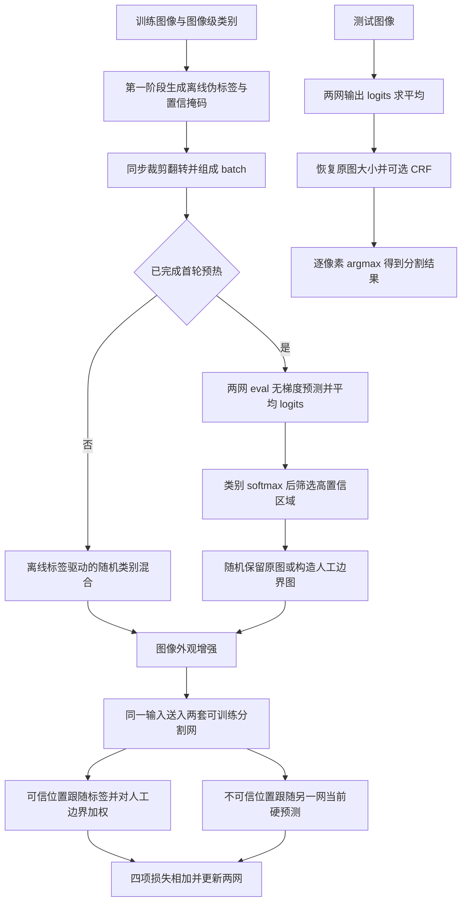
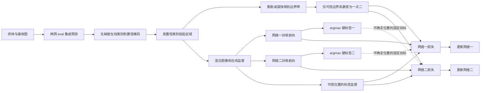

# 02 · BECO：Method 回顾

BECO 使用图像级类别标签准备离线伪分割标签，再训练两套独立的语义分割网络。它主要改进 WSSS 的第二阶段，训练时让两网在不确定像素上互相提供目标，同时把可信区域贴进另一张图，制造带有监督信号的人工边界。最终输出逐像素类别，官方默认测试路径把两网的 logits 求平均。

本文覆盖 CVPR 2023 会议版，按官方仓库固定提交 `6a57bed601a940cd2337d1465589418648a3a035` 的默认 VOC 入口讲解。论文方法、补充材料和源码均已独立阅读，源码属于静态核对，未实际训练。到 2026-11-11 的检索未确认同一工作的期刊扩展版，核查范围见文末。

## 先看整体流程



这里有两条容易混在一起的在线预测路径。混图之前的预测在 `eval()` 和 `no_grad()` 下产生，负责挑选可信的粘贴内容。混图之后的两网前向处于训练模式，负责计算损失，其硬预测还会交叉监督另一网。两条路径使用同一对模型的当前参数，但服务于不同位置。第一阶段网络在第二阶段的计算图之外，第二阶段优化器更新两套分割网的参数。[官方训练入口](https://github.com/ShenghaiRong/BECO/blob/6a57bed601a940cd2337d1465589418648a3a035/main.py) · [BECO.train_step](https://github.com/ShenghaiRong/BECO/blob/6a57bed601a940cd2337d1465589418648a3a035/models/train_beco.py)

### 对着原论文图 3 看整体训练

结合下面的原论文框架图，可以把前面的 Mermaid 接到论文符号上。先沿左侧读出样本，再看中间两网，最后展开右侧的像素损失。

/images/BECO/BECO_main_fig3.png>)

*CVPR 2023 主文图 3，BECO 框架概览。复用原笔记中的论文图片，图号与原图说明见来源。* [原笔记方法部分](<../BECO/BECO_paper_notes.md#3-方法>)

左侧两张输入图各带一张类别伪标签和一张置信掩码。经过混合后，蓝框中得到 $X,Y,M,B$ 四件东西。$X$ 的两条实线分别进入 $f(\theta_1)$、$f(\theta_2)$，说明两网读同一张训练图。当前实现中两套分割网参数独立且都参与更新，第一阶段分类器已在离线阶段交出监督材料。原图和混图的具体标签来源，可以接着读“顺着数据走一遍”的第 1、3、4 步。

中间的 $P^1,P^2$ 标作 Logits，经过 `argmax` 后变成整数类别 $Y^1,Y^2$。交叉实线把 $Y^2$ 送到网络 1 的损失，把 $Y^1$ 送到网络 2 的损失。图例中的虚线表示反向传播，梯度沿各自 logits 路径回到对应网络。作为目标的硬类别已经停止梯度，具体可对照后文“梯度如何走”的 Mermaid。

| 图中位置 | 顺着图理解 | 对应本回顾的实现位置 |
| --- | --- | --- |
| 左侧混合框 $X,Y,M,B$ | 图像、类别、可信标记和人工边界一起准备好 | 第 3–5 步，`imgmix_one_withmaskol_bdry` 与 `getBoundry` |
| 两个 $f(\theta)$ 与 $P$ | 同一输入做两次独立的训练前向 | “分割网络输出什么”，`DeepLabV3Plus.forward` |
| 右侧上方 CE 与 $M$ | 可信位置使用样本携带的类别 $Y$ | “片段三”的 `trusted1` |
| 下方 CE、$Y^2$ 与 Rev | `Rev` 将 $M$ 取反，在其余位置使用同伴硬类别 | “片段三”的 `peer1` |

读右侧展开框时留意三个细节。第一，上下两个 CE 共用网络 1 的 $P^1$，目标分别来自样本 $Y$ 和同伴 $Y^2$。第二，边界 $B$ 进入可信损失的加权支路，当前默认代码的系数为 0.2，落到正文公式就是 $M(1+0.2D)$，此处 $D$ 对应原图的 $B$。第三，底部 `mean` 对应整批像素平均，有效监督面积会影响各项损失的占比。

图 3 把数据准备概括成左侧一块。按当前实现阅读时，还要接上前文的两次在线预测顺序，先用 `eval()` 无梯度集成挑粘贴区域，再用训练模式前向计算这张图里的两网损失。图中也概括了原图与混图联合训练，默认代码用每个方向 0.5 的概率决定是否混合。测试路径可接到“推理时还剩哪些步骤”，由两网输出集成得到分割结果。

## 顺着数据走一遍

### 1. 先为每张图准备一张类别图和一张可信程度开关图

假设训练图 A 是一只狗站在草地上。第一阶段的 CAM 与后续传播给每个像素分配一组类别分数，最后沿类别维取 `argmax`，得到离线伪标签 $Y^{off}\in\{0,\ldots,C-1\}^{H\times W}$。VOC 中 $C=21$，含一个背景类。BECO 默认配套的是 IRN 生成流程，其语义标签脚本把随机游走分数上采样、归一化，补入固定分数的背景通道，再取最大值，并把类别图和分数图保存下来。这里只需要记住输出的接口，后续分割训练直接读取这些产物。[离线语义标签生成](https://github.com/ShenghaiRong/BECO/blob/6a57bed601a940cd2337d1465589418648a3a035/first-stage/irn/step/make_sem_seg_labels.py)

论文用第一名与第二名类别分数的差来度量可信度。

$$
h_j=S_{(1),j}-S_{(2),j}.
$$

狗的身体中心可能第一名明显领先，狗与草地交界处可能两个类别分数接近。对一张图里被预测为同一类别的像素分别排序，取前 $r=50\%$ 标为可信，形成二值掩码 $M^{off}$。于是狗类、背景类各自选出一半，某个类别面积很大也不会挤掉其他类别的可信名额。分数源于传播后的响应，论文在这里采用分数差排序。离线阶段的 $50\%$ 是每图每类的保留比例。

配套 `gen_mask.py` 的具体写法是先取最大值，把等于最大值的条目置零，再取剩余最大值来计算差，并对每类保留 `floor(像素数 × 0.5)` 个位置。最大分数并列时，这个清零写法会同时清掉并列项，因此严格重现这份实现时应保留它的行为。脚本单独生成 PNG 掩码，`run_voc.sh` 负责生成语义伪标签，置信掩码还需由 `gen_mask.py` 生成。[置信掩码脚本](https://github.com/ShenghaiRong/BECO/blob/6a57bed601a940cd2337d1465589418648a3a035/first-stage/irn/gen_mask.py) · [第一阶段运行脚本](https://github.com/ShenghaiRong/BECO/blob/6a57bed601a940cd2337d1465589418648a3a035/first-stage/irn/run_voc.sh)

### 2. 数据读取时，让图像、标签、可信掩码对齐

`VOCSegmentationPseuMask` 从三个位置分别读取 RGB 图、`irn_pseudo_label` 中的类别图、`irn_mask` 中的二值图。裁剪与水平翻转共享空间变换，类别图和掩码使用最近邻插值。进入 `train_step` 时，图像为 `[B,3,512,512]`，标签为 `[B,512,512]`，掩码为 `[B,1,512,512]`。

默认入口调用 `RandomResizedCropMask`。该类按随机面积比例裁剪后缩放到 $512\times512$，实际 `get_params` 读取传入 `scale` 列表的前两个值，得到 `[0.5,0.75]` 的面积范围。后文按这份入口实际产生的数据讲解。两套网络后续接收同一个增强结果。[数据集读取](https://github.com/ShenghaiRong/BECO/blob/6a57bed601a940cd2337d1465589418648a3a035/datasets/voc.py) · [裁剪与变换实现](https://github.com/ShenghaiRong/BECO/blob/6a57bed601a940cd2337d1465589418648a3a035/datasets/transforms/transform.py)

### 3. 首轮先使用离线标签，随后在线生成混图依据

模型内部 `epoch` 从 0 开始，默认 `warm_up=1`。第一轮调用 `imgmix_multi_withmask_bdry`，按离线类别随机决定是否复制粘贴，图像、离线标签和离线可信掩码同步混合。这个预热分支返回的边界图全部为零，同时仍然执行后面的可信监督与交叉监督损失。

从第二轮起，代码先临时把两网切到 `eval()`，用当前输入图各做一次无梯度前向，取两网全分辨率 logits 的算术平均，再沿类别维 `softmax(dim=1)`。

$$
\bar p_j=\operatorname{softmax}_{c}\!\left(\frac{z^1_j+z^2_j}{2}\right),\qquad
Y^{on}_j=\arg\max_c\bar p_{j,c},\qquad
M^{on}_j=\mathbf 1[\max_c\bar p_{j,c}>0.95].
$$

这里的 0.95 用来筛选在线概率，$50\%$ 用来筛选离线分数的类内排序，两者的含义不同。图 A 中狗身体的一些像素可能通过 0.95，毛发边缘可能被排除。接着恢复两网的 `train()` 模式，为真正带梯度的训练前向做准备。[在线标签生成与预热分支](https://github.com/ShenghaiRong/BECO/blob/6a57bed601a940cd2337d1465589418648a3a035/models/train_beco.py)

### 4. 将高置信类别区域贴进另一张图

设图 B 是一辆车停在路边，现在把图 A 作为供体。源码先把供体在线低置信位置临时设为 255，再从有效前景类别中随机选择约一半，奇数时向上取整。默认 `ignore_bg=True`，挑选粘贴类别时会排除背景和 255。得到的二值粘贴区域 $\alpha$ 同时满足两个条件，属于选中类别，并且在线置信度高。

$$
X'=\alpha X_A+(1-\alpha)X_B,\qquad
Y'=\alpha Y^{on}_A+(1-\alpha)Y^{on}_B,
$$
$$
M'=\alpha M^{on}_A+(1-\alpha)M^{on}_B.
$$

例如将狗身体中一块可信的区域贴到汽车图上，贴片周围便出现一条人为制造的外观交界。供体贴片内的类别与置信掩码来自在线预测，接收图留下来的区域也采用接收图的在线类别和在线掩码。未进行混合的样本继续使用离线 $Y^{off},M^{off}$。这决定了后续损失里“可信标签”究竟来自哪里。

默认 `mix_prob=0.5`。源码把 batch 分成前后两半逐一配对，每一对产生 A 接收 B 和 B 接收 A 两个候选，各自独立以 0.5 概率混合，最后仍然得到 $B$ 张图。论文所述原图与人工边界图的 1∶1 比例，在这里以随机混合概率实现，单个 batch 的实际数量会波动。每张卡上的输入 batch 必须为偶数。[在线混合主函数与类别选择](https://github.com/ShenghaiRong/BECO/blob/6a57bed601a940cd2337d1465589418648a3a035/datasets/transforms/imgmix.py)

### 5. 用粘贴掩码生成边界带，再进行外观增强

`getBoundry` 对 $\alpha$ 分别膨胀和腐蚀，两者相减。

$$
D=\operatorname{Dilate}_{3\times3}$\alpha$-\operatorname{Erode}_{3\times3}$\alpha$.
$$

源码参数 `bdry_size=1` 对应核宽 `2 × 1 + 1 = 3`，得到贴片轮廓内外的一圈边界带。掩码只有单一取值时直接返回零边界。这个边界图描述复制粘贴形成的位置，监督语义由混合标签提供。狗的可信内部可以被切出一个新轮廓，模型于是能学习狗与周围其他外观交界时的像素分类。

随后 `augment_withmask` 对训练图进行亮度对比度、色相饱和度、灰度化和模糊等随机外观增强。这些操作保留像素位置，因此之前生成的类别图、可信掩码和边界图仍可直接对应。增强后的同一张图同时送给两网。[边界图与混图实现](https://github.com/ShenghaiRong/BECO/blob/6a57bed601a940cd2337d1465589418648a3a035/datasets/transforms/imgmix.py) · [外观增强](https://github.com/ShenghaiRong/BECO/blob/6a57bed601a940cd2337d1465589418648a3a035/datasets/transforms/transform.py)

### 对着原论文图 4 看四种数据怎样一起混合

下面的图 4 把整体框架左侧的混合操作放大，适合对照前面第 4、5 步和后面的“片段二”。

/images/BECO/BECO_main_fig4.png>)

*CVPR 2023 主文图 4，边界构造策略。复用原笔记中的论文图片，图号与说明见来源。* [原笔记中的图 4](<../BECO/BECO_paper_notes.md>)

先看左下的 `Label1`，它通过灰色箭头给出 `Class mask`。这张类别选择图向上、向下分出箭头，同时作用于 `Mask1`、`Label1` 和 `Image1`。三行随后分别与第二张图对应的数据组合，右侧得到 `Mixed mask`、`Mixed label` 和 `Mixed image`。复习时把这些箭头读成“同一块位置一起搬”，对应正文的同一张 $\alpha$。例如狗身体被贴过去时，RGB 像素、狗的类别编号和该位置的可信标记同步移动，接收图保留的位置则同步沿用接收方数据。

中间 `Class mask` 还有一条横向箭头，经过 `Dilation-Erosion` 得到右侧 `Boundary`。它承载的是粘贴选择区域，形态学操作负责给这个区域的轮廓画出窄带。图 4 中的 `Mask1/2` 承载每个像素的可信程度，`Class mask` 决定选中哪里，`Boundary` 指定哪一圈获得边界加权。三者分别接到正文的 $M$、$\alpha$、$D$，复习时可按这三个作用认图。

按预热结束后的代码流程，这张 `Class mask` 来自在线预测中超过 0.95 阈值、且属于被抽中前景类别的位置。图里省略的互补选择由正文“片段二”的 `1 - alpha` 表达，图像、标签和置信掩码都沿用同一选择关系。`getBoundry` 再对 $\alpha$ 做 $3\times3$ 膨胀减腐蚀，整个构造路径不参与梯度更新。首轮预热的离线混合另有分支，其边界图全零，阅读这张概念图时可回到第 3 步确认时序。

最后沿 `Boundary` 想到图 3 的可信损失。狗贴片外侧某点即使落在边界带里，也还要通过混合置信掩码的筛选。$D=1,M=1$ 时可信 CE 乘 1.2，$M=0$ 时使用同伴硬类别的基础权重。这样就把原图的空间操作接回“两网怎样分工，损失究竟监督哪里”中的逐像素监督表。

## 两网怎样分工，损失究竟监督哪里

### 分割网络输出什么

默认两套网络均为 DeepLabV3+，主干采用 ImageNet 预训练的 ResNet-D-101，输出步长为 16，参数彼此独立。两套主干读取同一份预训练权重，各自新建的分割头得到各自的初始化。ASPP 汇聚不同感受野信息，并包含将高层特征空间平均到 $1\times1$ 的分支。高层输出上采样后与低层投影特征拼接，再预测 21 类 logits。

`pre_logits` 保留解码器分辨率，`logits` 经双线性插值恢复到输入大小。训练交叉熵和交叉监督使用 `[B,21,512,512]` 的 `logits`。ASPP 的全局池化用于网络内部上下文聚合，当前阶段的监督单位仍然是每个像素。[DeepLabV3Plus.forward](https://github.com/ShenghaiRong/BECO/blob/6a57bed601a940cd2337d1465589418648a3a035/networks/deeplabv3plus.py) · [SepASPP](https://github.com/ShenghaiRong/BECO/blob/6a57bed601a940cd2337d1465589418648a3a035/modules/decoders/sep_aspp.py)

### 可信像素跟随已有标签，不确定像素跟随同伴

将经过混合选择后的数据统一记作 $X,Y,M,D$，将训练模式下两网的 logits 记作 $z^1,z^2$，硬预测记作 $\hat Y^k=\arg\max_c z^k_c$。网络 1 的损失可整理为

$$
\mathcal L_1=\frac{1}{N_p}\sum_j
\left[M_j(1+0.2D_j)\,\mathrm{CE}(z^1_j,Y_j)
+(1-M_j)\,\mathrm{CE}(z^1_j,\hat Y^2_j)\right].
$$

网络 2 对称地使用 $\hat Y^1$，最终 $\mathcal L=\mathcal L_1+\mathcal L_2$。这里 $N_p=BHW$，代码把逐像素损失乘上掩码后直接 `mean()`，分母包含整批所有位置。因此某一分项的有效像素较少时，其整体占比也会随之变小。

| 当前像素情况 | 网络 1 的监督来源 | 系数 |
| --- | --- | --- |
| 原图上的可信位置 | 离线伪标签 | 1 |
| 混图上的可信非边界位置 | 混合后的在线标签 | 1 |
| 混图上的可信人工边界位置 | 混合后的在线标签 | 1.2 |
| 任意 $M=0$ 的位置 | 网络 2 当前训练前向的硬类别 | 1 |

代码提供四个边界权重。默认 `bdry_whb=bdry_whi=0.2`，分别控制两网可信监督的边界加权，`bdry_wlb=bdry_wli=0`，不确定位置的交叉监督使用基础权重。膨胀与腐蚀得到的边界带可能包括低置信接收区域，真正额外加权的位置由 $D\cdot M$ 决定。`ignore_bg=True` 只影响粘贴类别选择，背景类别仍参与像素损失。交叉熵设置 `ignore_index=255`，标签为 255 的位置在该交叉熵分项中为零。[损失的四个分项](https://github.com/ShenghaiRong/BECO/blob/6a57bed601a940cd2337d1465589418648a3a035/models/train_beco.py)

### 梯度如何走

两个网络都由优化器训练。混图前的集成标签、置信筛选、类别选择与形态学操作位于无梯度的数据构造路径。混图后的交叉监督目标由 `argmax` 得到整数类别，目标路径停止梯度。于是网络 1 接受网络 2 给出的类别后，通过自己的 logits 更新自己的参数，网络 2 同理。`EpochRunner.train` 接收总损失，`OptimizerHook` 执行反向传播、更新和清空梯度。[训练调度](https://github.com/ShenghaiRong/BECO/blob/6a57bed601a940cd2337d1465589418648a3a035/runners/epoch_runner.py) · [优化器钩子](https://github.com/ShenghaiRong/BECO/blob/6a57bed601a940cd2337d1465589418648a3a035/hooks/optimizer.py)



图中虚线表示把硬类别交给另一网作为目标。两网互教提供了修正不确定位置的机会，可信区域提供相对稳定的语义锚点。双方也可能同时预测错误，在线置信度与复制粘贴的可信标签仍来自模型，因此这套机制提供的是经验上的抗噪训练办法。

## 对照官方代码

下面三段均为依据源码重新组织的伪代码，省略设备移动、日志、AMP 和张量拼接。调用入口是 `main.py → EpochRunner.train → BECO.train_step`，总损失随后交给优化器钩子。

### 片段一，生成可信粘贴候选

```python
if epoch >= 1:
    set_both_networks_to_eval()
    with no_grad():
        mean_logits = (net1(images).logits + net2(images).logits) / 2
        probability = softmax(mean_logits, dim=1)
        confidence, online_label = probability.max(dim=1)
        online_mask = confidence > 0.95
    set_both_networks_to_train()
```

这一步先平均 logits，再做类别概率归一化。离线排序掩码不参与这个概率的计算，后续是否采用在线标签由混合分支决定。对应 `BECO.train_step` 和 `forward_cat`。[生成在线候选的源码](https://github.com/ShenghaiRong/BECO/blob/6a57bed601a940cd2337d1465589418648a3a035/models/train_beco.py)

### 片段二，每个接收方向独立决定是否混合

```python
if random_value() < 0.5:
    candidate = where(donor.online_mask, donor.online_label, 255)
    selected = sample_half_of_present_foreground_classes(candidate)
    alpha = pixels_belonging_to(candidate, selected)
    image = alpha * donor.image + (1 - alpha) * receiver.image
    label = mix_by_alpha(donor.online_label, receiver.online_label)
    mask = mix_by_alpha(donor.online_mask, receiver.online_mask)
    boundary = dilate(alpha, 3) - erode(alpha, 3)
else:
    image, label, mask = receiver.image, receiver.offline_label, receiver.offline_mask
    boundary = zeros_like(mask)
```

此段对应预热结束后的 `imgmix_one_withmaskol_bdry`、`_mix_one_withmaskol_bdry` 和 `getBoundry`。混合分支的整张输出标签、掩码都会采用在线来源。首轮预热另走离线混合函数，且边界始终为零。[混合选择与边界构造源码](https://github.com/ShenghaiRong/BECO/blob/6a57bed601a940cd2337d1465589418648a3a035/datasets/transforms/imgmix.py)

### 片段三，训练前向与四项损失

```python
z1, z2 = net1(augmented_image).logits, net2(augmented_image).logits
y1, y2 = z1.argmax(dim=1), z2.argmax(dim=1)
trusted1 = mean(pixel_ce(z1, label) * mask * (1 + 0.2 * boundary))
trusted2 = mean(pixel_ce(z2, label) * mask * (1 + 0.2 * boundary))
peer1 = mean(pixel_ce(z1, y2) * (1 - mask))
peer2 = mean(pixel_ce(z2, y1) * (1 - mask))
loss = trusted1 + trusted2 + peer1 + peer2
```

这里的 `mask` 已整理成 `[B,H,W]`。可信位置与交叉监督位置互补，边界项嵌在可信损失的权重中。源码虽返回 `inside`、`isbdry` 等辅助张量，当前默认损失只使用 `bdry`。[损失与张量使用位置](https://github.com/ShenghaiRong/BECO/blob/6a57bed601a940cd2337d1465589418648a3a035/models/train_beco.py)

## 推理时还剩哪些步骤

默认 `main.py --test` 通过 runner 进入 `BECO.test_step`。两网处于评估模式，各输出一次结果，`forward_cat_test` 同时平均全分辨率 `logits` 与解码器分辨率 `pre_logits`。在线筛选、混图和交叉监督只属于训练流程。

默认配置 `test_msc=False`，保存两网平均的 `pre_logits`。独立的 `test.py` 读取这些数组，插值到原图大小，沿类别维 `softmax`，可选 DenseCRF，最后 `argmax` 保存类别 PNG。默认入口先把测试图缩放为 $512\times512$，独立后处理阶段再按原图尺寸恢复输出。[测试前向](https://github.com/ShenghaiRong/BECO/blob/6a57bed601a940cd2337d1465589418648a3a035/models/train_beco.py) · [离线输出与后处理](https://github.com/ShenghaiRong/BECO/blob/6a57bed601a940cd2337d1465589418648a3a035/test.py)

论文采用多尺度与 DenseCRF 做标签细化。对应源码需要显式打开 `test_msc`，其尺度列表是 `[0.5,0.75,1.0,1.25,1.5]`。各尺度先完成两网平均，再把 `pre_logits` 对齐空间大小，对尺度维逐元素取最大值。CRF 则由独立 `test.py --crf` 启动。这些开关会影响实际输出流程，阅读论文实验设置时应连同运行配置一起确认。

## 用狗与汽车的例子再走一遍

图 A 的离线伪标签把狗身体大致找对了，腿部和草地交界有些模糊。原图被保留时，离线可信的身体像素约束两网学“狗”，离线不可信的腿部像素由两网当前硬预测互相指导。

进入在线混图阶段后，集成预测从图 A 挑出置信度超过 0.95 的狗区域，贴到图 B 的汽车场景上。贴片内拥有在线“狗”标签，周围沿用图 B 的在线预测。如果汽车区域在线也可信，狗与汽车交界内外都可以获得可信监督，并在人工边界带上乘 1.2。若交界外的一点在线置信度不足，该点进入同伴监督分项，使用基础权重。

复制出来的狗区域可能只有身体的一部分，但类别归属相对可信，粘贴操作又提供了明确的空间交界。经过大量这样的样本，网络练习在外观突然改变的位置保留类别判别能力。最终测试原始图像时，分割网络直接产生语义预测。

## 回顾时抓住这几点

1. BECO 的主要训练对象是第二阶段的两套分割网，离线 $Y,M$ 为其提供起点。
2. 原图可信监督使用离线来源，混图可信监督使用混合后的在线来源，不确定位置始终接受另一网当前训练前向的硬标签。
3. 人工边界来自可信类别贴片的形态学轮廓，额外加权实际作用于“边界带且可信”的交集。
4. 两网参数独立、输入相同。混图依据由无梯度评估前向生成，损失由之后的训练前向计算。
5. 默认实现通过 0.5 概率混合保持 batch 大小，测试通过平均两网 logits 输出结果，多尺度和 CRF 由各自开关控制。

自检时可以问自己两个问题。狗边缘离线不可信时由谁提供训练目标？由另一网当前训练前向的硬预测提供。混图上某点处在人工边界带但在线不可信时会得到 1.2 倍监督吗？该点进入基础权重的同伴监督，只有可信监督中的边界项获得额外权重。

## 资料与实现版本

- **会议论文**为 Shenghai Rong、Bohai Tu、Zilei Wang、Junjie Li 的 *Boundary-Enhanced Co-Training for Weakly Supervised Semantic Segmentation*，CVPR 2023，19574–19584 页，DOI 为 `10.1109/CVPR52729.2023.01875`。本次实际读取本地原论文方法第 3 节及实现说明，并核对会议出版记录。[CVF 出版记录](https://openaccess.thecvf.com/content/CVPR2023/html/Rong_Boundary-Enhanced_Co-Training_for_Weakly_Supervised_Semantic_Segmentation_CVPR_2023_paper.html) · [论文 PDF](https://openaccess.thecvf.com/content/CVPR2023/papers/Rong_Boundary-Enhanced_Co-Training_for_Weakly_Supervised_Semantic_Segmentation_CVPR_2023_paper.pdf)
- **补充材料**实际读取本地 `BECO_CVPR2023_supplemental.pdf`，尤其 A.1 的原图与人工边界图监督来源、边界图构造，以及 A.4–A.6 的置信筛选与两网初始化说明。[官方补充材料入口](https://openaccess.thecvf.com/content/CVPR2023/html/Rong_Boundary-Enhanced_Co-Training_for_Weakly_Supervised_Semantic_Segmentation_CVPR_2023_paper.html)
- **官方代码**为 `ShenghaiRong/BECO`。本次固定 `main` 的提交 `6a57bed601a940cd2337d1465589418648a3a035`，提交日期为 2023-08-06。实际读取 23 个独立源码、配置或说明文件，覆盖第一阶段标签与掩码、默认入口、数据增强、混合、DeepLab 前向、损失、训练调度和推理后处理。[固定实现版本](https://github.com/ShenghaiRong/BECO/tree/6a57bed601a940cd2337d1465589418648a3a035)
- **会议版本对应关系**已核对提交历史及 2023-05-23 提交 `a26f1d8261a57867ecc054973f59a8dfd2a76e9c` 到上述固定版本的差异。混合文件相同，`BECO.train_step` 的核心训练逻辑相同，后续变化涉及 COCO 验证分支、其他网络修复和日志等。因此本文将其作为带后续维护修正的会议版实现，并以固定版本的 VOC 入口限定具体流程。[提交历史](https://github.com/ShenghaiRong/BECO/commits/main) · [两版本差异](https://github.com/ShenghaiRong/BECO/compare/a26f1d8261a57867ecc054973f59a8dfd2a76e9c...6a57bed601a940cd2337d1465589418648a3a035)
- **期刊扩展核查**检索了完整题名与 journal、extended、TPAMI、IJCV 等组合，进一步检索第一作者和 co-training，并查看作者 DBLP 出版列表、官方 README 与代码提交历史。截至 2026-11-11，所读记录未提供可确认的同一工作期刊扩展关系，本文覆盖已确认的 CVPR 2023 版本。[作者出版记录](https://dblp.uni-trier.de/pid/303/2129.html) · [官方 README](https://github.com/ShenghaiRong/BECO/blob/6a57bed601a940cd2337d1465589418648a3a035/README.md)
- **资料边界**为原论文和补充材料本地阅读、官方源码静态分析。CVF 网页直接打开曾返回 403，原文阅读由本地 PDF 完成，GitHub 源码成功读取。文中概率、权重、预热、随机混合与默认测试流程均按所列固定实现核对。
