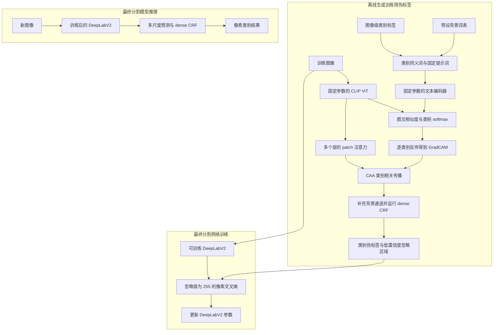
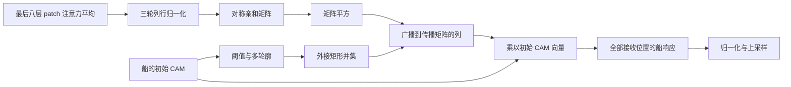

# 03 · CLIP-ES：Method 回顾

CLIP-ES 使用图像级类别标签，让预训练 CLIP 生成类别定位图，再把定位图加工成像素伪标签，训练 DeepLabV2 分割网络。CLIP 的参数在生成伪标签期间固定，真正接受分割损失更新的是后面的 DeepLabV2。核心想法是让文本类别之间参与竞争，再利用 CLIP 自带的 patch 关联，把较零散的定位响应补得更完整。

本文覆盖 CVPR 2023 会议版，方法依据原论文第 3 节及官方实现。源码固定在 `3893f817be359c5ee1dbf8111cad381a532c7acc`。截至 2026-11-11，经题名、作者主页、arXiv 版本与官方仓库核查，未找到能确认属于同一工作的已发表期刊扩展版。会议版与实现版本的核查细节见文末。[会议论文](https://openaccess.thecvf.com/content/CVPR2023/html/Lin_CLIP_Is_Also_an_Efficient_Segmenter_A_Text-Driven_Approach_for_CVPR_2023_paper.html) · [官方代码固定版本](https://github.com/linyq2117/CLIP-ES/tree/3893f817be359c5ee1dbf8111cad381a532c7acc)

## 先看整体流程



这条流程中有两种预测操作。训练集上先给定“这张图里有哪些类别”，用 CLIP 生成监督材料。最终模型面对新图像时，输入图像就能输出分割结果。论文采用 ResNet101 版 DeepLabV2，补充材料说明最终测试使用多尺度与 dense CRF。前面的 CLIP CAM 生成脚本则只保留单尺度原图。[官方使用步骤](https://github.com/linyq2117/CLIP-ES/blob/3893f817be359c5ee1dbf8111cad381a532c7acc/README.md) · [论文附录 E](https://arxiv.org/html/2212.09506v3#A5)

### 对着原论文图 2 复习这条流程

结合下面的原论文框架图，把上面的 Mermaid 对应到作者画出的三条信息流。先沿黑色实线读图文评分，再沿蓝色箭头读梯度归因，最后沿黑色点线读 CAM 加工和监督传递。


图 2 来自 CLIP-ES 的 CVPR 2023 会议论文，复用原笔记中的框架图。左侧蓝色区域覆盖 CAM 生成与 CAA 细化，右侧绿色区域概括 CGL 如何参与最终分割训练。图号与图注可在原论文笔记“3. 方法”中核对。[原论文笔记](<../CLIP-ES/CLIP-ES_paper_notes.md>)

**从左上读到中间。** 图像级标签提供本图的 $K$ 个前景类别，同义词和 $M$ 个背景词一起填进固定模板，再送入 Text Encoder。下方猫的图像进入 Image Encoder，两种特征在 `K+M logits` 处汇合，经 Softmax 变成类别概率。图中的蓝色回箭头把目标类别概率的梯度传回图像特征，用来生成 Initial CAM。文本编码器与图像编码器参数固定，梯度用于计算归因权重。当前实现共享前 11 个视觉 block，并为每个前景类执行最后一个 block，这一执行细节接在后文第 3、4 步与代码段 A。

**再看下方两条点线怎样汇合。** Initial CAM 中两个红框展示了由初始响应提取类别区域的思路，向下箭头提供 Class Mask。Image Encoder 另一路输出 MHSA，提供 patch 间关联。二者共同形成 CAA，随后作用到初始 CAM，得到右侧更完整的 Refined CAM。图中的类别信息来自当前类的 CAM 与区域掩码，共享注意力经过归一化、对称化和矩阵平方，具体顺序见后文第 5 步与代码段 B。

| 原图位置 | 对应本文的阅读位置 | 顺着代码记住什么 |
| --- | --- | --- |
| 模板、Text Encoder、Softmax | 第 2、4 步 | `zeroshot_classifier` 预先编码文本，`forward_last_layer` 返回类别 softmax 得分 |
| 蓝色 Gradients 与 Initial CAM | 第 3、4 步及代码段 A | `GradCAM` 对选中前景类反传，用特征和梯度生成空间图 |
| MHSA、Class Mask、CAA | 第 5 步及代码段 B | `perform` 把共同关联矩阵与逐类框掩码、初始 CAM 结合 |
| dCRF、Pseudo Mask、Confidence Map | 第 6 步、CGL 小节及代码段 C、D | `eval_cam_with_crf.py` 保存带 255 的标签，训练器在有效像素计算交叉熵 |

**最后读右边的监督连接。** Refined CAM 经 dCRF 得到 Pseudo Mask，Confidence Map 表达哪些位置的监督值得保留，两者一起决定分割交叉熵使用哪些像素。真正更新参数的是 DeepLabV2。图中的猫贯穿定位、细化与训练监督，最终分割模型面对新图像时直接预测，入口接回前面 Mermaid 的“最终分割模型推理”。

读图时有三处需要接上实现细节。

- 图上方的背景词参与图像级类别竞争。后处理还会根据前景 CAM 构造一个统一背景通道，两处背景分别对应第 2 步和第 6 步。
- 红框约束传播来源。按当前实现的列广播，框内响应可以传播到框外接收位置，复习时可对照第 5 步的矩阵公式。
- 图中从细化结果分出的置信度支路概括论文的 CGL 思路。当前发布实现依据 CRF 输出分布筛掉低置信度像素，并在离线 PNG 中写入 255，具体衔接见“CGL 与最终分割训练怎么衔接”。

用图中的猫复述一次，就是先用文本竞争找到猫的显著部位，再借助猫的框掩码与 patch 关联补全身体，经 CRF 与置信度筛选形成监督，交给 DeepLabV2 学习像素分类。

## 顺着数据走一遍

### 1. 从一张图和它的类别名单开始

假设图里有穿衣服的人、船和水面，训练标签提供 `person`、`boat`。定位阶段只为这两个前景类别生成 CAM，并加入背景词表作为竞争项。VOC 脚本从 XML 读取物体名称和图像尺寸，后续计算使用去重后的类别名单。CAA 所用矩形来自 CAM 的阈值区域。COCO 脚本直接从列表文件读取图像编号与类别编号。[VOC 入口与 `perform`](https://github.com/linyq2117/CLIP-ES/blob/3893f817be359c5ee1dbf8111cad381a532c7acc/generate_cams_voc12.py) · [COCO 入口与 `perform`](https://github.com/linyq2117/CLIP-ES/blob/3893f817be359c5ee1dbf8111cad381a532c7acc/generate_cams_coco14.py)

输入原图尺寸记作 $H_0\times W_0$。实现把高、宽分别向上调整到 16 的倍数，得到 $H\times W$，并做 CLIP 归一化。这样 ViT-B/16 得到 $h=H/16$、$w=W/16$ 的 patch 网格，总数 $N=hw$。位置编码插值到该网格，保留全图内容。辅助函数会构造翻转图，但 `ms_imgs = [ms_imgs[0]]` 最终只留下原图这一项。[图像预处理](https://github.com/linyq2117/CLIP-ES/blob/3893f817be359c5ee1dbf8111cad381a532c7acc/generate_cams_voc12.py) · [位置编码与视觉编码](https://github.com/linyq2117/CLIP-ES/blob/3893f817be359c5ee1dbf8111cad381a532c7acc/clip/model.py)

### 2. 先把类别写成 CLIP 能理解的句子

官方脚本使用单个模板 `a clean origami {}.`。部分类名已经在词表中拼好同义词或描述，例如 `person with clothes,people,human`、`bird avian`、`chair seat`。这些词先拼入同一句话，再经过文本编码器，形成一个类别向量。文本向量按最后一维做 L2 归一化，模板平均后再归一化。当前只有一个模板，因此每个类别对应一次文本编码结果。所有类别向量在遍历图像前预先计算，且处于 `no_grad` 中。[类别与背景词表](https://github.com/linyq2117/CLIP-ES/blob/3893f817be359c5ee1dbf8111cad381a532c7acc/clip_text.py) · [`zeroshot_classifier`](https://github.com/linyq2117/CLIP-ES/blob/3893f817be359c5ee1dbf8111cad381a532c7acc/generate_cams_voc12.py)

“人穿着衣服”这一描述让文本含义靠近完整人体，缓解单写 `person` 时响应偏向脸部的问题。这里的作用来自文本语义改变，推理期间使用的是预先写定的类别词表。

论文还讨论了模板选择。对某个候选模板，先在每张图内计算已知前景类别 softmax 得分的方差与均值，然后用全数据集的方差之和除以均值之和，得到 sharpness。较低的 sharpness 表示已知类别得分的分布较平缓，作者据此选择模板。官方生成入口已经固定采用上述模板，执行时直接使用选好的结果。[原论文 §3.2](https://openaccess.thecvf.com/content/CVPR2023/papers/Lin_CLIP_Is_Also_an_Efficient_Segmenter_A_Text-Driven_Approach_for_CVPR_2023_paper.pdf)

VOC 背景词表含 25 个词，包括 `water`、`railway`、`sky` 等。COCO 版本去掉 `sign`、`keyboard`，共 23 个。每张图都使用本数据集的完整背景词表，加上本图存在的 $K$ 个前景类别，形成 $(K+M)\times512$ 的文本矩阵。人和船的例子中，`water` 帮助模型把船相关响应与水面相关响应区分开。这些背景词在图文评分时分别参与竞争，保存的 CAM 只包含那 $K$ 个前景类。[`clip_text.py`](https://github.com/linyq2117/CLIP-ES/blob/3893f817be359c5ee1dbf8111cad381a532c7acc/clip_text.py) · [文本特征拼接](https://github.com/linyq2117/CLIP-ES/blob/3893f817be359c5ee1dbf8111cad381a532c7acc/generate_cams_voc12.py)

### 3. 图像编码分成“共享前段”和“逐类最后一层”

实现先调用 `model.encode_image(image, H, W)`。视觉 Transformer 在 `no_grad` 中运行前 11 个 block，输出形状为 $(N+1)\times1\times768$ 的 token 与这些层的注意力。随后每生成一个前景类 CAM，GradCAM 的包装器都调用 `forward_last_layer`，重新执行第 12 个 block。

最后一个 block 的输出经过 LayerNorm，舍去 CLS token，对 $N$ 个 patch token 在空间维求平均，得到一个 768 维图像向量，再投影到 512 维并归一化。它与文本向量计算带 CLIP `logit_scale` 的余弦相似度，最后在 $K+M$ 个文本类别上做 softmax。由此得到的概率形状为 $1\times(K+M)$。[`Transformer.forward`、`VisionTransformer.forward` 与 `CLIP.forward_last_layer`](https://github.com/linyq2117/CLIP-ES/blob/3893f817be359c5ee1dbf8111cad381a532c7acc/clip/model.py)

这一拆法使图像编码前段可以共享，最后一层保留类别归因所需的计算图。源码没有调用优化器去修改 CLIP 权重。GradCAM 使用的特征是最后一个 block 中 `ln_1` 的输出，也就是进入最后一次自注意力的归一化 token。去掉 CLS 后，它被整理成 $1\times768\times h\times w$，用于空间归因。[目标层设置](https://github.com/linyq2117/CLIP-ES/blob/3893f817be359c5ee1dbf8111cad381a532c7acc/generate_cams_voc12.py) · [归因 hook 与真实 forward 分派](https://github.com/linyq2117/CLIP-ES/blob/3893f817be359c5ee1dbf8111cad381a532c7acc/pytorch_grad_cam/activations_and_gradients.py)

### 4. Softmax-GradCAM 为每个类别产生初始定位图

令 $a_{d,p}$ 表示目标层第 $d$ 个特征通道在 patch $p$ 的激活，$z_c$ 为类别 $c$ 的图文相似度，执行逻辑可写成

$$
s_c=\frac{\exp(z_c)}{\sum_{q=1}^{K+M}\exp(z_q)},\qquad
\alpha_d^c=\frac1N\sum_p\frac{\partial s_c}{\partial a_{d,p}},\qquad
m_c(p)=\operatorname{ReLU}\!\left(\sum_d\alpha_d^c a_{d,p}\right).
$$

每个通道的权重来自该类别概率对特征的梯度，在全部 patch 上取平均。然后把通道按权重相加，保留正响应。实现将每个 CAM 减去最小值，再除以其最大值与数值稳定项，缩放到约 $[0,1]$。此时 $m_c$ 的形状是 $h\times w$。[空间梯度平均](https://github.com/linyq2117/CLIP-ES/blob/3893f817be359c5ee1dbf8111cad381a532c7acc/pytorch_grad_cam/grad_cam.py) · [反传、通道求和与 ReLU](https://github.com/linyq2117/CLIP-ES/blob/3893f817be359c5ee1dbf8111cad381a532c7acc/pytorch_grad_cam/base_cam.py) · [CAM 归一化](https://github.com/linyq2117/CLIP-ES/blob/3893f817be359c5ee1dbf8111cad381a532c7acc/pytorch_grad_cam/utils/image.py)

对船的归因信号可进一步展开为

$$
\frac{\partial s_c}{\partial a}
=s_c\left(\frac{\partial z_c}{\partial a}
-\sum_q s_q\frac{\partial z_q}{\partial a}\right).
$$

它衡量某个特征能否让船相对于其他候选类别更突出。如果一个特征同时明显支持水面，`water` 也会贡献到竞争项，从而改变船 CAM 的通道权重。这个竞争发生在图像级评分及其反向梯度中，最终空间图由 GradCAM 恢复。多个类别仍可在同一张图中各自产生定位图。[原论文 §3.1](https://openaccess.thecvf.com/content/CVPR2023/papers/Lin_CLIP_Is_Also_an_Efficient_Segmenter_A_Text-Driven_Approach_for_CVPR_2023_paper.pdf)

### 5. CAA 用共同的关联矩阵和各自的类别区域补全响应

CLIP 注意力给出 patch 之间的信息交换强弱。官方代码收集 12 层注意力，去掉涉及 CLS 的行列，选最后 8 层取平均，得到 $W\in\mathbb R^{N\times N}$。所用 `MultiheadAttention` 返回的是头平均后的注意力。脚本在第一个类别的最后一层 forward 完成后组装并缓存这张矩阵，再对每个类别使用同一张矩阵。[注意力提取与融合](https://github.com/linyq2117/CLIP-ES/blob/3893f817be359c5ee1dbf8111cad381a532c7acc/generate_cams_voc12.py) · [`ResidualAttentionBlock.attention`](https://github.com/linyq2117/CLIP-ES/blob/3893f817be359c5ee1dbf8111cad381a532c7acc/clip/model.py)

具体传播分为四步。

1. 对 $W$ 做三轮“按列求和归一化、按行求和归一化”，得到近似双随机矩阵 $D$，再对称化为 $A=(D+D^\top)/2$。
2. 对每个类别的初始 CAM 做阈值处理。VOC 阈值为当前 CAM 最大响应的 0.4 倍，COCO 为 0.7 倍。寻找多个轮廓，并把各自外接矩形的并集填成一个类别 box mask $b_c\in\{0,1\}^N$。使用矩形可以把稀疏响应附近的区域一起纳入候选范围。
3. 将 $A$ 自乘一次，得到 $A^2$。这允许响应经过两个关联步骤传播。
4. 用类别 mask 约束矩阵，再乘初始 CAM 向量。把结果还原为 $h\times w$，重新归一化并插值到原图尺寸，保存为该类的 `attn_highres`。[传播完整实现](https://github.com/linyq2117/CLIP-ES/blob/3893f817be359c5ee1dbf8111cad381a532c7acc/generate_cams_voc12.py) · [矩形提取 `scoremap2bbox`](https://github.com/linyq2117/CLIP-ES/blob/3893f817be359c5ee1dbf8111cad381a532c7acc/utils.py)

这里需要按源码的广播方向理解 mask。代码把它整理为 $1\times N$，再执行 `trans_mat * aff_mask`，因此每一列受到对应 mask 元素控制。若 $m_c$ 已展平，实际计算等价于

$$
\widetilde m_c=A^2\operatorname{diag}(b_c)m_c,
\qquad
\widetilde m_c(i)=\sum_j(A^2)_{ij}b_c(j)m_c(j).
$$

也就是说，框内的初始响应可以作为传播来源，接收端由整张关联矩阵决定。输出位置可以落在框外。论文式 (7) 用框 mask 和亲和矩阵的乘积概括这一过程，这里按发布实现明确其列广播语义。[CAA 中的 mask 形状与矩阵乘法](https://github.com/linyq2117/CLIP-ES/blob/3893f817be359c5ee1dbf8111cad381a532c7acc/generate_cams_voc12.py)



因此，CAA 的类别差异来自每个类别自己的初始 CAM 和 box mask。它可以把船头处较强的响应扩散到关联较强的船身位置，效果取决于初始定位和注意力的质量。

### 6. 补背景通道，经过 CRF，再保存训练用标签

每张图的输出文件包含 `keys` 与 $K\times H_0\times W_0$ 的前景 CAM。后处理重新构造一个统一背景分数

$$
u_0(p)=1-\max_{c=1,\ldots,K}\widetilde m_c(p).
$$

它与前景 CAM 拼为 $(K+1)\times H_0\times W_0$，送入 dense CRF。CRF 结合图像位置与颜色关系做 10 次迭代，输出各像素的类别分布 $Q$。代码对这些输出做 `argmax`，再通过 `keys + 1` 把本图局部前景编号还原成数据集类别编号，背景为 0。[`eval_cam_with_crf.py` 的 `DenseCRF` 与 `crf.process`](https://github.com/linyq2117/CLIP-ES/blob/3893f817be359c5ee1dbf8111cad381a532c7acc/eval_cam_with_crf.py)

背景词表在前面的相似度竞争中发挥作用。最终分割背景通道在此处由前景 CAM 的最大值计算得到。这两处背景的表示和用途各有对应步骤。

生成训练用 PNG 时，代码以 $\max_c Q_c(p)$ 作为置信度，把低于 0.95 的像素写成 255。`--eval_only` 分支直接评估 CRF 的完整预测。该脚本也读取真值 PNG 供返回和评估使用，生成 CAM、CRF 分布和置信度 mask 的计算均不依赖其中的像素类别值。[置信度筛选与评估分支](https://github.com/linyq2117/CLIP-ES/blob/3893f817be359c5ee1dbf8111cad381a532c7acc/eval_cam_with_crf.py)

## CGL 与最终分割训练怎么衔接

论文 §3.4 用前景最大响应 $r(p)=\max_c X_c(p)$ 定义 $\operatorname{Conf}(p)=\max(1-r(p),r(p))$，再以阈值 $\mu$ 决定是否计算该像素的交叉熵。发布实现把这一筛选落在 CRF 后的类别分布上。可以按下式理解实际交付给训练器的监督

$$
\widehat y(p)=
\begin{cases}
\operatorname*{argmax}_c Q_c(p),&\max_cQ_c(p)\ge0.95,\\
255,&\max_cQ_c(p)<0.95.
\end{cases}
$$

训练器读取这个 PNG，在有效像素上计算交叉熵。人在船上的例子中，人和船内部较确定的区域通常保留监督，交界处若 CRF 分布仍然犹豫，就进入忽略区域。置信度在离线生成时确定，DeepLabV2 训练期间直接使用已保存的标签。[原论文 §3.4](https://openaccess.thecvf.com/content/CVPR2023/papers/Lin_CLIP_Is_Also_an_Efficient_Segmenter_A_Text-Driven_Approach_for_CVPR_2023_paper.pdf) · [发布实现](https://github.com/linyq2117/CLIP-ES/blob/3893f817be359c5ee1dbf8111cad381a532c7acc/eval_cam_with_crf.py)

官方 CLIP-ES 仓库把最终训练指向 `kazuto1011/deeplab-pytorch`。本次还读取了这一外链实现的 `main.py`、DeepLabV2、MSC 包装器和 VOC 配置，固定在 `4219467fa5de07985f834f1bd8c04c186dc8f6d8`。其中 `main.py train` 使用 `CrossEntropyLoss(ignore_index=255)`，DeepLabV2 由空洞 ResNet101 和多个空洞卷积分支相加的 ASPP 构成，输出步长为 8。MSC 在 1、0.75、0.5 尺度调用同一网络，训练时对三个尺度预测和逐元素最大融合预测分别计算交叉熵并相加，之后反传和更新参数。[官方外链说明](https://github.com/linyq2117/CLIP-ES/blob/3893f817be359c5ee1dbf8111cad381a532c7acc/README.md) · [训练入口](https://github.com/kazuto1011/deeplab-pytorch/blob/4219467fa5de07985f834f1bd8c04c186dc8f6d8/main.py) · [DeepLabV2](https://github.com/kazuto1011/deeplab-pytorch/blob/4219467fa5de07985f834f1bd8c04c186dc8f6d8/libs/models/deeplabv2.py) · [MSC](https://github.com/kazuto1011/deeplab-pytorch/blob/4219467fa5de07985f834f1bd8c04c186dc8f6d8/libs/models/msc.py)

外链的 VOC 增广数据加载器通过列表中的标签路径读取 PNG，所以接入 CLIP-ES 时，训练标签路径应指向生成的伪标签。CLIP-ES 没有随仓库发布最终训练器的定制配置或依赖 commit 锁定。上述外链代码确认了 255 忽略标签能够接入交叉熵的具体方式，实验设置还需以 CLIP-ES 论文附录为准。附录 E 给出 VOC 的 321×321 裁剪与 20k 迭代，COCO 的 481×481 裁剪、100k 迭代及 balanced cross-entropy，但具体 COCO 类别平衡权重的实现缺少可核实的定制源码。附录同时说明最终测试使用多尺度和 dense CRF。[外链 VOC 数据加载器](https://github.com/kazuto1011/deeplab-pytorch/blob/4219467fa5de07985f834f1bd8c04c186dc8f6d8/libs/datasets/voc.py) · [论文附录 D–E](https://arxiv.org/html/2212.09506v3#A4) · [外链 VOC 配置](https://github.com/kazuto1011/deeplab-pytorch/blob/4219467fa5de07985f834f1bd8c04c186dc8f6d8/configs/voc12.yaml)

## 对照官方代码，把调用链压缩成四段

以下是等价整理的伪代码，省略了设备调度、I/O 与评估统计。

### A. 一次图像前段编码，逐类别执行最后一个 block

```python
text = encode_fixed_prompts(present_classes + background_words)
tokens, earlier_attention = model.encode_image(image, H, W)

for class_id in range(number_of_present_classes):
    cam, scores, last_attention = gradcam(
        input_tensor=[tokens, text, H, W],
        targets=[ClipOutputTarget(class_id)],
    )
```

`GradCAM → BaseCAM.forward → ActivationsAndGradients.__call__ → CLIP.forward_last_layer` 构成真正的归因调用链。`scores` 已经经过类别 softmax，`BaseCAM` 对选中类别的标量执行反传。源码中的通用 `CLIP.forward` 不在这条脚本调用链上。[生成入口](https://github.com/linyq2117/CLIP-ES/blob/3893f817be359c5ee1dbf8111cad381a532c7acc/generate_cams_voc12.py) · [forward 分派](https://github.com/linyq2117/CLIP-ES/blob/3893f817be359c5ee1dbf8111cad381a532c7acc/pytorch_grad_cam/activations_and_gradients.py)

### B. 初始 CAM 与固定关联矩阵结合

```python
W = mean(last_eight_patch_attention_maps)
D = W
for _ in range(3):
    D = D / D.sum(dim=0, keepdim=True)
    D = D / D.sum(dim=1, keepdim=True)
A = (D + D.T) / 2

box_mask = rectangles_from_thresholded_cam(cam, threshold)
transition = (A @ A) * box_mask.reshape(1, N)
refined = transition @ cam.reshape(N, 1)
```

这是 `perform` 内 CAA 的矩阵操作顺序。CAM 和注意力在离开归因过程后转到 CPU 并 detach，框提取及传播形成离线结果。[VOC `perform`](https://github.com/linyq2117/CLIP-ES/blob/3893f817be359c5ee1dbf8111cad381a532c7acc/generate_cams_voc12.py) · [COCO `perform`](https://github.com/linyq2117/CLIP-ES/blob/3893f817be359c5ee1dbf8111cad381a532c7acc/generate_cams_coco14.py)

### C. CRF 输出同时决定类别与置信度

```python
background = 1 - foreground_cams.max(axis=0, keepdims=True)
Q = dense_crf(image, concatenate([background, foreground_cams]))
local_label = Q.argmax(axis=0)
dataset_label = map_local_to_dataset(local_label, keys)
dataset_label[Q.max(axis=0) < 0.95] = 255
save_png(dataset_label)
```

训练用标签的置信度门控在这一步完成。DenseCRF 的高斯项兼容权重为 3，位置标准差为 1，双边项兼容权重为 4，位置和颜色标准差分别为 67 与 3，迭代数为 10。[后处理脚本](https://github.com/linyq2117/CLIP-ES/blob/3893f817be359c5ee1dbf8111cad381a532c7acc/eval_cam_with_crf.py)

### D. 外链训练器消费带 255 的标签

```python
criterion = CrossEntropyLoss(ignore_index=255)
predictions = segmentation_model(images)
loss = sum(criterion(pred, nearest_resize(labels, pred.shape[-2:]))
           for pred in predictions)
loss.backward()
optimizer.step()
```

这段依据作者指向的 DeepLab 实现整理，说明伪标签如何进入网络 forward 和 loss。其测试路径设为 `eval`，MSC 输出融合预测，插值回图像尺寸后沿类别维 softmax、argmax，另有 dense CRF 后处理入口。CLIP-ES 的完整实验定制情况受上一节所述源码边界约束。[外链 `main.py train/test/crf`](https://github.com/kazuto1011/deeplab-pytorch/blob/4219467fa5de07985f834f1bd8c04c186dc8f6d8/main.py)

## 回顾时抓住这几点

- 图像级标签先限定本图需要定位的前景类，固定背景词补充竞争项，文本编码结果可以提前缓存。
- Softmax 在图像级类别维建立竞争，GradCAM 再把这种竞争对特征的影响映射到 patch 网格。
- CAA 共享 CLIP 的 patch 注意力，每类用自己的 CAM 和框 mask 控制传播来源，源码把 mask 广播到关联矩阵的列。
- 伪标签在 dense CRF 后按 0.95 置信度门控，低置信度位置写成 255，最终网络用带忽略机制的像素交叉熵学习。
- 复述完整方法时要包含 CLIP 离线生成与 DeepLabV2 训练两个阶段，固定参数的 CLIP 仍需为 GradCAM 计算梯度。

两个自检问题可以帮助记住数据如何流动。只有“船”这一个前景标签时，softmax 还有竞争对象吗？有，背景词表仍参与评分。CAA 的矩形来自哪里？来自每类初始 CAM 的阈值轮廓外接框，类别标签只负责告知要生成哪些 CAM。

## 资料与实现版本

### 论文及版本关系

- 会议版为 Yuqi Lin 等的 *CLIP Is Also an Efficient Segmenter: A Text-Driven Approach for Weakly Supervised Semantic Segmentation*，CVPR 2023，15305–15314 页，DOI 为 `10.1109/CVPR52729.2023.01469`。本次独立读取了本地 CVPR PDF 的方法与实现细节。[CVF 记录](https://openaccess.thecvf.com/content/CVPR2023/html/Lin_CLIP_Is_Also_an_Efficient_Segmenter_A_Text-Driven_Approach_for_CVPR_2023_paper.html)
- arXiv `2212.09506v3` 更新于 2023-03-23，包含附录。本次读取附录 A–E、G，核查 token pooling、同义词、阈值、置信度、最终训练说明与背景词表。该记录对应会议工作的预印本及补充内容。[arXiv 版本记录](https://arxiv.org/abs/2212.09506) · [含附录全文](https://arxiv.org/html/2212.09506v3)
- 期刊扩展检索覆盖完整题名、`CLIP-ES` 与 `journal / extended version / TPAMI / IJCV` 组合，并核查作者主页、arXiv 更新和官方仓库公告。可核实记录仍指向 CVPR 2023。作者主页和仓库把 TagCLIP 列为另一项 AAAI 2024 工作。本回顾的版本覆盖据此限定为已核实的 CLIP-ES 会议工作。[作者发表列表](https://linyq2117.github.io/) · [官方公告与引用](https://github.com/linyq2117/CLIP-ES/blob/3893f817be359c5ee1dbf8111cad381a532c7acc/README.md)

### 代码阅读范围与可复核性

- 官方仓库只有 `main` 分支，本次固定读取头提交 `3893f817be359c5ee1dbf8111cad381a532c7acc`，日期为 2024-09-16。与早期代码提交 `6f8b769e77851881d9839ba748396ef53011e958` 比较，后续差异只有 README，核心实现与会议时期代码一致。[分支记录](https://api.github.com/repos/linyq2117/CLIP-ES/branches) · [提交历史](https://github.com/linyq2117/CLIP-ES/commits/main/) · [固定版本比较](https://github.com/linyq2117/CLIP-ES/compare/6f8b769e77851881d9839ba748396ef53011e958...3893f817be359c5ee1dbf8111cad381a532c7acc)
- 已阅读官方仓库的两个 `generate_cams` 脚本、`clip_text.py`、`clip/model.py`、`utils.py`、`eval_cam_with_crf.py`，以及 GradCAM 的 `base_cam.py`、`grad_cam.py`、`activations_and_gradients.py`、`utils/image.py`，共 10 个源码文件，另读 README。正文按这些函数的实际执行顺序组织。[固定源码树](https://github.com/linyq2117/CLIP-ES/tree/3893f817be359c5ee1dbf8111cad381a532c7acc)
- 最终训练外链实现另固定于 `kazuto1011/deeplab-pytorch` 的 `4219467fa5de07985f834f1bd8c04c186dc8f6d8`，读取 `main.py`、`libs/models/__init__.py`、`deeplabv2.py`、`msc.py`、`configs/voc12.yaml` 和 `libs/datasets/voc.py`，共 6 个文件。CLIP-ES 没有锁定该外部依赖版本，且缺少其定制训练配置，本文据此明确最终训练的证据范围。[外链固定版本](https://github.com/kazuto1011/deeplab-pytorch/tree/4219467fa5de07985f834f1bd8c04c186dc8f6d8)

本次工作完成了论文阅读、在线源码阅读与静态调用链核查。CVF 在线页面与补充 PDF 曾返回 403，会议正文通过本地 PDF 读取，附录通过 arXiv 版本读取。未在本地执行模型、下载权重或复现实验，源码的阈值、张量操作与版本关系均以已读取内容为依据。
