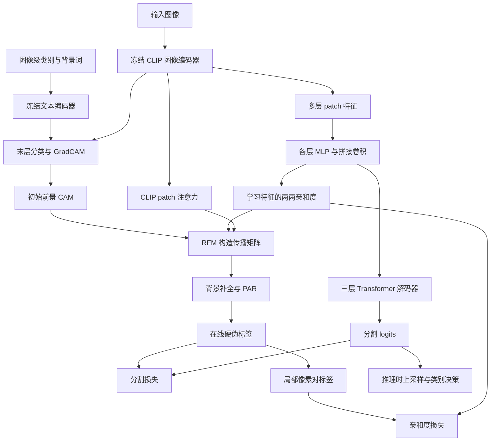
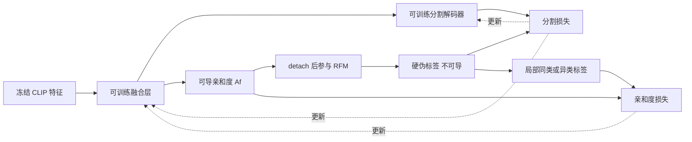
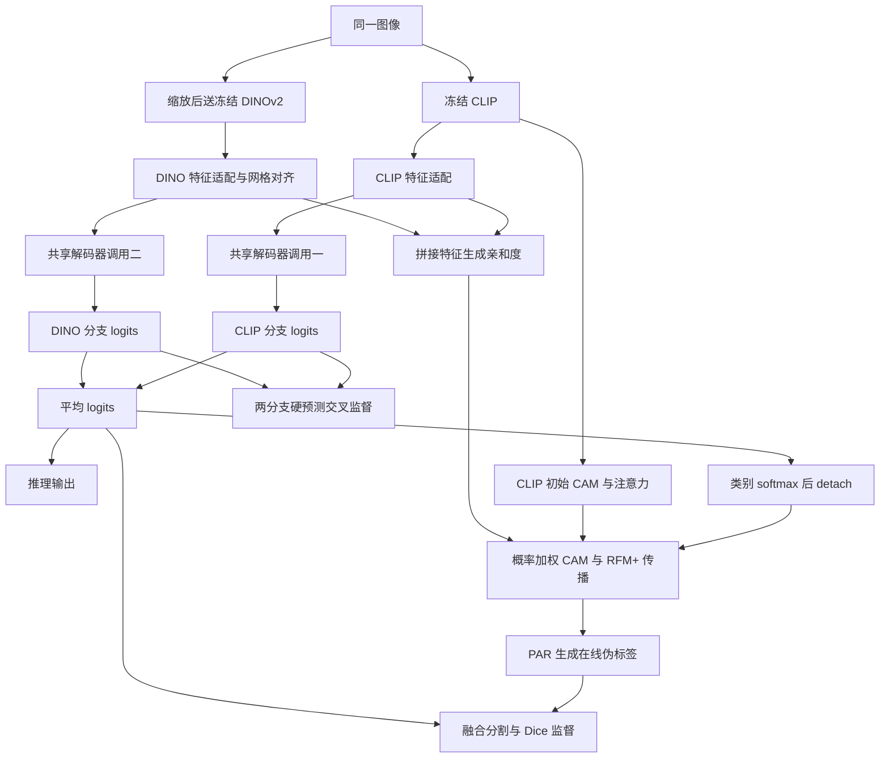

# 04 · WeCLIP 与 WeCLIP+：Method 回顾

WeCLIP 用图像级类别监督训练语义分割：CLIP 权重保持不变，只训练后面的特征适配与分割解码器，最后输出每个像素的类别。它让同一个冻结骨干同时承担两件事：提供分割特征，以及产生训练解码器的 CAM；再用正在学习的特征关系，在线修整这些 CAM。WeCLIP+ 加入冻结 DINOv2，让两种特征共享解码器，并把融合预测也用于伪标签更新。

本文先完整讲 **CVPR 2024 的 Frozen CLIP / WeCLIP**，再讲 **TPAMI 2025 的 Frozen CLIP-DINO / WeCLIP+**。主要沿 VOC 的官方执行路径展开，COCO 的不同设置另行注明。会议版使用 2024 年历史提交 `78307a91a0b4ba79709827631696c27d7d577b5c`，期刊版使用 2025 年提交 `0f47db46b5a59ff3bd9293a6e357382ca6490399` 下的 `WeCLIP+`，没有拿更新后的主分支代替会议版。

## 一、会议版：先看整体流程

想象一张“狗站在草地上，旁边有一个人”的照片。训练时只需要知道图中有“狗、人”，并不知道狗腿、人手、草地分别在哪里。CLIP 提供初步位置线索；解码器学习像素分类；RFM 则利用解码器学到的像素关系，把初步线索传到更合适的位置。



图中 CAM、RFM、PAR 是训练监督生成路径。真正的分割输出来自解码器；即使最后用了 DenseCRF，也是在整理解码器预测，并非把 CAM 直接当作最终分割模型。

### 对照原论文 Fig. 2 复习会议版

结合下面的原论文框架图，可以把上面的 Mermaid 按“分割预测”和“在线造监督”两条路线读一遍。


图 2，CVPR 2024 WeCLIP 框架。直接复用原笔记已有图片，图号与图注均可在其“3.1. 概述”核对。[原论文笔记](../WeCLIP/WeCLIP_paper_notes.md)

先从左侧的鸟图出发。CLIP Image Encoder 带雪花，表示它提供固定权重的视觉特征。往右下看，多个灰色特征块经过黄色 MLP 模块，在圆圈 C 处拼接，再经过 conv、TB-1～TB-3 和末端 conv，得到右侧 Pred.。蓝框顶部展开的 MLP、右上角展开的 TB-X，分别说明这些小模块内部怎样运算。学习集中在这条适配与解码路径。

再回到左上方，前景词 bird 与背景词进入 CLIP Text Encoder，文本向量与池化图像向量在 D 处计算分类分数，softmax 后通过橙色虚线标出的 GradCAM 产生初始热图 $M_{init}$。它沿上方黑线送到右侧圆圈 R，等待底部 RFM 给出的传播关系。粉框里，CLIP 注意力 $A_s$ 与解码器特征产生的 $A_f$ 做比较，经过 sum、mean、compare 得到层选择信号 $G$，expand 将它广播到每层矩阵，筛选后的注意力再与 $A_f$ 逐元素结合，形成 $R$。传播后的 $M_f$ 经 Post-process 得到 Pseudo Label。

| 原图中的位置 | 与现有流程、代码的对应 |
|---|---|
| 蓝框内 MLP → C → conv | “二、3. 多层冻结特征怎样变成分割结果”中的 `SegFormerHead` 与 $F_u$，当前实现接收前 11 个 block 输出 |
| 蓝框向下引出的 $A_f$ | `sigmoid(tokens.transpose(1, 2) @ tokens)`，取自融合特征，后接“三、RFM”的关系计算 |
| 粉框的选择、乘法和 $R$ | `perform_single_voc_cam` / `compute_trans_mat`，接到已有归一化、对称化、矩阵平方与 CAM 传播伪代码 |
| Post-process → Pseudo Label → Transfer | PAR 与 argmax 生成硬标签，再转成局部同类/异类对，分别进入“四”中的分割损失和亲和度损失 |

读这张图时有三处需要结合当前实现补上细节。

- 雪花表示骨干权重固定。GradCAM 仍需计算末层梯度，是否更新权重要看优化器参数集合，具体对应“二、2”。
- 粉框画出了动态筛层结构。VOC 代码先使用静态传播，超过前文给出的 forward 计数阈值后才启用动态关系；图中差值与损失的概括写法，也要结合“三、2”的有符号求和和“四”的实际损失公式阅读。
- 右侧两处损失连接分别约束分割输出与亲和度。标签生成中的 `detach()`、NumPy 和 `no_grad()` 截断梯度，训练更新通过可导的预测与 $A_f$ 返回适配模块；推理输出可沿蓝框一路读到 Pred.。

用图中的鸟复述一次，CLIP 给出初始鸟响应，蓝框逐渐学会哪些位置属于鸟，粉框用学到的两两关系改善训练标签，标签再监督蓝框。每次复习时把 Pred.、$M_f$、Pseudo Label 三个位置依次指出，就能对应上预测、细化响应与训练目标。

## 二、顺着会议版的数据走一遍

### 1. 图像进入冻结骨干，类别名称进入冻结文本编码器

VOC 默认训练裁剪为 $320\times320$。ViT-B/16 的空间网格为 $20\times20$，因此每幅图有 $N=400$ 个 patch token，另有一个 CLS token；视觉 token 通道数为 768。训练数据路径实际调用 `transforms.normalize_img` 的 ImageNet 均值与标准差，而不是文件中另外定义但未采用的 CLIP 归一化函数。

文本端为类别套上固定模板，源码是 `a clean origami {}.`，然后计算归一化文本向量。对某张图，候选文本只取图中出现的前景类别，再加一组背景词，例如 grass、tree、sky。它们用于形成分类竞争，不意味着分割头会输出二十多种背景：VOC 分割头仍然只有 **20 个前景类加 1 个背景类**。

这里有一个读源码时很重要的监督边界。`VOC12ClsDataset` 会加载图像级 one-hot 标签，但训练循环没有把这个张量直接传入模型。会议版 CAM 函数按文件名读取 `SegmentationClassAug` 的 PNG，用 `np.unique` 提取出现过的类别；它只使用这个类别集合和原图尺寸，**不把真实像素位置送进损失，也不使用真实物体轮廓生成伪标签**。因此它的算法监督是图像级的，但这一份发布实现的数据准备确实依赖标签 PNG，不能误写成完全不读标注文件。

### 2. “冻结”不等于完全不能计算梯度

会议版 `clip/model.py` 将图像 Transformer 的前 11 个 block 放在 `torch.no_grad()` 中运行，保存各层输出和注意力。第 12 个 block 留给后面的 GradCAM 分类调用。解码器因此实际接收 **前 11 个 block 的特征**，并不是抽象框架图中所画的所有 12 层输出。

模型初始化允许名字中带 `11` 的 CLIP 参数保留 `requires_grad=True`，目的是让末层 GradCAM 能取得梯度；但 `get_param_groups()` 只把两个解码模块交给优化器，完全没有加入 CLIP 参数。也就是说，CLIP 可以为“哪里影响了狗这个分类分数”计算导数，训练的 `optimizer.step()` 却不会更新它。这里应以优化器参数集合判断是否微调骨干，不能只看 `requires_grad`。

### 3. 多层冻结特征怎样变成分割结果

每层先去掉 CLS token，恢复成 $B\times768\times20\times20$。各层使用自己的两层 MLP：$768\rightarrow256\rightarrow256$，中间 ReLU；这相当于把 CLIP 各层的表达翻译成分割解码器能使用的通道。

11 层结果沿**通道维**拼接为 $B\times2816\times20\times20$，再经 $1\times1$ 卷积降到 256 通道，得到 $F_u$；之后还有概率为 0.1 的 `Dropout2d`。随后，三层、每层八个注意力头的 Transformer 在 400 个空间 token 间交换信息，最后用 $1\times1$ 卷积输出 $B\times21\times20\times20$ 的 logits。训练脚本再双线性上采样到伪标签尺寸。

这里没有用 CLIP 的全局向量去直接分类每个像素，也没有把各层预测投票：**先融合各层特征，再用一个分割解码器输出结果**。在例子中，多层特征可同时保留狗的局部外观和更高层语义，Transformer 解码器再学习如何把这些线索组合成“狗身、狗腿、人、背景”。

下面是等价整理，省略形状转换与 CAM 路径；并非可直接运行的完整代码。对应 [`WeCLIP.forward`](https://github.com/zbf1991/WeCLIP/blob/78307a91a0b4ba79709827631696c27d7d577b5c/WeCLIP_model/model_attn_aff_voc.py)、[`SegFormerHead`](https://github.com/zbf1991/WeCLIP/blob/78307a91a0b4ba79709827631696c27d7d577b5c/WeCLIP_model/segformer_head.py) 和 [`DecoderTransformer`](https://github.com/zbf1991/WeCLIP/blob/78307a91a0b4ba79709827631696c27d7d577b5c/WeCLIP_model/Decoder/TransDecoder.py)。

```python
features, clip_attentions = frozen_clip_first_11_blocks(image)
patch_maps = remove_cls_and_reshape(features)
Fu = dropout(conv1x1(cat([mlp[l](patch_maps[l]) for l in range(11)])))
logits = segmentation_decoder(Fu)
tokens = Fu.flatten(2)                         # B, 256, N
Af = sigmoid(tokens.transpose(1, 2) @ tokens) # B, N, N
```

### 4. 初始 CAM 从哪里来，为什么需要背景词

CAM 支路取第 11 个 block 的特征，再执行第 12 个 block。其输出先做 LayerNorm，去掉 CLS 后沿**空间 token 维平均池化**，再投影到文本共同空间。图像和文本向量都做 L2 归一化，余弦相似度乘上 CLIP 的 logit scale，最后沿**候选文本类别维**做 softmax。

GradCAM 的目标是当前前景类别的 softmax 分数。它在最后一个 block 的 `ln_1` 上取激活与梯度，对梯度做空间平均得到通道权重，加权激活、ReLU、归一化，形成该类的初始 CAM。代码依据见 [`CLIP.forward_last_layer`](https://github.com/zbf1991/WeCLIP/blob/78307a91a0b4ba79709827631696c27d7d577b5c/clip/model.py) 与 [`BaseCAM.forward`](https://github.com/zbf1991/WeCLIP/blob/78307a91a0b4ba79709827631696c27d7d577b5c/pytorch_grad_cam/base_cam.py)。

背景词在这一步与“狗、人”竞争，使草地像素更有机会支持 grass 而不是 dog。可是初始 CAM 仍可能只突出狗头，或者把狗旁边的一小片草地带进去。对于相同输入、相同类别，冻结 CLIP 的这些线索不会随着解码器训练自动变好，因此需要下一步的动态修整。

## 三、RFM：用正在学习的像素关系修整冻结 CAM

### 1. 学习一个“这两个位置应不应该连在一起”的矩阵

把解码器融合特征展平为 $F_u\in\mathbb{R}^{256\times N}$，计算

$$
A_f=\sigma(F_u^\top F_u),\qquad A_f\in\mathbb{R}^{N\times N}.
$$

它不是注意力的行 softmax，而是每个点积分别过 sigmoid。$A_f(i,j)$ 大，表示当前学习特征倾向于把位置 $i,j$ 连起来。它本身不知道类别名；同一物体内部的两点，希望关系强，狗与草地之间则希望关系弱。

另一路取 CLIP 的 patch-to-patch 注意力，删除 CLS 所在的行列。这些注意力保留预训练模型的先验关系，但不同层不一定同样适合分割。

### 2. 筛选和相乘，要以这份实现为准

论文用 $\sum_{ij}|A_f(i,j)-A_s^l(i,j)|$ 衡量每层注意力与学习亲和度的差异，再保留差异较小的层。**这里按历史源码执行：它实际计算的是有符号差值之和，没有取绝对值，并用小于等于均值作为保留条件。** 因而不能把这段实现直接解释成严格的 L1 距离筛选；各层差值和都含有同一个 $A_f$ 总和，与均值比较时这一项会抵消，所以这个标量比较不能保证按局部关系的一致程度选层。动态作用仍明确存在于随后 $A_f$ 与选中注意力的逐元素相乘。

VOC 还有启动过程：`self.iter_num <= 15000` 时，先平均最后 8 张 CLIP 注意力，不乘学习亲和度；超过此计数，或调用 `mode='val'`，才启用动态路径，候选变为最后 6 张。这里是 **模型 forward 次数**，不严格等于优化器更新次数，因为训练中的验证 forward 也增加计数。COCO 对应阈值是 40000，动态候选取最后 10 张。

动态阶段的等价整理如下，对应 [`perform_single_voc_cam` / `compute_trans_mat`](https://github.com/zbf1991/WeCLIP/blob/78307a91a0b4ba79709827631696c27d7d577b5c/clip/clip_tool.py)。`A` 是去掉 CLS 后最后 6 层的注意力；所有乘法 `*` 均为逐元素乘法，`@` 才是矩阵乘法。

```python
score = (Af - A).flatten(1).sum(1)  # 发布代码采用有符号差值
keep = score <= score.mean()
selected = (keep[:, None, None] * A).sum(0) / (keep.sum() + 1e-5)
R = selected.detach() * Af.detach()
T = repeat_column_then_row_normalization(R, rounds=3)
T = (T + T.T) / 2
T = T @ T
refined_cam = (T * box_mask.reshape(1, -1)) @ initial_cam.reshape(-1, 1)
```

### 3. 传播、自动框与 PAR 分别解决什么

传播矩阵先做三轮“列归一化再行归一化”，再对称化并平方一次；平方对应两步关系传播，而不是把每个元素平方。之后把 CAM 看成每个 patch 的初始分数，通过矩阵乘法汇集相关位置的信息。

VOC 用初始 CAM 的 0.4 阈值提取连通轮廓及包围框；COCO 阈值为 0.7。这些框**由 CAM 自动产生**，不是人工框监督。框 mask 广播到传播矩阵的列，因此更精确的理解是限制哪些源位置向外提供 CAM 证据，并非直接保证输出在框外全部为零。

传播后的每类 CAM 上采样、归一化，再补一个背景通道：

$$
M_{bg}(x)=1-\max_{c\in C_I}M_c(x).
$$

最后进入 PAR。它按输入图像的颜色差和邻域距离形成局部传播权重，在 dilation 为 $1,2,4,8,12,24$ 的邻域上更新 20 次；softmax 发生在**邻居维**。随后沿类别维 argmax，并把局部候选类别编号映射回 VOC 全局类别编号，得到硬伪标签 $Y_p$。PAR 是无可训练参数的在线细化，和推理时可选的 DenseCRF 是两回事。对应 [`PAR.forward`](https://github.com/zbf1991/WeCLIP/blob/78307a91a0b4ba79709827631696c27d7d577b5c/WeCLIP_model/PAR.py)。

伪标签在 forward 内生成；没有先把全训练集伪标签离线存完，再训练另一套分割骨干。与此同时，CAM 在 NumPy 转换、`detach()` 与 PAR 的 `no_grad()` 路径上断开梯度，所以不能靠分割损失直接穿过伪标签生成过程更新 CLIP 或传播规则。

## 四、会议版究竟训练哪些损失

### 分割监督：前景和背景分别求平均

`get_seg_loss` 对同一份预测分两次算交叉熵：一次只保留背景像素，一次只保留前景像素，其余设为 ignore 255，然后两项各占一半。它避免大面积背景在简单全像素平均中占据过重比例。

$$
L_{seg}=\tfrac12\operatorname{CE}_{bg}(P,Y_p)
+\tfrac12\operatorname{CE}_{fg}(P,Y_p).
$$

此处 `P` 是 logits，交叉熵内部完成类别归一化；不需要先把 logits 做 softmax 再传入 `cross_entropy`。

### 亲和度监督：只约束局部像素对

把硬伪标签最近邻降到 $20\times20$，标签相同的像素对记 1，不同记 0。训练脚本构建半径 8 的方形邻域，只保留局部对；超出范围的对、任何一端为 ignore 的对均设为 255。背景与背景的同类关系也保留，并非只学前景内部关系。

论文把这项写为交叉熵，但所读实现的 `get_aff_loss` 是平衡正负对的线性误差：

$$
L_{aff}=\frac12\frac{\sum_{(i,j)\in\mathcal P}(1-A_f(i,j))}{|\mathcal P|+1}
+\frac12\frac{\sum_{(i,j)\in\mathcal N}A_f(i,j)}{|\mathcal N|+1}.
$$

也就是同类对希望接近 1，异类对希望接近 0；没有取对数。总损失为 $L=L_{seg}+0.1L_{aff}$。实现依据为 [`scripts/dist_clip_voc.py`](https://github.com/zbf1991/WeCLIP/blob/78307a91a0b4ba79709827631696c27d7d577b5c/scripts/dist_clip_voc.py)、[`cams_to_affinity_label`](https://github.com/zbf1991/WeCLIP/blob/78307a91a0b4ba79709827631696c27d7d577b5c/utils/camutils.py)、[`get_aff_loss`](https://github.com/zbf1991/WeCLIP/blob/78307a91a0b4ba79709827631696c27d7d577b5c/utils/losses.py)。



这个循环是跨训练迭代发生的：先用当前特征生成伪标签，再把伪标签当固定目标更新解码器，下一次 forward 才产生新的特征关系。它不是在一次反向传播中，让网络同时修改“答案”和“评分标准”来把损失消掉。

## 五、会议版如何推理

分割所需的核心路径只有“图像 → 冻结 CLIP 多层特征 → 融合层 → 解码器”。不需要知道测试图有哪些类别，也不需要用文本类别筛选分割 logits；分割头直接在全部目标类别之间决定每个像素。

发布仓库有两种入口，需要分清：README 所指的 [`test_msc_flip_voc.py`](https://github.com/zbf1991/WeCLIP/blob/78307a91a0b4ba79709827631696c27d7d577b5c/test_msc_flip_voc.py) 仍调用含 CAM 的完整模型，同时评估 CAM 和分割结果，因此辅助评估路径仍有类别文件依赖。另有 [`test_msc_flip_seg.py`](https://github.com/zbf1991/WeCLIP/blob/78307a91a0b4ba79709827631696c27d7d577b5c/test_msc_flip_seg.py) 使用 [`model_attn_aff_voc_seg.py`](https://github.com/zbf1991/WeCLIP/blob/78307a91a0b4ba79709827631696c27d7d577b5c/WeCLIP_model/model_attn_aff_voc_seg.py)，其 forward 只返回分割 logits。因而“方法推理不需要伪标签支路”和“某评估脚本仍顺便生成 CAM”可以同时成立。

会议版测试采用尺度 $1.0,0.75$ 与水平翻转，翻转结果先翻回来，再平均 logits，最后上采样并取类别 argmax。若做 DenseCRF，则对融合 logits 沿类别维 softmax 后，将概率和原始 RGB 图像送入 CRF。历史 `test_msc_flip_voc.py` 中 CRF 调用是注释状态，而 `test_msc_flip_seg.py` 有实际调用，不能仅凭存在 `crf_proc` 函数便说所有入口默认开启 CRF。

## 六、期刊扩展版：WeCLIP+ 新增了什么

### 1. 扩展关系与出版信息

期刊正式标题为 **Frozen CLIP-DINO: A Strong Backbone for Weakly Supervised Semantic Segmentation**，发表于 *IEEE Transactions on Pattern Analysis and Machine Intelligence*，**2025，47(5)：4198–4214**，DOI：[10.1109/TPAMI.2025.3543191](https://doi.org/10.1109/TPAMI.2025.3543191)。正式 PDF 明确把 WeCLIP 引为已有工作，再提出 advanced version WeCLIP+；方法部分 III-A、III-B 也分别介绍两者。它确实是这一工作的扩展，不是仅仅主题接近的另一篇论文。

会议版的局限是：解码器能学习，但它拿到的视觉信息始终来自冻结 CLIP。如果 CLIP 的局部表示不够好，只在后端反复加工也有限。扩展版加入 DINOv2，给同一张图提供另一套自监督视觉表示，改变的是**特征来源、解码方式与伪标签反馈方式**。

| 环节 | WeCLIP 会议版 | WeCLIP+ 期刊版及发布实现 |
|---|---|---|
| 冻结骨干 | CLIP | CLIP 加 DINOv2 |
| 解码器输入 | 实现融合 CLIP 前 11 个 block 输出 | CLIP 一个高层输出与 DINOv2 最终 patch 特征 |
| 特征适配 | 11 套 MLP 后拼接 | CLIP、DINO 各一套适配模块 |
| 分割解码 | 一个特征流 | 两个特征流使用同一个 Transformer 与分类卷积 |
| 最终 logits | 单路 logits | 两路 logits 等权平均 |
| 学习亲和度 | 融合后的 CLIP 特征 | 两路适配特征沿通道拼接 |
| CAM 修整 | 关系传播 | 先乘融合预测概率，再关系传播 |
| 新增训练项 | 无 | Dice 与双向交叉监督 |
| 发布训练调度 | 先静态传播，再启用动态关系 | 立即启用 RFM+；后期增加高置信预测替换 |

### 2. 两套骨干，为什么只需要一个共享解码器

以默认 CLIP ViT-B/16 加 DINOv2 ViT-S/14 为例：同一训练裁剪图原为 $320\times320$，CLIP 网格是 $20\times20$；DINO 分支将图像双线性缩放为 $308\times308$，得到 $22\times22$ 的 patch 特征。这里源码是 resize，并非另取一个与 CLIP 不对齐的随机裁剪。

CLIP 768 维特征与 DINO-S 的 384 维特征分别经过自己的 MLP 和 $1\times1$ 卷积，变成 256 维；DINO 适配后的特征再插值到 CLIP 的 $20\times20$ 网格。然后两路分别调用**同一个** `self.decoder`，输出 $P_C,P_D\in\mathbb R^{B\times21\times20\times20}$，最终 logits 为

$$
\bar P=\tfrac12(P_C+P_D).
$$

注意顺序是平均 logits 后再按需要做 softmax，不是两个概率图先各自 softmax 再平均。两路也没有在输入解码器前合成一个混合特征：共享权重意味着两种表示学习使用同一种“分割读法”，而各自的前置适配层负责把它们送到合适的表示空间。

论文称两种骨干都用最后层特征。公开代码中，CLIP 的提取器仍只运行前 11 个 block，所以分割分支取的是提取列表 `[-1]`，即第 11 个 block 输出；DINO 取 `forward_features` 的 `x_norm_patchtokens`。此外 VOC 的 GradCAM 输入实际取列表 `[-2]`，再送进 CLIP 最后 block；COCO 这里取 `[-1]`。这些是发布版本的实际索引，不应把“最后层”口头概括当作完全一致的执行位置。

对应 [`WeCLIP_Plus.forward`](https://github.com/zbf1991/WeCLIP/blob/0f47db46b5a59ff3bd9293a6e357382ca6490399/WeCLIP%2B/WeCLIP_Plus/model_attn_aff_voc.py)、[`clip/model.py`](https://github.com/zbf1991/WeCLIP/blob/0f47db46b5a59ff3bd9293a6e357382ca6490399/WeCLIP%2B/clip/model.py) 与 [`COCO 模型`](https://github.com/zbf1991/WeCLIP/blob/0f47db46b5a59ff3bd9293a6e357382ca6490399/WeCLIP%2B/WeCLIP_Plus/model_attn_aff_coco.py)。



#### 对照原论文 Fig. 4 复习期刊扩展版

结合下面的原论文框架图，重点沿两套特征、共享参数和新增预测反馈三处连线看。


图 4，TPAMI 2025 WeCLIP+ 框架。图片从仓库已有正式 PDF 第 6 页（印刷页 4203）裁出，保留左侧图例及完整方法图；原笔记“三、B.1”保留了对应图注。[原笔记](../WeCLIP%2B/WeCLIP%2B_paper_notes.md) · [本地原论文 PDF](<../../../../../../99_Assets%20%28资源文件%29/papers/Frozen_CLIP-DINO_A_Strong_Backbone_for_Weakly_Supervised_Semantic_Segmentation.pdf>)

先看左侧 Input 的分叉，同一图像同时进入带雪花的 CLIP Image Encoder 和 DINO Encoder。两路输出分别经过自己的 MLP 与 conv，得到 $F_{clip}$、$F_{dino}$。顺着蓝框水平向右，两组 TB-1～TB-3 之间画着 shared 虚线，表示两次调用使用共享参数，末端分类卷积也共享。右侧分别得到 $P_{clip}$、$P_{dino}$，汇合成 $\tilde P$；图中上下预测间的 $L_{ce}$，对应后面“新增损失”中的双向硬预测交叉监督。

然后看蓝框中央向下的分叉，两路适配特征在圆圈 C 处拼接，生成粉框中的 $A_{cd}$。CLIP 左侧还单独引出注意力 $\tilde A_s$，与学习到的亲和度一起完成筛层和传播矩阵构造。再抬头看右上方，$\tilde P$ 沿带截断标记的回路线进入圆圈 R，同时那里还接收初始 CAM 和底部 $\tilde R$。这条回路就是 RFM+ 的预测反馈。细化响应 $\tilde M_f$ 经过 Post-process 形成伪标签，既监督融合预测，也通过 Transfer 生成亲和度目标。

| 原图中的位置 | 与本节现有实现说明的对应 |
|---|---|
| 两路骨干 → MLP/conv → shared | 上文“2. 两套骨干”中的 `WeCLIP_Plus.forward`，各自适配后把 DINO 网格对齐，再分别调用 `self.decoder` |
| 两路预测汇合成 $\tilde P$ | $\bar P=(P_C+P_D)/2$，代码先平均 logits，需要概率时再做类别 softmax |
| C → $A_{cd}$ → RFM+ | 下文“3. RFM+”中的通道拼接和 $\sigma(F_{CD}^{\top}F_{CD})$，随后结合 CLIP 注意力构造传播关系 |
| $\tilde P$ 回到 R → 伪标签 | `clip_tool.py` 中融合概率 `detach` 后先乘初始 CAM，再执行关系传播和 PAR |
| 右侧 $L_{ce}$、$L_{dice}$ 与粉框监督 | 下文“4. 新增损失与后期伪标签更新”中的融合 CE、Dice、局部亲和度及双向交叉监督 |

读图时再核对三件事。

- 圆圈 C 位于亲和度支路。两路特征分别完成分割解码，最终预测在 logits 层平均；图中的拼接位置可用来记住这两个操作的先后和用途。
- 图中 DINO 为冻结编码器，当前引用实现使用 DINOv2。RFM+ 的注意力输入来自 CLIP，DINO 信息通过适配特征进入 $A_{cd}$；具体层索引与 resize 尺寸沿用上文已核查的代码说明。
- 右上回线在每次生成 CAM 时提供概率门控，训练脚本后期另有高置信预测覆盖目标。两次更新所在位置与时机分别对应后面的“3”和“4”，亲和度目标在后期覆盖之前已生成。

例如图中的鸟，CLIP 初始响应给出语义位置，两路特征帮助解码器识别鸟身与背景，融合概率先压低不可信的 CAM 响应，$A_{cd}$ 支持的传播关系再把响应传到相关位置。复习到推理时，从双骨干沿蓝框走到融合预测即可接上“5. 期刊版推理”的执行路径。

### 3. RFM+ 的两个新增信息入口

第一个入口是两路特征关系。先沿通道拼接 $F_C,F_D$，得到 $F_{CD}\in\mathbb R^{512\times N}$，再计算

$$
A_{CD}=\sigma(F_{CD}^{\top}F_{CD}).
$$

拼接后的点积等于两路点积相加，再统一过 sigmoid；并不是先算两个 sigmoid 亲和度再平均。这个矩阵替代会议版 $A_f$，与 CLIP 注意力共同构建传播矩阵。默认 forward 没有传入 `dino_att`，所以不能因为辅助函数存在这个可选参数，就说实际主流程直接融合了 DINO 注意力矩阵。

第二个入口是分割预测概率。令 $Q=\operatorname{softmax}_{class}(\bar P)$，先 `detach`，再把每个前景类别初始 CAM 乘上对应的 $Q_c$，然后才传播：

$$
\widetilde M_c=T_{CD}\bigl(\operatorname{stopgrad}(Q_c)\odot M_c^{init}\bigr).
$$

例如狗的 CAM 在草地上还有响应，但两路解码器融合后认为那里更像背景，狗类别概率小，这部分 CAM 会先被压低；与此同时，DINO 特征可能把狗躯干和狗腿连得更完整，传播便有机会补足 CLIP 的局部漏响应。这只是机制直觉，错误预测也可能误压正确 CAM，并没有“必然越修越准”的保证。

VOC 发布实现还会在启用该概率乘法时把 `aff_mask` 全部设为 1，因此这条路径**不再使用初始 CAM 框限制传播源**；COCO 则保留框 mask。它们的层筛选仍沿用有符号差值求和，不是论文所写的绝对差。RFM+ 的 `require_seg_trans` 从一开始就是 True，没有会议版那段先用静态关系的开关。细节见 [`WeCLIP+/clip/clip_tool.py`](https://github.com/zbf1991/WeCLIP/blob/0f47db46b5a59ff3bd9293a6e357382ca6490399/WeCLIP%2B/clip/clip_tool.py)。

期刊 VOC 类别集合改为读取 XML 中的 `object/name`，没有使用其中的 bounding box 数值；COCO 仍由标签 PNG 的唯一值获取类别集合。这改变了文件依赖，但不是新增框监督。

### 4. 新损失与后期伪标签更新

原有的前景/背景平衡 CE 和局部亲和度损失保留，另外加入两类约束。

**Dice 约束融合预测的区域重合。** 对 $\bar P$ 做类别 softmax，把伪标签变成 one-hot；每类在 batch 与空间维汇总交集和预测/标签面积，计算 $1-\operatorname{mean}_c[2\,intersection_c/(sum_c+\epsilon)]$，包含背景类。它从整块区域的重合程度补充逐像素 CE。正常 PAR argmax 路径输出的是有效类别；不要据此把发布 `DiceLoss` 泛化描述为对任意外部 ignore 标签都正确屏蔽的通用实现。

**交叉监督让两路预测互相提供硬标签。** CLIP 分支预测的 argmax 监督 DINO 分支，DINO 分支的 argmax 监督 CLIP 分支。两项都使用与前面相同的前景/背景平衡 CE；这些 argmax 标签不反传梯度，且交叉监督本身没有额外的 0.75 置信度筛选。

实际总损失为

$$
L=L_{seg}(\bar P,Y_p)+L_{dice}(\bar P,Y_p)
+0.1L_{aff}(A_{CD},Y_{pair})
+0.1\left[L_{seg}(P_C,\hat Y_D)+L_{seg}(P_D,\hat Y_C)\right].
$$

公开 VOC 训练脚本还增加一个后期操作：`n_iter > 18000` 时，融合预测最大概率大于 0.75 的像素，用融合 argmax 覆盖当前伪标签；COCO 阈值为 `n_iter > 40000`。这是融合分割监督目标的更新，与 RFM+ 内的连续概率乘法是两件事。**亲和度标签先由覆盖前的 CAM 标签生成，覆盖发生在其后**，所以同一次迭代中，亲和度监督和 CE/Dice 监督不一定使用完全相同的硬标签。

下段是顺序等价整理，对应 [`dist_clip_voc.py`](https://github.com/zbf1991/WeCLIP/blob/0f47db46b5a59ff3bd9293a6e357382ca6490399/WeCLIP%2B/scripts/dist_clip_voc.py)、[`DiceLoss`](https://github.com/zbf1991/WeCLIP/blob/0f47db46b5a59ff3bd9293a6e357382ca6490399/WeCLIP%2B/WeCLIP_Plus/dice_loss.py)。

```python
PC, PD, Ycam, Acd = model(image, names)
P = resize((PC + PD) / 2, Ycam.shape[-2:])
Ypair = local_pair_labels(Ycam.clone())       # 在覆盖伪标签之前生成
Ytrain = Ycam
confidence, Ypred = softmax(P, dim=1).max(1)
if n_iter > 18000:
    Ytrain[confidence > 0.75] = Ypred[confidence > 0.75]
loss = balanced_ce(P, Ytrain) + dice(P, Ytrain)
loss += 0.1 * affinity_loss(Acd, Ypair)
loss += 0.1 * (balanced_ce(PC, argmax(PD)) + balanced_ce(PD, argmax(PC)))
# 上面省略了 PC、PD 对齐到 Ycam 尺寸的插值
```

CLIP 与 DINOv2 均不进入优化器，更新的只有两套特征适配模块和共享解码器。默认 VOC 配置中的基础学习率为 `2e-5`，解码参数组乘 10，即初始目标量级 `2e-4`；会议配置对应 `2e-4 × 10 = 2e-3`。这份期刊发布配置不应套用论文“其他设置相同”的概括。两个配置的 weight decay 都是 0.01，学习率另受 warmup/poly 调度影响。

### 5. 期刊版推理还留下哪些部件

核心推理同时保留两个冻结视觉骨干、两个适配模块和共享解码器，两路 logits 平均后形成最终分割；文本、GradCAM、RFM+ 和在线伪标签不再是分割结果的必要输入。相应 [`model_attn_aff_voc_seg.py`](https://github.com/zbf1991/WeCLIP/blob/0f47db46b5a59ff3bd9293a6e357382ca6490399/WeCLIP%2B/WeCLIP_Plus/model_attn_aff_voc_seg.py) 的 forward 只返回两路 logits。

README 所指的 [`test_msc_flip_voc.py`](https://github.com/zbf1991/WeCLIP/blob/0f47db46b5a59ff3bd9293a6e357382ca6490399/WeCLIP%2B/test_msc_flip_voc.py) 则仍使用完整模型，顺便计算 CAM 指标；它以 $1.0,1.5$ 两个尺度加水平翻转融合 logits，并实际调用 DenseCRF 后处理。这里要把“模型必需的分割计算”和“发布脚本额外做的辅助评估”区分开。

## 七、回顾时抓住这几点

1. **CLIP 不只是伪标签工具，它也是最终分割模型的冻结骨干。** 学习发生在后面的适配与解码模块。
2. **固定初始 CAM 不代表固定训练目标。** 学习特征产生的亲和度、传播和 PAR 让在线伪标签随训练变化；期刊版又增加预测概率门控和后期高置信更新。
3. **用于生成标签的亲和度副本断开梯度，但亲和度本身仍有独立损失。** 这是理解“互相促进”而不混淆梯度路径的关键。
4. **WeCLIP+ 的共享对象是后端解码器权重。** 两种冻结特征先分别适配、分别预测；拼接发生在构造亲和度时，最终预测则平均 logits。
5. **复现要固定版本与入口。** 层索引、筛选公式、亲和度损失、阶段开关和推理脚本的辅助路径，都应按相应源码理解。

可以用三个问题自检：为什么末层 CLIP 有梯度却仍叫冻结？因为它用于 GradCAM，且不在优化器中。狗 CAM 漏了狗腿，方法靠什么补？靠学习关系与先验关系的传播，以及后续分割学习，期刊版还有 DINO 表示补充。为什么最终预测不是 RFM 的输出？因为 RFM 负责构建训练目标，实际分割由解码器输出。

## 八、资料与实现版本

- **会议原文**：Zhang 等，*Frozen CLIP: A Strong Backbone for Weakly Supervised Semantic Segmentation*，CVPR 2024，3796–3806。[CVF 论文页面](https://openaccess.thecvf.com/content/CVPR2024/html/Zhang_Frozen_CLIP_A_Strong_Backbone_for_Weakly_Supervised_Semantic_Segmentation_CVPR_2024_paper.html)。实际阅读本地正式 PDF 的第 3 节方法及实现设置，并查看 Fig. 2。在线页面本次直接打开返回 403，但本地 PDF 完整可读。
- **期刊原文**：Zhang 等，*Frozen CLIP-DINO: A Strong Backbone for Weakly Supervised Semantic Segmentation*，TPAMI 2025，47(5)，4198–4214。[IEEE 页面](https://ieeexplore.ieee.org/document/10891864)，[PubMed 书目信息](https://pubmed.ncbi.nlm.nih.gov/40036450/)。实际阅读本地正式 PDF 的引言、III-A、III-B、IV-B，并查看 Fig. 4。PDF 首页标注首次发表 2025-02-18、当前版本 2025-04-03，卷期为 2025 年 5 月；不同索引的电子发表日期字段不影响这里采用的正式卷期信息。
- **官方仓库与版本历史**：[zbf1991/WeCLIP](https://github.com/zbf1991/WeCLIP)。已读取提交历史，2025-03-12 重新组织为 `WeCLIP` 和 `WeCLIP+` 两个子目录；会议版选择重组前的 [2024-07-11 提交](https://github.com/zbf1991/WeCLIP/commit/78307a91a0b4ba79709827631696c27d7d577b5c)，期刊版固定为 [2025-03-12 提交](https://github.com/zbf1991/WeCLIP/commit/0f47db46b5a59ff3bd9293a6e357382ca6490399)。两版 README、训练入口、模型 forward、CLIP 特征与 GradCAM 调用、CAM 传播、解码器、损失、配置及推理路径均已实际读取；关键文件链接已放在对应讲解旁。
- **补充源码定位**：会议版 [VOC 数据集](https://github.com/zbf1991/WeCLIP/blob/78307a91a0b4ba79709827631696c27d7d577b5c/datasets/voc.py)、[图像归一化](https://github.com/zbf1991/WeCLIP/blob/78307a91a0b4ba79709827631696c27d7d577b5c/datasets/transforms.py)、[VOC 配置](https://github.com/zbf1991/WeCLIP/blob/78307a91a0b4ba79709827631696c27d7d577b5c/configs/voc_attn_reg.yaml)；期刊版 [VOC 配置](https://github.com/zbf1991/WeCLIP/blob/0f47db46b5a59ff3bd9293a6e357382ca6490399/WeCLIP%2B/configs/voc_attn_reg.yaml)、[COCO 训练调度](https://github.com/zbf1991/WeCLIP/blob/0f47db46b5a59ff3bd9293a6e357382ca6490399/WeCLIP%2B/scripts/dist_clip_coco.py)、[亲和度标签](https://github.com/zbf1991/WeCLIP/blob/0f47db46b5a59ff3bd9293a6e357382ca6490399/WeCLIP%2B/utils/camutils.py)、[亲和度损失](https://github.com/zbf1991/WeCLIP/blob/0f47db46b5a59ff3bd9293a6e357382ca6490399/WeCLIP%2B/utils/losses.py)。

本文为原论文和固定版本的源码阅读回顾，未运行训练或复现实验；不把代码中的默认参数直接等同于所有论文实验设置。DINOv2 由 `torch.hub.load('facebookresearch/dinov2', ...)` 动态加载，发布项目未固定其上游 commit；这里核实的是 WeCLIP+ 的调用方式与特征接口，不声称整个第三方运行环境已被精确复现。
