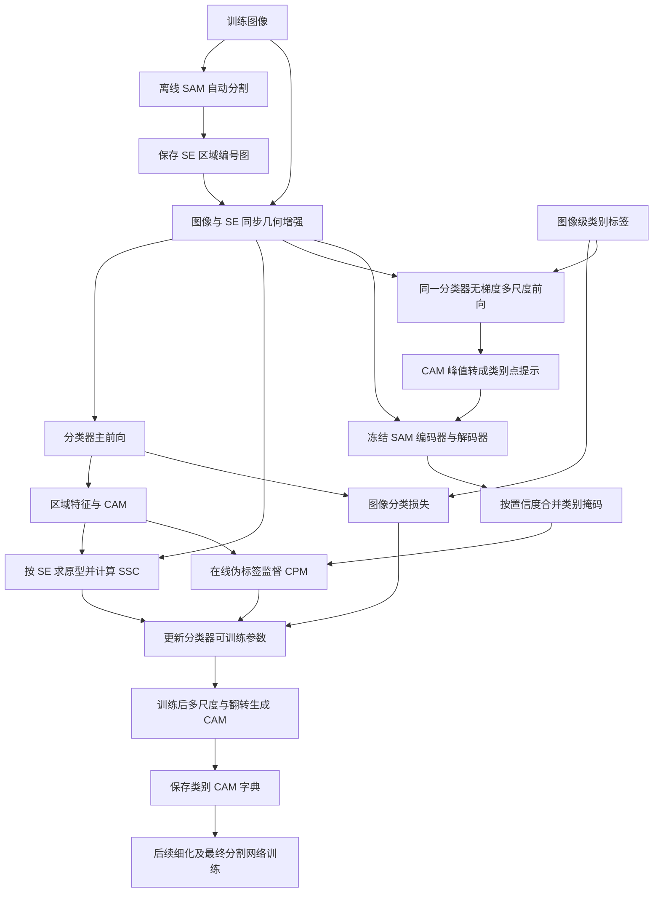
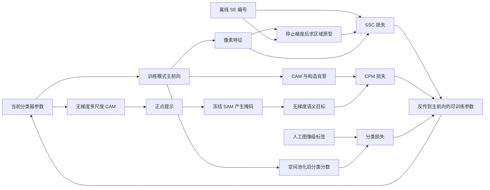

# 05 · S2C：Method 回顾

S2C 使用图像级类别标签，训练一个能生成 CAM 的分类网络；预训练 SAM 充当不更新参数的分割老师。直接产物是质量更好的类别激活图，之后再生成伪标签、训练最终语义分割网络。它最值得记住的想法是：**让 SAM 在训练期间教会分类器“哪些像素应该成片”，而且既教特征，也教类别热图。**

本文覆盖 *From SAM to CAMs: Exploring Segment Anything Model for Weakly Supervised Semantic Segmentation*，CVPR 2024。方法解释以官方仓库 `102e14c690c8e3bce3d5ccd1ae7832145ce10b27` 的实际调用链为主；论文用于解释设计目的。该仓库发布的是 CAM 生成阶段，不能把论文完整的最终分割实验直接等同于仓库里已经提供了一套端到端训练脚本。

## 先看整体流程

先把 SAM 的两种用法分开：**SSC 用提前存好的、没有类别含义的区域编号；CPM 用当前 CAM 动态产生的点提示，在线调用 SAM 得到带类别归属的监督。** 两条支路训练的是同一个分类器。



在线 SAM 接收的是当前增强后的图像。CPM 不是一开始就启用，前面先让分类器学到基本类别响应。最终的 CAM 推理路径不调用 SSC、CPM，也不需要执行 SAM 前向。[训练入口](https://github.com/sangrockEG/S2C/blob/102e14c690c8e3bce3d5ccd1ae7832145ce10b27/train.py)、[训练与推理实现](https://github.com/sangrockEG/S2C/blob/102e14c690c8e3bce3d5ccd1ae7832145ce10b27/models/model_s2c.py)

## 顺着数据走一遍

### 1. 先准备一张“区域编号图”，不要给它强行解释类别

设训练图里有两个人、一辆自行车和路面，图像标签只告诉我们“人、自行车存在”。离线运行 `get_se_map.py`，SAM 的 `SamAutomaticMaskGenerator` 会给出若干二值区域，可能包括一个人的身体、另一个人的头、自行车车架、车轮等。它们没有“人=15”这样的语义类别，只能告诉分类器某一块内部的像素比较像一个整体。

论文希望把重叠掩码按面积处理，让小区域优先。**这份公开脚本实际上没有显式按面积排序，而是逆序遍历 `masks`，用后写入的区域覆盖已有编号。** 因此按源码理解时，SE 的精确重叠结果取决于 SAM 返回的列表顺序，不能直接把“小区域总会覆盖大区域”当作脚本保证。未覆盖位置先记为 `-1`，生成结果保存为 `.npy`。[预处理脚本](https://github.com/sangrockEG/S2C/blob/102e14c690c8e3bce3d5ccd1ae7832145ce10b27/get_se_map.py)

训练数据集读取后给编号加一，并转为 `uint8`；对图像做随机缩放、翻转、颜色扰动、少量灰度增强和裁剪。SE 只跟随几何变换，缩放用最近邻，以免插值造出不存在的区域编号。实现通过恢复 Python 与 PyTorch 随机数状态，使图像和 SE 的缩放、翻转、裁剪对齐，还会把出现的编号重新映射为连续整数。默认裁剪是 `256×256`。

这里有一个容易混淆的“0”：SSC 会忽略**最终 SE 图中编号为 0 的像素**。原始未覆盖区加一后通常对应 0，裁剪补边也填 0；但数据集还会重新编号，所以应准确理解为“忽略最终编号 0”，而不是把 0 当成一个有可靠语义的背景类别。[数据集实现](https://github.com/sangrockEG/S2C/blob/102e14c690c8e3bce3d5ccd1ae7832145ce10b27/voc12/data.py)、[几何变换](https://github.com/sangrockEG/S2C/blob/102e14c690c8e3bce3d5ccd1ae7832145ce10b27/tools/imutils.py)

### 2. 分类器先产生特征，再产生 CAM 和整图分类结果

`Net_CAM.forward` 使用 ResNet38 主干，然后通过 `fc8` 的 `1×1` 卷积和 ReLU 得到 256 维特征，再经过 `fc9` 的 `1×1` 卷积得到 20 类 CAM。对于默认 VOC 配置：

| 张量 | 形状 | 在流程中的含义 |
|---|---|---|
| 输入图像 | `B×3×256×256` | 当前训练裁剪 |
| `feat` | `B×256×32×32` | SSC 使用的特征，输出步长为 8 |
| `cam` | `B×20×32×32` | 未归一化的前景类别分数 |
| `pred` | `B×20` | 对原始 CAM 的空间维做全局平均池化 |
| 上采样后的 CAM | `B×20×256×256` | CPM 使用的归一化热图 |

整图分类使用 `BCEWithLogitsLoss(pred, label)`。这允许一张图同时有人、自行车，不是在 20 个类之间选唯一答案。分类分支池化的是原始 CAM；CPM 的学生分支则对 CAM 做 ReLU、逐类别除以空间最大值，再上采样，并乘图像级标签以屏蔽不存在的类别。**这里的最大值归一化发生在空间维，不是类别维 softmax。**

分类器并非每一层都更新：`train()` 固定早期卷积/残差层，所有 BatchNorm 设为评估模式并冻结其仿射参数，其余可训练部分接受损失。SAM 不进入优化器，而且其前向本身有 `no_grad`；因此这不是 SAM 微调。[`Net_CAM`](https://github.com/sangrockEG/S2C/blob/102e14c690c8e3bce3d5ccd1ae7832145ce10b27/networks/resnet38d.py)、[`Sam.forward`](https://github.com/sangrockEG/S2C/blob/102e14c690c8e3bce3d5ccd1ae7832145ce10b27/modeling/sam.py)

### 3. SSC：把同一区域的特征拢在一起

想象 SAM 把自行车的前轮划成区域 7。SSC 不说“区域 7 是自行车”，而是说：“前轮这片内部的特征应该接近它们自己的平均特征，也应该能和其他区域区分开。”

具体地，先把 256 维特征上采样到 SE 分辨率，在通道维做 L2 归一化。然后按区域编号求均值，并再次在通道维归一化，得到每张图自己的区域原型。用 $f_p$ 表示像素 $p$ 的单位特征，$R_j$ 表示编号为 $j$ 的区域：

$$
q_j=\operatorname{norm}\left(\frac{1}{|R_j|}\sum_{p\in R_j}\operatorname{stopgrad}(f_p)\right).
$$

`scatter_mean` 的输入显式 `detach()`，所以本次反传不会穿过原型均值；像素特征仍能收到梯度。原型每个 batch 都从当前特征重新计算，不是可训练类别参数，也不是跨图维护的记忆库。

将 `B×256×N` 的原型和 `B×256×HW` 的像素特征做批量矩阵乘，得到 `B×N×HW` 的相似度。每个像素的目标就是自己的 SE 编号，交叉熵在**区域编号维 N** 上竞争：

$$
\mathcal L_{\mathrm{SSC}}
=-\frac{1}{|\Omega|}\sum_{p\in\Omega}
\log\frac{\exp(\beta q_{s_p}^{\mathsf T}f_p)}
{\sum_j\exp(\beta q_j^{\mathsf T}f_p)},
\qquad \Omega=\{p:s_p\ne0\}.
$$

这里 $\beta$ 对应代码里的 `args.T`：源码是相似度**乘** `T`，默认 1，而论文用相似度除以温度 $T$ 的写法。上式按实际的 `cross_entropy` 表达其 softmax 与负对数，便于理解实现。编号 0 的目标像素被忽略，但代码没有把第 0 个原型通道从分母中删除。

为什么放在特征层？因为一个人可以被切成头、上身、腿，两个不同的人也可能是不同区域。若直接强迫“不同区域必须是不同语义类别”，就会和图像分类任务冲突。特征层允许它们保持一些差异，分类头仍可把这些特征共同映射到“人”。这是一种有用的约束方式，不是保证 SAM 每个分块都正确。[SSC 对应的 `update`](https://github.com/sangrockEG/S2C/blob/102e14c690c8e3bce3d5ccd1ae7832145ce10b27/models/model_s2c.py)

#### 对照原论文图 3，把区域原型这一步看具体

下面的图把前面的特征计算和 SSC 损失接到一起。先沿左侧两路读，再看最右侧的单位超球面。

/images/3b038ad8c9b414e4a79aa5ad6af4c9be.png>)

*CVPR 2024，图 3，SAM-segment Contrastive（SSC）。复用原笔记中的论文原图。图号与图注见[原论文笔记](<../S2C/S2C_paper_notes.md>)。*

上路是图像经过 `Classifier encoder` 得到特征图 $F$，下路是图像经过带雪花的冻结 SAM 得到 `SE map`，再拆成绿色、红色、蓝色的区域。两路在圈叉处汇合，表示用区域掩码挑出对应位置的特征。右侧三颗星分别代表各区域的平均原型，粉色圆点是红色区域中的一个像素特征，`Pull` 指向本区红星，虚线 `Push` 指向另外两区的原型。颜色帮助跟踪区域归属，具体的语义类别仍由后面的分类头学习。

| 图中位置 | 接到本节已有讲解与代码 |
|---|---|
| `Feature map F` | 第 2 步 `Net_CAM.forward` 返回的 `feat`，经过插值与通道归一化进入 SSC |
| `SE map` 与圈叉 | 第 1 步准备并同步增强的区域编号，用来给 `scatter_mean` 分组 |
| 三颗原型星星 | 第 3 步的 $q_j$，代码由 `f.detach()` 求均值并再次归一化 |
| `Pull / Push` | 后文第二段代码的 `bmm` 相似度和区域编号交叉熵，像素特征沿这条损失路径更新 |

读图时补上两个实现细节。图中 SAM 到 SE 的箭头跨过了离线预处理，训练 batch 直接读取已保存的编号。右侧的原型星星每次根据当前特征重算，当前反传在求均值前停止梯度。拿图里的猫来复述，就是先取出“猫这一片”的特征平均，再让这片内各点更接近自己的平均方向。整图分类标签通过分类 BCE 继续提供类别信息。

### 4. CPM：当前 CAM 提问，SAM 回答，再教回当前分类器

CPM 在 `update` 中先于带梯度的主前向执行。它暂时把**同一分类器**切到 `eval`，在 `no_grad` 下分别看 `0.5、1、1.5、2` 倍图像；各尺度 CAM 上采样、ReLU、用类别标签过滤后相加，再逐类别除以空间最大值。这里没有额外 EMA 教师，也没有重新训练另一套分类器。

接着逐图、逐存在类别抽点。对“人”的热图，用 `3×3` 最大值滤波，再调用 `peak_local_max(min_distance=20)`，从候选点中保留 CAM 值大于 `th_multi=0.5` 的点。代码另取一个全局最大点，并拼接 `peaks_valid[1:]`；这意味着全局点是兜底保留的，不能概括成“所有送入 SAM 的点都经过 0.5 阈值过滤”。同一类的所有点作为一组正点提示，不给其他类别加负点。

对于两个人的图像，多峰点让 SAM 有机会同时关注两处目标，减少只围着最显眼的那个人分割的情况。点本身没有类别文字，类别含义来自“这些点是从人的 CAM 里取出的”，SAM 输出后仍由外层循环给它贴回“人”的类别编号。

SAM 接收反归一化后的当前裁剪，将其缩放到 `1024×1024`，先算一次图像 embedding，再对不同类别重复运行 prompt encoder 和 mask decoder，避免每个类都重算昂贵的图像编码。训练裁剪为方形，点坐标也按 `1024/H` 同步缩放。官方仓库提供了替换版 `sam.py` 和 `mask_decoder.py` 来支持这条调用路径。[CPM 调用](https://github.com/sangrockEG/S2C/blob/102e14c690c8e3bce3d5ccd1ae7832145ce10b27/models/model_s2c.py)、[SAM 编解码入口](https://github.com/sangrockEG/S2C/blob/102e14c690c8e3bce3d5ccd1ae7832145ce10b27/modeling/sam.py)、[mask decoder](https://github.com/sangrockEG/S2C/blob/102e14c690c8e3bce3d5ccd1ae7832145ce10b27/modeling/mask_decoder.py)

### 5. 多个类别的掩码会打架，需要合成一张监督图

SAM 对每组点返回三张候选掩码。实现固定取候选下标 `2`，没有根据 predicted IoU 自动挑选。还要分清“置信度”的具体来源：`output_sam[2]` 是 **low-resolution mask logits**，代码把选中候选的 logits 上采样后用作逐像素分数；没有把它先 sigmoid 成概率，也没有使用 SAM 自动掩码生成器里的稳定性指标。论文把这一路概括为 SAM stability，回看源码时应按 mask logits 理解。

对类别 $c$，设选中的二值掩码为 $M_c$，无梯度多尺度 CAM 为 $A_c$，上采样后的 SAM mask logit 为 $z_c(p)$，实现相当于：

$$
r_c=\frac{1}{|M_c|}\sum_{p\in M_c} A_c(p),
\qquad
a_c(p)=
\begin{cases}
z_c(p)r_c,&p\in M_c,\\
-10^5,&p\notin M_c.
\end{cases}
$$

$r_c$ 是整张掩码的一个标量：SAM 圈出的这片区域，平均获得了多少本类 CAM 支持；$z_c(p)$ 则区分该掩码内部哪些像素更有把握。如果“人”和“自行车”掩码在手与车把附近重叠，就比较二者的 $a_c(p)$，较大的类别获胜。它综合两个来源的证据，但不能保证解决所有语义混淆。

所有类别分数最大值仍小于 **0** 的位置，代码设为背景 `20`；其余像素取最大类别，前景编号为 `0…19`。这一步没有采用论文公式里“最大置信度低于 $\tau$ 就为背景”的 `0.5` 判据。**点筛选阈值与这份实现的背景判定不能混为一谈。**

得到 `pgt_sam` 后，重新把分类器切回训练模式，执行带梯度的主前向。以学生归一化 CAM 的逐像素前景最大值定义背景分数：

$$
A_{\mathrm{bg}}(p)=1-\max_c A_c(p).
$$

把背景通道接在 20 个前景通道**后面**，得到 `B×21×H×W`，用 `cross_entropy` 对齐 `pgt_sam`。交叉熵内部的 softmax 沿 21 类通道计算；输入是归一化 CAM 与构造背景分数，并不是未经处理的分类 logits。`ignore_index=255` 虽然写在损失里，但这条 CPM 目标生成代码本身只产生前景编号和背景 20，没有主动把低置信度像素标成 255。[聚合和 CPM 损失源码](https://github.com/sangrockEG/S2C/blob/102e14c690c8e3bce3d5ccd1ae7832145ce10b27/models/model_s2c.py)

#### 对照原论文图 4，沿类别热图走到监督目标

结合下面的 CPM 原图，可把第 4、5 步连成一条“抽点—出掩码—合并”的路径。

/images/d105a31037a810156241747405f6c643.png>)

*CVPR 2024，图 4，CAM-based Prompting Module（CPM）。复用原笔记中的论文原图。图号与图注见[原论文笔记](<../S2C/S2C_paper_notes.md>)。*

从左到右读，每行是一类 CAM。绿色自行车热图取一个点，粉色人的热图取两个点，灰色热图也取一个点；白圈标出峰值位置。各行经过带雪花的 SAM 后得到对应掩码，右侧大括号将它们汇入 `Confidence-based aggregation`，输出一张 `Self-supervision` 类别图。右下角照片交代这些 CAM 和掩码来自同一输入图像。图中并排画出的 SAM 框表达逐类别提示调用，当前实现共用同一个冻结模型，并复用同一图像 embedding。

| 原图模块或箭头 | 接到已有章节和调用链 |
|---|---|
| CAM 内白圈 | 第 4 步无梯度多尺度 CAM 的峰值，按存在类别组织为正点提示 |
| `CAMs → SAM → SAM masks` | 第一段代码的 `prompt_sam_and_merge`，先准备监督目标，再执行训练模式主前向 |
| `Confidence-based aggregation` | 第 5 步的 $z_c(p)r_c$ 与类别竞争，第三段代码保存实际候选选择、背景判定 |
| `Self-supervision` | `pgt_sam / target`，随后与学生 CAM 加构造背景通道计算 CPM 交叉熵 |

图中 `Eq.11` 指向论文的聚合表达，按当前实现回看时，SAM 侧逐像素分数取自 mask logits，CAM 侧支持度是掩码内的均值。图里的监督终点还要接回前面 Mermaid 的 CPM 损失，再更新分类器可训练参数。两个人的白圈说明同类可以同时有多个提示点，人的掩码与自行车掩码重叠时，则交给聚合分数决定像素归属。记忆时可以顺着三个问题走一遍，“当前 CAM 在哪里亮”“SAM 沿这些点圈出哪片”“重叠处哪一类证据更高”。整条目标生成路径使用无梯度结果，训练后的 CAM 导出见后文的推理章节。

## 三种监督究竟教什么

| 损失 | 目标从哪里来 | 直接约束什么 | 不能误解成什么 |
|---|---|---|---|
| 分类 BCE | 人工图像级多标签 | GAP 后的整图类别分数 | 已经有像素级真值 |
| SSC 区域交叉熵 | 离线 SE 区域编号 | 像素特征与本图区域原型的关系 | 不同区域一定是不同语义类 |
| CPM 语义交叉熵 | 当前 CAM 点提示得到的 SAM 掩码 | 前景 CAM 与构造背景分数 | 通过 SAM 反传来优化点坐标 |

按此提交，优化目标是：

$$
\mathcal L=W_0\mathcal L_{\mathrm{cls}}
+\mathcal L_{\mathrm{SSC}}
+\mathbf{1}[\mathrm{epoch}\ge\mathrm{sstart}]\mathcal L_{\mathrm{CPM}}.
$$

参数虽然定义了三个 `W`，但实际只有 `W[0]` 用于分类损失，SSC、CPM 直接相加。公开入口默认 `max_epochs=40`、`sstart=2`，epoch 从 0 开始，所以默认前两个 epoch 不启用 CPM；论文实验段报告的是训练 6 个 epoch、首个 epoch 不用 CPM、温度 0.5。这里列出两者是为了明确：**当前公开入口的默认参数不等于论文实验配置已经原样写在命令行里。** 本文未运行训练，也不声称默认命令能复现论文数字。[参数定义](https://github.com/sangrockEG/S2C/blob/102e14c690c8e3bce3d5ccd1ae7832145ce10b27/train.py)

## 对照官方代码：三段抓住调用链

下面是省略设备、日志、可视化的**等价逻辑整理**，不是逐字摘录。

第一段对应 `train.py → model_WSSS.update`。关键是先产生没有梯度的监督，再让同一个模型在训练模式下学习；优化器只管理 `net_main`。

```python
for epoch in range(max_epochs):
    for pack in train_loader:
        image, tags, se = unpack(pack)
        if epoch >= sstart:
            with no_grad():
                net_main.eval()
                teacher_cam = multiscale_cam(net_main, image, tags)
                target = prompt_sam_and_merge(teacher_cam, image, tags)
        net_main.train()
        optimizer_main.zero_grad()
        feat, raw_cam, image_logits = net_main(image)
        loss = W[0] * bce_logits(image_logits, tags)
        loss += ssc(feat, se)
        if epoch >= sstart:
            loss += cpm(normalize_cam(raw_cam, tags), target)
        loss.backward()
        optimizer_main.step()
```

对应：[入口](https://github.com/sangrockEG/S2C/blob/102e14c690c8e3bce3d5ccd1ae7832145ce10b27/train.py)、[`update`](https://github.com/sangrockEG/S2C/blob/102e14c690c8e3bce3d5ccd1ae7832145ce10b27/models/model_s2c.py)。这里的 `teacher_cam` 只是便于讲解的变量名，不表示仓库另有教师网络。

第二段对应 SSC，最值得看的是 `detach`、矩阵维度与 `ignore_index`。

```python
f = normalize(upsample(feat), dim=1).reshape(B, D, H * W)
index = se.reshape(B, 1, H * W).long()
prototype = normalize(scatter_mean(f.detach(), index), dim=1)
similarity = bmm(prototype.transpose(1, 2), f)  # B, N, HW
loss_ssc = cross_entropy(similarity * T, index[:, 0], ignore_index=0)
```

对应：[SSC 实现](https://github.com/sangrockEG/S2C/blob/102e14c690c8e3bce3d5ccd1ae7832145ce10b27/models/model_s2c.py)。原型本轮不接梯度，像素特征接梯度；监督索引是区域号，不是 VOC 类别号。

第三段对应 CPM 的类别掩码聚合，保留了代码里的候选选择和背景规则。

```python
score = full_like(cam_ms, -1e5)
for image_id, class_id in present_classes:
    masks, predicted_iou, low_res_logits = sam_decode(points[class_id])
    mask = masks[0, 2]
    pixel_score = resize(low_res_logits[0, 2], (H, W))
    cam_support = cam_ms[image_id, class_id][mask].mean()
    score[image_id, class_id][mask] = pixel_score[mask] * cam_support
best_score, target = score.max(dim=1)
target[best_score < 0] = 20
background = 1 - cam_main.max(dim=1, keepdim=True).values
student = concatenate([cam_main, background], dim=1)
loss_cpm = cross_entropy(student, target, ignore_index=255)
```

对应：[调用和损失](https://github.com/sangrockEG/S2C/blob/102e14c690c8e3bce3d5ccd1ae7832145ce10b27/models/model_s2c.py)、[SAM 返回值定义](https://github.com/sangrockEG/S2C/blob/102e14c690c8e3bce3d5ccd1ae7832145ce10b27/modeling/sam.py)。`predicted_iou` 返回了，但这条聚合路径没有用它。

## 训练结束后，究竟怎么得到分割结果

`train.py` 每个 epoch 保存分类器，并调用 `infer_init → infer_multi` 生成 CAM。验证数据集提供四尺度乘水平翻转，共 8 个视图；`infer_multi` 用分类器分别前向，将 CAM 插值回原始尺寸、ReLU、屏蔽不在图像标签中的类别，再把翻转视图翻回来，最后相加并逐类别归一化。

输出 `.npy` 是 `{类别索引: H×W 热图}` 字典，通常只有图中存在的类别。**它还不是每像素唯一类别的分割图。** `evaluation.py` 读取已生成的字典，为背景添加常数分数，再对类别维取 argmax；这里将前景字典索引加一，背景放在 0，与 CPM 内部的“背景 20”是两个不同使用场景。评价代码还读取像素真值来计算指标、选择阈值，这些真值不进入前述三项训练损失。[CAM 推理](https://github.com/sangrockEG/S2C/blob/102e14c690c8e3bce3d5ccd1ae7832145ce10b27/models/model_s2c.py)、[评价转换](https://github.com/sangrockEG/S2C/blob/102e14c690c8e3bce3d5ccd1ae7832145ce10b27/evaluation.py)

如果开启 `--crf`，仓库还会以 $(1-\max_c A_c)^\alpha$ 构造背景分数，再用 DenseCRF 输出细化结果。不过 README 明确把进一步 refinement 指向外部 RIB 和 SAM_WSSS。论文使用细化伪标签训练最终 DeepLab 分割网络；当前 S2C 仓库的可核实训练入口止于分类器/CAM 阶段，因此这里不把外部完整细化与 DeepLab 训练写成已经在 `train.py` 中执行的步骤。最终分割器是后续独立学习的模型，而不是在部署时仍靠图像级标签过滤的 CAM 字典。[CRF 工具](https://github.com/sangrockEG/S2C/blob/102e14c690c8e3bce3d5ccd1ae7832145ce10b27/tools/imutils.py)、[仓库范围说明](https://github.com/sangrockEG/S2C/blob/102e14c690c8e3bce3d5ccd1ae7832145ce10b27/README.md)

## 用一张图看清监督与梯度



仍用两个人和自行车的例子：SSC 教“车轮内部是一片、人的衣服内部也是一片”，CPM 教“根据人的热图提问后，SAM 圈出的这片更应该属于人”，分类 BCE 则始终提醒网络“这张图确实有人和自行车”。SSC 没有独立赋予区域语义，CPM 也没有绕开 CAM 的类别判断；两者是互补的约束。早期 CAM 若把路面误当自行车，SAM 仍可能沿错误提示给出看起来边界很漂亮的错误掩码，所以延迟启用与分数聚合是在减轻噪声，并非消除噪声的保证。

## 回顾时抓住这几点

1. **SAM 用两次、用途不同。** 离线 SE 是无类别的区域结构，在线 CPM 是由当前类别 CAM 提示得到的语义监督。
2. **SSC 的分类对象是区域号。** 每张图独立求原型，原型停止梯度，像素特征去匹配自己的区域；它不是把 SAM 区域当语义真值。
3. **CPM 是自举。** 当前分类器产生点，冻结 SAM 给出形状，再用形状监督同一分类器下一次更新；没有端到端穿过 SAM 的梯度。
4. **源码中的具体规则要分别记。** 候选固定选第 3 张、逐像素分数来自 mask logits、背景阈值是 0，不能和抽点阈值 0.5 混在一起。
5. **CAM、伪标签、最终分割器是三个阶段。** 这份仓库主要负责第一个阶段，并提供部分后处理接口。

自检：为什么不直接让 SE 编号监督 CAM 的语义通道？因为两个人、一个人的不同部位都可能是不同 SE 区域，区域号没有语义类含义。为什么 CAM 推理时可以不跑 SAM？因为 SAM 的约束已经通过训练更新了分类器参数。为什么要复用一次 SAM embedding？因为一张图的多个类别只改变提示，不需要反复计算图像编码。

## 资料与实现版本

- **会议论文：** Hyeokjun Kweon、Kuk-Jin Yoon，CVPR 2024，19499–19509；[CVF 正式条目](https://openaccess.thecvf.com/content/CVPR2024/html/Kweon_From_SAM_to_CAMs_Exploring_Segment_Anything_Model_for_Weakly_CVPR_2024_paper.html)，DOI `10.1109/CVPR52733.2024.01844`。实际读取了本地英文 PDF 的方法第 4 节、实现与流程相关段落，并渲染检查了方法图及公式所在页。
- **本地原论文：** [英文 PDF](<E:/Data/GitHubRepo/Deeplearning-notes-Obsidian/99_Assets (资源文件)/papers/From SAM to CAMs Exploring Segment Anything Model for Weakly Supervised Semantic Segmentation.pdf>)。
- **官方实现：** [sangrockEG/S2C](https://github.com/sangrockEG/S2C)，读取时分支为 `main`，固定提交 [102e14c690c8e3bce3d5ccd1ae7832145ce10b27](https://github.com/sangrockEG/S2C/commit/102e14c690c8e3bce3d5ccd1ae7832145ce10b27)，提交日期 2024-07-10。已检查分支、文件树与提交历史；这是以 CVPR 2024 为名发布的版本，没有把较晚的其他工作代码套到会议方法上。
- **实际读取的实现文件共 11 个：** `README.md`、`train.py`、`get_se_map.py`、`models/model_s2c.py`、`networks/resnet38d.py`、`modeling/sam.py`、`modeling/mask_decoder.py`、`voc12/data.py`、`tools/utils.py`、`tools/imutils.py`、`evaluation.py`；仓库文件树、分支与提交元数据另计。
- **期刊扩展核查：** 检索了题名、作者与 `journal / extended / TPAMI` 等组合，并检查[作者公开发表列表](https://sangrockeg.github.io/)、CVF 出版信息和官方仓库。**截至 2026-11-11，本次未找到能够核实为 S2C 同一工作期刊扩展的论文、出版记录与对应代码。** 因此只讲 CVPR 2024，不将同作者后续其他任务论文视为扩展，也不把聚合网站对会议论文的“Journal Article”标签当作期刊出版证据。
- **资料边界：** 补充材料的 CVF 链接返回 403，未取得全文，未作为方法细节依据；GitHub tags API 端点被连接器拒绝，但分支、提交历史、固定提交的正文均已读到。本文是论文与源码静态阅读回顾，未运行训练、未下载权重或数据集，也未验证作者训练环境中的运行结果。
