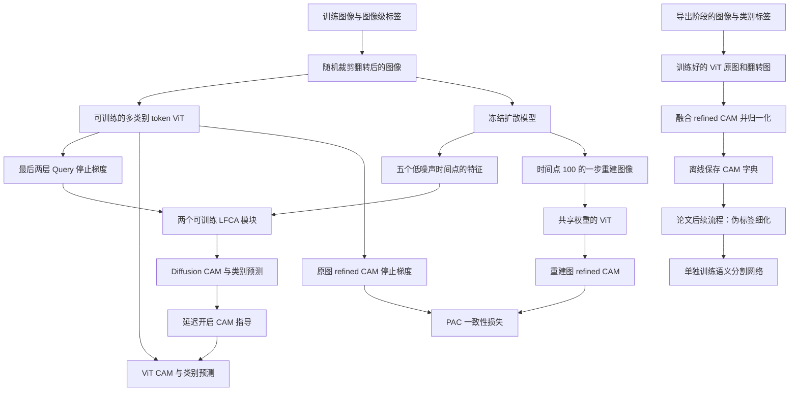
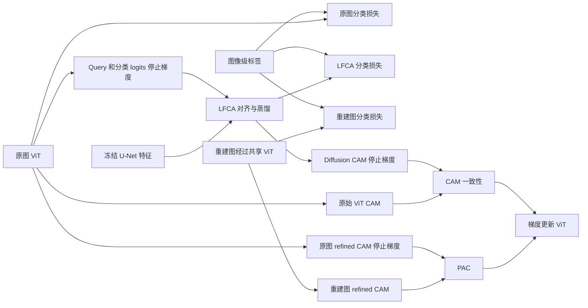

# 06 · DiG：Method 回顾

DiG 用图像级类别标签训练一个生成 CAM 的多类别 token Transformer，同时借助冻结的扩散模型改善定位。训练完成后，由 Transformer 导出类别响应图，再交给伪标签后处理和下游分割网络。核心想法是：**让扩散特征教分类器“物体在哪里”，再用同一张图的去噪版本约束它“这些位置之间的关系应当稳定”。**

本文覆盖 ECCV 2024 会议工作。讲解以官方仓库 `66e12b86a0bcd1f7b7f7dfdb4c93939c917f3e65` 的 VOC 实现为主；这是 2024-12-17 发布的会议版代码。论文概念和实现细节有差异时，下文直接说明实际采用的计算。未运行训练或复现指标。

## 先看整体流程



先分清三种对象：**原始 ViT-CAM** 是 patch 特征经过分类卷积得到的响应；**refined CAM** 又乘了 class-to-patch attention，并通过 patch-to-patch attention 传播；**Diffusion-CAM** 来自 LFCA，是训练时的定位老师。它们的用途不同，不能都笼统叫“最终分割结果”。

### 对着原论文图 2 看两条训练支路

结合下面的原论文框架图，可以把前面的流程分成下方的局部性指导与上方的 PAC 配对约束。


图 2，DiG ECCV 2024 整体框架。复用原笔记中的论文图片，图注还说明此图为简洁起见省略了分类损失。[原笔记与图注](../DiG/DiG_paper_notes.md)

**先看中间，再看上下。** 中间原图被拆成灰色 patch token，前面接蓝色的 $C$ 个类别 token，经过 ViT 得到原始响应 $A$。通往右侧乘法节点的注意力连线承载 $A_{att}$ 与 $A_{aff}$，与 $A$ 结合后形成 $A_{ref}$，对应后文“ViT 先完成分类，同时留下定位和关系信息”中的类别筛选与位置传播。

下方橙色区域读取多个带噪版本，经带锁的 Diffusion U-Net 提取特征，再聚合成 $F_{diff}$。ViT 送来的 $Q$ 与扩散分支送来的 $K_f,V_f$ 进入 LFCA，输出 $A_{diff}$。右侧 $\mathcal L_{lfca}$ 把这张图的局部定位信息传给 $A$。图例中带短斜杠的箭头表示停止梯度，所以比较时 $A_{diff}$ 这一端作为固定目标。

上方绿色区域把去噪图送入共享权重的 ViT，再生成 $\tilde A$ 和 $\tilde A_{ref}$。右侧 $\mathcal L_{pac}$ 比较两份 refined CAM，原图 $A_{ref}$ 一侧的斜杠对应代码中的 `detach`。图中 `Shared` 表示两次前向共用参数，梯度仍可经去噪图分支更新同一个分类器。

| 图中位置 | 本文阅读位置与代码对应 |
|---|---|
| 带锁 U-Net、聚合特征 | 第 3 节及代码第一段，`update → p_losses` 在线取特征 |
| $Q,K_f,V_f$、$A_{diff}$ | 第 4 节及代码第二段，`MCTformerV2_DiG.forward → LFCA.forward` |
| $A_{ref}$ 与 $\tilde A_{ref}$ | 第 5 节及损失表，原图目标指导重建图输出 |

读图时再记住三个实现细节。图中去噪图标了 $\tilde x_{0\leftarrow60}$，当前 VOC 代码采用 `t=100` 的一步重建。两项空间一致性按 `epo>9` 开启。CAM 导出时走训练好的 ViT 与原图/翻转融合，图中的扩散、LFCA 和 PAC 支路属于训练辅助流程。用图里的划艇场景复述，就是先让扩散特征帮助响应贴近连贯物体区域，再要求重建图经过关系传播后仍保留相近响应。

## 顺着数据走一遍

### 1. 输入仍然只有“这张图里有什么”

以“人骑着自行车”为例，标签向量只把 `person`、`bicycle` 置为 1，其余 VOC 类别为 0，没有像素边界，也没有训练用背景 mask。入口 `train_trm.py` 构造 `VOC12Dataset`，随后调用 `model_WSSS.unpack()` 和 `update(epo)`。

默认训练输入为 `B×3×224×224`，经过空间增强和 ImageNet 标准化。VOC 数据构建函数关闭颜色抖动与 AutoAugment；保持颜色统计比较接近扩散模型所见图像。数据集虽然返回了两个增强图，但 `update()` 真正用于 PAC 的去噪图是在当前 batch 内从 `self.img` 重新生成的，不是读取第二个增强图作为 PAC 配对。这样两条 PAC 路径对应同一套空间坐标。[数据构建与增强](https://github.com/yoon307/DiG/blob/66e12b86a0bcd1f7b7f7dfdb4c93939c917f3e65/tools/utils.py)、[数据集](https://github.com/yoon307/DiG/blob/66e12b86a0bcd1f7b7f7dfdb4c93939c917f3e65/voc12/data.py)

### 2. ViT 先完成分类，同时留下定位和关系信息

实际模型名是 `deit_small_MCTformerV2_DiG`：patch 大小 16，宽度 384，12 层，每层 6 个自注意力头。224 的输入对应 `14×14=196` 个 patch token，前面再放 20 个可训练类别 token，因此 token 张量是 `B×216×384`。

最终类别 token 在特征维上取平均，得到 `B×20` 的分类 logits。patch token 还原为 `B×384×14×14`，经过 3×3 分类卷积得到每个类别的空间 logits `Z`。正值响应 `A=ReLU(Z)` 就是这里的原始 CAM。

patch 分支的分类不是整图平均，而是正负各做一次 Top-3 pooling：

$$
\hat y_p=\operatorname{meanTop3}(\operatorname{ReLU}(Z))
-\operatorname{meanTop3}(\operatorname{ReLU}(-Z)).
$$

Top-3 沿空间维选取，每个类别独立计算。大白话说，一个类别既要有几个足够支持它的位置，也要考虑最强的反对证据；类别 token 分支和 patch 分支都用图像标签做多标签分类监督。这里没有把 20 个类别当成只能选一个的互斥分类。

Transformer 的注意力还有第二个用途。先平均每层的 6 个头，再把各层的 class-to-patch 子矩阵求和，得到 `B×20×14×14` 的 `mtatt`；patch-to-patch 子矩阵也跨 12 层求和，得到 `B×196×196` 的 `patch_attn`。最后计算：

$$
R_c=P\,\operatorname{vec}(A_c\odot M_c).
$$

其中 `M` 是类别对位置的注意力，`P` 是位置之间的注意力。先让“人的类别 token”筛一遍人的 CAM，再让相互关联的位置交换响应。自行车轮廓如果只亮了一部分，有机会沿关系图扩展开；但关系图把路面也当成相关区域时，也会把错误传播出去，这正是 PAC 要约束的地方。自注意力的 softmax 在每个 query 对应的全部 key token 维进行；截取后跨层求和的 `P` 没有再做一次行归一化。[模型 forward](https://github.com/yoon307/DiG/blob/66e12b86a0bcd1f7b7f7dfdb4c93939c917f3e65/networks/mctformer.py)、[自注意力实现](https://github.com/yoon307/DiG/blob/66e12b86a0bcd1f7b7f7dfdb4c93939c917f3e65/networks/vision_transformer.py)

### 3. 扩散模型在线提供特征，参数不更新

训练器加载预训练 U-Net，把当前图像从 ImageNet 标准化还原后映射到 `[-1,1]`。对 `t=0,1,2,3,4` 分别直接采样带噪图：

$$
x_t=\sqrt{\bar\alpha_t}\,x_0+\sqrt{1-\bar\alpha_t}\,\epsilon.
$$

这里是从同一张干净图独立构造五个噪声级别，并非连续执行五步反向生成。每次 `p_losses()` 都默认重新采样噪声；名字虽带 `losses`，U-Net 处于 eval 模式时返回的是带噪图、预测和中间特征，计算出的扩散 MSE 不参与 WSSS 更新。

这份实现取 U-Net 瓶颈和四个上采样阶段之后的特征，统一插值到 `14×14`。通道分别为 `512、256、128、64、64`，拼成每个时间点 `B×1024×14×14`；五个时间点再沿通道拼接，得到 `B×5120×14×14`。因此这里按实际代码理解为**瓶颈加解码过程的多层特征**，不能只把它画成一个瓶颈张量。

所有扩散调用都在 `torch.no_grad()` 中，优化器也只接收 `net_trm` 参数；冻结的是扩散 U-Net，后面的 LFCA 和分类头仍然学习。预训练扩散模型学到的区域结构并不天然知道哪个响应该叫“人”，还需要下一步完成语义对齐。[扩散模型与特征返回](https://github.com/yoon307/DiG/blob/66e12b86a0bcd1f7b7f7dfdb4c93939c917f3e65/denoising_diffusion_pytorch/denoising_diffusion_pytorch.py)

### 4. LFCA 把“区域长什么样”接到“类别是什么”上

ViT 最后两层各取一个 Query 张量，把原来的多头维合回 384 维，得到两组 `B×216×384` 的 Query。**这两组 Query 都先 detach。** 每组对应一个独立 LFCA，不是先平均 Query 再过一个公共模块。

每个 LFCA 先用残差卷积块把五组扩散特征从 5120 通道压到 1024；实现中的卷积归一化主要是 GroupNorm。之后生成 Query、Key、Value，并做 8 头 cross-attention。每头的 Query/Key 宽度是 48，Value 宽度是 128：

$$
O=\operatorname{softmax}_{\text{扩散空间位置}}
\left(\frac{QK^\top}{\sqrt{48}}\right)V.
$$

注意力形状为 `B×8×216×196`，softmax 沿最后的 196 个扩散位置进行。人的类别 Query 可以从更像人体区域的扩散位置取信息，patch Query 则按自己的语义选择适合补充的区域信息。它是在学习对齐，不是把扩散特征当成已有像素真值。

输出再拆回类别与 patch 两部分。类别部分投影回 384 维，带 Query 残差和 MLP；patch 部分恢复空间网格，经卷积、插值后加回聚合扩散特征，并经过带残差的卷积 MLP。两个 LFCA 的对应输出取平均，类别特征均值得到 `diff_cls`，patch 特征通过卷积头得到 `Diffusion-CAM`，同样用正负 Top-3 得到 `diff_pcls`。因此老师不是冻结 U-Net 直接产出的类别图，而是**冻结特征加上可训练语义对齐模块**。[LFCA 与两个模块的调用](https://github.com/yoon307/DiG/blob/66e12b86a0bcd1f7b7f7dfdb4c93939c917f3e65/networks/mctformer.py)

### 对着原论文图 3 拆开 LFCA

图 2 的橙色框继续展开，就能看到“类别语义怎样读出扩散区域”，以及老师本身怎样获得监督。


图 3，DiG ECCV 2024 的 LFCA 模块。复用原笔记中的论文图片，图注确认两类输出预测都接受 KD 损失。[原笔记与图注](../DiG/DiG_paper_notes.md)

**沿左到右读。** 左侧 $F_0$ 到 $F_4$ 表示不同低噪声时间点取得的特征，汇聚后形成 $F_{diff}$。中部两条标有 `1×1` 的路径把扩散特征变成 $K_f$ 与 $V_f$，空间位置数是 $N_f^2$。上方 ViT 提供的 $Q$ 同时含蓝色类别 token 和灰色 patch token，共 $C+N^2$ 个查询。交叉注意力让每个查询对扩散位置分配权重，再读出对应的值，这正好对应前文 softmax 沿 196 个位置计算的公式。

LFCA 右侧输出继续分两路。蓝色 $T_{c-diff}$ 形成类别预测 $\hat y_{c-diff}$，灰色 $T_{p-diff}$ 经 `Interp.` 还原为空间特征。图底部从 $F_{diff}$ 绕行到加号的长箭头是残差路径，与插值后的 patch 特征相加，再经卷积得到 $A_{diff}$。它又产生 $\hat y_{p-diff}$。顶部两个 $\mathcal L_{kd}$ 分别训练这两份预测，包含图像级标签监督与来自 ViT 的分类蒸馏，具体权重和温度接到后文“关键模块与损失”即可。

把图压缩成代码第二段时，有三个地方要一起记。图展示单个 LFCA 的内部结构，当前实现用最后两层停止梯度的 Query 分别调用两个 LFCA，再平均对应输出。图把扩散侧浓缩成 `Diffusion Encoder` 和特征汇聚，实际特征来源按第 3 节记录，包括瓶颈与上采样阶段。图顶部 $A_{diff}$ 通往 $\mathcal L_{lfca}$ 的停止梯度标记属于空间指导阶段，LFCA 自己仍通过两路分类与蒸馏学习。

这样复习“人”的类别 Query 时，就可以顺着 $Q\rightarrow$ 扩散位置权重 $\rightarrow T_{c-diff},T_{p-diff}\rightarrow A_{diff}$ 走一遍。类别预测负责让聚合区域对上“人”的语义，空间 CAM 再给 ViT 的人的响应提供定位参照。

### 5. 去噪配对图怎样产生，PAC 又怎样用它

同一 batch 还在 `t=100` 做一次带噪输入与 U-Net 前向。公开代码默认采用 `pred_v` 参数化，接着直接调用 `predict_start_from_v()`：

$$
\tilde x_0=\sqrt{\bar\alpha_t}\,x_t-
\sqrt{1-\bar\alpha_t}\,v_\theta(x_t,t).
$$

这条训练路径是**一步预测干净图**，并未调用完整的逐步 DDPM/DDIM 采样循环；构造器里的 `sampling_timesteps=150` 不等于每个 PAC 样本实际做 150 次反向去噪。论文以加噪再去噪来解释增强，本文按已发布调用链讲解这一步实现。

把重建图还原并转回分类器标准化后，送进同一个 ViT，得到另一份分类输出和 refined CAM。它有自己的图像级分类损失；PAC 则让它的 refined CAM 接近原图 refined CAM。原图一侧停止梯度，重建图一侧接收梯度，参数仍然共享。人在图里的位置没有被重新裁剪，所以能逐位置比较；但“去噪不改变语义”是方法希望近似成立的条件，并非数学保证。

## 关键模块与损失：谁在教谁

公开默认权重 `W=[1,1,1,1,10]`，分别对应原图分类、扩散分支分类与蒸馏、CAM 一致性、重建图分类、PAC。前两种分类都同时监督类别 token logits 和 patch logits。

| 项目 | 目标与梯度方向 | 实际关键细节 |
|---|---|---|
| 原图分类 | 图像标签监督 ViT | 两个多标签 soft-margin loss 相加 |
| LFCA 分类与蒸馏 | 标签和停止梯度的 ViT logits 监督 LFCA | `alpha=0.2`，温度 `T=5`；Query 也 detach |
| CAM 一致性 | Diffusion-CAM 教原始 ViT-CAM | Diffusion-CAM detach，按图中存在的类别筛选 |
| 重建图分类 | 同一个标签监督共享 ViT | 不给重建图添加新的人工标注 |
| PAC | 原图 refined CAM 教重建图 refined CAM | 原图 detach，权重 10，只比较存在类别 |

蒸馏的实现值得展开。对每条分类分支，先沿类别维做 `softmax(logits/T)` 得到 `p`，再拼接 `p` 与 `1-p`。可以把这看成让每个类别同时提供正、负两种证据，然后以 `log_target=True` 的 KLDivLoss 计算老师到学生的差异。等价写法为：

$$
L_{\rm kd}(s,t,y)=0.2L_{\rm ml}(s,y)
+0.8\,T^2\frac12\operatorname{KL}
\bigl([p_t,1-p_t]\parallel[p_s,1-p_s]\bigr).
$$

`t` 在此表示教师 logits，不是扩散时间；教师先 detach。这个拼接向量整体和为类别数，代码没有把它重新归一化成一个 40 类分布，而是对正负两组项求和并除以 batch 大小。论文公式写出的温度因子是除以 `T²`，这份实现实际乘以 `T²`，上式按代码记录。

CAM 与 PAC 都先做每张图、每个类别内部的 ReLU 和 min-max 归一化。设该归一化为 `N`、标签广播 mask 为 `Y`，则代码对应：

$$
L_{\rm lfca}=\operatorname{mean}\left[
Y\odot\left|\operatorname{sg}(N(A_{\rm diff}))-N(\operatorname{resize}(A))\right|\right],
$$

$$
L_{\rm pac}=10\operatorname{mean}\left[
Y\odot\left|\operatorname{sg}(N(R))-N(\tilde R)\right|\right].
$$

`sg` 表示停止梯度。CAM 指导实际把 ViT-CAM 插值到 Diffusion-CAM 尺寸；默认训练时两者都是 `14×14`。mask 只筛类别，没有像素置信度阈值，也没有像素级 `ignore_index`。`.mean()` 仍然按整个 `B×C×H×W` 张量平均，并非除以有效前景元素数量。

两项一致性都以 `epo>9` 开启；训练循环从 0 开始，因此首次生效是索引 10，也就是第 11 个训练 epoch。最初先让分类与 LFCA 对齐稳定些，再让老师给空间指导。PAC 名字里虽有 affinity，实际损失比较的是**应用 affinity 后的 refined CAM**，并没有直接把两个 `196×196` 关系矩阵做 L1。[完整损失与调度](https://github.com/yoon307/DiG/blob/66e12b86a0bcd1f7b7f7dfdb4c93939c917f3e65/models/model_ECCV24_DiG.py)

## 对照官方代码

以下是便于回顾的等价整理，不是逐字摘录，也不是可直接执行的独立脚本。

**第一段：训练器在线产生扩散特征和配对图。** 对应 `train_trm.py → model_WSSS.update → GaussianDiffusion.p_losses → Unet.forward`。

```python
with no_grad():
    for step in [0, 1, 2, 3, 4, 100]:
        noisy, predicted_v, features = diffusion.p_losses(image, step)
        if step == 100:
            paired_image = diffusion.predict_start_from_v(noisy, step, predicted_v)
        else:
            feature_list.append(concat_channels(features))
outputs = vit(image_for_classifier, feature_list)
```

`p_losses` 的 eval 返回分支决定了它在此充当特征提取接口；扩散网络没有加入优化器。[训练入口](https://github.com/yoon307/DiG/blob/66e12b86a0bcd1f7b7f7dfdb4c93939c917f3e65/train_trm.py)、[训练器](https://github.com/yoon307/DiG/blob/66e12b86a0bcd1f7b7f7dfdb4c93939c917f3e65/models/model_ECCV24_DiG.py)

**第二段：两个 LFCA 各取最后两层的 Query，再平均输出。** 对应 `MCTformerV2_DiG.forward` 与 `LFCA.forward`。

```python
features = concat_channels(feature_list)
c0, p0 = lfca0(detach(query_last_layer), features)
c1, p1 = lfca1(detach(query_previous_layer), features)
diff_cls = mean_features((c0 + c1) / 2)
diff_cam_logits = diffusion_head((p0 + p1) / 2)
```

这段 detach 意味着 LFCA 的分类损失不会顺着 Query 反向改变 ViT；它先学会从已有类别语义中取定位信息，随后由另一项 CAM 一致性把空间知识教回 ViT。[模型代码](https://github.com/yoon307/DiG/blob/66e12b86a0bcd1f7b7f7dfdb4c93939c917f3e65/networks/mctformer.py)

**第三段：CAM 导出不再调用 LFCA 前向。** 对应 `infer_trm.py → infer_multi → net_trm.forward(return_att=True)`。

```python
cam = resize(vit(image, return_att=True), original_size) * image_labels
flipped = resize(vit(flip(image), return_att=True), original_size) * image_labels
cam = normalize(cam + flip(flipped))
save_only_present_classes(cam)
```

这里返回的是 refined CAM。虽然函数叫 `infer_multi`，已发布 VOC 路径实际执行原图与水平翻转融合，没有尺度循环。模型包装器初始化时仍会加载扩散网络，但导出函数没有向它传图，也不执行 LFCA。导出的 `.npy` 是按类别编号保存的响应图字典，背景不是 ViT 的一个学习通道；评估脚本补一个常数背景分数再取 argmax，可选 CRF 路径另构造背景分数。[导出入口](https://github.com/yoon307/DiG/blob/66e12b86a0bcd1f7b7f7dfdb4c93939c917f3e65/infer_trm.py)、[评估与背景](https://github.com/yoon307/DiG/blob/66e12b86a0bcd1f7b7f7dfdb4c93939c917f3e65/evaluation.py)

论文在 CAM 后使用 IRN，亦报告 PSA 后处理，再训练 DeepLab 分割网络。这个阶段是独立的离线伪标签训练流程，不能把分类器的 CAM 导出直接等同于最终分割推理。本次固定仓库可完整追踪的是 VOC 的 CAM 学习与导出；虽然含分割网络定义，未发现与论文分割结果对应的完整训练入口，因此不补写未核实的下游调用链。

## 用一张图串起梯度关系



对“人骑自行车”的图，LFCA 可以利用扩散特征里较连贯的人体或车轮区域，给原始 CAM 一个空间参照；PAC 则要求换成有轻微内容变化的重建图后，关系传播产生的区域仍大致一致。前者作用在**传播之前的类别响应**，后者作用在**传播之后的结果**。这是两个互补约束，不能把它们合成“扩散模型直接输出更好的分割”。

## 回顾时抓住这几点

1. **扩散模型是训练期的冻结辅助网络。** 本工作主要学习 CAM 生成器，并没有在每次最终预测时生成一张分割 mask。
2. **LFCA 是可训练的翻译层。** 冻结的扩散特征提供结构，ViT Query 提供类别线索，两者经过 cross-attention 才形成 Diffusion-CAM。
3. **知识方向分两段。** 分类语义先从停止梯度的 ViT 传给 LFCA；定位信息再从停止梯度的 Diffusion-CAM 传回 ViT。
4. **PAC 约束关系的使用结果。** 比较的是原图与去噪图的 refined CAM，训练时原图一侧作为固定目标。
5. **CAM 与最终分割之间还有一段路。** 类别筛选、背景处理、伪标签细化和下游分割训练各有自己的作用。

自检：为什么不直接监督两个 affinity 矩阵？——此实现通过 refined CAM 的一致性间接约束关系传播，代码中直接比较 affinity 的写法被注释掉。为什么不让扩散分支一开始就教定位？——LFCA 尚未完成类别对齐，所以空间一致性延迟开启。推理还需要图像标签吗？——这里的训练集 CAM 导出会用标签剔除不存在类别；它不是下游分割网络处理未知测试图的接口。

## 资料与实现版本

- 原论文：Sung-Hoon Yoon 等，[*Diffusion-Guided Weakly Supervised Semantic Segmentation*，ECCV 2024](https://www.ecva.net/papers/eccv_2024/papers_ECCV/papers/06482.pdf)。实际阅读本地原文方法第 3 节及实现细节，并查看整体结构图。
- 官方出版记录：[ECVA 页面](https://www.ecva.net/papers/eccv_2024/papers_ECCV/html/6482_ECCV_2024_paper.php)；[KAIST 机构记录](https://pure.kaist.ac.kr/en/publications/diffusion-guided-weakly-supervised-semantic-segmentation/) 把 Springer 会议论文集的出版年份记为 2025，但仍明确归类为 ECCV 2024 会议贡献，**不是期刊扩展版**。DOI 为 `10.1007/978-3-031-73195-2_23`。
- 官方仓库：[yoon307/DiG](https://github.com/yoon307/DiG)。已查默认分支 `master`、分支列表和提交历史，固定 [commit 66e12b86a0bcd1f7b7f7dfdb4c93939c917f3e65](https://github.com/yoon307/DiG/commit/66e12b86a0bcd1f7b7f7dfdb4c93939c917f3e65)，日期 2024-12-17；记录中的提交均属 2024 年会议版发布期，没有将后续期刊主分支当作会议实现。
- 实际读取的关键源码共 12 个文件：`train_trm.py`、`train_trm_coco.py`、`infer_trm.py`、`models/model_ECCV24_DiG.py`、`networks/mctformer.py`、`networks/vision_transformer.py`、`networks/resnet101.py`、`denoising_diffusion_pytorch/denoising_diffusion_pytorch.py`、`tools/utils.py`、`tools/imutils.py`、`voc12/data.py`、`evaluation.py`，另读 README 定位资源。正文已按功能给出固定版本链接。
- 实现范围：VOC 主路径的入口、forward、损失、反向更新与 CAM 导出已串联核实。COCO 脚本默认引用的 `model_trm_cnn3.py` 不在该提交树中，现有 DiG 包装器和扩散分类头还有固定 20 类设置；因此不声称这份公开快照包含完整可直接执行的 COCO 对应实现。README 的示例还使用了入口未定义的 `--exp`，实际模型选择依据是 `--model`。这些是源码阅读边界，本次没有运行或修改实现。
- 扩展版核实：截至 2026-11-11，按完整标题、作者和扩展关键词检索，结合官方仓库及出版记录，**未确认存在同一 DiG 工作的期刊扩展版**，故只讲会议版。题目相近或同样利用扩散模型的其他工作不纳入本篇。
- 访问边界：正文论文与关键源码均可读取。ECVA 补充材料全文抓取因文件大小限制失败，未把它作为方法细节依据；GitHub tags 接口遭连接工具端点限制，版本固定依靠成功取得的分支与提交历史。本文是源码静态阅读回顾，不是训练复现报告。
