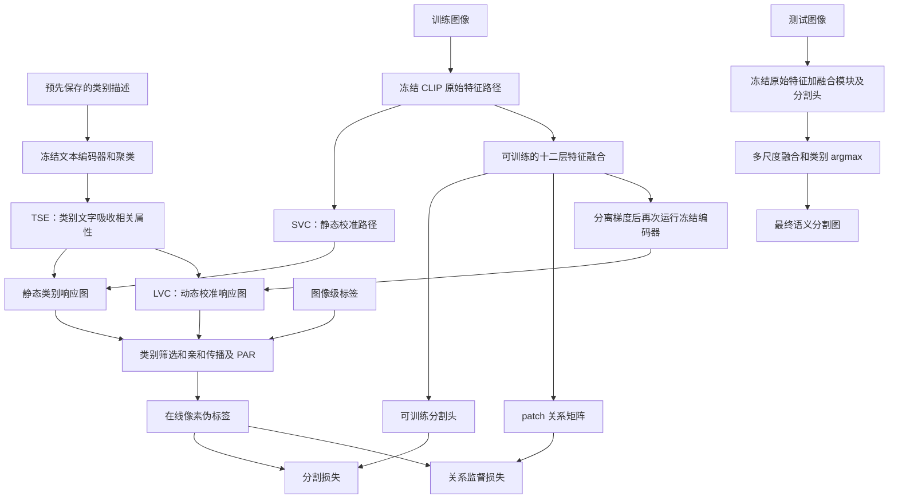
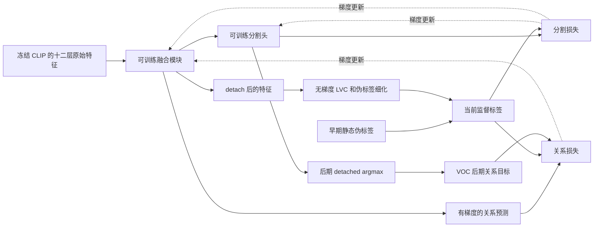

# 07 · ExCEL：Method 回顾

ExCEL 使用图像级类别标签，冻结 CLIP，用它生成像素伪标签，再训练一个轻量特征融合模块和分割头。它也提供不训练任务参数、直接生成定位图的路径。核心想法是：**让文字描述更适合认局部，让图像 patch 之间的信息传播更保留局部差异，再把两者对齐。**

下面以 CVPR 2025 论文和官方 ExCEL 仓库的 `2cd7f510d62793c76365268a2cc4da7cbe915e4d` 为依据。正文按该代码实际执行的顺序讲解，重点使用 VOC 默认配置；COCO 的阶段差异单独标明。文中的 CAM 指局部类别响应图，不需要由分类梯度计算 Grad-CAM。

## 先看整体流程



图中静态、动态响应图是分阶段选择的：VOC 前 14,000 次迭代使用静态图，之后才让学习到的关系参与伪标签生成。最终分割推理使用分割头输出，不需要知道测试图像里有哪些类别。

### 把原论文框架图接到上面的流程

结合下面的原图，把整体流程中的三条主线放回论文的位置。先读顶部文字分支，再读中部静态视觉路径，最后沿底部关系分支回到中部。


图 2，ExCEL 的 CVPR 2025 架构图。图片连同原始英文图注复用自原笔记的“3.2 框架总览”。[原笔记](../ExCEL/ExCEL_paper_notes.md)

**先看 (a) TSE 的文字箭头。** 左边从类别描述问题进入 LLM，再经带雪花的 Text Encoder 得到 Knowledge Base。中间 Clustering 将描述压成隐式属性，右边类别模板也经冻结文本编码器得到 $t_c$，向左搜索属性，再向下输出增强表示 $T_c$。这些箭头传递描述、嵌入和检索结果。对应下文第 1 节的预存 JSON、`attr_clustering` 与属性加权，训练初始化时准备好供各张图共用。

**再看 (b) SVC 的视觉箭头。** 飞机图片进入冻结图像编码器，得到 $F_l$；Intra Correlation 小框分别画出 q–q、k–k、v–v 的关系，经求和形成 $S^l_{attn}$。上方回环与“× N”表示校准跨若干层重复。最右边视觉特征 $P_s/P_d$ 与顶部来的 $T_c$ 做图文匹配，得到 CAM，再往下细化为 $M_s/M_d$。蓝色分布曲线和橙色偏移曲线用于说明关系改变了特征聚合，具体计算可接着读第 2、3 节的双路径与 `clip_feature_surgery`。

**最后看 (c) LVC 的回接箭头。** 冻结编码器的 $F_1$–$F_{12}$ 送入带火焰的 Adapter，形成 $F_d$，再得到 Dynamic Relation $R$。从 $R$ 向上进入 Adding Shifting Term 的箭头表示用学习关系修正视觉聚合。右侧掩码向左产生 Pixel Affinity，它与关系矩阵之间的 $\mathcal L_{div}$ 说明同类、异类像素配对提供训练约束。雪花、火焰分别标识冻结与可训练模块。

| 原图位置 | 接回本文的讲解与代码 |
|---|---|
| Adapter → $F_d$ | 第 4 节的十二层特征融合，对应 `decoder_fts_fuse`；融合特征同时送往分割头和关系计算 |
| $R$ → Adding Shifting Term | 第 5 节的 LVC，对应第二遍 `model(image, ex_feats=detached_f)`；关系只加入 patch 子矩阵 |
| CAMs → $M_s/M_d$ | 第 6 节的类别筛选、亲和传播、背景构造和 PAR，对应训练伪代码中的 `pseudo` |
| Pixel Affinity ↔ $\mathcal L_{div}$ | “关键损失”中的配对目标和关系损失，对应 `pair_targets` 与 `balanced_pair_loss` |

读图时再对齐三处执行细节。第一，原图的 $P_s/P_d$、$M_s/M_d$ 在一个位置合画静态和动态结果，VOC 实现按 14k 的阶段边界选择监督来源，24k 后还会切换关系目标。第二，图中的监督连线说明配对关系的约束方向，梯度由关系损失更新融合模块；向上回接的生成路径使用 detached 特征，并在无梯度环境中生成伪标签。第三，最终分割预测要接上正文中的分割头与 $\mathcal L_{seg}$，推理读取原始十二层特征的融合结果，具体入口见“训练好以后，究竟输出哪一张图”。

用猫和沙发这张图复述一次，顶部先准备类别文字，SVC 先提供可用的局部响应，伪标签给融合特征提供配对监督；融合特征学出的关系随后参与动态校准，更新后的伪标签继续训练分割头。这样，图里的文字、视觉、关系三条箭头就与前面的 Mermaid 及后面的两项损失接起来了。

## 顺着数据走一遍

### 1. 先准备文字知识，而不是每张图都问一次 GPT

假设图片里有一只猫、一张沙发。图像级标签只告诉模型“猫、沙发存在”，没有说猫在哪里。直接拿“猫”这个整体概念去匹配耳朵、毛发、爪子等局部，文字信息可能太粗。

TSE（Text Semantic Enrichment）先让 GPT-4 为每个前景类生成 20 条外观描述，并预先保存为 JSON。训练初始化读取这些描述，不在线调用大语言模型。`attr_clustering` 用普通 CLIP 文本编码器把每条描述编码为 512 维向量，逐条归一化，然后把**全数据集各类描述放到一起**做 K-means：VOC 聚成 112 个中心，COCO 聚成 224 个中心。

这些中心叫“隐式属性”，意思是它们是描述向量的聚合，不一定对应可以直接念出来的“圆眼睛”“金属外壳”。属性库跨类别共享，一类可以借用其他类描述中的相关信息。

接着，类别模板 `a clean origami {}.` 得到类别向量 $t_c$。它与所有属性中心 $a_j$ 做内积，排除最低分的一小部分，在剩余属性这一维做 softmax，再将属性加权和加回类别向量，最后沿 512 维通道重新归一化：

$$
T_c=\operatorname{normalize}\left(t_c+\sum_{j\in\mathcal N_c}
\operatorname{softmax}_{j}(t_c^\top a_j)a_j\right).
$$

这里按实现取属性补充系数为 1。`topK=0.9` 是大约保留九成属性：VOC 实际屏蔽最低的 `int((1-0.9)*112)=11` 个，保留 101 个，不能把它理解成“只选最相近的一个属性”。背景文本向量也参与后续响应处理，但不经过这个前景属性聚合过程。

### 2. 一张图在冻结 CLIP 中同时留下两种信息

VOC 训练默认裁剪成 $320\times320$，ViT-B/16 得到 $20\times20=400$ 个 patch，再加一个 CLS token。Transformer 内部通道数为 768；投影到图文共同空间后是 512 维。

SVC（Static Visual Calibration）处理最后五个 Transformer block。代码虽然调用 `reload_self_attn(layers=6)`，实际循环是 `range(1, layers)`，所以修改的是最后五层。每层从冻结投影中得到 $Q,K,V$，分别计算同一种表示内部的关系：

$$
S=\frac{1}{3}\left[
\operatorname{softmax}_{j}\left(QQ^\top/\sqrt{d_h}\right)+
\operatorname{softmax}_{j}\left(KK^\top/\sqrt{d_h}\right)+
\operatorname{softmax}_{j}\left(VV^\top/\sqrt{d_h}\right)
\right].
$$

$d_h$ 是每个注意力头的通道数；softmax 沿“被读取的 token”这一维归一化。直观上，让猫耳朵优先读取与自己表示相似的局部，减少所有位置都被混成相近整体语义的倾向。这是设计动机，并不保证猫的所有部位都会自动相连。

**源码保留了双路径。** 原始路径继续执行 $QK^\top$ 注意力和 FFN，下一层的 $Q,K,V$ 仍从这条原始路径计算；校准路径累加使用 $S$ 聚合出的残差，并跳过自己的 FFN。代码还先把校准注意力沿多头维求和，再广播用于各头的 $V$ 聚合。因此这里的实际实现比“把所有原注意力直接换成新注意力”更具体。

模型返回的十二层 `all_feats` 来自原始路径；最后输出的 patch 向量来自校准路径，CLS 则被原始路径的 CLS 替换。这解释了两个后续用途：校准后的向量负责生成响应图，十二层原始特征负责训练融合模块和分割头。

### 3. 响应图实际还经过一次类别共同成分消除

论文用“patch 与文字的余弦相似度，再做 min-max 归一化”描述 CAM。固定实现调用的是 `clip_feature_surgery`，不能把执行过程缩成一次矩阵乘法。

它先用 CLS 与所有前景、背景文本计算分数，在**类别维**做 softmax，并除以该维均值，得到每类的权重。再逐元素相乘 patch 与文字向量，乘上类别权重，减去类别维上的共同成分，最后沿通道求和。输出在**token 位置维**做 min-max 归一化，随后去掉 CLS 和背景文本通道，得到 VOC 的 `batch × 400 × 20` 前景响应。

一个实现细节也应保留：`generate_clip_fts` 对形状为 `batch × token × 512` 的视觉特征使用 `norm(dim=1)`，归一化沿 token 维，而不是逐 patch 的通道维。因此这里称它为“实现中的图文响应”更准确；不能断言该版本执行的每一步都是标准余弦相似度。这个操作以及响应图返回处的 `detach()` 均可在固定源码直接核对。

### 4. 从十二层特征学一份更适合分割的表示

`decoder_fts_fuse` 就是论文中轻量 adapter 的实际落点：十二层原始 patch 特征分别通过独立 MLP（线性层、ReLU、线性层），从 768 维映射到 256 维；沿通道拼接后，用 $1\times1$ 卷积压回 256 维，并施加 dropout。得到

$$F_d\in\mathbb R^{b\times256\times20\times20}.$$

这份 $F_d$ 有两个用途。一路进入三层、八头的 Transformer 分割头，再经 $1\times1$ 卷积输出 `batch × 21 × 20 × 20` 分割 logits。另一路沿通道归一化，计算所有 patch 对之间的相似度 $C_{ij}$，得到 `batch × 400 × 400` 关系矩阵。

关系预测用于训练时采用

$$\widehat R_{ij}=\operatorname{sigmoid}\left(3(C_{ij}-\overline C)\right).$$

这里的 $\overline C$ 对应代码无维度参数的 `torch.mean`，是当前整个相似度张量的均值。这个分支学习“两个位置应不应该属于同一类”，本身不直接输出猫、沙发等具体类别。

### 5. LVC 用学到的关系再校准一次，但这次生成标签不反传

VOC 当 `n_iter >= 14000` 后，训练循环把刚才的 $F_d$ 分离梯度，以 `ex_feats` 参数再次调用冻结 CLIP。LVC（Learnable Visual Calibration）用同一份 patch 相似度，先中心化、乘 3，再将负值置为负无穷，沿目标 patch 维 softmax：

$$
R_{ij}=\begin{cases}3(C_{ij}-\overline C),&C_{ij}\ge\overline C,\\-\infty,&\text{否则},\end{cases}
\qquad L_{ij}=S_{ij}+\operatorname{softmax}_{j}(R_{ij}).
$$

新增关系只加进 patch-to-patch 子矩阵，不加到 CLS 行列；相加后没有额外重新归一化。它让冻结的 $V$ 按学习到的关系再聚合一次，形成动态响应图。例如猫的躯干与猫耳朵如果被判为同类，就有机会更充分交换信息。

“可学习”指关系来自可训练融合特征，**不是把梯度穿过第二次 CLIP 和伪标签生成器来训练 CLIP**。返回的 `fts_diver` 已 `detach()`，`cure_attr_map` 包在 `no_grad()` 中，视觉编码器本身也不记录梯度。融合模块由下文的关系损失与分割损失更新，更新后的特征再影响下一轮标签。

### 6. 响应图要经过筛选和传播，才成为真正监督

对猫、沙发这张图片，只保留图像级标签允许的两个类别。`refine_cams_with_aff` 取最后六层原始注意力的 patch 子矩阵做传播；这里“六层传播”与前面“五层 SVC”是两个不同设置。

静态阶段对六层注意力取平均。动态阶段先比较各层与预测关系的差异和，筛选差异不高于均值的层，再将平均结果与预测关系逐元素相乘。随后反复做行列归一化、对称化，并将矩阵与自身相乘一次，形成传播矩阵。

每个类别响应图以其峰值的 0.79 为阈值找轮廓包围框，框区域作为传播源位置的 mask，再用传播矩阵乘响应图。它不是把人工框作为额外监督，也不是对框内每个像素直接宣布类别。COCO 对应阈值为 0.88。

传播结果归一化、上采样后，构造背景分数 $1-\max_c M_c$。随后 PAR 根据图像颜色差异和空间邻域传播这些分数，使用 20 次迭代及 `[1,2,4,8,12,24]` 六种 dilation。最后沿类别维 argmax，将局部类别编号映射回数据集类别 ID，产生在线伪标签 $Y$。

训练主路径使用这套“自适应背景分数 + PAR”，并没有使用参数列表里的 0.7/0.25 高低阈值制造一个中间 ignore 区。脚本里另算的 `diver_pseudo_labels` 主要用于可视化，实际损失目标是 `aff_pseudos` 或后期分割预测。VOC loader 确实读取像素标注以便同步变换和日志展示，但该训练循环的两项损失没有拿它作监督。

## 关键损失：谁监督谁，梯度到哪里

分割损失把伪标签背景像素与前景像素的交叉熵分别求平均，再等权相加：

$$\mathcal L_{seg}=\tfrac12\operatorname{mean}_{Y=0}\mathrm{CE}
+\tfrac12\operatorname{mean}_{Y>0,\,Y\ne255}\mathrm{CE}.$$

这避免背景像素数量很多时完全淹没前景。`ignore_index=255` 不参与统计；分母加了小量防止空集合除零。梯度经过分割头回到特征融合模块，停在冻结 CLIP 输出。

关系损失先把像素标签最近邻缩小到 patch 网格：同类 patch 对记 1，异类记 0，超出半径 8 的方形邻域或涉及 ignore 标签的配对记 255。该文件有两个同名函数，Python 实际使用最后一个定义；这个有效版本**保留对角线自配对**。损失为

$$
\mathcal L_{div}=\frac{1}{2}\frac{\sum_{(i,j)\in\mathcal P}(1-\widehat R_{ij})}{|\mathcal P|+1}
+\frac{1}{2}\frac{\sum_{(i,j)\in\mathcal N}\widehat R_{ij}}{|\mathcal N|+1}.
$$

同类关系往 1 拉，异类往 0 压，正负配对分开平均。这是线性形式的亲和约束，不是二元交叉熵，也不是无条件地把所有特征推远。总损失是 $\mathcal L_{seg}+0.1\mathcal L_{div}$。

官方训练循环还包含论文总览没有展开的阶段安排，以下迭代数均指从 0 开始的 `n_iter`：

| 配置与阶段 | 生成分割监督的响应图 | 关系损失的标签来源 |
|---|---|---|
| VOC，0–13,999 | 静态 SVC 图，经传播和 PAR | 当前伪标签 |
| VOC，14,000–23,999 | LVC 动态图，经关系辅助传播和 PAR | 当前动态伪标签 |
| VOC，24,000–29,999 | 同上 | 当前分割 logits 的 detached argmax |
| COCO，0–29,999 | 静态 SVC 图 | 当前伪标签 |
| COCO，30,000–99,999 | LVC 动态图 | 当前动态伪标签 |

因此，源码里的关系教师不是训练全程固定的 SVC 标签。先让静态知识建立可用的融合特征，再逐步让当前模型参与监督更新，是理解实现的关键。



图中“当前伪标签”和“后期关系目标”按阶段切换。CLIP 不接收这两项损失的更新；文本属性库也不随训练优化。代码参数组仅收集 `decoder_fts_fuse` 和 `decoder`。优化器参数组将它们的学习率设为 `args.lr * 10`，即默认基础学习率 `1e-4` 对应组学习率 `1e-3`，随后应用 warmup/poly 调度。

## 对照官方代码

以下是保留控制流的等价伪代码，不是可以直接运行的源码摘录。

第一段对应 [model/model_excel.py：ExCEL_model.forward](https://github.com/zwyang6/ExCEL/blob/2cd7f510d62793c76365268a2cc4da7cbe915e4d/model/model_excel.py)。注意融合特征同时承担分割与关系学习，动态生成分支只返回响应图。

```python
if ex_feats is not None:
    calibrated = frozen_clip(image, ex_feats=ex_feats)
    return feature_surgery(calibrated, enriched_text).detach()

calibrated, original_attention, original_features = frozen_clip(image)
static_maps = feature_surgery(calibrated, enriched_text).detach()
fused = fuse_12_layers(original_features)
seg_logits = decoder(fused)
cosine = pairwise_cosine_along_channels(fused)
relation = sigmoid(3 * (cosine - cosine.mean()))
return seg_logits, fused.detach(), static_maps, original_attention, relation
```

第二段对应 [scripts/train_voc.py：train](https://github.com/zwyang6/ExCEL/blob/2cd7f510d62793c76365268a2cc4da7cbe915e4d/scripts/train_voc.py)、[utils/affutils.py](https://github.com/zwyang6/ExCEL/blob/2cd7f510d62793c76365268a2cc4da7cbe915e4d/utils/affutils.py) 和 [model/losses.py](https://github.com/zwyang6/ExCEL/blob/2cd7f510d62793c76365268a2cc4da7cbe915e4d/model/losses.py)。真正的训练入口是 `run_train.sh → scripts/train_voc.py → build_network → ExCEL_model`；该 shell 文件已把 VOC 脚本和设备写在文件内，第一个参数只赋给实验描述。

```python
seg, detached_f, maps, clip_attn, relation = model(image)
if step >= 14000:
    maps = no_grad_second_pass(image, detached_f)
pseudo = refine_per_present_class(maps, clip_attn, relation_if_enabled)
pseudo = add_background_then_PAR(pseudo, image)

source = pseudo if step < 24000 else seg.detach().argmax(dim=1)
pair_targets = same_class_pairs(source, radius=8, ignore=255)
loss = balanced_foreground_background_CE(seg, pseudo)
loss += 0.1 * balanced_pair_loss(relation, pair_targets)
loss.backward()  # 更新融合模块和分割头
```

第三段对应 [clip/clip_surgery_model.py：Attention.forward、ResidualAttentionBlock.forward](https://github.com/zwyang6/ExCEL/blob/2cd7f510d62793c76365268a2cc4da7cbe915e4d/clip/clip_surgery_model.py)。它说明 LVC 改的是冻结值向量的聚合方式，原始路径仍然保留。

```python
q, k, v = frozen_qkv(original_path)
original_attention = softmax(q @ k.T / sqrt(head_dim), dim=-1)
static = (softmax(q @ q.T / sqrt(head_dim), dim=-1)
        + softmax(k @ k.T / sqrt(head_dim), dim=-1)
        + softmax(v @ v.T / sqrt(head_dim), dim=-1)) / 3
if detached_f is not None:
    r = 3 * (pairwise_cosine(detached_f) - global_mean_similarity)
    r[r < 0] = -inf
    static[..., 1:, 1:] += softmax(r, dim=-1)
calibrated_attention = static.sum(dim=head_axis, keepdim=True)
calibrated_path += output_projection(calibrated_attention @ v)
original_path = ordinary_attention_and_FFN(original_path)
```

## 训练好以后，究竟输出哪一张图

需要分清两个入口。

**定位图评估**走 `infer_lam.sh → tools/infer_lam.py`。`training_free=True` 时直接使用 TSE+SVC 的静态响应，并根据图像级标签筛选类别，然后做传播、背景构造和 PAR。学习版定位评估会用训练好的融合特征进行动态校准，并融合原图与水平翻转响应。它评估的是伪标签/定位能力，不等于无标签条件下的最终分割。

该版本 `tools/infer_lam.py` 在判断 `training_free` 之前就执行 `torch.load(model_path)`，只是免训练模式不把这些权重加载到模型。因此“方法不需要任务训练”与“发布脚本完全不要求检查点文件存在”不能混为一谈。这里只做源码阅读，没有修改或运行脚本。

**最终分割推理**走 `infer_seg_voc.sh → tools/infer_seg_voc.py → model(image)[0]`。读取训练后的融合模块和分割头权重，用它们输出 21 类 logits；不把测试图像的类别标签拿来过滤预测，也不执行带 `ex_feats` 的第二遍动态校准。当前 `forward` 仍会顺带计算静态响应和关系，但分割输出只依赖原始十二层特征、融合模块和分割头。

VOC 默认以 320 为基准，综合 0.7、1.0、1.2、1.5 四个尺度，插值回目标大小后平均 logits，再沿类别维 argmax。该文件对基准尺度只取未翻转结果，其他尺度才做原图/翻转均值；COCO 文件则在基准尺度也融合翻转结果。DenseCRF 是单独开关：VOC 默认关闭，COCO 推理文件默认开启。若启用，先在类别维 softmax，再用图像引导 CRF 后处理。

## 回顾时抓住这几点

1. **TSE 改文字侧的内容。** 先离线准备描述，再把跨类描述聚成属性，类别向量检索并吸收相关属性；不是每张图片生成一段新描述。
2. **SVC 改冻结特征的读取方式。** 同空间相关性保留局部差异；实际代码保留原始与校准双路径，分割头读取原始路径的十二层特征。
3. **LVC 学的是关系，再用关系生成更好的监督。** 融合特征受到两项损失训练；再次运行 CLIP 和生成伪标签都停止梯度。
4. **论文框架要连上实现中的阶段切换。** VOC 14k 开启动态标签，24k 后关系目标换成分割预测；COCO 没有同样的 24k 切换。
5. **最终产品是分割头的预测。** 响应图负责提供训练监督，部署预测并不需要图像级类别标签。

可以用三个问题检查理解：猫的属性从哪里来？来自预存描述的全数据集聚类。关系损失会更新 CLIP 吗？不会，只更新融合特征对应的可训练模块。测试时一定要再生成动态伪标签吗？最终分割入口不需要。

## 资料与实现版本

本回顾独立读取了原论文方法部分、架构图和下列官方源码，并核对了默认分支与提交历史；没有运行训练、加载权重或复现实验数值。代码固定在 2025-06-21 的提交 `2cd7f510d62793c76365268a2cc4da7cbe915e4d`；核查时仓库仅列出 `main` 分支，该提交对应 CVPR 工作的公开实现，不是借用后续相关论文主分支。

| 资料 | 本文采用的依据 |
|---|---|
| [CVPR 2025 原论文](https://openaccess.thecvf.com/content/CVPR2025/papers/Yang_Exploring_CLIPs_Dense_Knowledge_for_Weakly_Supervised_Semantic_Segmentation_CVPR_2025_paper.pdf) | 第 3 节、图 2、式 1–12；方法与训练目标 |
| [官方仓库固定提交](https://github.com/zwyang6/ExCEL/tree/2cd7f510d62793c76365268a2cc4da7cbe915e4d) | 代码版本及完整目录；并检查仓库提交历史 |
| [run_train.sh](https://github.com/zwyang6/ExCEL/blob/2cd7f510d62793c76365268a2cc4da7cbe915e4d/run_train.sh)、[network_engine.py](https://github.com/zwyang6/ExCEL/blob/2cd7f510d62793c76365268a2cc4da7cbe915e4d/engine/network_engine.py)、[train_coco.py](https://github.com/zwyang6/ExCEL/blob/2cd7f510d62793c76365268a2cc4da7cbe915e4d/scripts/train_coco.py) | 入口、构建、COCO 阶段差异；VOC 循环已在正文链接 |
| [load_attr.py](https://github.com/zwyang6/ExCEL/blob/2cd7f510d62793c76365268a2cc4da7cbe915e4d/model/load_attr.py)、[clip.py](https://github.com/zwyang6/ExCEL/blob/2cd7f510d62793c76365268a2cc4da7cbe915e4d/clip/clip.py) | 属性聚类、聚合、实际响应计算和归一化维度 |
| [segformer_head.py](https://github.com/zwyang6/ExCEL/blob/2cd7f510d62793c76365268a2cc4da7cbe915e4d/model/segformer_head.py)、[TransDecoder.py](https://github.com/zwyang6/ExCEL/blob/2cd7f510d62793c76365268a2cc4da7cbe915e4d/model/decoder/TransDecoder.py) | 十二层特征融合、三层分割头 |
| [camutils.py](https://github.com/zwyang6/ExCEL/blob/2cd7f510d62793c76365268a2cc4da7cbe915e4d/utils/camutils.py)、[PAR.py](https://github.com/zwyang6/ExCEL/blob/2cd7f510d62793c76365268a2cc4da7cbe915e4d/utils/PAR.py) | 停止梯度、有效关系标签函数、局部细化 |
| [voc.py](https://github.com/zwyang6/ExCEL/blob/2cd7f510d62793c76365268a2cc4da7cbe915e4d/datasets/voc.py)、[optimizer_engine.py](https://github.com/zwyang6/ExCEL/blob/2cd7f510d62793c76365268a2cc4da7cbe915e4d/engine/optimizer_engine.py) | 训练输入及监督用途、优化参数组 |
| [infer_lam.py](https://github.com/zwyang6/ExCEL/blob/2cd7f510d62793c76365268a2cc4da7cbe915e4d/tools/infer_lam.py)、[infer_seg_voc.py](https://github.com/zwyang6/ExCEL/blob/2cd7f510d62793c76365268a2cc4da7cbe915e4d/tools/infer_seg_voc.py)、[infer_seg_coco.py](https://github.com/zwyang6/ExCEL/blob/2cd7f510d62793c76365268a2cc4da7cbe915e4d/tools/infer_seg_coco.py) | 定位与分割推理的不同调用链、多尺度及后处理 |

**期刊扩展关系核查：未确认。** 已核查同作者相关工作 [DiCLIP 预印本](https://arxiv.org/abs/2605.04593)、[官方 README](https://github.com/zwyang6/DiCLIP) 及 [出版记录](https://pubmed.ncbi.nlm.nih.gov/42139125/)。DiCLIP 确实发表于 *IEEE Transactions on Image Processing*，2026 年，第 35 卷，5641–5656 页，DOI 为 [10.1109/TIP.2026.3692055](https://doi.org/10.1109/TIP.2026.3692055)。其官方仓库声明代码建立在 ExCEL 等实现之上，但已读原文和官方说明未明确声明它是 ExCEL 的期刊扩展。代码继承不足以证明同工作扩展关系，因此本文不将 DiCLIP 列为 ExCEL 的“期刊版”，也不将它的流程混入上述会议版解释。
