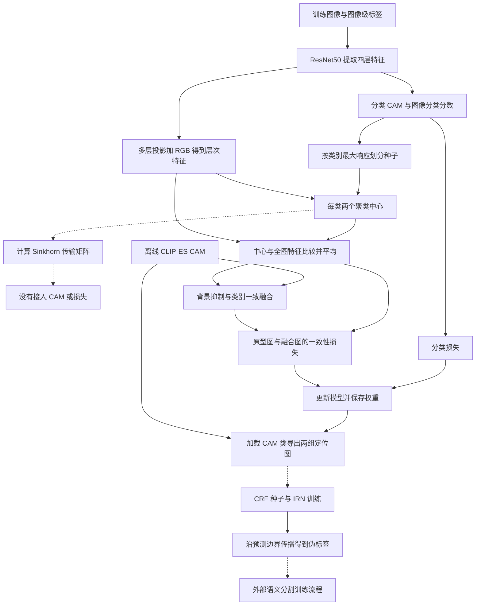
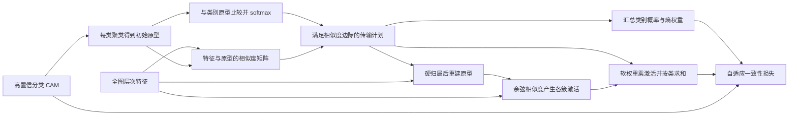

# 08 · POT：Method 回顾

POT 使用图像级类别标签学习定位图，再把定位图转成伪标签，供后续语义分割网络训练。会议论文的核心想法是：**同一种物体可以有几种外观，先为它建立多个代表，再用最优传输安排每个位置归谁负责**。公开的 ResNet50 实现还读取预先生成的 CLIP-ES CAM；这些 CAM 是固定输入，不会在 POT 训练中更新 CLIP。

需要先划清资料边界：作者在官方 issue 中明确说明，CVPR 版本代码没有提供，仓库当时发布的是不完整版本。此次读到的最新提交仍能验证这个边界：Sinkhorn 被调用，但其传输矩阵没有进入返回的 CAM 或训练损失。因此，下面先沿**实际公开实现**走一遍，再独立解释论文完整的 OT 机制；不能把两条流程拼成一个已经实现的系统。[作者说明](https://github.com/jianwang91/POT/issues/2#issuecomment-3043261049)

## 先看整体流程

下图对应固定提交 `60fd4ce4934c07744d0afe7426fd8aae94860f56`，省略没有参与输出的临时变量。实线是公开实现中的数据依赖；虚线表示后续独立阶段或没有接回输出的计算。



`run_voc.sh` 实际启用的是训练、生成 CAM、评估 CAM 三条命令；IRN 的三条命令处于注释状态。它没有自动完成最后的分割网络训练。[入口脚本](https://github.com/jianwang91/POT/blob/60fd4ce4934c07744d0afe7426fd8aae94860f56/POT/run_voc.sh)

## 顺着数据走一遍：公开实现到底做了什么

### 1. 一张“人骑自行车”的图，带着两种监督信息进来

VOC 训练数据集返回图像、20 维图像级标签和 21 通道有效区域掩码。假设标签只标记“人、自行车”，其余前景类别会被掩码置零；背景通道保留。这里的 21 是背景加 20 类，不能理解成每张图真的存在 21 种物体。

当前 VOC 入口把图像直接缩放到 `512×512`，有效掩码下采样到 `32×32`。与此同时，程序按图像名称读取 CLIP-ES 的 `.npy` 文件，用 `keys` 把 `attn_highres` 放回对应的 20 个前景通道，再缩放到相同的低分辨率。其余类别填零。因此模型除了知道“图中有什么”，还拿到了一份离线定位提示。[训练入口与数据读取](https://github.com/jianwang91/POT/blob/60fd4ce4934c07744d0afe7426fd8aae94860f56/POT/train_resnet50_POT.py)、[数据集实现](https://github.com/jianwang91/POT/blob/60fd4ce4934c07744d0afe7426fd8aae94860f56/POT/data/data_voc.py)

### 2. 一套特征负责分类，另一套负责“哪里长得像”

ResNet50 的四层输出通道为 256、512、1024、2048。对 `512×512` 输入，空间尺寸依次是 `128×128`、`64×64`、`32×32`、`32×32`。最后一层接一个 `1×1` 分类卷积，得到 20 张前景 CAM；对空间维做全局平均池化，得到图像分类分数。

原型分支则把每一层特征与缩放后的 RGB 图像拼接，再经 `1×1` 卷积投影到 128、128、256、256 通道。每层先沿**特征通道维**做 L2 归一化，再统一到第三层的空间尺寸，最后拼成

$$
F\in\mathbb R^{B\times768\times32\times32}.
$$

它把浅层颜色、纹理和深层语义放到同一个位置描述中。人脸和衣服不一定在最后一层像得很近，多层信息让原型比较拥有更丰富的依据；这是一种设计直觉，不保证衣服一定会被找全。

分类 CAM 先 ReLU，再分别除以每个通道的空间最大值。背景图由 `1 - 最大前景响应` 得到，随后乘有效类别掩码。**这里没有类别 softmax**：某个位置可以对几类同时响应，后面再通过 `argmax` 选种子归属。[模型定义与 forward](https://github.com/jianwang91/POT/blob/60fd4ce4934c07744d0afe7426fd8aae94860f56/POT/network/resnet50_POT.py)

### 3. 公开实现按最大响应分组，再在每组里做两个聚类

`get_seed_aff_x4` 对含背景的分类 CAM 沿类别维取 `argmax`，形成 one-hot 种子，然后乘类别掩码。也就是说，当前实现没有先用论文的 `0.7` 置信阈值筛掉不可靠位置，而是让位置先“投票给响应最高的一类”；不存在类别的种子随后被清掉。

对每张图、每个类别，取出种子区域中的 768 维层次特征，调用 cosine k-means，`num_clusters=2`。如果该类不足两个位置，就跳过这一类。聚类中心仅由当前图像形成，不是可学习参数表，也不是跨图像维护的原型记忆库。

接着用两个中心分别与**整张特征图**做余弦相似度，得到两张 `H×W` 图，再直接平均。这一步的含义是：“这个位置与该类两个代表外观平均有多接近？”公开实现中，平均图被广播存入两个 cluster 槽位，最后再对槽位平均；其有效结果仍是两个中心相似度图的算术平均。之后乘类别掩码并做逐通道空间最大值归一化。

因此，人类的两个中心可能分别偏向皮肤与衣物，但输出并没有通过 OT 决定衣服位置究竟归哪个中心，也没有依据重新分配的像素更新中心。[种子、聚类与 CAM 返回路径](https://github.com/jianwang91/POT/blob/60fd4ce4934c07744d0afe7426fd8aae94860f56/POT/network/resnet50_POT.py)

### 4. Sinkhorn 在这里确实计算了，但没有驱动结果

代码把全图特征和聚类中心分别归一化，计算两两相似度，再以 `exp(-(1-sim)/0.1)` 构造正矩阵。Sinkhorn 用均匀的像素边际和均匀的两个原型边际交替缩放，最多 100 次，检查缩放向量变化是否小于 `1e-2`。

关键在下一步：得到的 `T` 只被检查 NaN、搬到 GPU、重排维度，没有乘到 `all_cam_maps`，没有拿去重新分配特征，也没有返回给训练入口。`cam_mask` 同样只计算而未使用。因而不能把函数名中的 OT 理解为已经实现了论文的相似度边际、重新分配、重建原型和加权损失。

这里也不将 `view(M, 2, n_cls)` 当作经过验证的“逐类 OT”实现：它来自类别与原型维展平后的相似度，布局解释需要额外核实。不过在这份代码中，正常返回路径不依赖 `T` 的数值，本文不据此延伸一个实际不存在的后续算法。

### 5. 真正参与输出的是 CLIP-ES 引导的抑制与融合

把聚类相似度图记作 `cam_class`，把外部 CAM 记作 `norm_clip`。当前训练 forward 继续做几件很具体的事：

1. 用 CLIP 背景图抑制原型前景，系数是 0.5，并重新计算原型背景。
2. 对 CLIP 前景减去 0.15 倍 CLIP 背景，再重建 CLIP 背景；随后做跨通道响应抑制 `ReLU(1.2A - 0.2∑A)`，并按通道归一化。
3. 沿宽度维计算均值，清掉低于该行均值一半的位置。这里的 `mean(dim=3)` 是逐行统计，不是整幅图的空间均值。
4. 分别取两份 CAM 的类别赢家。赢家相同时，给 CLIP 图加上 0.2 倍原型图；不同时保留 CLIP 图；最后将大于 1 的值截为 1，得到 `cam_add`。

以骑车图为例：原型分支把某块衣服判断为人，CLIP 也判断为人，就允许这块区域增强；两边争执是“人”还是“自行车”，当前规则便更依赖 CLIP。注意比较得到的是每个像素一个真假值，随后广播到全部类别通道，并非只增加赢家那一个通道。[融合逻辑](https://github.com/jianwang91/POT/blob/60fd4ce4934c07744d0afe7426fd8aae94860f56/POT/network/resnet50_POT.py)

### 6. 损失和梯度：谁在学，谁只是固定材料

训练入口把 `cam_class` 和 `cam_add` 再乘有效掩码、按通道归一化，优化

$$
\mathcal L_{\rm released}
=0.5\mathcal L_{\rm cls}
+10\,\operatorname{mean}\left|A_{\rm proto}-A_{\rm fused}\right|.
$$

分类损失是图像级多标签 soft-margin loss；一致性损失是批次、类别、空间上的普通平均绝对差。这里没有从 OT 概率计算的熵权重，也没有按有效像素数重新归一化的分母。有效掩码屏蔽无效类别/区域，与下游伪标签的 `255=ignore` 不是同一个东西。

公开模型冻结最前面的 `conv1` 和 `bn1` 参数；ResNet 使用固定统计量的 BatchNorm。当前 forward 没有把四层特征统一 `detach`，分类头、多层投影和其余骨干处于训练图中。离线 CLIP 数组无梯度，`argmax` 形成的离散归属没有可微分决策梯度，Sinkhorn 显式在 `no_grad` 中执行。原型与全图特征比较的连续部分可以把梯度传回特征；外部 k-means 包的中心计算梯度细节未在仓库内固定，不进一步声称其反向算法。

`cam_add` 包含当前模型生成的原型图，而且没有整体 `detach`，所以它不是完全固定的教师目标。与它做一致性，是同一步两条相关计算分支之间的约束。默认训练 6 个 epoch、batch size 16，骨干与新增层学习率分别为 0.1 和 1.0；这些是当前入口配置，不能据此声称已经复现会议结果。[损失与优化调用](https://github.com/jianwang91/POT/blob/60fd4ce4934c07744d0afe7426fd8aae94860f56/POT/train_resnet50_POT.py)

## 生成 CAM、伪标签与最终推理不是同一步

`make_cam.py` 加载 checkpoint，调用模型的 `CAM.forward`。数据集准备尺度 `1.0、0.5、1.5、2.0`，每个尺度有原图与水平翻转图；模型先恢复翻转方向，把分类图和层次特征相加，再提取原型图。因此它不是对原图单独聚类后再平均最终结果。

导出时的融合规则与训练 forward 也不同：它保留 0.5 倍背景抑制和跨通道抑制，但没有训练中的 0.15 背景扣减及逐行阈值；类别一致处添加原型图的系数改为 0.3。返回值包含原型图和融合图两项。[CAM.forward](https://github.com/jianwang91/POT/blob/60fd4ce4934c07744d0afe7426fd8aae94860f56/POT/network/resnet50_POT.py)

保存结果时，`IS_CAM` 虽然先收集所有尺度，随后却显式只保留第一个尺度的融合结果。`IS_CAM1` 才把各尺度原型图上采样后相加、归一化，并对前景再加一次自身、给背景加 0.4。文件还保存 `keys`，把局部通道对应回 VOC 类别。评估脚本使用 `IS_CAM + IS_CAM1`，下游 IRN 脚本读取的则是 `IS_CAM1`；不要把这些同名近似的数组全部称作“最终 POT CAM”。[导出脚本](https://github.com/jianwang91/POT/blob/60fd4ce4934c07744d0afe7426fd8aae94860f56/POT/make_cam.py)、[评估脚本](https://github.com/jianwang91/POT/blob/60fd4ce4934c07744d0afe7426fd8aae94860f56/POT/eval_cam.py)

后续可见调用链是：`cam2ir.py` 对 `IS_CAM1` 做类别 argmax 与 CRF，生成 IRN 监督；`train_irn.py` 训练局部关系和位移；`make_seg_labels.py` 调用 `EdgeDisplacement` 得到边界，用 `propagate_to_edge` 传播 CAM，再上采样、argmax、映射 `keys`，写出 PNG 伪标签。IRN 阶段固定骨干特征，只训练边界和位移头，亲和监督排除标签值不小于 21 的位置。当前 `cam2ir.py` 两个 CRF 分支使用相同输入，没有实现常见的高低背景阈值差异，不能默认它自动产生了大片不确定忽略区。[IRN 训练](https://github.com/jianwang91/POT/blob/60fd4ce4934c07744d0afe7426fd8aae94860f56/POT/train_irn.py)、[伪标签生成](https://github.com/jianwang91/POT/blob/60fd4ce4934c07744d0afe7426fd8aae94860f56/POT/make_seg_labels.py)

最终语义分割器的训练被 README 交给外部 DeepLab/分割代码库，本仓库没有它引用的 `test.sh`。因此这里能够确认的是“图像级监督 → 定位图 → IRN 伪标签”的静态代码链；最终分割器具体训练和测试调用不能从 POT 仓库补写出来。

## 再理解会议论文完整的 OT 机制

这一节依据原论文第 3.1–3.4 节，描述**论文算法**，不是宣称上述源码已经实现。它保留了“分类 CAM 提供起点、多原型寻找完整区域”的共同框架，但对原型的分配和使用作了更完整的设计。

### 对着原论文 Figure 2 读三阶段与两条监督线

结合下面原论文框架图，把前面的公开实现与接下来的论文机制对应起来。蓝框先产生初始簇，粉框安排全图特征归属，绿框用更新后的原型得到更完整的 CAM。


图为 CVPR 2025 POT 的 Figure 2，复用原笔记中的框架图。右侧 Feature ACTIVATION 用一个类别演示多个簇的处理。图号与三阶段说明见原笔记“3. 方法”及图注。[原笔记](<../POT/POT_paper_notes.md>)

**顺着企鹅图读一遍。** 输入图像先过 Encoder，随后分成两路。上路经 Classifier 得到 Classifier CAM，用高响应位置确定各类初始分组。下路把编码特征送往分组和分配阶段。蓝框中的圆点、三角形代表特征，实心星形代表簇原型，六边形代表类别原型。背景也占一行，每个出现类别各有多个簇。

粉框里，全部位置组成传输表的 $HW$ 行，全部类别的簇组成 $(J+1)K$ 列。右侧带圈的 S 表示余弦相似度，比较簇原型与所属类别原型，再经 Eq. (5) 给出列边际。图中表格上方的绿色柱子对应原型接收的质量，左边蓝色短条对应各位置给出的质量。两组约束一起决定 Transport plan T，后文“从可靠区域找代表，再把不可靠区域分给它们”会展开这一步。

从粉框向右的粗箭头写着 Allocate & Reweight，可以沿两条用途理解。绿框底部 Eq. (7) 先把特征分配进簇，用全部分配结果重新求带黑边的星形原型，再逐簇 Activate。上部 Eq. (10) 用传输权重乘各簇激活，Eq. (11) 将同类结果相加，输出右上角更完整的企鹅 CAM。“同一张传输表做三件事”及其 Mermaid 分别把重建、加权和损失分支画开。

| 图中位置 | 对应本文已有讲解 | 按当前固定代码阅读 |
|---|---|---|
| Encoder → Classifier CAM | 步骤 2 的四层特征与分类图 | `Net.forward` 提取特征，分类头得到类别分数 |
| 蓝框 Feature PARTITIONING | 可靠区域与初始原型 | `get_seed_aff_x4` 采用类别赢家分组，每类两个中心 |
| 粉框 Transport plan T | 相似度边际与全图分配 | 步骤 4 已核实 `T` 的使用范围，实际 CAM 路径见步骤 3 |
| 绿框 Activate / Reweight / Combine | 重建原型与加权 CAM 公式 | 当前返回的是初始中心的余弦图平均，后接步骤 5 的 CLIP-ES 融合 |

**监督线和阶段也要一起看。** 图顶端左侧损失接分类 CAM，中间一致性损失连接分类 CAM 与右上角的原型结果，对应论文的图像级分类监督与 OT 加权一致性约束。按当前实现阅读这张图时，应接回步骤 6 的实际目标，比较 `cam_class` 与 `cam_add`。离线 CLIP-ES 数组在首张实现 Mermaid 中单独进入融合节点，原论文这张总览则集中展示 POT 三阶段。

读图时留意三处。实心星形与黑边星形分别标出更新前后的原型。粉框的硬分配和绿框的软加权各有用途，复述时需要都保留。图内输出到 CAM 为止，后面的 CRF、IRN、PNG 伪标签与最终分割器接在本文的导出章节。图的箭头表达数据关系，具体冻结参数与梯度范围以步骤 6 已核实的实现为准。

用企鹅例子回忆，就是先从高响应区域找几个外观代表，再按全图分配更新这些代表，最后把各簇对企鹅的激活加权合起来。对照公开代码时，记住表中每一行的实际输出去向，就能把图、公式与伪代码接上。

### 从可靠区域找代表，再把不可靠区域分给它们

论文先用阈值 $\tau=0.7$ 选择高响应特征，在每个出现类别及背景内分成 $K=3$ 簇；聚类掩码作用于融合后的层次特征，得到多个初始原型。人脸、上衣、裤子只是帮助理解的例子，k-means 并没有人体部位标签，不保证三个簇有这样的语义。

设一张图有 $J$ 个前景类别，展平后有 $M=HW$ 个位置、$N=(J+1)K$ 个原型。两两余弦相似度构成 $S\in\mathbb R^{M\times N}$。如果每个位置独立找最近原型，可能都挤向最显眼的人脸中心；OT 则同时考虑整张图的分配，还要求每个原型承接一定的总质量。

POT 没让所有原型平均分配：先比较每个簇原型与其所属类别的 CAM 原型，再把全部“类别×原型”相似度展平做 softmax，得到边际 $x_j$。这是**在当前图全部候选原型上归一化**，不是对每个像素做分类 softmax，也不是分别让每类内部概率和为 1。更接近类别总体代表的原型获得较大的接收份额。

$$
T^*=\arg\max_T\sum_{i,j}T_{ij}S_{ij},\qquad
T\mathbf1_N=\tfrac1M\mathbf1_M,\quad
T^\top\mathbf1_M=x.
$$

通俗地说，每个像素都拿出相同的一小份质量，原型的“容量”由相似度决定，在满足容量时尽量把质量运给相似的代表。Sinkhorn 是求这个带边际约束分配的高效办法，不能把它简化成“对余弦分数 softmax”。

### 同一张传输表做三件事

论文随后用 `argmax` 为每个位置选原型，把**全部分配进来的特征**重新汇总为原型 $P_j^*$，再以它们计算非负余弦激活 $A_{ij}$。最初只用可靠种子，现在把较弱响应的衣服区域也吸收进来，中心就可能更能代表整片衣物。

最终类别图是传输权重加权的各簇激活之和：

$$
A_{i,c}^{*}=\sum_{k=1}^{K}T^{*}_{i,c,k}
\operatorname{ReLU}\!\left(\cos(F_i,P_{c,k}^{*})\right).
$$

这里包含两种用法：重建原型用硬归属；合成 CAM 仍用软传输权重。不能因为前面取过 `argmax`，就认为后面的传输表已经完全变成 one-hot。



第三种用途是控制一致性损失的强弱：把一个类别的 $K$ 个传输值加起来，形成该位置属于该类的分数；用二元熵衡量不确定性。接近 0 或 1 时熵低，约束更强；接近 0.5 时熵高，约束更弱。论文使用图像级标签屏蔽不存在类别，并以类别数相关因子缩放熵，再加权原型 CAM 与分类 CAM 的 L1 差异；总目标为 $\mathcal L_{\rm cls}+3\mathcal L_{\rm otcon}$。

有一个理解概率时必须保留的尺度问题：论文 OT 约束令每行和为 $1/M$，而讨论分类概率与二元熵时需要每行和为 1。把传输质量理解为条件分配概率，应先考虑 $q_{ij}=MT_{ij}$ 或等价行归一化。论文公式之间没有把这一换算交代完整，公开实现又没有熵损失路径可核验，因而这里仅解释其意图，不声称已经核实概率归一化的实现。类似地，不能从未发布的会议代码推断其具体 stop-gradient 设置。

## 对照官方代码：抓住三段就不会串错流程

下面都是按照已读源码重新表达的**等价流程伪代码**，不是可直接运行的补全实现。

```python
# 当前 get_seed_aff_x4 的有效输出路径
seed = one_hot(argmax(classifier_cam, axis="class")) * valid_classes
for image, category in present_regions(seed):
    centers = cosine_kmeans(features_in_region(image, category), k=2)
    response[image, category] = mean(cosine(centers, all_features), axis="cluster")
transport = sinkhorn_with_uniform_marginals(similarity)  # 无梯度；不接回 response
return spatial_max_normalize(response * valid_classes)
```

这段对应 `get_seed_aff_x4`。`transport` 的存在不等于输出由它决定；读这篇工作的代码，最有用的办法是从 `return` 反向追数据依赖。[固定版本函数](https://github.com/jianwang91/POT/blob/60fd4ce4934c07744d0afe7426fd8aae94860f56/POT/network/resnet50_POT.py)

```python
# 当前训练循环的损失依赖
out = Net(image, valid_mask, external_clip_cam)
proto = spatial_max_normalize(out.cam_class * valid_mask)
fused = spatial_max_normalize(out.cam_add * valid_mask)
loss = 0.5 * multilabel_loss(out.score, image_labels)
loss += 10 * mean_absolute_difference(proto, fused)
backward_with_amp_and_clip_grad(loss)
```

这段对应 `train()`。目标比较的是原型图与融合图；它不是论文中的“传输熵加权的原型 CAM 与分类 CAM”。[固定版本训练循环](https://github.com/jianwang91/POT/blob/60fd4ce4934c07744d0afe7426fd8aae94860f56/POT/train_resnet50_POT.py)

```python
# 当前文件之间的伪标签路径
IS_CAM, IS_CAM1 = export_fused_and_prototype_maps(checkpoint, offline_clip_cams)
ir_seed = crf(argmax(IS_CAM1, axis="class"))
irn = train_affinity_and_displacement(image, ir_seed)
edge = irn.edge(image)
pseudo_mask = argmax(edge_guided_propagation(IS_CAM1 ** 1.5, edge), axis="class")
save_png(remap_with_keys(pseudo_mask))
```

这里的 CRF、IRN 和传播是训练 POT 后的独立环节，不是每个 mini-batch 都执行。传播使用预测边界构建关系，再让相邻位置交换类别响应；它也不是前面“像素到原型”的 OT。[CRF 种子](https://github.com/jianwang91/POT/blob/60fd4ce4934c07744d0afe7426fd8aae94860f56/POT/cam2ir.py)、[传播实现](https://github.com/jianwang91/POT/blob/60fd4ce4934c07744d0afe7426fd8aae94860f56/POT/tool/indexing.py)

## 实现版本与论文版本的对应关系

| 需要区分的环节 | CVPR 2025 论文 | 本文固定的公开实现 |
|---|---|---|
| 初始分组 | 高置信区域，阈值 0.7，每类 3 簇 | 分类 CAM 的类别赢家，每类 2 簇 |
| OT 边际 | 类别原型与簇原型相似度决定容量 | 计算时使用均匀边际 |
| OT 对 CAM 的作用 | 重新分配、重建原型、软权重融合 | `T` 没有参与 CAM 返回路径 |
| 一致性约束 | 传输不确定性加权，分类图对原型图 | 普通 L1，原型图对 CLIP 融合图 |
| 外部 CAM | 论文报告接入不同基线 | 当前入口读取离线 CLIP-ES CAM |

还检查了最早上传代码的提交 `f26e6141b0a78ce765eccb952d6c1fa9b9b06aad`。那个版本的多层投影不拼接 RGB，并有多处 `detach`，训练损失也不同；但同样不能找到传输表用于论文完整机制的有效路径，推理类更没有调用多簇 OT 分支。所以不能简单回退到最早提交，就把它标成“完整会议实现”。[早期模型](https://github.com/jianwang91/POT/blob/f26e6141b0a78ce765eccb952d6c1fa9b9b06aad/POT/network/resnet50_POT.py)、[早期训练入口](https://github.com/jianwang91/POT/blob/f26e6141b0a78ce765eccb952d6c1fa9b9b06aad/POT/train_resnet50_SIPE.py)

运行层面也应与方法解释分开：当前 `make_cam.py` 默认导入 `network.resnet50_SIPE`，仓库没有对应 `.py` 源文件；多个脚本保留作者环境路径；评估文件含未定义的外部名称；POT 训练循环没有显式清梯度调用。本文没有修复这些脚本、没有运行训练，也没有据静态阅读承诺原样可复现。这里讲的是可见函数的数据流与可核实的资料边界。

截至 2026-11-11，检索论文题名、作者出版记录与官方仓库，**未确认同一工作的已发表期刊扩展版**。同作者的其他 OT 工作不能仅凭主题相近当作 POT 扩展；因此不另造期刊版流程。[作者出版记录](https://dblp.org/pid/39/449-122.html)

## 回顾时抓住这几点

- 论文要解决的是“一个类别的一个代表不够用”：多个原型覆盖不同外观，OT 同时安排全图特征的归属。
- 论文中传输表有三份工作：分配像素以重建原型、给各簇激活加权、根据不确定性调节一致性损失。记住这三处，才能把完整方法复述清楚。
- 公开版本真正可追到输出的是多簇相似度平均与 CLIP-ES 融合；不能因为看到了 `Sinkhorn()`，就认为论文全部机制已落地。
- CAM 生成、IRN 伪标签生成、最终分割器训练是不同阶段。训练图像级标签参与前两者的类别筛选，不等于最终测试必须知道图像里有哪些类别。

**自检：为什么不是直接找最近原型？** 论文希望通过总量约束让像素分配彼此关联，而不是每个位置独立决定。**当前代码的 `T` 改变是否必然改变 CAM？** 在没有 NaN 中断的正常返回路径上，不会，因为 `T` 没有接入该输出。**聚类原型是不是一组长期训练参数？** 当前实现不是，它们由每次输入图像的特征现场生成。

## 资料与实现版本

- **会议原文**：Jian Wang 等，*POT: Prototypical Optimal Transport for Weakly Supervised Semantic Segmentation*，CVPR 2025，15055–15064。已独立读取本地原始 PDF 的方法、公式和 Figure 2，并渲染核看方法页。[CVF 论文页](https://openaccess.thecvf.com/content/CVPR2025/html/Wang_POT_Prototypical_Optimal_Transport_for_Weakly_Supervised_Semantic_Segmentation_CVPR_2025_paper.html)；[本地原始 PDF](<E:/Data/GitHubRepo/Deeplearning-notes-Obsidian/99_Assets (资源文件)/papers/Wang_POT_Prototypical_Optimal_Transport_for_Weakly_Supervised_Semantic_Segmentation_CVPR_2025_paper.pdf>)。
- **当前源码**：[官方仓库](https://github.com/jianwang91/POT)，默认分支 `main`；固定 SHA `60fd4ce4934c07744d0afe7426fd8aae94860f56`，提交日期 2025-07-30。读取了入口、数据集、骨干、POT 模型、训练损失、CAM 导出、评估、CRF/IRN/传播实现等 13 个源码文件及 README；未只依据 README 推断方法。
- **历史核查**：读取 2025-06-30 的 `f26e6141b0a78ce765eccb952d6c1fa9b9b06aad` 中模型、训练入口、运行脚本，核对了模型文件提交历史和分支列表。[提交历史](https://github.com/jianwang91/POT/commits/main/)
- **发布边界**：官方作者在 2025-07-07 的 [issue #2 回复](https://github.com/jianwang91/POT/issues/2#issuecomment-3043261049) 说明 CVPR 代码未提供、公开代码不完整。该说明用于版本归属，不替代本文对实际源文件的阅读。
- **扩展版核查**：题名与作者组合检索、[作者 DBLP 记录](https://dblp.org/pid/39/449-122.html)、官方仓库未提供可确认的 POT 期刊扩展关系。结论是“未确认”，不是对未来出版的断言。
- **访问与验证限制**：CVF 补充材料链接返回 403，未将补充材料列为方法证据；会议正文由本地 PDF 完成核读。GitHub 源文件与必要历史提交可读取；本次仅做源码静态阅读及文档检查，没有下载数据或模型权重，没有运行训练或验证精度。
