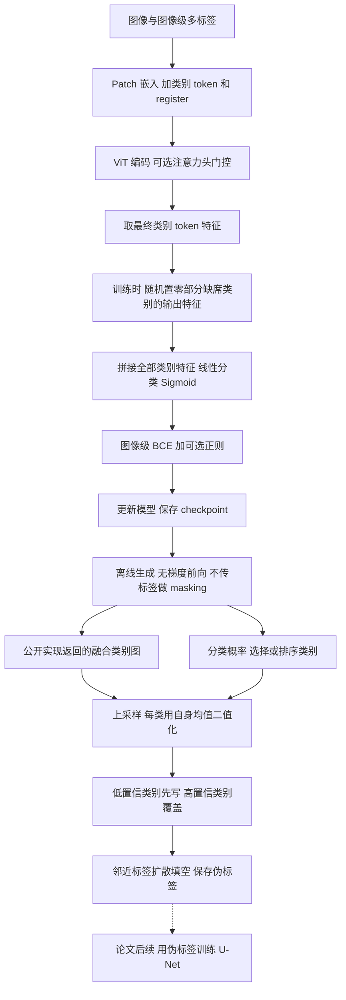
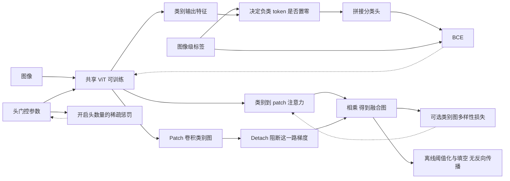

# 09 · TokenMasking：Method 回顾

TokenMasking 用图像级类别标签训练一个带有多个类别 token 的 ViT，再把类别 token 对图像 patch 的注意力转换成像素伪标签。分类主干、类别 token、register token 和分类头一起训练；开启稀疏训练时，注意力头的门控参数也一起学习。核心想法是：**每个类别预留一个 token，训练时随机让“不在图中”的类别 token 在分类前失声，促使 token 与类别形成较稳定的对应关系。**

本文覆盖 ICCV 2025 的 *Know Your Attention Maps: Class-specific Token Masking for Weakly Supervised Semantic Segmentation*。先按官方公开实现讲实际数据流，再说明论文与该实现的边界。代码固定在 `3daaec734700a4c9578dd8ce7bedef7f917aed66`，提交于 2025-11-15；它是会议后的公开代码，不能视作论文全部实验的已验证复现包。截至核查日，没有确认到同一工作的期刊扩展版。

## 先看整体流程



这里分清三个阶段：分类模型训练、离线伪标签生成、论文描述的后续分割模型训练。公开仓库能追到前两个阶段的调用链，也提供 U-Net 网络定义，但没有把伪标签读入并训练 U-Net 的完整入口。因此，不能把图中的虚线部分说成已在该仓库核实的训练流程。

### 对照原论文图 2 读整体流程

结合下面的原论文框架图，把上面的训练与离线生成流程对应起来。先看左半边的输入和共享编码器，再看右上训练，最后看右下生成伪标签。

/images/TokenMasking/TokenMasking_ICCV2025_Fig2.png>)

图 2 来自 ICCV 2025 论文第 4 页，左侧为架构，右侧为训练与推理管线。原笔记保留了方法文字及本地 PDF 链接，本图从同一份 PDF 裁取，连同英文图注保留。[原笔记](../TokenMasking/TokenMasking_paper_notes.md) · [本地论文](<../../../../../../99_Assets (资源文件)/papers/Know Your Attention Maps Class-specific Token Masking for Weakly Supervised Semantic Segmentation.pdf>)

**左半边沿黑箭头向下读。**照片先切成 patch，经 `Linear Projection` 变成蓝色 image tokens；粉色 classification tokens 和绿色 register 与它们组成同一条序列。序列进入多层 `ViT Encoder`，每层的 Multi-Head Attention 让 token 交换信息，Feed Forward 再更新特征，旁路箭头表示残差连接。右侧放大的方阵是注意力权重，行列都包含类别、patch 和 register。它展示的是 token 之间的关系，空间热图还需要从中挑出类别 query 对 patch key 的那一块。当前入口将主干、类别 token、register 和分类头一起交给优化器更新。

**右上 A. Training 要把两个小图连起来读。**`Attention Head Pruning` 对应编码器内部的可学习头门控；`Classification` 则接编码后的类别输出。粉色输出中有一项变灰，箭头 `randomly masked` 指向这里，随后把保留的输出拼接，送入 `Linear Layer`。图中 1、0 向量表达图像级多标签分类任务。训练标签一方面决定哪些缺席类别允许随机置零，另一方面进入 BCE；分类损失与头稀疏惩罚共同驱动参数更新。图中的 pruning 和 masking 因而处在两个位置，前者影响注意力计算，后者作用于最终类别特征。

**右下 B. Inference 沿粉色箭头，再沿蓝色箭头读。**粉色框从注意力矩阵挑出类别 token 的行，恢复出 `[CLS] sky`、`[CLS] tree`、`[CLS] field` 三张空间图；三条蓝箭头把各类别的定位证据送去合成彩色伪掩码。这里的热图承载空间得分，最终颜色承载像素类别。离线阶段用训练好的模型前向提取这些证据，阈值化、覆盖和填空在无梯度流程中完成。图像级监督形成类别表示，伪掩码随后才可作为另一分割模型的像素监督。

| 原图位置 | 对应现有章节与代码 | 连起来复习时抓住什么 |
| --- | --- | --- |
| Linear Projection、三类 token、ViT Encoder | “每个类别占一个 token，另设一个公共‘记事本’”；`PatchEmbed` 与 `MCTformerV2` | 按代码中的类别、patch、register 顺序理解序列，register 的用途是学习公共上下文 |
| A 中的随机 masking 与 Linear Layer | “Masking 发生在编码之后”；`ViTWithTokenDropout` 及“入口到分类监督”代码 | 传入 `y_ohe` 后按缺席类别抽样，全部类别输出拼接后分类，BCE 使用图像标签 |
| A 中的 Attention Head Pruning | “稀疏门控”；`ConcreteGate.get_penalty()` | 每头一个门，分类损失保留信息，稀疏项推动减少开启的头 |
| B 中的空间图与 Pseudomask Generation | “自注意力如何变成类别位置图”与“从 checkpoint 到离线伪标签” | `MCTformerV2.forward()` 返回图，`generate_pseudomasks.py` 负责阈值、写入顺序与填空 |

按当前实现阅读这张图时，还要给右下角补上三个具体条件。第一，原图小标题写的是最后一层的头，当前 `forward()` 先平均头，再汇总最后 `n_layers=12` 层。第二，默认返回图还乘了 `detach` 后的 patch 卷积类别图，后文的融合公式正是对这一步的展开。第三，生成入口固定 `prune=False`，训练门控与生成返回图的关系要沿“稀疏门控”一节的调用链理解。图的箭头交代了论文的主要构思，当前入口的层数、融合与门控行为则由后文代码补全。

用图中的天空、树和田地复述一遍就能自查理解。训练时保留这些正类输出，对其余缺席类别随机置零，利用图像标签学分类；生成时提取各类空间图，每类用自身均值定阈值，再从分类概率低到高依次写进画布，最后由邻近标签扩散填空。这样便能把图上“三张热图合成一张彩色图”的简写，接到现有伪代码的每一步。

## 顺着数据走一遍

### 1. 输入监督只回答“有什么”，不回答“在哪里”

以一张包含森林、农田、水面的遥感图像贯穿说明。模型收到图像，以及一个长度为类别数 $C$ 的向量 $y$：这三个类别为 1，其余类别为 0。它没有在分类损失中收到森林边界或者水面轮廓。

`run.py` 创建数据模块、`ViTWithTokenDropout`、损失和优化器，再交给 Lightning 的 `VisionTransformers.training_step()`。训练步取 `img`、`y` 和 `y_ohe`，把 `y_ohe` 传给模型决定哪些类别允许被遮掉，用 `y` 算分类损失。多标签数据集中，二者都是类别存在向量。

监督来源仍需说具体：VOC loader 从 XML 对象类别构造标签；ADE20K loader 从已有标注图提取出现过的类别；DFC loader 从标注图汇总面积比例，默认只将覆盖至少 10% 图像的有效类别设为正类。后两者在数据准备阶段使用标注图生成弱标签，但训练目标没有逐像素监督。数据字典中出现 `mask`，不代表 `training_step()` 用它训练分割。相关实现见 [VOC loader](https://github.com/HSG-AIML/TokenMasking-WSSS/blob/3daaec734700a4c9578dd8ce7bedef7f917aed66/datasets/voc.py)、[DFC loader](https://github.com/HSG-AIML/TokenMasking-WSSS/blob/3daaec734700a4c9578dd8ce7bedef7f917aed66/datasets/dfc.py) 和 [ADE20K loader](https://github.com/HSG-AIML/TokenMasking-WSSS/blob/3daaec734700a4c9578dd8ce7bedef7f917aed66/datasets/ade.py)。

### 2. 每个类别占一个 token，另设一个公共“记事本”

输入为 $B\times D_{in}\times H\times W$，patch 大小为 $P$。`PatchEmbed` 用核大小和步长均为 $P$ 的卷积得到 $N=\lfloor H/P\rfloor\lfloor W/P\rfloor$ 个 patch，每个嵌入维度为 $D$。实际序列是：

$$
X_0=[t_1,\ldots,t_C,p_1,\ldots,p_N,r]+E_{pos},
\qquad X_0\in\mathbb R^{B\times(C+N+1)\times D}.
$$

前 $C$ 个是可学习类别 token，最后一个 $r$ 是 register，中间是图像 patch。register 可以承载跨区域、全局性的内容，让类别 token 少承担一些杂事；这是设计动机，不意味着它受到了“必须表示背景”的监督。**它不是背景类别，也没有单独的背景分类损失。**

类别名称并没有作为文本编码进来。“森林 token”首先只是一个固定序号的可学习向量，其类别意义来自标签驱动的训练。所有 token 在 Transformer 内共同交互，没有为森林 token 预先圈定森林位置。

这一入口的骨干默认 $D=768$、12 层、16 个注意力头。`run.py` 虽然解析 `depth`、`num_heads`、`pretrained` 等参数，实际 `setup_model()` 只向模型传 patch 大小、剪枝开关、输入通道数、类别数和 masking 概率；没有在该入口加载预训练权重。读配置时应以传参链为准，不能只看命令行参数名称。这里也没有冻结教师或 EMA 分支。

### 3. Masking 发生在编码之后，不是在图像上挖洞

经过所有 Transformer 层后，取出类别特征 $Z\in\mathbb R^{B\times C\times D}$。对每张图、每个类别独立判断：

$$
\widetilde Z_{b,c}=
\begin{cases}
0,& y_{b,c}=0\text{ 且一次随机抽样命中 masking};\\
Z_{b,c},&\text{其他情况}.
\end{cases}
$$

`rate` 默认 0.5，含义是每个缺席类别被置零的概率，不是每张图恰好删掉一半类别。森林、农田、水面这几个正类 token 保留；城市、裸地等负类 token 随机失声。图像 patch 不被遮，类别 token 在前面的自注意力计算中也仍然存在。

接下来，把全部 $C$ 个类别特征拼成一个 $CD$ 维向量，经过一个 `Linear(CD, C)`，再对各类别独立做 sigmoid。**代码不是给每个 token 接一个互不相通的二分类头。**某个类别输出可以读取全部保留的类别特征，所以 token 与类别的对应关系是一种训练诱导，不能理解成结构上禁止串用信息的硬约束。

这也解释了 masking 的作用边界：被置零的最终特征不再直接影响本次分类，其直接分类梯度被挡住；该 token 仍可能通过更早层与其他 token 的交互间接影响输出。实现用“是否传入 `labels`”控制 masking，验证和伪标签生成不传标签，因而不做这一置零操作。

### 4. 自注意力如何变成类别位置图

每层每头先计算

$$
A_{l,h}=\operatorname{softmax}_{key}(QK^\top/\sqrt{d_h}).
$$

softmax 沿最后的 key-token 维归一化，包含类别 token、patch 和 register，大小是 $T\times T$，其中 $T=C+N+1$。我们想读的是“类别 token 作为 query，对图像 patch 的注意力”：从矩阵中取前 $C$ 行、中间 $N$ 列，而不是取 patch 对类别 token 的反向注意力。

固定版本的 `MCTformerV2.forward()` 先在头维求平均，再对最后 `n_layers=12` 层求和，抽出类别到 patch 的子矩阵，恢复为 $B\times C\times H'\times W'$。这里没有 attention rollout，也没有通过 patch 亲和矩阵传播种子。

但继续追到真正的返回值，会看到一个需要保留的实现细节：默认 `attention_type="fused"`。模型还把 patch 特征送入一个 $3\times3$ 卷积分类头，得到类别特征图 $F$，最终返回

$$
S_c=\left(\sum_l\frac{1}{n_h}\sum_h A_{l,h}[c,\mathrm{patch}]\right)
\odot\operatorname{ReLU}(\operatorname{stopgrad}(F_c)).
$$

因此，**当前公开脚本用于阈值化的是融合图 $S$，不是单独的原始注意力图**。外层变量仍叫 `mtatt` 或 `img_attn`，但数据内容是这个乘积。论文方法强调直接利用注意力；本文不把公开实现中多出来的乘法隐藏起来。

另一个相连的事实是：卷积头算出的 pooled patch logits 没有送入有效训练损失，`F` 又被整体 `detach`。按这份训练链静态推导，该卷积头没有从已列出的损失取得梯度，不能称其为“另一个训练好的 CAM 分支”。这一点也限制了我们将该公开快照等同于论文结果的程度。源码位置见 [模型定义与三个 forward](https://github.com/HSG-AIML/TokenMasking-WSSS/blob/3daaec734700a4c9578dd8ce7bedef7f917aed66/model.py)。

## 关键模块与损失

### 分类损失：把图像中的类别预测对

对 VOC、COCO、DFC、ADE 等多标签任务，入口选择 `BCELoss(reduction="mean")`，接收的是 sigmoid 后的概率：

$$
\mathcal L_{cls}=-\frac{1}{BC}\sum_{b,c}
\left[y_{b,c}\log p_{b,c}+(1-y_{b,c})\log(1-p_{b,c})\right].
$$

负类参与 BCE；即使对应 token 被遮掉，也没有把那个类别的损失忽略掉。这里没有像素交叉熵、像素 ignore 区域或者在线伪标签监督。代码把单标签数据映射到交叉熵，但本文的完整讲解沿多标签链展开，不把单标签接口当成已经跑通的另一套流程。

### 稀疏门控：让一些注意力头真正闭嘴

开启 `--prune` 后，每层每个头有一个标量门 $g_{l,h}$，广播到整个注意力矩阵。代码先 softmax，再乘门，再计算 $AV$。因为每头只有一个标量，这与先算该头输出、再乘同一个门在代数上等价。

训练时，门由 Hard Concrete 随机变量产生；实现先拉伸、裁剪到 $[0,1]$，再以 0.5 为阈值二值化，反向用 straight-through 形式保留连续近似的梯度。门控参数不是人工选出来的。分类损失要求保留有用信息，稀疏项则要求少开头，两者共同决定哪些头留下：

$$
\mathcal L_{reg}=0.01\sum_{l,h}P(g_{l,h}>0),
\qquad \mathcal L=\mathcal L_{cls}+\mathcal L_{reg}.
$$

代码中 0.01 已包含在 `ConcreteGate.get_penalty()` 的返回值里，训练循环直接相加，不能再额外乘一次。命令行 `pr_rate` 被解析和记录，但没有传入该门控系数。论文报告的“约剪去三分之二”是实验观察，不是代码强制达到的比例。

还要区分“用于更新特征的注意力”与“模型返回的注意力”：`Attention.forward()` 在乘门前保存 `weights`，返回的类别图由这些门前权重汇总。Recorder 虽能选择挂在门控输出上，但伪标签脚本构造的是 `prune=False` 的模型，而且最终使用的是模型返回的融合图。故不能说当前生成入口自动丢弃了所有关闭头的图。

### 可选多样性项：公开实现比论文主公式多一条支路

`--diversify` 默认关闭，README 示例打开了它。开启后，将每个类别融合图展平并沿空间维做 L2 归一化，计算类别间 Gram 矩阵 $G_b=\widehat S_b\widehat S_b^\top$：

$$
\mathcal L_{div}=\frac{\alpha}{B}\sum_b
\sqrt{\|G_b-I\|_F^2+10^{-10}},\qquad \alpha=0.1\text{（默认）}.
$$

直观上，它不希望所有类别图长得一样。它作用于所有类别通道，没有按图像正类标签筛选。梯度能通过乘积中的注意力部分回传，但不能穿过被 `detach` 的卷积特征图。这是公开训练代码的可选项，不应写成论文公式中必需的第三项。有效训练损失因此可概括为 BCE，加按开关启用的稀疏项与多样性项；所谓额外 token loss 在训练步里实际被设为 0。[训练封装与损失实现](https://github.com/HSG-AIML/TokenMasking-WSSS/blob/3daaec734700a4c9578dd8ce7bedef7f917aed66/models/vision_transformers.py)

## 对照官方代码

下面三段均为保留调用关系的等价整理，不是可以直接复制运行的完整脚本。

### 入口到分类监督

```python
# run.py -> VisionTransformers.training_step
network = ViTWithTokenDropout(patch_size, prune, in_chans, C, rate)
trainer.fit(lightning_wrapper(network), train_loader, val_loader)

# 每个训练批次
probabilities, spatial_maps = network(batch["img"], batch["y_ohe"])
loss = BCE(probabilities, batch["y"])
if prune:
    loss += sum(block.attn.gate.get_penalty() for block in network.mct.blocks)
if diversify:
    loss += diversity_loss(spatial_maps)
return loss
```

这个顺序说明：masking 的选择来自图像标签；优化器接收 `model.parameters()`，没有只训练新 token 而冻结主干的步骤。验证则调用 `model(data)`，不做 label-conditioned masking，验证损失只有分类损失。参见 [run.py](https://github.com/HSG-AIML/TokenMasking-WSSS/blob/3daaec734700a4c9578dd8ce7bedef7f917aed66/run.py) 与 [training_step / validation_step](https://github.com/HSG-AIML/TokenMasking-WSSS/blob/3daaec734700a4c9578dd8ce7bedef7f917aed66/models/vision_transformers.py)。

### 从编码结果分出分类和空间图

```python
# model.py 内部流程的等价整理
class_features, patch_features, attention = encode_all_tokens(image)
class_to_patch = sum_layers(mean_heads(attention))[:, :C, C:-1]
spatial_maps = reshape_grid(class_to_patch) * relu(stopgrad(conv(patch_features)))

if labels_are_provided:
    zero_some_absent_class_features(class_features, labels, probability=rate)
probabilities = sigmoid(linear(flatten_class_tokens(class_features)))
return probabilities, spatial_maps
```

注意，空间图在输出特征 masking 前已经算好。masking 通过长期训练改变特征与注意力，并不是当场把空间图中的负类区域涂黑。具体见 [MCTformerV2 与 ViTWithTokenDropout](https://github.com/HSG-AIML/TokenMasking-WSSS/blob/3daaec734700a4c9578dd8ce7bedef7f917aed66/model.py)。

### 从 checkpoint 到离线伪标签

```python
# generate_pseudomasks.py，按其实际分支整理
model = load_checkpoint_into_model(prune=False, return_att=True)
model.eval()
with no_grad():
    probabilities, fused_maps, *_ = recorder(model)(image)

classes = predicted_positive_classes(probabilities)  # DFC
# ADE20K 分支改用图像标签中的正类，非上面这个预测集合
canvas = full_image_filled_with_minus_one()
for c in sort_classes_by_increasing_probability(classes):
    region = resize(fused_maps[c])
    canvas[region >= region.mean()] = c
canvas = fill_by_nearest_valid_label(canvas)
save_numpy(canvas)
```

Recorder 返回五项：分类概率、模型的融合图、patch 注意力、汇总注意力、hook 记录。生成循环解包 `out, x, *_`，使用 `x[0]`，所以真正送去阈值化的是第二项的第一个样本；第五项 hook 记录没有进入伪标签。当前代码实际按 batch size 1 写这段逻辑。[Recorder](https://github.com/HSG-AIML/TokenMasking-WSSS/blob/3daaec734700a4c9578dd8ce7bedef7f917aed66/recorder_tokendropout.py)；[生成入口](https://github.com/HSG-AIML/TokenMasking-WSSS/blob/3daaec734700a4c9578dd8ce7bedef7f917aed66/generate_pseudomasks.py)。

## 伪标签到底怎样落到每个像素

DFC 分支对 sigmoid 概率做 `np.round` 得到预测存在类别。对每个选中类别，恢复 patch 网格，再用 OpenCV resize 上采样；以**该类别图自己的空间均值**为阈值，保留不低于均值的像素。没有对所有类别图做像素级 softmax，也不是每个像素直接 `argmax`。

类别按分类概率从低到高写进同一张画布。继续看森林、农田、水面的例子：若概率依次为 0.65、0.80、0.93，就先写森林，再写农田，最后写水面。如果森林图与水面图都覆盖某个像素，水面最终胜出，因为它后写，而不是因为该像素的水面注意力必然大于森林注意力。

未覆盖像素暂记为 -1。论文文字说用周围最常见的类别补上；公开代码 `fill_closest_values()` 用四邻域、多源 BFS，把邻近已有标签逐层向空白区域传播。它相当于按网格距离传播最近的有效标签，不是邻域众数滤波。没有任何类别留下有效像素时，BFS 没有可传播的种子，不能凭空补出类别。

ADE20K 分支有两个单独的处理：其一，候选集合来自 `batch["y"]` 的正类，虽然函数接收预测类别参数，却没有用它过滤类别；其二，填完 -1 后还把 0 当作待填值再扩散一次。因而这条链使用已知图像标签筛类别，不应当作完全不需要标签的测试图推理。这里读入真值分割图用于画布形状与保存对照，并未读取其边界来画伪标签；类别标签本身来自前述数据准备。

公开生成脚本只有 DFC 和 ADE20K 两个实际分支，路径、patch 大小、checkpoint 位置写在脚本常量中，并没有 README 示例所暗示的命令行解析入口。`load_model()` 固定关闭剪枝并严格加载权重，因此不能声称带 gate 参数的剪枝 checkpoint 已由这条入口兼容加载。以上是阅读调用链所得的边界，本次没有运行训练或生成实验。

## 用一张图看清监督与梯度



这张图最值得注意的是两处“断开”：空间伪标签生成不把像素监督送回分类训练；patch 卷积图被 detach，不能因为它出现在返回值里就认为它被分类损失训练。与之相对，类别注意力不是离线算出来的固定先验，而是可训练 ViT 在标签监督下逐渐形成的内部关系。

论文第 5.1 节描述再用伪标签训练 U-Net。到这个阶段，伪标签才变成另一模型的像素级监督；它与前面的分类训练不是同一个联合损失。公开 [U-Net 文件](https://github.com/HSG-AIML/TokenMasking-WSSS/blob/3daaec734700a4c9578dd8ce7bedef7f917aed66/models/unet.py) 能确认网络定义，但无法据此核实后续训练的损失、ignore 规则和优化配置，本文不补写这些细节。

## 回顾时抓住这几点

1. **TokenMasking 遮的是最终类别特征。**图像不挖洞，ViT 内部也没有先把缺席 token 删除。
2. **类别 token 的意义由训练诱导。**输出拼接后共用一个线性分类器，不是严格独立的每类小网络；register 也不是背景类别。
3. **稀疏门控解决“哪些头值得保留”，masking 解决“token 与类别如何关联”。**二者目标相关，但作用位置不同。
4. **公开版本的伪标签图是注意力与 detach 卷积图的乘积。**汇总顺序是先平均头、再加层；真正使用的返回项要沿调用链核对。
5. **像素类别由阈值、覆盖次序与填空共同决定。**图像级分类置信度影响重叠区域归属，不能只盯着一张热图解释最终分割。

可以自问：为什么只遮负类？因为正类的证据通路需要保留；为什么推理不遮？没有传入训练标签；为什么有类别 token 还不能保证每个 token 只表示自己的类？因为自注意力和最终拼接分类器都允许跨 token 交互。

## 资料与实现版本

- **会议论文**：Joëlle Hanna、Damian Borth，ICCV 2025，23763–23772 页。[CVF 正式页面](https://openaccess.thecvf.com/content/ICCV2025/html/Hanna_Know_Your_Attention_Maps_Class-specific_Token_Masking_for_Weakly_Supervised_ICCV_2025_paper.html)。实际阅读了本地对应 PDF 的方法第 3 节及模型阶段说明，并查看了第 4 页的架构图与公式；本文没有以未读的补充材料支撑实现细节。
- **预印本**：[arXiv:2507.06848v1](https://arxiv.org/abs/2507.06848v1)，2025-07-09。核查页面仅列这一版；它是同工作的预印本，不是期刊扩展。
- **官方代码身份与版本**：[HSG-AIML/TokenMasking-WSSS](https://github.com/HSG-AIML/TokenMasking-WSSS)，作者主页直接链接该仓库。本文固定 [提交 3daaec734700a4c9578dd8ce7bedef7f917aed66](https://github.com/HSG-AIML/TokenMasking-WSSS/commit/3daaec734700a4c9578dd8ce7bedef7f917aed66)。核查时仅发现 `main` 分支，提交历史共三次；2025-07-03 的前一快照仅有 README，实际源码在 2025-11-15 提交中发布。没有拿另一论文或后续期刊主分支替代会议实现。
- **实际源码阅读范围**：`run.py`、`model.py`、`models/vision_transformers.py`、`generate_pseudomasks.py`、`recorder_tokendropout.py`、VOC/ADE20K/DFC 三个数据加载文件，以及 `models/unet.py`。共 9 个源码文件；上述固定链接分别对应正文结论。
- **期刊扩展核查**：检索论文完整标题、TokenMasking 名称与作者的扩展版记录，交叉查看 [作者出版列表](https://joellehanna.github.io/publications.html)、[学校出版记录](https://alexandria.unisg.ch/entities/publication/5e530344-4305-4eb4-b59f-ad8e9519d4ee)、arXiv 与官方仓库。可确认的是 ICCV 2025 会议版；没有找到可核实的同工作期刊扩展。作者的其他期刊论文不据名称相近并入本篇。
- **验证边界**：完成了论文阅读、源码静态调用链与版本核查；没有安装项目依赖、下载模型权重、运行训练或复现分割指标。公开实现中未接通的后续阶段与上述配置边界不能由源码阅读自动补齐。
