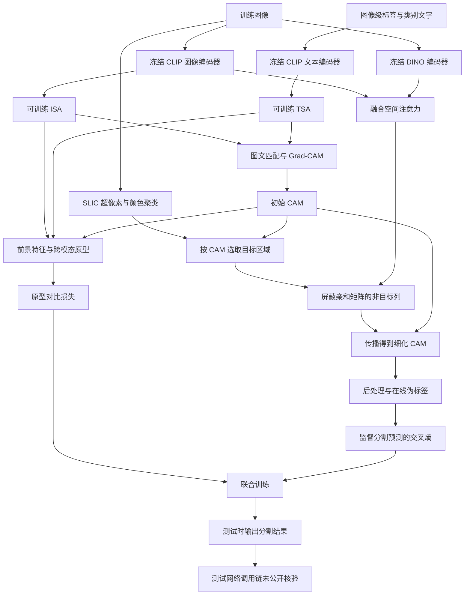
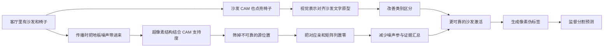

# 10 · SSR：Method 回顾

SSR 用图像级类别标签做弱监督分割：训练时知道图里有什么，不知道每个像素属于谁。论文图 2 将 CLIP 的图像、文本编码器及 DINO 编码器标为冻结，将图像侧 ISA、文本侧 TSA 标为可训练；校正后的 CAM 在线生成伪标签，再用于分割交叉熵训练。核心想法是分两处处理错误：先让图像与文字在语义上更合拍，再限制 CAM 沿着不可靠的空间关系传播。

本文覆盖 **AAAI 2026 会议版**。正式记录为 *Proceedings of the AAAI Conference on Artificial Intelligence*, 40(4): 2444–2452，发布日期 2026-03-14；arXiv 的 2025 年预印本是同一会议工作的前置版本。本次未找到能够确认属于作者的公开 SSR 实现，也未确认同工作期刊扩展，因此下面按原论文讲解，**不把论文流程冒充已核验的代码执行流程**。[出版记录](https://ojs.aaai.org/index.php/AAAI/article/view/37230) · [作者主页](https://faculty.cqupt.edu.cn/bixiuli) · [arXiv 版本记录](https://arxiv.org/abs/2512.01701)

## 先看整体流程

可以把 SSR 想成“先认准，再传开”。CMPA 负责让“沙发”的文字与沙发的视觉证据对应起来；SGC 负责检查传播证据时哪些位置值得信任。两个模块作用的位置不同：前者改变特征表示，后者修改空间亲和矩阵。



图中最后几步需要保留边界：论文明确写了在线伪掩码、分割损失和单阶段训练，但没有提供足够细节来恢复分割解码器结构、其特征入口及测试脚本。不能仅因为论文讨论了 WeCLIP，就直接套用 WeCLIP 的解码器或推理流程。

以下方法依据是正式论文第 2446–2448 页的 Methodology、图 2 和 Implementation Details，已独立读取本地原版 PDF；本地文件也带有 AAAI-26 页码和出版元信息。

## 对着原论文图 2 复习两条校正路线

结合下面的原论文框架图，可以把上面的 Mermaid 与后面的七步讲解对起来。先看左侧输入，再沿上方 CMPA 读语义对齐，最后沿下方 SGC 读空间传播。

/images/0462ca2acc1918f902d6ffaea4cdadf5.png>)

图 2 为 SSR 的 AAAI 2026 会议版整体框架，复用原笔记保存的论文原图。右侧图例标出了冻结、可训练、梯度及三种运算符号。资源与图号说明见[SSR 原论文笔记](<../SSR/SSR_paper_notes.md>)。

**先读上半幅。** 文字模板带入前景、背景类别，经 CLIP Text Encoder、TSA 得到 $f_T$；同一张图经 CLIP Image Encoder、ISA 得到 $f_I$。雪花对应冻结编码器，火焰对应可训练投影。两路在 `Cos` 汇合得到 `logits`，这条匹配路线接到正文的 Grad-CAM 解释。向右的虚线把两路表示连接到文字、图像原型，右上圆点、三角与星形展示特征与原型的对齐关系，$L_{Proto}$ 约束类别表示。原型的构造与刷新节奏要接着读第 2–4 步及第一、二段伪代码。

**再读下半幅。** 输入图像同时进入 DINO；CLIP 与 DINO 的 MHSA 箭头在加号处汇合，形成 Attention Map。另一条路线把 Superpixel 和 Initial CAM 合起来判断目标位置，产出 Correction Mask。掩码向下与注意力图做逐元素乘法，剪刀图标提示连接被筛掉；得到的 Affinity Matrix 再与 Initial CAM 做矩阵乘法，生成 Refined CAM，随后经 Post Process 变成 Pseudo Label。这对应第 5–7 步与第三段伪代码。

| 原图位置 | 对照本文已有讲解 | 读图时抓住的操作 |
| --- | --- | --- |
| 左上 TSA、左中 ISA 与左下模块小图 | 第 1 步“冻结大编码器，在输出之后学习语义投影” | 学习发生在投影模块，图中小图标注 Linear、BatchNorm、LeakyReLU |
| `Cos`、`logits`、两套 Prototypes 与 $L_{Proto}$ | 第 2–4 步与前两段伪代码 | 图文匹配生成 CAM，CAM 汇总视觉证据，聚类原型提供对比参照 |
| Superpixel、Correction Mask 与剪刀 | 第 5–6 步 | CAM 为区域赋予类别支持，目标位置决定哪些亲和矩阵列保留 |
| Refined CAM → Post Process → Pseudo Label | 第 7 步与第三段伪代码 | 细化结果转成在线像素监督，再用于分割交叉熵 |

读图时有三处值得停一下。第一，红色虚线在图例中写的是 Gradient，阅读 Initial CAM 时要结合正文的 Grad-CAM，梯度计算与冻结参数可同时成立。第二，图中“加号融合注意力”和投影小图只提供结构示意，具体融合算子、激活函数的材料差异已在第 1、6 步逐项交代。第三，Correction Mask 的黄格与红叉要结合第 6 步的 $M^c_{ij}=r^c_j$ 阅读，列筛选控制源位置的贡献；剪刀图标本身没有给出最终所有背景位置的数值保证。

仍以沙发、椅子和地板为例，上半幅帮助“沙发”文字找到更可靠的视觉参照，下半幅筛查参与传播的空间证据。图像级标签提供类别存在信息，右上的聚类参照参与原型监督，右下的伪标签参与像素监督。原图止于伪标签，分割损失由第 7 步的论文训练目标接续；分割头、测试入口及实际梯度处理的可核验范围，继续以“对照官方实现：本次能核验到哪里”一节为准。

## 顺着数据走一遍

### 1. 冻结大编码器，在输出之后学习语义投影

假设一张客厅照片同时有沙发、椅子和地板，图像级标签告诉模型有“沙发”和“椅子”。文本输入包含前景类别以及从 CLIP-ES 沿用的背景类别词；图 2 展示了文字模板。背景词为图文匹配提供额外语义参照，不能直接等同于最终分割输出里的一个背景通道。

CLIP 提取视觉特征和文字特征，分别进入 ISA 与 TSA：

$$
v'=\operatorname{ISA}(v),\qquad t'=\operatorname{TSA}(t).
$$

两个模块结构相同、参数独立。大白话说，就是给图像和文字各配一个翻译器，让两边都能调整说法，而不是只改文字。论文说明这些模块由线性层、批归一化和激活层堆叠，并在投影空间降低特征维度。正文实现说明写 ReLU，图 2 的模块小图标的是 LeakyReLU；没有源码时无法确定实际采用哪一个，因而不能给出确定的层表。

这里的“冻结”是编码器参数不随优化器更新，**不表示 Grad-CAM 不需要求梯度**。Grad-CAM 求的是类别得分对中间视觉表示的敏感程度；它和训练时更新参数是两件事。具体在哪里保留计算图、注册 hook 或关闭梯度，需要代码才能核实。

### 2. 先得到 CAM，再用它汇总一个类别的视觉证据

图 2 用投影后的图文特征做余弦匹配并产生 logits，正文说明通过 Grad-CAM 生成类别 CAM。对沙发而言，CAM 就是“哪些位置支持这张图里有沙发”的热力图。它还不是完整像素标签，可能只覆盖沙发局部，也可能把相邻椅子点亮。

论文接着用 CAM 对视觉特征做 masked average pooling，文字侧则直接取对应类别向量：

$$
f_{\mathrm{image}}^c=\operatorname{MAP}(\operatorname{CAM}^c\odot v'),
\qquad
f_{\mathrm{text}}^c=t'[c].
$$

为了看清空间维度，可把被池化的稠密视觉特征记作 $V'\in\mathbb R^{P\times d_2}$，$P=h\times w$ 是特征网格的位置数，一张类别 CAM 展平后是 $m^c\in\mathbb R^P$。池化沿 **空间位置维** 汇总，输出一个 $d_2$ 维向量；文字索引沿 **类别维** 选取，同样得到 $d_2$ 维向量。这里补全维度是为了说明运算，不代表已确认作者程序里某个张量的名称或布局。

直观上，沙发 CAM 权重高的位置对“这张图的沙发长什么样”贡献较多，地板尽量少参与。论文没有展开 MAP 的分母、CAM 是否二值化、零掩码保护等细节；不能据此断言采用了哪一种归一化实现。CAM 所用的目标层、分类 softmax 范围和梯度聚合方式也没有在本文资料中完整给出。

### 3. 跨图像收集特征，形成图像和文字两套原型

单张沙发可能是皮质，也可能是布艺；原型试图把很多训练样本里的稳定共性汇总起来。论文描述：收集整个数据集的前景感知视觉特征和对应文字特征，经 K-means 得到两套原型：

$$
P^I\in\mathbb R^{K\times d_2},\qquad
P^T\in\mathbb R^{K\times d_2}.
$$

因此，原型不是随手取当前 batch 的均值。它们来自数据集范围的聚类；实现说明进一步写明 **每 5,000 次迭代更新原型**。训练时的特征持续变化，定期刷新原型能让参照点跟上表示空间的变化。

聚类还给出样本的簇伪标签，用来决定哪一个原型是正样本。这与图像级类别标签、像素伪标签是三个不同层次：图像标签告诉我们有哪些语义类别，簇标签服务于原型对比，像素伪标签服务于分割损失。论文没有说明两种模态独立聚类后怎样做簇编号匹配、是否按类别分别聚类，也没有说明刷新原型的具体缓存和停止梯度策略。这些细节关系到可复现性，不能用“同一编号天然同一类”代替。

### 4. 跨模态对比，让视觉特征靠近正确文字原型

原型对比的核心不是再问一次“整张图有没有沙发”，而是让视觉表示靠近对应的文字语义参照，并远离不对应的参照。按论文式（3）–（6），将视觉表示记为 $z_i$、正原型索引记为 $q_i$，可写成：

$$
s_{ik}=\frac{z_i^\top P_k^T}{\tau_{\mathrm{proto}}},\qquad
\mathcal L_{\mathrm{proto}}
=-\frac1N\sum_i\log
\frac{\exp(s_{i q_i})}{\sum_{k=1}^{K}\exp(s_{ik})}.
$$

softmax 在 **候选原型维 $K$** 上进行，不是在图像空间位置上进行；$N$ 个样本的损失再平均。正样本索引来自前述聚类伪标签。温度越小，分数之间的差别越尖锐。方法段称温度可学习，实验设置给出 $0.05$；缺少代码时，只能分别保留这两项信息，不能确认 $0.05$ 是初始化值还是实际固定值。

论文还从概念上描述同类跨模态原型聚合、异类分离，但显式公式展示的是“视觉表示对文字原型”的交叉熵。不要自行增加一个对称的文字到图像损失，或额外的原型到原型损失，再说这是作者完整实现。

对客厅例子，这一步希望减轻沙发与椅子因纹理相似产生的混淆。但它不保证所有同类像素都聚在一起，更不保证 CAM 从此没有噪声，后面的空间校正仍有必要。

### 5. 空间结构提供第二把尺子：哪些区域适合参与传播

SGC 首先在输入图像上运行 SLIC，把颜色和空间上接近的像素组织成超像素，再依据颜色空间信息聚类。超像素提供的是局部结构，并不自带“这是沙发”的语义。

类别意义来自 CAM：对每个聚类区域，论文计算“高置信像素的激活总量”占“区域全部激活总量”的比例，比例超过阈值才保留为目标区域。注意这是 **激活量之比**，不是简单的高置信像素数量比例。颜色区域与 CAM 共同做判断，可以保留较连贯的沙发区域，同时削弱只有零星误激活的地板区域。

论文未给出该处高置信阈值、区域接受阈值、SLIC 超像素数和颜色聚类簇数。它描述了如何决策，却不足以唯一确定一个可直接运行的预处理函数。SLIC 的离散分组也不应被想象成一个靠分割损失端到端学习的神经模块。

### 6. 先修亲和矩阵，再用它细化 CAM

CLIP 提供类别语义联系，DINO 补充空间结构联系。这里使用 CLIP ViT-B/16 与 DINOv1 ViT-S/16 的 MHSA 信息，而不是把 DINO 当作另一个类别分类器。

论文式（9）写了两种 MHSA 的 ConCat，正文随后说明归一化得到亲和矩阵；图 2 用求和符号，实验设置又给出 CLIP:DINO 为 $0.4:0.6$。能够确定的是“融合两种注意力，形成位置到位置的关系”，但不能将它直接落实成某个 `cat(dim=...)`、加权和或行 softmax 的完整代码。层选择、头聚合、归一化顺序都还缺少实现证据。

为了理解后续运算，令最终亲和矩阵 $A\in\mathbb R^{P\times P}$，区域选择向量 $r^c\in\{0,1\}^P$。论文式（7）、（10）、（11）对应：

$$
M^c_{ij}=r^c_j,\qquad
A^{*c}=A\odot M^c,\qquad
\widetilde m^c=A^{*c}m^c.
$$

掩码沿列广播：某个位置不属于目标区域，就把它对应的整列屏蔽。按左乘列向量的写法，展开后是

$$
\widetilde m_i^c=\sum_j A_{ij}\,r_j^c\,m_j^c.
$$

这让我们准确看见它在做什么：在输出位置 $i$ 汇总证据时，不让被剔除的源位置 $j$ 贡献激活。它不是只允许同一个超像素内通信的块对角邻接矩阵，也不是把最终 CAM 的所有非目标位置直接清零。**列屏蔽限制的是证据来源；输出位置是否还会被激活，仍取决于剩余亲和关系。** 这也解释了为何它是抑制错误传播的启发式约束，而不是背景响应必为零的保证。

### 7. 细化 CAM 变成在线监督，训练分割输出

图 2 在细化 CAM 后还有 Post Process，最终产生伪标签；训练目标明确称伪掩码在线生成：

$$
\mathcal L_{\mathrm{SSR}}=
\mathcal L_{\mathrm{proto}}+\gamma\mathcal L_{\mathrm{seg}},
\qquad \gamma=0.1.
$$

分割交叉熵比较每个像素的类别预测与伪标签，语义上的类别竞争发生在类别通道维。监督不是人工像素真值，而是这轮方法产生的伪掩码。论文报告使用 CRF 与不使用 CRF 的结果，但没有据此给出全部训练和测试后处理调用细节。

能确认的训练关系是：原型损失负责表示对齐，分割损失负责学会输出像素类别；冻结编码器提供特征，ISA/TSA 是明确的可训练模块。无法确认的部分包括分割头结构、损失究竟回传到哪些附加模块、伪标签是否显式 `detach`、不确定像素如何设置 ignore、背景分数阈值及多尺度测试流程。在线生成伪标签也不等于整个伪标签分支可微，不能凭“end-to-end”一词补出这些结论。

## 对照官方实现：本次能核验到哪里

截至 2026-11-11，已检查原论文、arXiv 项目入口、作者主页，并在 GitHub 搜索完整标题、arXiv 编号、`SSR weakly supervised` 和相关模块名称。找到的是论文目录与笔记索引，没有确认到作者发布的 SSR 代码仓库。**因此没有可记录的官方 commit/tag，也没有已验证的脚本入口 → 模型 forward → loss → 推理函数调用链。** 下列内容只把论文公式整理成便于阅读的伪代码，不是源码摘录，也不是复现程序。

第一段说明类别 CAM 如何参与原型构造，对应论文式（1）–（2）及原型更新说明；它没有把未交代的初始化与簇匹配规则藏进一个声称已实现的函数中。

```text
视觉表示 = ISA(CLIP 图像特征)
文字表示 = TSA(CLIP 文本特征)
类别 CAM = Grad-CAM(图文匹配得分, 视觉中间表示)
类别视觉摘要 = 在空间维用类别 CAM 做掩码平均池化
类别文字摘要 = 取该类别的文字向量
按论文约定定期收集数据集特征并聚类，刷新两套原型
```

第二段是式（3）–（6）的等价数学整理；`cross_entropy` 的目标是簇索引，输入的最后一维是原型候选。

```text
原型分数[i, k] = dot(视觉表示[i], 文字原型[k]) / 温度
正样本索引[i] = 聚类产生的伪标签[i]
原型损失 = cross_entropy(原型分数, 正样本索引)
```

第三段是式（7）–（12）的流程整理。`融合并归一化`、`区域筛选` 和 `后处理` 在这里刻意保留为论文级操作，因为材料不足以确定其具体参数和函数定义。

```text
候选区域 = 按颜色聚类(SLIC(图像))
目标位置 = 按类别 CAM 的高置信激活占比筛选候选区域
A = 融合并归一化(CLIP 注意力, DINO 注意力)
A_star[i, j] = A[i, j] * 目标位置[j]
细化 CAM = A_star @ 初始 CAM
在线伪标签 = 后处理(细化 CAM)
总损失 = 原型损失 + 0.1 * 分割交叉熵
```

三段均可对照[正式论文 PDF](https://ojs.aaai.org/index.php/AAAI/article/download/37230/41192)的 Methodology 核验。由于没有官方源码，本文不提供虚构的文件路径、类名、训练命令或版本 SHA，也没有借用其他方法的实现填补 SSR 的空白。

## 用一张图串起沙发、椅子和地板

第一张图讲模块顺序；下面专门区分两类错误和两种纠正位置。即使语义选对了，传播也可能出错；即使边界较清楚，语义类别也可能弄混。



如果椅子始终被当作沙发，CMPA 接收的前景摘要也会混入椅子特征；如果地板与沙发颜色相近，超像素与颜色聚类同样可能判断失误。两个模块能相互补充，但它们仍依赖当前 CAM 的质量。这种依赖关系是理解方法的关键：SSR 没有新增人工像素真值，而是在已有弱监督信号上增加语义参照和空间约束。

## 回顾时抓住这几点

1. **CMPA 改表示，SGC 改传播。** 一个解决类别语义混淆，一个削弱空间传播中的噪声，两者不是同一类后处理。
2. **原型是跨样本的参照。** CAM 先选出前景感知特征，数据集级聚类再形成图像和文字原型；原型按论文设置每 5,000 次迭代更新。
3. **三种标签别混在一起。** 图像标签提供类别存在信息，聚类标签指定对比正样本，像素伪标签监督分割预测。
4. **列屏蔽要按矩阵乘法理解。** 它删除不可靠源位置的贡献，不等于强制输出的所有背景位置为零。
5. **方法可理解不等于实现已复现。** 论文给出了核心算子与训练目标，但缺少官方代码时，解码器、阈值、归一化和测试调用链仍须保留为未核验项。

自检：为什么既需要 CAM 又需要超像素？因为 CAM 提供类别证据，超像素提供区域结构；颜色相近并不等于类别相同。为什么冻结 CLIP 仍能算 Grad-CAM？因为求中间表示的梯度与更新编码器权重是不同操作。原型损失的 softmax 在哪里？在每个样本对应的候选原型维上。

## 资料与实现版本

| 资料 | 本次核验范围 |
| --- | --- |
| [本地正式论文 PDF](<E:/Data/GitHubRepo/Deeplearning-notes-Obsidian/99_Assets (资源文件)/papers/SSR Semantic and Spatial Rectification for CLIP-based Weakly Supervised Segmentation.pdf>) | 已读取全文相关页，重点检查第 2446–2448 页方法、公式、训练设置，并渲染查看图 2 与公式页；作者、页码和 PDF 元信息对应 AAAI-26 |
| [AAAI 出版记录](https://ojs.aaai.org/index.php/AAAI/article/view/37230) | 标题、作者、卷期、页码和 2026-03-14 发布日期；直接打开遇到反爬，使用搜索返回的官方出版记录与本地正式 PDF 交叉确认 |
| [arXiv 版本记录](https://arxiv.org/abs/2512.01701)与 [v2 HTML](https://arxiv.org/html/2512.01701v2) | v1 为 2025-12-01，v2 为 2025-12-20，标明 Accepted in AAAI 2026；这些是会议工作的预印本版本，不是另一个期刊版本 |
| [毕秀丽作者主页](https://faculty.cqupt.edu.cn/bixiuli) | 作者列出的 SSR 为 AAAI 2026，未发现相应官方代码链接或扩展声明 |
| [Die Xiao 的 DBLP 条目](https://dblp.org/pid/424/4838.html) | 作为补充书目核查；不能仅由书目没有记录就推断扩展绝对不存在 |

**代码阅读结论：未能读取到经确认的官方 SSR 实现；源码来源数为 0，SHA 不适用。** GitHub 仓库搜索及代码内容搜索返回论文索引等结果，没有建立可验证的作者实现来源。本次没有运行训练、推理或复现实验，也没有读取到独立补充材料。

**期刊扩展核查：截至检查日期，未找到明确声明由这篇 SSR 扩展而来的期刊论文。** 已结合完整标题、作者、期刊扩展关键词、TPAMI/IJCV 定向检索，以及作者主页和书目记录核查。AAAI 论文集虽有卷期和 DOI，仍是本篇会议论文的正式出版形态；arXiv v2 也不是期刊扩展。后续若出现作者声明和可核验版本，应在会议版之后追加其新增机制及独立代码版本，而不能回填到本篇会议流程中。
