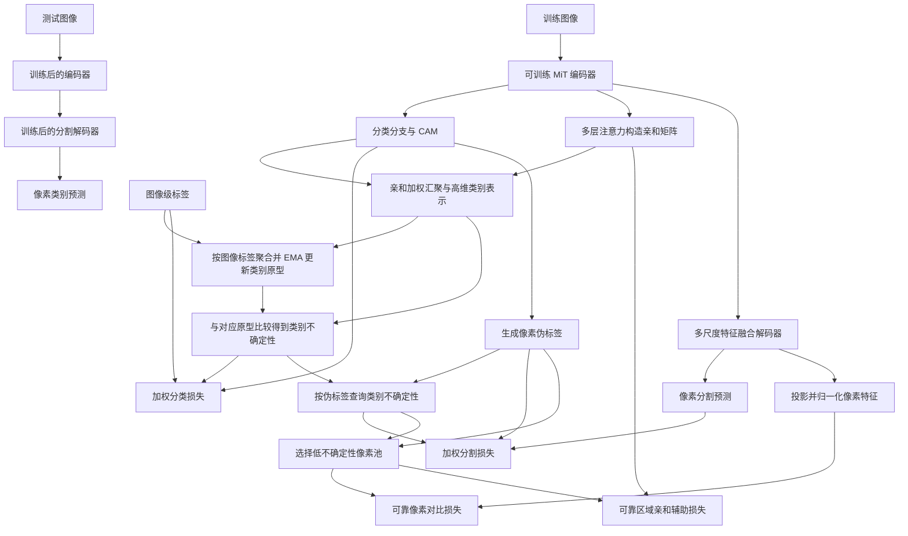
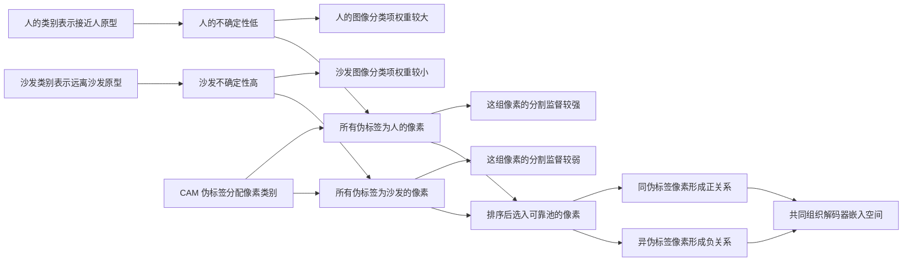

# 11 · UGRL：Method 回顾

UGRL 使用图像级类别标签，联合训练 ImageNet 预训练的 MiT 编码器、分类分支与 MLP 分割解码器，目标是直接输出像素级分割。它仍然使用 CAM 生成伪标签，但把重点放到“这些监督该信多少，以及解码器应该学成什么样”：先估计类别可靠性，再用它调节损失、筛选参与特征对比的像素。

**资料边界先说清楚：**本篇依据独立阅读的 AAAI 2026 正式论文，尤其是第 2736–2738 页的方法与实现设置。论文给出的官方地址 [YL616/UGRL](https://github.com/YL616/UGRL) 在核验时，GitHub API 与网页访问均返回 404，因此没有取得本工作的源码，也无法固定 commit、查明真实函数调用链。下文是有明确边界的论文方法回顾；所有伪代码都是帮助理解的概念整理，不是官方实现摘录。

出版信息已由 [AAAI 官方页面](https://ojs.aaai.org/index.php/AAAI/article/view/37262) 确认：AAAI 2026，卷 40、第 4 期，2734–2742 页，页面标注发表日期为 2026-03-14。它是会议论文，不因为会议录有卷期号就变成期刊扩展版。

## 先看整体流程

可以把 UGRL 理解成一个边学习分割、边调整监督信任度的单阶段框架。图中的训练路径来自论文 Fig. 2；推理路径是由网络输出结构得到的最小逻辑路径，具体测试脚本与后处理未能核验。



这里没有额外的文本编码器或 CLIP 教师。论文明确说整个网络使用 AdamW 训练，编码器有自己的学习率，所以不能把 ImageNet 预训练理解为“编码器冻结”。原型是随训练更新的跨批次状态；它与网络参数通过梯度更新是两种不同操作。至于原型更新在代码里是否使用 `no_grad`、不确定性是否 `detach`，论文没有交代，不能进一步断言。

### 对照原论文框架图，把三块控制接起来

下面复用 AAAI 2026 会议版的整体框架图，可与上面的 Mermaid 对着看。先沿左侧共享编码器看分类、解码两条路，再沿右侧的不确定性向下看监督如何被调节。

/images/a348b194c825adc0804a0b1655d2c543.png>)

图 2 为 UGRL 原论文方法总览，蓝、黄、绿三块分别标出 PUM、ULM、RSE。图片沿用仓库已有资源，图号由原笔记图注核实。[原论文笔记](<../UGRL/UGRL_paper_notes.md>)

**先看上方蓝区。** `Data batch → Encoder` 后，一条箭头把多层注意力 $S^l$ 送入 `Concat → g_cls → A`，另一条经 `Classifier` 得到 $f_{\mathrm{cls}}$。$A$ 向下连到 pooled 表示，表示空间关联参与类别信息汇聚；后面的圈叉由图例标为 Einstein summation，它把汇聚结果与 $\Phi$ 结合，得到 $\mathcal H^f_{\mathrm{cls}}$。带图像级真值 $y$ 的圈加标为 Bundling operation，按类别聚合出 batch 原型，再沿 `EMA Update` 更新云形的全局原型。当前表示和全局原型都进入右侧 $U(\cdot,\cdot)$，输出一排类别不确定性 $u_{\mathrm{cls}}$。这条右侧回路串起了“当前图像”和“训练历史”。

**再看中间黄区。** 分类分支向下产生 CAM，CAM 再产生 `Pseudo-labels Y`。$u_{\mathrm{cls}}$ 一路向左调节 $\mathcal L_{\mathrm{cls}}$，另一路与 $Y$ 一起进入圆圈 `p`，生成空间形状的 $u_{\mathrm{seg}}$。图例把 `p` 称作 Propagating operation，结合第 4 节的查表公式，可理解为按伪标签的类别把不确定性铺回像素。$\mathcal L_{\mathrm{seg}}$ 同时接收伪标签 $Y$、解码器预测 $p_{\mathrm{seg}}$ 和 $u_{\mathrm{seg}}$，分别提供目标类别、待优化的预测和监督权重。

**最后看下方绿区。** `Decoder → z → g_seg → L2-Norm` 把解码特征送进单位超球面 $\mathbf H_{\mathrm{seg}}$。右侧 $u_{\mathrm{seg}}$ 向下筛出可靠池 $\mathcal R$，再与像素嵌入共同进入 $\mathcal L_{\mathrm{ucl}}$。同一池子还在蓝区连接 $\mathcal L_{\mathrm{aux}}$，在那里约束亲和矩阵 $A$。因此，读图时应同时跟踪“被训练的特征从哪里来”和“哪些像素关系能进入损失”。

| 图中位置 | 对应本篇已有讲解与概念流程 |
| --- | --- |
| 蓝区 $A$、$\Phi$、batch/global 原型、$U$ | “2. PUM”与“3. 类别原型”，对应第一段伪代码的类别汇聚、EMA、原型距离 |
| 黄区 $u_{\mathrm{cls}}$、`p`、$u_{\mathrm{seg}}$ | “4. ULM”与“分类与分割损失的可确认部分”，对应第二段伪代码的按伪标签查表 |
| 绿区 `g_seg`、`L2-Norm`、$\mathcal R$ | “5. RSE”与“像素对比损失”，对应可靠池筛选、嵌入归一化、同异类配对 |
| 蓝区 $\mathcal R\rightarrow\mathcal L_{\mathrm{aux}}$ | “亲和辅助项与总目标”，补上整体流程中可靠区域对注意力亲和关系的约束 |

读图还需对齐几个层次。图中的 $y$ 表示图像级真值，$Y$ 来自 CAM，复习时要保留两者各自的监督来源。全局原型箭头标明 EMA，网络参数则由训练损失更新；共享编码器的可训练性已在上文说明。图中两个高维空间分别承载类别参照与像素关系，跟随箭头时要分别对应 PUM 和 RSE。这里展示训练框架，测试逻辑仍对应上方 Mermaid 的编码器、分割解码器路径；精确执行顺序、梯度截断及后处理沿用本篇已有的源码可获取范围说明。

用“人坐在沙发上”的例子复述，先由上方得到人和沙发各自的可靠性，再由黄区决定两类监督各占多大分量，最后由绿区选出可靠像素学习同类靠近、异类分离。这样就能从原图直接接回后面的两个任务、两种表示空间和四项训练目标。

## 顺着数据走一遍

### 1. 一张“人坐在沙发上”的图同时进入两个任务

训练标签只告诉模型“有人、有沙发”，不告诉它人的轮廓和沙发的范围。MiT 编码器提取多尺度特征，末端特征送分类分支产生类别激活；多尺度特征送分割解码器，产生逐像素预测。

为便于看维度，设批量大小为 $B$，前景类别数为 $C_f$，最终分割类别数为 $C_s=C_f+1$。图像标签可记作 $B\times C_f$，像素分割 logits 可记作 $B\times C_s\times H_s\times W_s$。这是用于解释的张量约定，不是已核实的源码布局。论文多处统一写 $C,H,W$，没有完整区分分类背景通道、解码器分辨率和原图分辨率。

分类是多标签任务，“人”和“沙发”可以同时为真，概率应按各类别独立解释，而非让所有前景类别通过一个 softmax 互相排斥。分割则是每个像素选一个类别，交叉熵对应在类别维上比较 logits。论文没有提供具体的激活函数调用和维度参数。

### 2. PUM：先给每张图的每个类别做一个表示

PUM 是 Prototype-driven Uncertainty Modeling。它不直接把 CAM 最大值当成可靠性，而是希望问：“这张图里的沙发，在表示空间里像不像我们长期见过的沙发？”

首先，论文从多个 Transformer 层取得多头注意力。若对齐后的空间位置数为 $N=hw$，单层有 $n$ 个头，文中将其表示为 $N\times N\times n$，再沿注意力通道拼接多个层。把空间关系与其转置相加后，交给轻量 MLP：

$$
A=g_{\mathrm{cls}}(S_{\mathrm{attn}}+S_{\mathrm{attn}}^{\top}).
$$

$A\in\mathbb R^{N\times N}$ 的含义是位置之间的语义关联。它用于引导类别表示的空间汇聚：与某类语义相关的空间信息，应该比随便平均整张图更有用。这里的 pooling 是汇聚空间信息，不是把不同类别揉成一个类别。论文没有说明不同层的注意力空间尺寸如何对齐，也未完整给出加权汇聚的归一化与收缩维度；因此不将这一步擅自写成特定的 `matmul`、`softmax(dim=...)` 或 `einsum`。

随后，投影矩阵 $\Phi$ 把类别表示映射到 $\mathcal H_{\mathrm{cls}}$，得到每张图的类别高维表示 $H_{\mathrm{cls}}\in\mathbb R^{C\times d_{\mathrm{cls}}}$。论文选择 $d_{\mathrm{cls}}=1024$。读这里时抓住“保留类别维，每个类别有一个向量”就够了；式 (2) 的简写不足以唯一恢复一个有确定输入通道的投影层，是否可训练、具体初始化也未能从源码确认。

### 3. 类别原型：把当前图与训练历史联系起来

对类别 $c$，只取当前 batch 中图像标签包含该类的样本，将对应向量逐元素相加，得到 batch 原型：

$$
\widehat P^c_{\mathrm{batch}}
=\sum_{x\in\mathcal B:\,y_x^c=1}H^c_{\mathrm{cls}}(x),
\qquad
P^c_{\mathrm{global}}\leftarrow
\eta P^c_{\mathrm{global}}+(1-\eta)\widehat P^c_{\mathrm{batch}}.
$$

论文把第一步叫 bundling，其具体定义是求和；不能自行改成 batch 均值。第二步是 EMA，让原型缓慢吸收训练中见到的类别特征，而不完全跟随一个 batch 的偶然样本。它是类别级记忆，不是为每个物体实例保存一个向量，也不是从真实像素标注求出前景中心。

随后，对当前图的类别表示与同类别全局原型计算余弦距离：

$$
u^c_{\mathrm{cls}}(x)
=1-\frac{\langle H^c_{\mathrm{cls}}(x),P^c_{\mathrm{global}}\rangle}
{\|H^c_{\mathrm{cls}}(x)\|_2\|P^c_{\mathrm{global}}\|_2}.
$$

靠近原型就得到较小的不确定性，远离则较大。数学上一般余弦距离在 $[0,2]$，不是天然校准到 $[0,1]$ 的“错误概率”。人的形态清晰、沙发被遮挡时，可能出现 $u^{\mathrm{person}}<u^{\mathrm{sofa}}$；这只是方法希望捕捉的情况，不能保证距离大的对象一定标错。类别少见、姿态特殊，也可能远离原型。

### 4. ULM：同一份类别可靠性用两次

ULM 是 Uncertainty-guided Loss Modulation。第一次用于图像分类：一张图里的不同类别项不再一律等权。图像级标签仍是真实监督，调的是该项对参数更新的影响，不是把“沙发存在”改成“不存在”。

第二次用于分割。CAM 先形成像素伪标签 $Y_{ij}$，再做一个类别查表：

$$
u^{ij}_{\mathrm{seg}}=u_{\mathrm{cls}}[Y_{ij}].
$$

如果一个像素被伪标签判为沙发，就拿这张图的“沙发不确定性”作为它的权重依据。这样一来，同图中所有伪标签为沙发的像素获得同一个不确定性值。它把类别级信号铺到像素网格上，**没有因此获得独立的像素级错误检测能力**。

这个区别很关键：沙发内部正确标注的像素和误扩到墙壁的“沙发像素”，在这一步可能完全同权。因此 ULM 能减少某些不可靠类别对训练的影响，但不能保证逐个找到 CAM 的错误边界。背景如何得到对应的不确定性、ignore 像素如何处理、CAM 到硬标签采用哪些阈值，在可读原文中没有足够细节。

### 5. RSE：不只要求输出答案对，还要求特征关系合理

RSE 是 Reliable Semantic Enhancement。分割解码器融合多尺度特征后得到 $z$，非线性投影头 $g_{\mathrm{seg}}$ 再把每个位置映射到独立的度量空间：

$$
E_i=g_{\mathrm{seg}}(z)_i,
\qquad
e_i=\frac{E_i}{\|E_i\|_2+\epsilon}.
$$

论文采用 $d_{\mathrm{seg}}=512$。L2 归一化沿每个像素向量的特征维进行，而不是对空间位置或类别概率做 softmax。归一化以后，向量内积可以表示余弦相似度。

两个高维空间要分清：$\mathcal H_{\mathrm{cls}}$ 存的是类别表示和类别原型，用来估计可靠性；$\mathcal H_{\mathrm{seg}}$ 存的是解码器的像素嵌入，用来组织局部语义。论文没有让分割像素直接去对齐 PUM 的类别原型，这不是一个“像素到类别原型”的对比损失。

对每张图，把像素按 $u_{\mathrm{seg}}$ 从小到大排序，选低不确定性部分构成可靠池 $\mathcal R$。论文的池大小实验按比例控制，所选配置为 35%。在池内，同伪标签的其他像素是正样本，不同伪标签的像素是负样本；anchor 自己不属于其正样本集合。

注意，排序依据仍是刚才的类别查表结果。同类像素有大量并列分数，可靠池可能偏向整类区域，不能把它描述成“精确挑出每类最可靠的中心像素”。并列时如何取样、是否保证多类都入池、没有正样本时如何处理，均没有代码证据。

## 关键模块与损失：每项到底在监督谁

### 分类与分割损失的可确定语义

为了避免把排版公式直接误当成可执行代码，可把两项训练意图写成：

$$
L_{\mathrm{cls}}\sim\sum_c w_{\mathrm{cls}}(u^c)\,
\operatorname{BCE}(\widehat y^c,y^c),
\qquad
L_{\mathrm{seg}}\sim\sum_{ij}w_{\mathrm{seg}}(u^{ij})\,
\operatorname{CE}(p_{ij},Y_{ij}).
$$

这里的 $w$ 仅代表“可靠性越低，影响越小”的调制关系，符号 $\sim$ 表示解释性结构，而非声称与源码逐项相同。分类标签来自人工图像标注，分割标签来自 CAM，二者可信度来源不同。

原论文式 (6)、(8) 印出的权重分别为 $e^{1/(\alpha u)}$、$e^{1/(\beta u)}$，正文称其为随不确定性衰减的权重；式中还直接使用对数概率项。由于没有实现，无法核实实际最小化损失的负号、$u=0$ 附近的数值保护、权重归一化等。本文不把它偷偷换成常见的 $e^{-u/\alpha}$，也不把印刷形式当作可以直接运行的 loss。可确认的是使用不确定性调节分类和分割监督这一设计。

### 像素对比损失

定义 anchor $i$ 的同类集合 $\mathcal R_i^+$ 和异类集合 $\mathcal R_i^-$。原论文式 (10) 的结构可清楚整理为：

$$
\ell_i=-\log\frac{
\sum_{j\in\mathcal R_i^+}\exp(e_i^\top e_j/\tau)}{
\sum_{j\in\mathcal R_i^+}\exp(e_i^\top e_j/\tau)
+\sum_{j\in\mathcal R_i^-}\exp(e_i^\top e_j/\tau)},
\qquad
L_{\mathrm{ucl}}=\frac1{|\mathcal R|}\sum_{i\in\mathcal R}\ell_i.
$$

它希望 anchor 的相似性总量更多地落在同类像素上。这里是“先把正样本指数项求和，再取对数”，不要替换成另一种“逐个正样本计算 log 后平均”的监督对比公式；两种目标不完全一样。

在例图中，人手臂和人的躯干若进入可靠池，会作为同类关系参与学习；人的特征与沙发的特征则应更易区分。该损失直接作用于投影后的解码器特征，因而能为解码器提供比最终类别输出更具体的表示约束。伪标签仍然可能出错，所以“类内聚拢、类间分开”是优化方向，不是对真实语义的理论保证。

### 亲和辅助项与总目标

论文还加入基于亲和矩阵 $A$ 的辅助损失，只在可靠池涉及的关系上计算，而不是任意像素之间都计算。它与 RSE 的分工不同：前者约束注意力导出的亲和关系，后者约束解码器嵌入。原文式 (12) 的正负关系记号与 sigmoid 项不足以无歧义恢复实际最小化实现，因此本文只保留其监督位置与可靠池限制，不补写未经核实的 BCE 或符号翻转。

总目标为：

$$
L=L_{\mathrm{cls}}+\lambda_1L_{\mathrm{seg}}
+\lambda_2L_{\mathrm{ucl}}+\lambda_3L_{\mathrm{aux}}.
$$

论文给出 VOC 总训练 20,000 次、前 2,000 次预热分类分支，COCO 总训练 80,000 次、前 5,000 次预热；图像随机缩放、翻转并裁剪至 $512\times512$，batch 为 8。可以据此理解“先让分类信号有基本可用性，再进行联合训练”，但不能据此确定预热期间每个模块是否前向运行、何时更新原型，以及各项损失的精确开启条件。

## 对照官方代码：访问结果与可复述的逻辑

当前不能给出“启动脚本 → 模型 forward → loss → 推理函数”的源码链。核验过论文首页指定的 [仓库](https://github.com/YL616/UGRL) 和 [GitHub 仓库 API](https://api.github.com/repos/YL616/UGRL)，两者都不可读；作者账户另有 UAMT，但其 README 明确对应视网膜 OCT 病灶分割，不能替代 UGRL 实现。

以下三段只按[正式论文](https://ojs.aaai.org/index.php/AAAI/article/download/37262/41224)整理数据依赖。函数名是说明性名称，没有对应到已读取的源码文件。

第一段对应式 (1)–(5)，表达 PUM 的输入、跨样本聚合和跨批次记忆：

```text
特征、各层注意力 = 编码器(图像)
类别表示 = 亲和引导汇聚并投影(分类分支特征, 各层注意力)
batch 原型 = 按真实图像标签，逐类汇总类别表示
全局原型 = 用 batch 原型作 EMA 更新
类别不确定性 = 1 - 当前类别表示与对应全局原型的余弦相似度
```

原型初始化、某批次缺失类别时的更新策略、计算不确定性使用更新前还是更新后的原型，没有足够证据确定。上述顺序表示论文的叙述依赖，不声称是一次训练迭代中的精确调用时序。

第二段对应式 (7)、(9)–(11)，表达可靠池如何连接 ULM 和 RSE：

```text
伪标签 = 从 CAM 形成像素标签
像素不确定性 = 按每个像素的伪标签，查询本图的类别不确定性
可靠池 = 每张图中不确定性最低的一部分像素
像素嵌入 = 对解码器融合特征作投影，并沿特征维 L2 归一化
正负关系 = 在可靠池内比较伪标签是否相同，排除 anchor 自身
对比损失 = 计算同类相似性总量占全部候选相似性总量的负对数
```

这里没有暗含离线生成一套固定伪标签再训练第二个网络。论文将它作为单阶段联合学习框架；但是是否缓存 CAM、多尺度生成如何实现、伪标签转换处如何停止梯度，都需要源码才能确定。

第三段只表达输出端的训练与测试角色：

```text
训练：分类与分割预测 + 图像标签与 CAM 伪标签
      + 不确定性权重 + 可靠池上的表示约束 -> 联合目标
测试：图像 -> 已训练编码器 -> 分割解码器 -> 像素类别预测
```

由论文结构可知，获得分割输出不必先为测试图建立一套新的类别原型；原型与可靠池主要服务训练监督。不过官方是否采用多尺度、翻转、CRF、滑窗或不同的输出融合，本次不能确认，也不把这些常见技巧填进其推理流程。

## 用一张图串起来：一个类别分数怎样影响整张图

下面示意的是可靠性的大小关系，不是论文实验测量结果。它强调同一张图的“人类可靠性”会广播到所有被标成人的像素；它不能区分同类像素中谁恰好被错标。



由这张图也能看出方法的能力边界：如果 CAM 把一块墙错标为人，而人的类别不确定性很低，这块墙也可能得到较强监督。UGRL 引入了可信度过滤，但没有把伪标签自动变成真值。学习到更好的特征可能改善后续预测，是否发生以及改善多少要看实验，不能从流程图直接推出。

## 回顾时抓住这几点

1. **原型提供的是类别参照。**它由包含该类的图像表示聚合并 EMA 更新，估计的是当前图中这个类别与全局类别参照的一致程度。
2. **不确定性有两条用途。**ULM 调整分类和分割监督的相对力度；RSE 根据它选择像素，再组织解码器特征关系。
3. **类别到像素是查表传播。**同图、同伪标签通常得到同一不确定性；它不等同于独立预测的边界置信度。
4. **两个投影空间服务不同任务。**类别空间用于原型距离，像素空间用于像素之间的对比，不要混成一个原型分类器。
5. **CAM 仍在训练链中。**“Escaping the CAM Shadow”强调改善解码器的学习方式，并不意味着彻底去掉 CAM。

自检：为什么只重加权分割交叉熵还不够？因为它主要约束输出类别，RSE 额外约束中间特征之间的关系。可靠池里的像素是否一定正确？不一定，可靠性来自类别表示与伪标签，错误也可能进入池中。推理时是否需要图像级真值标签？论文的分割输出路径不依赖这种训练监督；具体测试程序尚未取得。

## 资料与实现版本

| 核验项 | 本篇采用的依据与边界 |
| --- | --- |
| 会议版本 | Chang, Chen, Yang, Zhou，AAAI 2026；[正式出版页](https://ojs.aaai.org/index.php/AAAI/article/view/37262)，DOI [10.1609/aaai.v40i4.37262](https://doi.org/10.1609/aaai.v40i4.37262) |
| 方法原文 | [AAAI 正式 PDF](https://ojs.aaai.org/index.php/AAAI/article/download/37262/41224)；独立读取本地同题 9 页 PDF，重点复核 Fig. 2、式 (1)–(13)，并渲染核看第 2736、2737 页 |
| 官方仓库 | 论文首页指定 [YL616/UGRL](https://github.com/YL616/UGRL)；核验日期 2026-11-11，网页与 API 均返回 404 |
| 代码版本 | 未取得代码；commit、tag、branch 和训练/推理入口均不可核实，不提供虚构的固定源码链接 |
| 同作者仓库排除 | [YL616/UAMT 的 README](https://github.com/YL616/UAMT/blob/main/UAMT/UAMT/README.md) 是 OCT 病灶分割的另一项工作；仅用于排除误认，不作为 UGRL 方法或实现依据 |
| 补充材料与运行 | 未取得独立补充材料；未运行训练、评估或复现实验 |
| 期刊扩展 | 按完整标题、UGRL、作者名与 journal / extended version 检索，尚未找到可确认属于本工作期刊扩展的原始声明 |

扩展版检索中还出现同作者的 [Rethinking weakly supervised semantic segmentation from an object-centric perspective](https://www.sciencedirect.com/science/article/abs/pii/S0031320326020029)，出版页条目为 Pattern Recognition 183、115038，卷期年份 2027，DOI 年份 2026。检索可读内容将其方法命名为 SOC，并未提供足够证据证明它是 UGRL 的期刊扩展；直接页面访问另遇到 403。因此本篇不把它作为第二版本展开，也不把同作者、同任务或共同使用不确定性当成扩展关系的证明。

本篇完成的是论文层面的机制回顾与资料边界核验。源码访问恢复后，仍需补核亲和汇聚的维度、投影层定义、权重公式与数值稳定、原型更新时机、背景及 ignore 处理、可靠池采样、损失系数和测试后处理，才能升级为按真实调用链组织的实现回顾。
