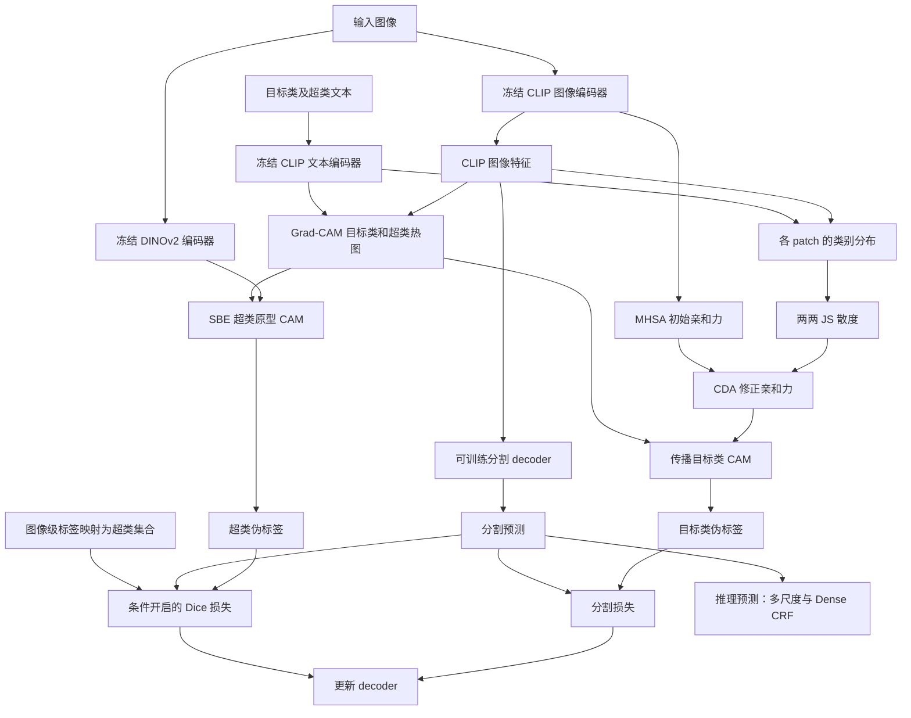
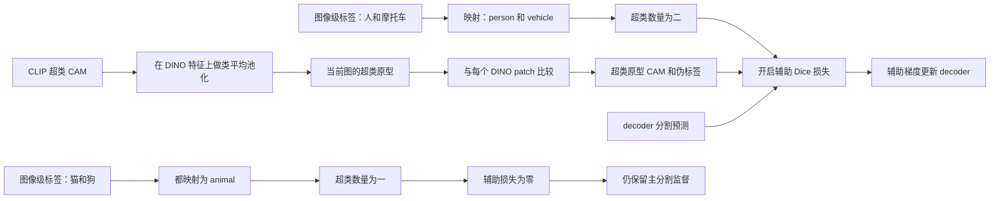

# 12 · CD-CLIP：Method 回顾

CD-CLIP 使用图像级类别标签，冻结 CLIP 图像编码器、文本编码器和 DINOv2 编码器，训练分割 decoder，最终输出像素级语义分割。它的核心想法是：**用每个 patch 对整套类别的响应分布来改善 CAM 的传播关系，再用 DINO 的超类原型给 decoder 补一份区域边界监督。**

本文对应 Ziqian Yang 等人的 *Leveraging Class Distributions in CLIP for Weakly Supervised Semantic Segmentation*，已核实为 **CVPR 2026，34714–34723 页**。截至本次核验，未找到可以确认属于这项工作的期刊扩展版。[CVF 官方条目](https://openaccess.thecvf.com/content/CVPR2026/html/Yang_Leveraging_Class_Distributions_in_CLIP_for_Weakly_Supervised_Semantic_Segmentation_CVPR_2026_paper.html)

> **阅读边界：**已独立阅读本地原论文的方法、实现设置和图 2，并检查论文链接的官方仓库。固定提交 `db72ddc372cbcc7592db6f1d716c6a1b9a79605a` 的完整文件树只有 `.gitignore` 与 `README.md`，没有训练脚本、模型或推理实现。因此下文是有原论文依据的方法回顾；不能声称已经核实入口、`forward`、loss 到推理的真实函数调用链。伪代码均为论文流程整理，绝非官方代码摘录。[固定版本文件树](https://github.com/yay97/CD-CLIP/tree/db72ddc372cbcc7592db6f1d716c6a1b9a79605a)

## 先看整体流程

先把三个不同的东西分开：CAM 是“某一类在哪些位置亮”；亲和力是“两个位置应不应该交换信息”；decoder 输出才是最后要交付的分割结果。CD-CLIP 同时改善前两者产生的监督，再用监督训练第三者。



上图的 CAM、CDA、SBE 和损失路径承担训练监督。根据论文图 2，预测主路径是“图像 → CLIP 特征 → decoder → 分割”；正文另明确给出推理多尺度 `{1.0, 1.5}` 和 Dense CRF。**推理脚本是否完全跳过其余分支、如何合并尺度、是否翻转测试，公开仓库无法验证。**这张图表达方法的数据依赖，不冒充已运行的调用图。

### 对照原论文图 2 阅读两条监督分支

结合下面的原论文框架图，可以把前面的 Mermaid 对应到具体模块。先看左侧编码器，再读右上角 CDA，最后沿底部 SBE 走到右侧的分割结果。

/images/CD-CLIP_Figure_2.png>)

*图 2，CD-CLIP 的 CVPR 2026 版框架概览。复用原论文笔记中的本地图片，图号及图注可在来源笔记的第 3 节核对。*[原论文笔记](<../CD-CLIP/CD-CLIP_paper_notes.md>)

**先读输入和图例。**左上角 Target Classes 与 Super Classes 共同进入 Prompt，再经 Text Encoder 得到两组文本特征。左侧图像同时送入 Visual Encoder 和 DINO Encoder。三个编码器上的雪花表示冻结，带斜线的箭头表示图中标注的无梯度路径。黑箭头传递前向数据，红箭头连接损失与监督对象。中间 Class logits 附近的蓝色虚线对应 CAM 生成所需的梯度信息，可接着阅读后文第 2 节的 Grad-CAM 公式，以及损失小节关于冻结参数与特征导数的说明。

**再读右上角 CDA。**Image Features 与 Text Features 在圆圈 S 处计算余弦相似度，形成 Attention Maps。两条黑箭头选出两个 patch 的整串类别响应，右上角柱状图同时包含 Target Classes 和 Super Classes。JS 比较这些分布，得到的位置关系与 MHSA 提供的 Initial Affinity 结合，形成 CDA Affinity，再向下参与 CAM 细化。这样便能把图上的柱状图、方阵、热图，依次对应到后文的类别分布、patch 两两关系和传播后的 CAM。

**最后读底部 SBE 和右侧输出。**Super CAM 向下进入圆圈 P，用它指定的区域汇聚 DINO Features，得到黄色的 Super-Class Prototypes。原型与 DINO 特征在圆圈 S 处比较，产生 Prototype CAM 和超类伪标签。右侧另一条 Image Features → Decoder → Seg 路径给出分割预测。上方目标类伪标签经红箭头参与 $\mathcal L_{seg}$，底部超类伪标签参与 $\mathcal L_b$，Class Label 的红箭头则对应后文的超类数量筛选条件。

| 原图中的位置 | 接到本文哪里 | 对应后文的论文流程伪代码 |
|---|---|---|
| 编码器、Class logits 与 CAM | 第 1、2 节的特征准备和初始 CAM | 第一段的 `GradCAM`、`initial_affinity` |
| Attention Maps → JS → CDA Affinity | 第 3 节两次 softmax、JS 与 CAM 传播 | 第二段的 `class_distributions`、`paper_equation_5`、`propagate` |
| Super CAM → P → 原型 → S | 第 4 节的 CAP 与 DINO 空间余弦相似度 | 第三段的 `CAP`、`prototype_cam` |
| 两份 Pseudo label、Class Label 与红箭头 | “关键损失”及超类监督 Mermaid | 第三段的条件 Dice 和 `update_decoder` |

**读图时留意三个细节。**圆圈 S 的两次出现分别连接 CLIP 图文特征和 DINO 原型特征，阅读时要跟住输入所属的特征空间。上方 CAM 与底部 Prototype CAM 具有不同类别粒度，两份伪标签最终一起监督同一个 decoder。Class Label 连到 $\mathcal L_b$ 的画法只概括监督依赖，具体开启条件需结合正文的 $|C_p|\ge2$ 阅读。

拿“人骑摩托车”复述一遍，右上角比较 patch 分布并传播 CAM，底部借 person、vehicle 的超类 CAM 生成 DINO 原型监督，右侧 decoder 学习输出 person、motorbike 的细类分割。沿用本文开头的源码核验范围，这些对应关系依托论文图示和讲解伪代码，具体函数、张量对齐与推理分支仍需公开实现确认。

## 顺着数据走一遍

### 1. 一张“人骑摩托车”的图，同时得到语义和结构信息

假设训练图像的图像级标签是 `person`、`motorbike`。这份标签只告诉模型图里有什么，不告诉哪个像素属于谁。目标类的文本提供细粒度语义；额外设计的超类文本提供更粗的语义视角。VOC 使用五个超类：`animal`、`vehicle`、`household item`、`furniture`、`person`。这里人映射到 `person`，摩托车映射到 `vehicle`。

令 patch 数为 $L=hw$，目标类文本数为 $C$，超类文本数为 $N$。为了阅读方便，将论文的空间特征展平为 $F\in\mathbb R^{L\times d}$，全部文本特征为 $T_{all}\in\mathbb R^{(C+N)\times d}$。后续会反复出现三种形状：

| 对象 | 形状 | 每一行或每个元素的含义 |
|---|---|---|
| patch 对文本的相似度 | $L\times(C+N)$ | 一个 patch 对整套文本的响应 |
| patch 两两关系 | $L\times L$ | 一个位置与另一个位置的关联强度 |
| 某一类别的 CAM | $1\times L$ | 这一类在所有位置的激活程度 |

论文实现设置使用 CLIP ViT-B/16 和 DINOv2 ViT-B/14；输入分别裁为 $320\times320$、$308\times308$。按 patch 大小推算，两路原生网格分别为 $20\times20$ 和 $22\times22$，不能直接逐点相乘。方法公式把它们简写在共同空间网格上，真正实现必须处理空间对齐，但正文没有说明插值方向和裁剪配准细节。这是待源码补齐的步骤，不能因为公式都写 $h,w$ 就当成天然相同。

### 2. 先获得初始 CAM 和初始传播关系

初始 CAM 采用 Grad-CAM。它先计算某类的图像—文本分类分数，再利用分数对视觉特征的梯度，确定哪些特征通道更支持这个类别：

$$
M_{init}^{c}=\operatorname{ReLU}\left(\sum_k W_k^c V^k\right).
$$

$V^k$ 是第 $k$ 个通道的空间激活，$W_k^c$ 是由类别梯度得到的通道权重。因此这里的 CAM 不是简单把 patch—文本余弦相似度直接当成分割结果。人衣服上的辨识性特征可能很亮，头部却不够亮；后面需要通过 patch 关系把已有证据传过去。超类 CAM $M_s^n$ 也按这条 Grad-CAM 思路生成。

同时，从 CLIP 的多头自注意力得到空间关系 $A$，经 Sinkhorn 归一化和对称化构造：

$$
A_{init}=\frac{\operatorname{Sinkhorn}(A)+\operatorname{Sinkhorn}(A)^\top}{2}.
$$

这张 $L\times L$ 矩阵是传播通道，而不是类别标签。对称化让两个位置之间的关系不再只取单向注意力；它仍可能把同一个人的不同部位连得不够强，或者把人和紧贴着的摩托车连在一起。注意力的具体层与头如何汇聚、Sinkhorn 的迭代次数，正文未给出可复现的完整细节。

### 3. CDA 比较“整套类别响应”，重新安排传播关系

CDA 首先计算图像 patch 与所有目标类、超类文本之间的余弦相似度，再做 min-max 归一化：

$$
S_a=\operatorname{MinMax}\bigl(\operatorname{CosSim}(F,T_{all})\bigr).
$$

对每个 patch，沿 **类别维** 做 softmax，得到 $p_i\in\mathbb R^{C+N}$。此时一个位置不只剩下“person 分数”，还保留它对 vehicle、animal 等语义的相对响应。人头和衣服的 person 分数可能差很多，但整串响应的形状仍相似；CDA 希望利用这份额外线索把它们联系起来。不存在的类别也能作为比较响应形状的坐标，它们不因此成为该图的真实标签。

然后对每对 patch 计算 JS 散度。将公式展开为索引形式，更容易看懂论文式 (4) 中的两两比较：

$$
\begin{aligned}
m_{ij}&=(p_i+p_j)/2,\\
\operatorname{JS}(p_i,p_j)&=\tfrac12\operatorname{KL}(p_i\|m_{ij})
+\tfrac12\operatorname{KL}(p_j\|m_{ij}),\\
S_d(i,j)&=\bigl[1-\operatorname{JS}(p_i,p_j)\bigr]/\tau.
\end{aligned}
$$

分布越像，JS 越小，相似度越高。这里得到的是 $L\times L$ 的位置关系，不再是 $L\times(C+N)$ 的类别分数。第二次 softmax 则是在位置关系上分配权重；概念上是固定一个 patch，比较它与所有其他 patch 的相似程度。这与前一次“沿类别维形成分布”的 softmax 是两回事。

论文接着写：

$$
A_d=\operatorname{Softmax}(S_d)\cdot A_{init},
\qquad
M_{re}^{c}=M_{init}^{c}\cdot(A_d)^t.
$$

按通常矩阵记法，前式让分布关系与原始亲和力组合，后式把 CAM 沿修正后的关系传播 $t$ 次。以 $M_{init}^c$ 为行向量理解，输出仍是一张同类 CAM。**不要把“修正关系”自动解释成新增可训练注意力层，也不要把式中的乘号直接声称为已核实的某个 PyTorch 运算。**具体实现中采用何种乘法、在哪一维归一化、是否补做归一化，现有公开仓库均无法检查；本文保留原论文的运算记法。

直觉上，CDA 让强激活的人体区域更容易影响原来漏掉的头部。不过，“分布相似”只是一种经验线索，不保证两个 patch 一定同类。人和摩托车接触的位置可能混入相近语义，传播后仍会越界，所以还需要下一条监督路径。

### 4. SBE 在 DINO 空间里找超类原型

DINOv2 特征擅长表达视觉区域的结构，但自身没有“这个区域叫 vehicle”的文本接口。SBE 借 CLIP 的超类 CAM 指明大概位置，再在这些位置上聚合 DINO 特征，形成每张图自己的超类原型：

$$
f_s^n=\operatorname{CAP}(M_s^n\odot F_d),
\qquad
M_p^n(i)=\operatorname{ReLU}\bigl(\operatorname{CosSim}(f_s^n,F_d(i))\bigr).
$$

CAP 是 class average pooling：沿空间位置汇聚，保留特征通道，所以每个超类最终得到一个特征向量。理解上，可以把它想成“用 vehicle CAM 指出的区域，为这一张图求一份代表交通工具的 DINO 特征”。再拿这个向量与每个 DINO patch 比较，得到新的 vehicle 原型 CAM。这里比较的是同一个 DINO 特征空间里的两个向量，**不是把 CLIP 文本向量直接与 DINO 向量做余弦相似度**。

需要区分聚合的概念和实现细节：论文没有展开 CAP 的分母、CAM 是否先阈值化、空区域怎样处理。不能直接把某个“按权重和归一化的加权平均”当成作者已经公开的代码。可确认的是，原型来自当前图的超类 CAM 与 DINO 特征；正文没有跨图原型队列或 EMA 原型更新的描述。

SBE 的角色也不是把 CDA 的亲和力改一遍。它另行产生超类伪标签，为同一个 decoder 提供辅助监督。这样，目标类 CAM 负责告诉模型“这里是 person、那里是 motorbike”，DINO 超类原型则补充“人的区域和交通工具区域应当分开”。

## 关键损失：两份监督都落在 decoder 上

主分割损失 $\mathcal L_{seg}$ 使用细化目标类 CAM 导出的伪标签。辅助分支从超类原型 CAM 导出 $Y_s$，但只对图中至少出现两个超类的样本开启 Dice 损失：

$$
\mathcal L_b=
\begin{cases}
\operatorname{Dice}(P,Y_s),& |C_p|\ge2,\\
0,& |C_p|<2,
\end{cases}
\qquad
\mathcal L=\mathcal L_{seg}+0.6\mathcal L_b.
$$

$C_p$ 来自**图像级目标类标签映射后的超类集合**，不是先让 decoder 预测类别，再按预测类别决定是否启用损失。`person + motorbike` 对应两个超类，会开启辅助项；`cat + dog` 虽然有两个细类，却都属于 animal，不满足开启条件。这个筛选针对跨超类的区域分离，不能据此声称 SBE 直接解决所有细类别之间的边界。

“边界增强损失”这个名称也容易令人误会。正文定义的是条件开启的 Dice loss，没有给出边缘检测、轮廓带提取或只在窄边界 mask 上计算损失的公式。它通过更可靠的超类区域监督改善边界，不应自行补出一条边缘检测分支。

论文用 $P$ 概括分割预测，但没有展开细类预测通道与超类伪标签怎样对齐。例如，将同一超类的细类概率求和，是一种可能的实现方式；**这只是解释维度需要对齐的例子，不是 CD-CLIP 已核实的实现**。类似地，正文没有完整定义 $\mathcal L_{seg}$ 的计算形式、背景阈值、伪标签 ignore 值及 Dice 的平滑项。它们会影响复现，不能从其他工作的默认值移植过来充当事实。

三个编码器冻结，学习的主体是轻量 Transformer decoder。Grad-CAM 计算类别分数对中间特征的导数，与用分割损失更新 CLIP 参数是两回事：前者用于生成热图，后者在这里被阻断。按论文图示，伪标签路径提供固定监督，decoder 接受两种损失的梯度；具体代码如何设置 `requires_grad`、`detach` 或梯度上下文，尚无实现可查。

## 用一张图串起超类监督的选择

下面这张图只展开 SBE 的监督逻辑，与前面的总流程图关注点不同。



对贯穿全文的例子，CDA 要补上“同一个人身上漏掉的部位”；SBE 要避免“补全人体时把摩托车也吞进去”。二者都在帮助 decoder 学习，但分工不同：前者修 CAM 的传播关系，后者增加超类区域监督。最终仍由 decoder 输出 person 和 motorbike 等目标类，而不是只输出 person、vehicle 这套超类。

## 对照官方仓库：可核实范围与论文流程伪代码

官方地址来自本地 PDF 第一页的真实超链接。已经检查 `main`、提交列表、递归文件树和 README：可见分支只有 `main`，历史只有 2026-03-16 的 initial commit；该提交中 README 只有项目名称和论文标题。没有能够继续追踪的运行入口，更不存在可引用的 `CDA.forward`、`train.py` 或 `infer.py`。[README 固定版本](https://github.com/yay97/CD-CLIP/blob/db72ddc372cbcc7592db6f1d716c6a1b9a79605a/README.md) · [提交记录](https://github.com/yay97/CD-CLIP/commit/db72ddc372cbcc7592db6f1d716c6a1b9a79605a)

下面三段只整理论文方法的计算顺序，变量及函数名为讲解自定义。它们不能直接执行，也不填补尚未公开的阈值、通道映射及函数调用。

**第一段：先准备冻结模型的两类信息。**依据原论文 §3.1、图 2 和 §4.1。

```text
clip_features, attention = frozen_CLIP_image(image_clip)
text_features = frozen_CLIP_text(target_names + superclass_names)
dino_features = frozen_DINOv2(image_dino)

target_cam, super_cam = GradCAM(class_scores, clip_features)
initial_affinity = symmetrize(Sinkhorn(attention))
seg_prediction = trainable_decoder(clip_features)
```

冻结表示不更新编码器参数；Grad-CAM 所需的特征导数仍然要计算。图像两路预处理的精确配准、特征层选择并没有被这段概念伪代码解决。

**第二段：CDA 负责建立关系，再传播类别证据。**依据原论文 §3.2，式 (3)–(6)。

```text
scores = minmax(cosine(clip_patch_features, all_text_features))
class_distributions = softmax_over_classes(scores)
distribution_relation = (1 - pairwise_JS(class_distributions)) / tau
cda_affinity = paper_equation_5(distribution_relation, initial_affinity)
refined_cam = propagate(target_cam, cda_affinity, iterations=t)
target_pseudo_label = derive_pseudo_label(refined_cam)
```

这里刻意保留 `paper_equation_5`，不把缺少源码确认的组合方式写成具体 `@` 或逐元素乘法。`derive_pseudo_label` 同样代表论文提到但没有充分展开的步骤，不暗含已知背景阈值和 ignore 规则。

**第三段：SBE 生成另一份监督，按超类数量决定是否启用。**依据原论文 §3.3–3.4，式 (7)–(10)。

```text
super_prototypes = CAP(super_cam, spatially_aligned_dino_features)
prototype_cam = relu(cosine(super_prototypes, dino_patch_features))
super_pseudo_label = derive_pseudo_label(prototype_cam)

present_superclasses = map_image_labels_to_superclasses(image_labels)
loss_boundary = 0
if count(present_superclasses) >= 2:
    loss_boundary = paper_Dice(seg_prediction, super_pseudo_label)
loss = segmentation_loss(seg_prediction, target_pseudo_label)
loss += 0.6 * loss_boundary
update_decoder(loss)
```

这三段对应的是“论文所述训练逻辑”。伪标签是否缓存、是否每一步重算、loss 的实际函数和推理分支是否复用训练 `forward`，都不能由目前仓库回答。论文将方法定位为单阶段，但“单阶段”不自动等于“每一步所有伪标签都在线重新生成”。

## 回顾时抓住这几点

1. **CDA 比的是类别分布，不是只比目标类 CAM 的一个数。**它把 patch—类别响应转成 patch—patch 关系，再用关系传播 CAM。
2. **两次 softmax 的对象不同。**第一次把每个 patch 的类别响应变成分布；第二次处理分布比较得到的位置关系。其具体代码轴与归一化实现尚未公开。
3. **SBE 的语义来自 CLIP，原型特征来自 DINO。**超类 CAM 负责指位置，DINO 特征负责形成原型和更紧致的区域响应。
4. **至少两个细类不等于至少两个超类。**辅助 Dice 由图像标签映射后的超类数量开启，主分割监督仍负责全部目标类学习。
5. **训练结果是 decoder，不是直接交付原型 CAM。**冻结骨干与无需训练的 CDA，不代表整套 CD-CLIP 无需训练。

自检：如果只有猫和狗，辅助损失是否开启？按论文规则不开启，因为它们只覆盖 animal 一个超类。如果把 DINO 原型 CAM 直接当最终结果，会缺少什么？会丢掉 decoder 学到的目标类别分割，也混淆超类监督与最终输出的粒度。

## 资料与实现版本

| 资料 | 本次核验内容 |
|---|---|
| [本地原论文 PDF](<E:/Data/GitHubRepo/Deeplearning-notes-Obsidian/99_Assets (资源文件)/papers/Yang_Leveraging_Class_Distributions_in_CLIP_for_Weakly_Supervised_Semantic_Segmentation_CVPR_2026_paper.pdf>) | 10 页；独立读 §3 方法、§4.1 实现设置，渲染检查方法图及公式。上述技术说明的主要依据 |
| [CVF 官方出版条目](https://openaccess.thecvf.com/content/CVPR2026/html/Yang_Leveraging_Class_Distributions_in_CLIP_for_Weakly_Supervised_Semantic_Segmentation_CVPR_2026_paper.html) | 搜索索引返回官方作者、会议、年份、页码；直接页面请求返回 403 |
| [官方 README 固定版本](https://github.com/yay97/CD-CLIP/blob/db72ddc372cbcc7592db6f1d716c6a1b9a79605a/README.md) | 确认项目与论文标题，但没有方法实现或使用说明 |
| [固定提交递归文件树](https://api.github.com/repos/yay97/CD-CLIP/git/trees/db72ddc372cbcc7592db6f1d716c6a1b9a79605a?recursive=1) | 返回完整、未截断的两文件列表，未发现实现源码 |
| [官方提交列表](https://api.github.com/repos/yay97/CD-CLIP/commits) | 可见唯一提交为 `db72ddc372cbcc7592db6f1d716c6a1b9a79605a`，2026-03-16 |
| [官方分支列表](https://api.github.com/repos/yay97/CD-CLIP/branches) | 可见分支只有 `main`，指向上述提交 |

**补充材料：**官方条目的索引显示存在补充材料入口，但本次未取得补充 PDF 正文，不将其列作方法依据。因此未补写 COCO 超类完整集合或正文没有交代的实现参数。

**期刊扩展核验：**检索了完整论文题名、CD-CLIP 与作者组合，以及 journal、TPAMI、extended 等关键词，没有发现能够建立“同一工作的期刊扩展”关系的正式记录；本篇只覆盖已确认的 CVPR 2026 版本。相近的 CLIP/DINO 论文不能据标题或骨干相似就并入这个论文家族。

**代码与运行状态：**确实读取了官方 README 和仓库版本元数据，未读到模型实现，因为固定版本中未提供；没有运行训练、推理或复现实验。访问限制包括 CVF 正文页面的 403、补充材料未取得，以及 GitHub 工具对 tags 接口的限制；分支、提交和完整文件树均已成功取得。这里记录的是已验证的公开资料边界，而不是对未公开实现的猜测。
