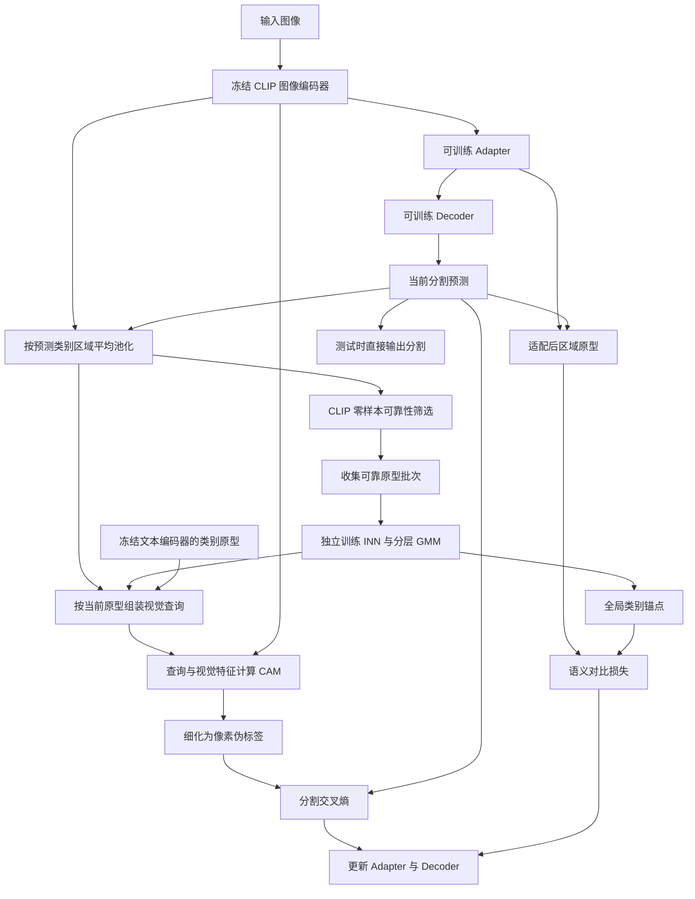
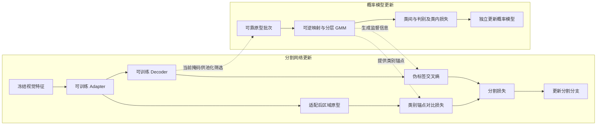

# 13 · VDA：Method 回顾

VDA 使用图像级类别标签做弱监督语义分割，冻结 CLIP 图像与文本编码器，学习 adapter、分割 decoder，以及训练时辅助使用的可逆概率模型。训练时，它把当前图像里的视觉信息拼成类别查询，生成 CAM 和伪标签；测试时移除概率模型相关分支，由图像编码器、adapter 和 decoder 输出分割结果。核心想法是：与其一直修改“鸟是什么样”的文字，不如从视觉特征里学出一套“鸟的外观积木”，再按当前这只鸟的特点组装查询。

本文覆盖 **CVPR 2026 会议版**，正式标题为 *Beyond Text: Visual Description Assembly by Probabilistic Model for CLIP-based Weakly Supervised Semantic Segmentation*，作者为 Xianglin Qiu、Jian Wang、Xiaolei Wang、Zhen Zhang、Jimin Xiao，会议论文页码为 6346–6356。[CVF 出版记录](https://openaccess.thecvf.com/content/CVPR2026/html/Qiu_Beyond_Text_Visual_Description_Assembly_by_Probabilistic_Model_for_CLIP-based_CVPR_2026_paper.html)

**实现资料边界先说明：** 原论文直接链接的官方仓库可以读取，但截至核查日，固定提交 `abc38b6cdef2dd689a3abef9609b0090459e41e0` 只有 README、框架图和一个仅 1 字节的 `sources/configs` 文件，没有训练脚本、模型或损失实现。因此下面按原论文方法段解释数据流，不能声称已核实作者的实际 `forward`、反向传播调用顺序或推理代码。后文单独列出已经核实与仍缺失的部分，不把示意伪代码当作官方实现。[固定版本文件树](https://github.com/weakguy98/VDA/tree/abc38b6cdef2dd689a3abef9609b0090459e41e0)

## 先看整体流程



图中的回路表示训练期间反复利用“当前预测”，不表示对一个样本无限迭代到收敛。原论文明确把分割网络优化和 INN 优化分开；测试路径只保留图像编码器、adapter、decoder。至于一个训练 step 内先更新谁、缓存何时填满、何时切换视觉查询，公开材料不足以还原。

可以把系统理解成两件互相提供信息的工作：分割网络负责逐像素判断；概率模型负责整理“各类物体通常怎样出现”。前者给后者提供候选区域，后者把积累的外观结构转成更合适的监督。

### 对着原论文图 2，把信息流接起来

结合下面的原论文框架图，可以把前面的 Mermaid 落到具体模块上。建议先读左上 (a)，再读左下 (b)、右下 (c)，最后看右上 (d)。

/images/9797a2ea56505b4768ff09ff6df54062.png>)

图 2 为 CVPR 2026 会议版 VDA 的整体框架，复用原笔记已有资源。图中的雪花表示冻结，火焰表示可学习，圆圈 M、W、S、C 分别表示掩码平均池化、重加权、求和、余弦相似度。图号与分图名称可在原笔记的图注中核对。[原笔记及图注](<../VDA/VDA_paper_notes.md>)

**先顺着 (a) 的鸟图往右走。** 输入经过 CLIP Visual Encoder 得到 Visual Features，再经 Adapter、Decoder 得到 Prediction。预测掩码往下接到 M，与原始视觉特征一起池化出 Instance Prototype。这个向量向左经过 Zero-shot Filter，被收集进 Reliable Prototype Batch，再交给 VAMD；向右则进入 VDAF，为当前图像组装查询。右上另一处 M 使用 Adapted Visual Features，得到的 Adapted Instance Prototype 交给 DSE。读到这里，就能把“原始 CLIP 区域原型”和“适配后区域原型”各自沿箭头找到。

| 原图位置与模块 | 接到本文哪里 | 沿箭头应记住什么 |
| --- | --- | --- |
| (a) M、Zero-shot Filter、Reliable Prototype Batch | 第 2、3 节及第一段教学伪代码 | 当前预测提供掩码，筛选后的原型提供概率模型的学习样本 |
| (b) INN、Inter-Class GMM、Intra-Class GMM | 第 4 节 VAMD | 先建立类别层面的分布，再展开该类内部的潜在属性成分 |
| (c) Attribute Responses、W、S | 第 5 节 VDAF 及第二段教学伪代码 | 当前区域决定配比，逆映射得到的 Attribute Prototypes 按配比组成 Visual Prototype |
| (c) Density Estimation、Fusion、C | 第 6 节 | 类间密度决定视觉与文本的融合比例，融合查询再与空间特征计算 CAM |
| (d) Class Anchors、Pull / Push | 第 7 节 DSE 及第三段教学伪代码 | 适配后原型对齐正确类别锚点，并与其他类别锚点拉开距离 |

**再看 (b)、(c) 里 INN 的来回方向。** (b) 中可靠原型从左进入 INN，在潜空间形成分层 GMM。到了 (c)，右侧 Latent Attribute Prototypes 沿向左的虚线穿过 INN，回到可与 CLIP 特征比较的 Attribute Prototypes。左侧当前 Instance Prototype 则送入 INN 和类内 GMM，产生图示的 0.2、0.5、0.3 属性响应，经 W 与 S 组成 Visual Prototype。下方另一路接类间 GMM 和 Density Estimation，图示的 0.3 再参与 Fusion。这些数字展示两种权重各自出现的位置，复习时分别对照第 5、6 节的公式。

读图时有三处值得停一下。

- (a) 的 Stop Gradient 画在可靠批次通往 VAMD 的路径上，对应后文两套独立优化目标。图中模块连通说明它们交换信息，精确的梯度截断位置与更新时序仍受本文开头所述公开资料范围限制。
- 图中 CAM 的箭头到热力图为止。按第 7 节和现有 Mermaid，后续还包括细化为伪标签、计算分割交叉熵，再更新 Adapter 和 Decoder。训练监督需要把这几步一起接上。
- (d) 标了 Sampling，本文第 7 节按正文公式使用类间中心的逆映射解释锚点。图示保留了采样这一抽象环节，具体采样数量、聚合方式需要实现资料才能进一步确定。

用这只鸟复述一次，就是“先预测鸟区域，收集可信外观，学成属性词典，再按这只鸟的响应配出查询”。CAM 伪标签和 DSE 锚点共同服务训练；测试路径对应 (a) 顶部的图像编码器、Adapter、Decoder。本文下方三段教学伪代码可依次与 (a)(b)、(c)、(d) 对照，当前可获取的官方仓库资料边界仍按开头说明理解。

## 顺着数据走一遍

### 1. 同一张特征图分成两条用途不同的路径

以“一只鸟站在树枝上”为例。图像经过冻结 CLIP 后得到特征图 $V\in\mathbb R^{h\times w\times D}$。这里 $h,w$ 是特征网格尺寸，$D$ 是每个位置的特征维数，不能直接把它当作原图像素分辨率。

一条路径把 $V$ 交给 adapter 和 decoder，输出类别预测。另一条保留原始 CLIP 特征，用于计算区域原型和 CAM。这个区分很关键：概率模型学习的是 CLIP 视觉空间中的区域表示；分割损失则主要训练适配后的表征与解码器。正文将骨干细粒度知识处理、adapter 和 decoder 架构指向 ExCEL 的设置，但没有公开 VDA 源文件，所以这里不额外指定“取了哪些层、如何融合、通道究竟多大”。

### 2. 预测出来的鸟区域，先压缩成一个向量

记 decoder 的硬类别预测为 $\hat y(u)$，$u$ 是特征网格上的位置。鸟类 $k$ 对应掩码 $m_k(u)=\mathbf 1[\hat y(u)=k]$，原型为：

$$
p_k=\frac{\sum_u m_k(u)V(u)}{\sum_u m_k(u)}\in\mathbb R^D.
$$

这就是 masked average pooling：把当前判为鸟的所有位置平均一下，得到“这张图里的鸟看起来怎样”。它不是用真实像素标注池化，也不是 softmax 加权池化。

论文称它为 instance prototype，但按这个定义，一张图里同类的多只鸟可能一起被平均进去；没有证据表明这里另做实例分割或连通域拆分。掩码全空时如何处理、掩码插值如何对齐特征网格，也需要源码才能确认。

### 3. 不是所有预测区域都有资格教概率模型

如果 decoder 把一段树枝也算成鸟，平均出来的原型就可能偏离鸟。VDA 用 CLIP 的零样本分类能力再审核一次：构造前景类别与背景类别文本集合，得到 $T_{zs}\in\mathbb R^{(K+N)\times D}$，计算：

$$
s=\operatorname{softmax}_{K+N}\!\left(p_kT_{zs}^{\mathsf T}/\tau\right),
\qquad \mathcal B=\{p_k\mid s_k>\eta\}.
$$

softmax 在**候选文本类别维**上进行，不在空间位置上进行。判定条件是“当前声明的类别 $k$ 得分超过阈值”，不是任意一个类别自信就通过。论文使用 $\eta=0.95$，可靠原型批次大小为 16。背景文本的作用是让非目标区域有竞争选项，减少“只能在前景类别里硬选一个”的问题；它不等于已经核实分割输出中的背景类别也采用同一套 GMM。

筛选直接决定哪些样本进入概率模型学习。它不是像素级置信度过滤器，也不能保证留下的区域边界一定正确。CLIP 如果认错，一个错误区域仍可能高置信度通过。

## 概率模型到底整理了什么

### 4. VAMD：先稳定类别中心，再在类别内部展开多个成分

VAMD 是 Visual Attribute Modeling and Decoupling。它用可逆网络 $z=f_\theta(p)$，把复杂的视觉原型分布映射到较规整的潜空间。可逆意味着存在 $g_\theta=f_\theta^{-1}$：既能把真实原型送进潜空间，也能把潜空间中心送回 CLIP 特征空间。

第一层是类间 GMM：每类一个中心 $\mu_k$，协方差固定为单位矩阵，混合权重 $\pi_k$ 由可学习 logits 的类别 softmax 得到。忽略固定常数，其负对数似然可写为：

$$
\mathcal L_{inter}=\mathbb E_{p\sim\mathcal B}
\left[-\log\sum_{k=1}^{K}\pi_k
\exp\left(-\frac{\|f_\theta(p)-\mu_k\|_2^2}{2}\right)
-\log|\det J_{f_\theta}(p)|\right].
$$

前半项让映射后的原型落到某个高斯成分附近；后半项补偿可逆变换对体积的压缩或拉伸，因此它不是“对原型跑一次 K-means”。另外还有类别判别损失 $\mathcal L_{dis}$，让已知为鸟的可靠原型对应鸟的成分，而不是只要找到任意一个近的中心就算完成任务。这里保留正文对该损失的功能解释，不在缺少实现时补写一个自选的交叉熵公式冒充作者代码。

第二层才是类内 GMM。每个类别有 $M$ 个成分，论文取 $M=8$。它们不是八个人工命名属性，而是从视觉原型分布中学出的潜在成分。正文用颜色、形状、动作作直观解释，并不意味着可以预先规定第 1 个成分就是颜色、第 2 个成分就是姿态。

为了不让八个中心从零各自乱跑，作者把类别主中心保留下来，其余中心写成相对偏移：

$$
\mu_i^k=\mu_1^k+\Delta\mu_i^k,\qquad \Delta\mu_1^k=0.
$$

类内似然 $\mathcal L_{intra}$ 对真实类别 $k$ 的 $M$ 个成分做 log-sum-exp，驱动属性偏移学习。训练先只使用 $\mathcal L_{inter}+\mathcal L_{dis}$ 预热，再加入类内项：

$$
\mathcal L_{inn}=\mathcal L_{inter}+\mathcal L_{dis}+\mathcal L_{intra}.
$$

“先主类、后类内”的意义是先把鸟和其他类的位置关系站稳，再学鸟内部的变化。正文说明了偏移参数化和渐进策略，但没有足够材料确认各损失分别对哪些参数执行 `detach`、主中心是否在后期每一步都冻结，以及预热的精确步数。

### 5. VDAF：按当前鸟的响应，拼出当前图像的查询

VDAF 是 Visual Description Assembly and Fusion。已经学好的类内中心 $\mu_i^k$ 位于潜空间，不能直接与原图的 CLIP patch 特征作比较。先用逆映射取回视觉空间中的属性原型：

$$
a_i^k=g_\theta(\mu_i^k)\in\mathbb R^D.
$$

再把当前图像的区域原型映射为 $z_k=f_\theta(p_k)$，计算它对同一类别内部各成分的响应：

$$
\omega_i^k=
\operatorname{softmax}_{i=1\ldots M}
\left(-\frac{\|z_k-\mu_i^k\|_2^2}{2}+\log\pi_i^k\right),
\qquad
A_k^{vis}=\sum_{i=1}^{M}\omega_i^ka_i^k.
$$

这里 softmax 的维度换成了**同一类的属性成分维**。鸟与猫不在这一步竞争；竞争的是“这一类的哪些外观成分更接近当前区域”。加权和仍是一个 $D$ 维向量，而不是一张新的分割掩码。

这一过程也不是把当前原型原封不动复制出来：当前原型只负责确定组合比例，真正被加权的是模型学到的属性原型。可以把它理解成用已有积木重新描述这只鸟，而不是直接把一块可能混有树枝的原型当作查询。

### 6. 视觉描述不够可信时，保留文本兜底

VDA 并没有完全扔掉文本。它用当前潜原型离**类间主中心**的距离计算融合权重：

$$
\alpha_k=\exp\left(-\frac{\|z_k-\mu_k\|_2^2}{2}\right),
\qquad
Q_k=(1-\alpha_k)T_k+\alpha_kA_k^{vis}.
$$

$\alpha_k$ 是对应单位高斯密度除以峰值后的比值，取值在 0 到 1 之间；它不是跨类别 softmax，也不是对八个属性响应再取最大值。靠近鸟类主中心时更多相信视觉描述；远离时更多依赖稳定的鸟类文本原型。

应把它理解为“典型程度”的代理指标，而非校准好的预测正确概率：少见但正确的鸟外观也可能远离中心。文本所起的作用，是防止这种情况下完全依赖可能不可靠的视觉组合。

最终用 $Q_k$ 替换静态 $T_k$，与每个视觉位置算余弦相似度，得到 $h\times w$ 的类别 CAM，再按论文式（1）做 min-max 归一化。这里的归一化与前面的两次 softmax 不是同一件事。论文接着说把 CAM 细化成密集伪标签；但本次无法核实细化器、背景阈值、忽略标签与尺寸恢复的具体实现。

## 两种监督分别把梯度送到哪里

### 7. DSE：让可训练表征对齐全局类别语义

改善 CAM 是在改善监督信号；DSE（Decoder Semantic Enhancement）则直接约束分割分支学到的表示。

adapter 输出 $V_{dec}$ 后，用当前预测掩码池化得到 $p_{dec,k}$。它与前面的 $p_k$ 使用不同特征：前者来自可训练 adapter，后者来自冻结 CLIP。将类间中心逆映射得到全局类别锚点 $G_k=g_\theta(\mu_k)$，再计算：

$$
\mathcal L_{con}=-\log
\frac{\exp(\operatorname{sim}(p_{dec,k},G_k)/\tau)}
{\sum_{j=1}^{K}\exp(\operatorname{sim}(p_{dec,k},G_j)/\tau)}.
$$

这次分母是在**类别锚点维**上竞争：让鸟区域的适配后原型靠近鸟锚点，远离其他类别锚点。文本描述每张图都相同；全局视觉锚点同样提供跨图的类别参照，而 VDAF 的组合查询负责当前图像的具体外观。两者任务不同。

正文式（15）前的定义明确从类间中心逆映射取锚点，图 2 同时标有 Sampling。缺少实现和可读补充材料，无法断定代码是否进一步采样多个锚点，因此本文只按正文中心定义解释，不自行添加采样数或聚合规则。

分割目标为：

$$
\mathcal L_{seg}=\mathcal L_{ce}(\text{伪标签},\text{decoder 输出})+0.2\mathcal L_{con}.
$$

真实监督仍只有图像级标签；像素训练目标来自 CAM 伪标签，区域原型的类别来自当前预测及其可靠性筛选。论文没有提供可核实的 `ignore_index`、前景背景损失重加权或空区域处理细节，不能把其他工程的默认值填进来。



虚线表示信息传递，不表示两套优化器共享一条端到端反向传播链。原论文明确两种优化独立，INN 梯度不回传分割网络；图 2 标出了停止梯度。可确认的是这个训练设计，无法确认的是作者具体在哪一行 `detach()`。分割交叉熵训练 adapter 和 decoder；对比项通过适配后原型约束 adapter 表征，不能仅因它叫 Decoder Semantic Enhancement 就说它直接对 decoder 每一层施加特征损失。

## 对照官方代码：查到了入口说明，尚无可执行调用链

原论文第一页的“Code”超链接指向 `weakguy98/VDA`，所以官方来源可以确认。检查该仓库 `main`、全部 7 条可见提交记录，以及初始版、添加框架图后的历史树和当前树，没有找到曾经发布后又被移除的训练实现。当前版本日期为 2026-10-20。

README 确实列出两个启动目标：`run_train.sh` 调用 `scripts/train_voc_vda.py` 或 `scripts/train_coco_vda.py`。但固定提交的文件树中，这三个文件都不存在。因此能确认“作者文档写了哪些入口名”，不能继续声称查明“入口创建了哪个模型类、调用哪个 forward、哪个函数输出伪标签”。[README 固定链接](https://github.com/weakguy98/VDA/blob/abc38b6cdef2dd689a3abef9609b0090459e41e0/README.md)；[递归文件树](https://api.github.com/repos/weakguy98/VDA/git/trees/abc38b6cdef2dd689a3abef9609b0090459e41e0?recursive=1)。

以下三段是**根据论文公式整理的教学伪代码，不是源码摘录，不代表实际执行顺序**。未公开的函数实现保留为文字接口；它们只帮助把上面的机制串起来。依据均为[原论文](https://openaccess.thecvf.com/content/CVPR2026/papers/Qiu_Beyond_Text_Visual_Description_Assembly_by_Probabilistic_Model_for_CLIP-based_CVPR_2026_paper.pdf)第 3.2–3.5 节。

```text
视觉特征 = 冻结的图像编码器(图像)
适配特征 = adapter(视觉特征)
当前预测 = decoder(适配特征)
原型 = 按当前硬预测掩码平均池化(视觉特征)
可靠原型 = 用前景与背景文本得分筛选(原型, 阈值=0.95)
概率模型使用可靠原型，独立优化类间、判别与类内目标
```

这段对应可靠原型构建与 VAMD。原型批次如何累积、类别如何采样，以及初期 decoder 尚不可靠时的启动逻辑，论文正文没有给出足以落到代码行的说明。

```text
z = 可逆网络正向(当前类别原型)
属性原型 = 可逆网络逆向(该类别的各个类内中心)
属性权重 = softmax(该类别各成分的对数响应, 维度=属性)
视觉查询 = 属性原型按属性权重加权求和
融合权重 = exp(-0.5 * 当前潜原型到类间主中心的平方距离)
查询 = 融合权重 * 视觉查询 + (1 - 融合权重) * 文本原型
CAM = min_max_normalize(cosine(视觉特征, 查询))
伪标签 = 论文所述的 CAM 细化流程(CAM)
```

这段对应 VDAF。它解释“为什么要能逆映射”和“三种权重为什么不同”，但最后一行仍然是未核实的实现边界，不能据此选择某个 CRF、PAR 或亲和传播方案。

```text
适配后原型 = 按预测掩码平均池化(适配特征)
全局锚点 = 可逆网络逆向(类间中心)
分割目标 = CE(伪标签, decoder输出) + 0.2 * InfoNCE(适配后原型, 全局锚点)
独立更新 adapter 与 decoder

测试输出 = decoder(adapter(冻结的图像编码器(测试图像)))
```

这段对应 DSE 与推理路径。测试不需要再为每张图训练 GMM 或重新组装 CAM 查询。是否使用多尺度、水平翻转和后处理，需要推理脚本才能核实，本回顾不额外假定。

正文报告分割分支采用 AdamW，学习率 $10^{-4}$、权重衰减 $10^{-2}$；INN 使用 Adam，学习率 $2\times10^{-4}$、权重衰减 $10^{-4}$。VOC/COCO 分割批次分别为 4/8，训练迭代为 30,000/100,000。这些是**论文报告的配置**，不是从配置文件验证出的实际默认值；尤其当前 `sources/configs` 是空内容占位文件，而非可读取的实验配置。

## 回顾时抓住这几点

- **它训练的是两条互相交换信息、分别优化的分支。** 分割分支给区域，概率分支给更有结构的视觉知识；CLIP 本体冻结。
- **“属性”是潜在混合成分。** 方法没有人工属性标签，也没有保证每个成分都有清晰的人类名称。
- **两级 GMM 各司其职。** 类间中心提供类别参照与典型性判断；类内成分提供当前实例可组合的外观原型。
- **三次比较不要混淆。** 零样本筛选在前景加背景文本间竞争；属性组装在同类成分间竞争；DSE 在全局类别锚点间竞争。
- **最终部署的是分割网络。** INN、动态视觉查询和 CAM 主要服务训练阶段的监督构造，论文明确测试移除 INN 相关模块。

自检：如果把当前鸟原型直接拿来当查询，少了什么？少了用跨图学习的属性原型重组描述，以及按典型程度融合文本的过程。如果没有可逆性，哪里不方便？潜空间里的类中心和属性中心无法通过同一个模型直接映射回 CLIP 视觉空间。两只同类鸟一定得到两个查询吗？按正文类别掩码池化公式不能保证，它可能得到整张图该类区域的一个平均原型。

## 资料与实现版本

1. **原论文：** [CVF 论文页](https://openaccess.thecvf.com/content/CVPR2026/html/Qiu_Beyond_Text_Visual_Description_Assembly_by_Probabilistic_Model_for_CLIP-based_CVPR_2026_paper.html)，CVPR 2026，pp. 6346–6356。实际阅读本地原始英文 PDF 的方法第 3 节、图 2、实现设置及相关实验解释，并渲染查看了方法图所在页。[本地 PDF](<E:/Data/GitHubRepo/Deeplearning-notes-Obsidian/99_Assets (资源文件)/papers/Qiu_Beyond_Text_Visual_Description_Assembly_by_Probabilistic_Model_for_CLIP-based_CVPR_2026_paper.pdf>)。CVF 网页直读返回 403，出版记录由其检索索引与作者实验室列表交叉确认；原论文方法阅读不依赖二手摘要。
2. **官方仓库：** [weakguy98/VDA](https://github.com/weakguy98/VDA)，由 PDF 第一页原始链接核实。检查分支、提交历史、完整递归文件树与 README；固定版本为 `abc38b6cdef2dd689a3abef9609b0090459e41e0`，`main`，2026-10-20。**确实读取了仓库资料，但没有可供阅读的算法实现源码，未运行训练或推理。**
3. **历史记录：** [提交列表](https://github.com/weakguy98/VDA/commits/main/)、[初始版本](https://github.com/weakguy98/VDA/tree/4eb4811000a094478df61009b0ffe2f367d3c95a)、[2026-09-02 版本](https://github.com/weakguy98/VDA/tree/6f90a4df18bb4e95068f1e1e0fd5a557618cebaf)。初始版本只有 README，随后添加的是说明和框架图，不能将当前主分支误称为已发布的会议训练代码。
4. **发布状态辅助证据：** [代码发布时间询问 issue](https://github.com/weakguy98/VDA/issues/1)，核查时仍开放且无回复。代码缺失的判断以文件树为主，不以这个问题单独作结论。
5. **补充材料：** CVF 记录列有 supplementary，但本次补充材料访问返回 403，未实际读到，未将其列作公式、预热步数或实现细节的依据。
6. **期刊扩展确认：** 检索完整标题、VDA、作者名与 journal/extension/Transactions，并检查[作者实验室论文列表](https://jiminxiao.github.io/publications.html)及 [DBLP 会议条目](https://dblp.org/rec/conf/cvpr/QiuWWZX26)。截至 2026-11-11，未找到可核实为本工作的期刊扩展版；本篇仅覆盖会议版。作者列表中的其他 CLIP、概率流或分割论文不自动构成 VDA 扩展，不能据此补写第二个版本。
