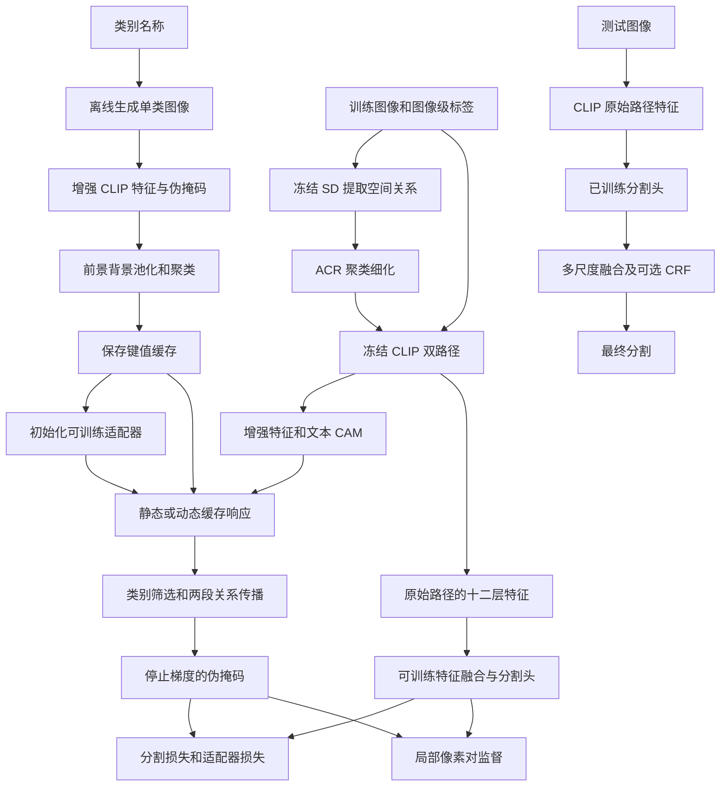
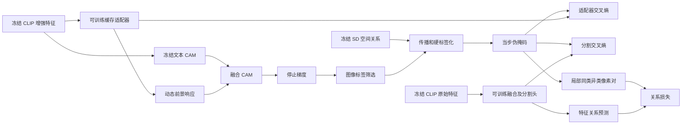

# 14 · DiCLIP：Method 回顾

DiCLIP 使用图像级类别标签，冻结 CLIP 与 Stable Diffusion（SD），训练一个缓存适配器和轻量分割头。训练时让扩散模型帮助产生更完整的伪掩码，最后输出逐像素分割；分割预测路径不执行 SD 的去噪前向。核心想法是：**SD 一方面提供“哪些位置应该互相照应”的空间关系，另一方面生成各种物体外观，变成 CLIP 可以检索的视觉记忆。**

本文对应 **IEEE Transactions on Image Processing，2026，35：5641–5656**，DOI：[10.1109/TIP.2026.3692055](https://doi.org/10.1109/TIP.2026.3692055)。作者在 [arXiv 页面](https://arxiv.org/abs/2605.04593v1)注明已被 TIP 接收；卷页信息由 [PubMed 记录](https://pubmed.ncbi.nlm.nih.gov/42139125/)核对。本次检索原论文、作者仓库与提交历史，**未找到明确宣称其扩展自同一工作的会议论文的证据**。仓库致谢 ExCEL、Tip-Adapter 说明代码来源，不足以成立会议—期刊扩展关系，因此以下仅讲 DiCLIP。

阅读基准是官方仓库 `main` 在 2026-06-10 的提交 `1c3f6ff7d4fde2afff32d527d78b28d119583602`。公开实现与论文简图有若干实质差异，下面沿源码组织主流程，论文层面的离线设计另行标明。

## 先看整体流程



图中的“离线”指生成图像、汇总缓存可以预先完成，**并不意味着真实训练图像的 SD 注意力也预先算完了**。训练 `forward` 每次仍会对当前图像执行一次加噪后的 UNet 前向。相反，分割测试设置 `eval_seg=True`，会绕过这次 SD 调用。

### 对着原论文图 2 串起离线与在线两段

结合下面原论文框架图，把上面的 Mermaid 对应起来。先读上半部的 `(1) Offline Phase`，再读下半部的 `(2) Online Phase`，右侧三个小框展开 CAM 与检索运算。


*图 2 为本文所述 DiCLIP TIP 工作的整体框架，复用原论文笔记中的图片。图中雪花表示冻结，火焰表示可训练，圆圈加号表示逐元素相加，圆圈叉号表示矩阵乘法。来源见[原论文笔记](../DiCLIP/DiCLIP_paper_notes.md)。*

上半部从左侧合成图 $I_g$ 开始。图像同时送进 SD 和 VCE 编码器，SD 的注意力先经 `Attn-Clustering` 与递归细化，再沿向下的箭头加入 CLIP 注意力，产生增强 patch 特征 $P_e$。这组箭头传递空间关系，类别名称则从右上角 `Cls Text` 经冻结文本编码器产生 $T$。两者组成 `Patch-text CAM`，进一步得到合成图伪掩码 $\mathcal M_g$。沿伪掩码向下看，`MAP → Clustering` 把前景、背景外观压缩成键，类别的 `One Hot` 形成值，最后汇入 `Pos / Neg` 两排缓存。对应下文第 1 节的“池化、分开聚类、保存”，训练入口实际加载的是保存好的缓存。

下半部换成真实训练图 $I$，图像分两路流动。上路经冻结 VCE 得到查询特征 $\mathcal Q$，同时进入静态检索、动态检索和文本 CAM。图中静态响应 $M_s$ 与 $M_t$ 相加得到 $M_{es}$，经细化形成给适配器的监督，红色虚线 $\mathcal L_{ada}$ 标在动态响应 $M_d$ 旁。动态响应再与 $M_t$ 合成 $M_{ed}$，右侧硬伪掩码 $\mathcal M_d$ 通过红色 $\mathcal L_{seg}$ 监督分割输出。下路 `Raw Encoder → F₁–F₁₂ → Segmentation Head` 则对应原始 CLIP 十二层特征与可训练分割头。

| 在图中找的位置 | 接到本文已有讲解与代码 |
|---|---|
| 左上 VCE 与 ACR | 第 2、3 节，以及“入口与双路径”中的 `extract_diff_attn → frozen_clip` |
| 上方键值缓存与右侧检索小框 | 第 1、4 节，`KV_Adapter` 用缓存初始化两层权重，右侧 `Initiate Weight` 箭头表示这个初始化过程 |
| 下方 CAM、伪掩码、红色损失箭头 | 第 5 节和“监督交接”代码，联系 `cam.detach()`、关系传播与 `get_seg_loss` 阅读 |
| 最底部分割路径 | “分割推理”代码中的 `eval_seg=True`，预测依赖原始特征与训练好的分割头 |

按当前实现阅读这张图时，还要把三处抽象补全。第一，在线 VCE 内部仍为当前训练图调用一次 SD，图的下半部将这一步收进了编码器图标。第二，图中“静态教动态、动态教分割”的两级监督表达论文设计，本文“训练目标与梯度到底流向哪里”的表格给出了 VOC、COCO 的实际调度及共用伪掩码的情况。第三，图中 CAM 到硬伪掩码之间的虚线省略了细化细节，固定提交应接上第 5 节的两段传播，并计入关系损失。复习公交车例子时，可以沿图依次说出“合成外观存入缓存，真实图 patch 查询缓存，融合响应变成监督，原始特征学会分割”。

## 顺着数据走一遍

### 1. 先备一本视觉图鉴：离线缓存

以“公交车旁边站着一个人”为贯穿例子。只给 CLIP 一个“bus”文本向量，表达的概念很概括；不同颜色、视角的公交车在局部特征上却可能相差很大。论文让 SD 先生成单类别图像，把这些外观压缩为少量代表特征。生成类别是已知的，但生成图里的物体轮廓仍由模型自己估计，不是人工像素标注。

论文 III-D 的操作是：用增强编码器得到每张合成图的 patch 特征和伪掩码；分别把前景位置、背景位置的特征做 masked average pooling。前景向量按类别做 K-means，背景向量单独聚类。键保存代表性外观，值保存其类别。若有 $U$ 个原型、特征维度 $D=512$、前景类别数 $C$，缓存可写成：

$$
K\in\mathbb R^{U\times512},\qquad
Y\in\mathbb R^{U\times(C+1)}.
$$

其中第 0 类是背景。论文配置每类生成 50 张图，VOC/COCO 每个前景类分别保留 10/5 个中心；适配器总隐藏宽度分别为 312/512。不要把隐藏宽度直接当作原始缓存条目数，它还包含额外可学习槽位。

公开 [`generate_kv_cache.py`](https://github.com/zwyang6/DiCLIP/blob/1c3f6ff7d4fde2afff32d527d78b28d119583602/maintain_kv_cache/generate_kv_cache.py)能够确认“按掩码池化→分开聚类→保存键与 one-hot 值”这段逻辑，且该脚本将背景中心数设为 25。不过它调用旧的构造参数及 `return_feats=True`，与当前 `DiCLIP_model` 的接口不匹配；同目录伪掩码生成脚本也保留旧返回值形式。因此，**离线构建的算法意图有论文及局部代码支撑，但不能声称这份提交可原样跑通完整的从零构建链**。后面的主训练脚本直接加载仓库提供的 `.pth` 缓存。本次没有反序列化其权重核对实际条目数。

### 2. 一张真实图进入 SD：只取关系，不生成替代训练图

VOC 入口把输入裁成 $320\times320$，CLIP patch 大小为 16，于是空间网格是 $20\times20$，即 $N=400$。训练图先反归一化送入 SD 2.1，VAE 编码为 latent，再加噪并运行一次 UNet。这里 `time_step=45` 是 **50 步调度表的索引**，不是对每张真实图完整去噪 45 次。文本条件为空串，因此这一路提供空间关系，并不直接告诉模型某个位置是公交车。

[`Processor.py`](https://github.com/zwyang6/DiCLIP/blob/1c3f6ff7d4fde2afff32d527d78b28d119583602/diffusion_model/Processor.py)回调保存两套量：原始 self-attention 概率，以及把 Q、K 插值到 $20\times20$ 后重算的 $QK^\top$。后者没有在回调里做 softmax。模型取 UNet 层索引 `-14` 的重算关系用于 VCE，取 `-4` 的原始注意力供后面的 CAM 传播。

VCE 的 ACR（Attention Clustering Refinement）可以理解为“先按关系模式分组，再让组内位置互相借信息”。源码先沿查询位置维做最大值缩放，低于 0.2 的关系清零，再沿每个查询的目标位置维归一化。随后选注意力头索引 1、2，将两张关系矩阵连乘；并非直接平均所有头。

`attn_kl_cluster` 用对称 KL 距离比较关系分布，迭代 5 次得到分组，并构造同组为 1、异组为 0 的 $A_c\in\mathbb R^{N\times N}$。接着做三次：

$$
\widehat A^{(r)}_{ij}
=\frac{\sum_k (A_c)_{ik}\widehat A^{(r-1)}_{kj}}
{\sum_k(A_c)_{ik}+\epsilon}.
$$

也就是让同组位置共享它们看向其他位置的关系。它只能给出无类别的分组，不能保证“同组就一定是同一真实物体”。函数参数写着 `num_cluster=9`，实际初始锚点由网格步长生成，还可能合并空组，因此不要把它理解为任何分辨率下都严格输出九个语义类别。

### 放大看原论文图 4 的 ACR


*图 4 展开图 2 左上角的注意力聚类细化模块，输入标作 `Image I_g & null text`。复用图片及图号见[原论文笔记](../DiCLIP/DiCLIP_paper_notes.md)。*

沿图从左向右读。SD 先产出 $A_{dif}$，随后分成上下两路。上路经 `Attn Cluster` 得到彩色分组图 $\mathcal M_c$，再经 $O_h(\cdot)$ 把组号展开成位置两两是否同组的矩阵 $A_c$。图中的颜色只表示分组身份，公交车、人等类别名称要由后续文本与缓存响应提供。下路经 `Noise Filter` 得到 $A_{dif}^{0}$，在每个圆圈乘号处接收上路同一份 $A_c$，递归得到 $A_{dif}^{1}, A_{dif}^{2},\ldots$。所以底部的 `Recursive Refinement × R` 可以对照前面的更新公式，理解为“让同组位置共享各自看向其他位置的答案”。

对应源码时，`attn_kl_cluster` 负责分组，第 2 节所述三次组内平均负责这张图底部的递归。这里输出的细化关系继续送去增强 CLIP 注意力。第 5 节 `recursive_refinement_with_diff_attn` 则在后面传播类别 CAM，使用另一套 SD 原始注意力，复习时应分别沿“关系矩阵更新”和“类别响应传播”两条张量链追踪。公交车车头与车身若被分到同组，就会共享关系模式，随后再由文本和缓存确定其类别响应。

### 3. 同一个 CLIP 保留两条路径

[`reload_self_attn`](https://github.com/zwyang6/DiCLIP/blob/1c3f6ff7d4fde2afff32d527d78b28d119583602/clip/clip_custom.py)收到 `layers=4`，内部循环是 `range(1, layers)`，实际改造最后 **3 层**。每层保留正常的 $QK^\top$ 注意力作为原始路径，同时建立产生 CAM 的增强路径。原始路径继续走原有 FFN；增强路径累加改造的注意力输出并跳过这部分 FFN。

源码增强注意力的基础并非普通 $QK^\top$，而是：

$$
A_{\mathrm{enh}}
=\operatorname{softmax}_{j}(QQ^\top/\sqrt d)
+2\operatorname{softmax}_{j}(KK^\top/\sqrt d)
+\widehat A_{\mathrm{SD}}.
$$

SD 项只加进 patch—patch 子块，CLS 的行列不加。实现之后还对注意力头求和，没有再把融合矩阵整体 softmax。每个改造层的 Q/K/V 仍从原始路径特征产生，增强分支累积输出；这比“把 SD 注意力加进标准 CLIP 后一路前传”更准确。

最终增强分支输出 $B\times401\times512$ 的特征，包含一个 CLS 和 400 个 patch；另存原始路径全部 12 层的 $768$ 维特征。后者负责分割，前者负责生成监督，两个用途不能混在一起。视觉前向带 `no_grad`，优化器也不收 CLIP 参数。

基础文本 CAM 也不是直接一次余弦相似度。`clip_feature_surgery` 用 CLS 与全部文本的匹配分数，经文本维 softmax 得到权重；对 patch—文本逐通道乘积加权，减去文本维的公共成分，最后汇总通道并沿空间归一化。一个需要保留的实现细节是：`generate_clip_fts` 对 $B\times N\times D$ 特征使用 `norm(dim=1)`，即沿 token 维归一化；因此不能把这份实现所有点积都直接称为“标准 L2 单位向量的余弦”。

### 4. 每个 patch 查缓存：静态和动态两种响应

静态检索先让 patch 对全部缓存键计算响应，再通过值把“像哪条原型”汇总为“像哪个类别”。当前代码同样使用 CLS 权重和公共成分扣除，之后做 ReLU，抑制负响应。缓存中的 one-hot 值此时用作类别掩码：键与类别文本的点积在不属于该类的位置填负无穷，再用 `softmax(0)` **沿缓存条目维**归一化。同一类别的多个原型于是竞争贡献权重，而非让每个原型在类别维选一个类别。

检索得到 $B\times400\times(C+1)$ 响应，沿空间分别归一化，再用背景响应抑制前景：

$$
M_s=\operatorname{Norm}_{\mathrm{space}}
\left(M_s^{fg}\odot(1-M_s^{bg})\right),\qquad
M_{es}=\operatorname{Norm}_{\mathrm{space}}(M_t+0.5M_s).
$$

例如路面 patch 可能也像一些公交车照片中的颜色纹理；若它强烈匹配背景缓存，前景响应就被压低。这里是乘 **背景响应的补值**，不能把它理解成“越像背景，越加强公交车”。

动态检索把这个过程改成两层 MLP。第一层权重前 $U$ 行由 $K$ 初始化，第二层权重对应部分由缓存 one-hot 值的转置初始化，额外槽位随机初始化。当前 `KV_Adapter.forward` 实际采用 ReLU，并在两层后使用 dropout 0.1；线性层偏置保持 PyTorch 默认初始化，不能按论文公式说明写成代码显式置零。适配器输出原始 logits $M_d\in\mathbb R^{B\times400\times(C+1)}$。用于 CAM 的只是它的前景部分：

$$
M_{ed}=\operatorname{Norm}_{\mathrm{space}}
\left(M_t+0.1\operatorname{ReLU}(M_d^{fg})\right).
$$

`return_dynamic=True` 时，这张图覆盖静态融合图，返回前会 `detach()`；而用于适配器交叉熵的 $M_d$ 保留梯度。**动态并不是每步向一个数据库追加真实图像，实际更新的是两层 MLP 的权重。**

### 5. CAM 还要变成真正可监督的伪掩码

公开训练入口先用图像级标签筛掉不在当前图里的类别。对于公交车和人的例子，其余前景通道都不参与伪掩码竞争。然后进行两段空间传播。

第一段在 [`refine_cams_with_aff`](https://github.com/zwyang6/DiCLIP/blob/1c3f6ff7d4fde2afff32d527d78b28d119583602/utils/affutils.py)：取 CLIP 最后 6 层原始注意力，做行列归一化、对称化和矩阵平方；每类 CAM 的高响应区域提供轮廓包围框，框内位置作为传播来源。训练后期还加入分割特征产生的关系预测，筛选层并约束关系。包围框来自 CAM 自己，不是额外框标注。

第二段在 [`recursive_refinement_with_diff_attn`](https://github.com/zwyang6/DiCLIP/blob/1c3f6ff7d4fde2afff32d527d78b28d119583602/model/rar.py)：把 CAM 插值到 SD 原始注意力的网格，选头 1、2 求平均，经缩放、对数修正与截断得到传播矩阵；每轮左乘 CAM，再按每类的空间分布归一化。VOC 训练传播 5 次，COCO 训练与 VOC CAM 推理传播 10 次。最后恢复尺寸、补背景分数 $1-\max_cM_c$，沿类别取 argmax，得到硬标签。

这份训练代码并未用 PAR 输出作为最终监督。虽然论文 III-E 写了 PAR，脚本也构造了 PAR 对象，但训练目标最终来自上述 SD 递归传播；CAM 评估脚本甚至先算 PAR，随后用递归传播结果覆盖它。这里应记住实际被交给 loss 的张量，而不是只看某个模块有没有被导入。

## 训练目标与梯度到底流向哪里

原始 CLIP 的 12 层特征移除 CLS，整理成 $12\times B\times768\times20\times20$。`SegFormerHead` 逐层投影、拼接融合为 256 通道，再交给 3 层、8 头的 Transformer decoder 和分类卷积，得到 $B\times(C+1)\times20\times20$ 的分割 logits。插值到伪标签尺寸后计算损失。

源码实际总损失是：

$$
\mathcal L=\mathcal L_{seg}+0.1\mathcal L_{aff}+0.1\mathcal L_{dynamic}.
$$

`get_seg_loss` 同时用于分割头和动态适配器，分别计算背景有效像素、前景有效像素的平均交叉熵，再各占一半。`ignore_index=255` 被忽略。不过当前 `cam_to_label_iseg(..., bkg_thre=0)` 产生的是全图 argmax 硬标签，**不会主动制造一个中间置信度忽略带**。

关系损失监督特征融合模块：融合特征先沿通道归一化，得到 patch 两两点积；减全局均值、乘 3 后 sigmoid，生成 $A_{pred}\in\mathbb R^{B\times400\times400}$。伪掩码下采样后，同类像素对为正、异类为负。正样本惩罚 $1-A_{pred}$，负样本惩罚 $A_{pred}$，分别平均后各占一半。只使用半径 8 的方形邻域，去掉自身配对和含 255 的配对；它不是标准的二元交叉熵。

论文的叙述是“静态伪标签教适配器，动态伪标签教分割头”。**固定提交里的两个训练入口则有不同的阶段调度，而且两个像素损失共用当步同一张伪掩码：**

| 源码设置 | VOC | COCO |
|---|---|---|
| 默认训练步数 | 20,000 | 100,000 |
| 用哪张 CAM 制作伪标签 | 从第一步就用动态融合 CAM | 前 60,000 步静态，此后动态 |
| 引入分割特征关系帮助 CAM | `n_iter >= 4000` | `n_iter >= 40000` |
| 关系标签从伪掩码切换为分割预测 | 阈值 34,000，默认训练不会触发 | `n_iter >= 80000` |

所以 VOC 实现更像“缓存初始化的适配器参与产生自身的无梯度目标”；其目标仍经过文本 CAM、类别筛选和关系传播约束，并非简单把自身 logits 原样监督自身。COCO 前期才明确体现静态来源的监督。目标路径都已停止梯度，损失不会穿过 argmax、轮廓提取或 SD 传播去训练大模型。

数据加载器确实读取真实分割 PNG 并同步增强，但当前 VOC loss 不使用其像素值：`labels` 用于尺寸和日志展示，像素监督来自 `aff_pseudos`，关系监督来自它或后期分割预测。不能只因 loader 返回了 `labels` 就判定使用了像素真值训练。

## 对照官方代码：三个关键接点

以下都是为解释调用顺序写的等价伪代码，并非可直接执行的完整程序。

**入口与双路径。** [`run_train_voc.sh`](https://github.com/zwyang6/DiCLIP/blob/1c3f6ff7d4fde2afff32d527d78b28d119583602/run_train_voc.sh)启动 `scripts/train_voc.py`；`build_network` 建立 `DiCLIP_model`，再由 `clip.load → build_model → clip_custom.DiCLIP` 载入改造版 CLIP。核心模型见 [`model_diclip.py`](https://github.com/zwyang6/DiCLIP/blob/1c3f6ff7d4fde2afff32d527d78b28d119583602/model/model_diclip.py)。

```python
sd_relation, sd_raw = extract_diff_attn(image)
enhanced, original_attention, raw_layers = frozen_clip(image, sd_relation)
text_cam = feature_surgery(enhanced, frozen_text)
dynamic_logits = trainable_adapter(enhanced[:, 1:])
cam = normalize(text_cam + 0.1 * relu(dynamic_logits[..., 1:]))
seg = decoder(fuse(raw_layers))
return cam.detach(), original_attention, sd_raw, seg, affinity, dynamic_logits
```

**监督交接。** 下列 VOC 默认路径对应 [`train_voc.py`](https://github.com/zwyang6/DiCLIP/blob/1c3f6ff7d4fde2afff32d527d78b28d119583602/scripts/train_voc.py)与 [`losses.py`](https://github.com/zwyang6/DiCLIP/blob/1c3f6ff7d4fde2afff32d527d78b28d119583602/model/losses.py)。

```python
cam, clip_attn, sd_attn, seg, affinity, dynamic = model(image, True)
cam = propagate_in_cam_regions(cam, clip_attn, image_level_labels)
pseudo = propagate_with_sd_then_argmax(cam, sd_attn, steps=5)
loss = balanced_ce(seg, pseudo) + 0.1 * balanced_ce(dynamic, pseudo)
loss += 0.1 * pair_relation_loss(affinity, pseudo, radius=8)
loss.backward()  # 更新适配器、特征融合和分割头
```

**分割推理。** [`infer_seg_voc.py`](https://github.com/zwyang6/DiCLIP/blob/1c3f6ff7d4fde2afff32d527d78b28d119583602/tools/infer_seg_voc.py)调用 `model(..., eval_seg=True)`，此时不执行 SD 提取；分割结果来自原始 CLIP 路径的特征，与增强分支的 SD 项无关。

```python
for resized_view in views:
    logits = model(resized_view, eval_seg=True)
    aligned_logits.append(resize_and_align(logits))
logits = mean(aligned_logits)
prediction = argmax(logits, class_axis)
# 可选：类别维 softmax 后送 DenseCRF，再 argmax
```

VOC 脚本的尺度为基准 320 以及 0.7、1.2、1.5 倍；非基准尺度平均原图与翻转图，基准尺度虽计算两张却只取原图结果。还需区分“预测数学依赖”和“程序加载依赖”：模型构造时仍实例化 SD、载入缓存，且 `eval_seg` 提前返回前还计算了静态 CAM；因此原样运行脚本仍需要这些初始化资源。说“最终分割不执行 SD 前向”准确，说“公开推理程序彻底不加载 SD/缓存”就不准确。

## 用一张图看清谁教谁

下面展开 VOC 默认训练时的监督关系；COCO 前期将其中的动态融合来源换成静态缓存融合。



对公交车来说，SD 关系帮助车头、车身互相传递响应；缓存给不同外观提供多个参照；图像级标签约束候选类别。最终分割头只学习“原始 CLIP 特征怎样映射到这张伪掩码”。若 SD 把公交车与邻近的人混为一组，或缓存没有覆盖遮挡严重的车身，这些误差仍可能传进监督。机制提供更好的线索，不构成伪标签必然正确的保证。

## 回顾时抓住这几点

1. **SD 有两份工作。** 离线生成图像供缓存；在线提供当前训练图的空间关系，两者用途不同。
2. **CLIP 有两条特征去向。** 增强路径做 CAM，原始路径的十二层特征训练分割头，后者解释了为何分割前向可以不调用 SD。
3. **缓存由固定参照变成可学习 MLP。** 不是给 CLIP 增加新的文本描述，也不是自回归模型的 KV 加速缓存。
4. **要记住实际监督链。** 该提交用 CLIP 关系加 SD 递归传播产生硬伪标签，加入了关系损失；VOC 与 COCO 的静态/动态切换不同。
5. **冻结不等于没有代价。** 大模型不更新，但训练仍执行 SD 前向；公开模型初始化也保留 SD 资源依赖。

自检：为什么背景也要缓存？因为前景检索可能误匹配背景纹理，需要负向视觉证据。为什么不能把动态 CAM 和分割预测当成同一个输出？因为它们来自不同特征路径和不同可训练模块，前者负责制作监督，后者是最终任务输出。为什么不能声称已经复现？因为这里只静态阅读了源码，离线旧接口、硬编码资源路径及实际数值行为都没有通过训练运行验证。

## 资料与实现版本

- **原论文全文：** [arXiv:2605.04593v1](https://arxiv.org/abs/2605.04593v1)，2026-05-06，16 页；本次读取仓库本地同版 PDF 的 III-A 至 III-E、实现设置，并渲染查看 Fig. 2。没有将未读补充材料列作证据。原始 PDF 位于 [本地论文](<E:/Data/GitHubRepo/Deeplearning-notes-Obsidian/99_Assets (资源文件)/papers/DiCLIP Diffusion Model Enhances CLIP’s Dense Knowledge for Weakly Supervised Semantic Segmentation.pdf>)。
- **出版核验：** 作者 arXiv 接收说明、[官方 README](https://github.com/zwyang6/DiCLIP/blob/1c3f6ff7d4fde2afff32d527d78b28d119583602/README.md)及 PubMed 索引的期刊卷页、DOI。IEEE DOI 页面本次未能直接读取，所以未宣称逐页比对 IEEE 排版终版；方法依据明确限定为作者公开全文。
- **官方实现：** [zwyang6/DiCLIP 固定提交](https://github.com/zwyang6/DiCLIP/tree/1c3f6ff7d4fde2afff32d527d78b28d119583602)，`main`，SHA `1c3f6ff7d4fde2afff32d527d78b28d119583602`。查阅唯一返回的分支及 17 条提交历史，当前代码发布集中在 2026-06-10；未据此构造一个不存在的会议版快照。
- **额外核读的调用文件：** [`network_engine.py`](https://github.com/zwyang6/DiCLIP/blob/1c3f6ff7d4fde2afff32d527d78b28d119583602/engine/network_engine.py)、[`optimizer_engine.py`](https://github.com/zwyang6/DiCLIP/blob/1c3f6ff7d4fde2afff32d527d78b28d119583602/engine/optimizer_engine.py)、[`clip.py`](https://github.com/zwyang6/DiCLIP/blob/1c3f6ff7d4fde2afff32d527d78b28d119583602/clip/clip.py)、[`featurecluster.py`](https://github.com/zwyang6/DiCLIP/blob/1c3f6ff7d4fde2afff32d527d78b28d119583602/model/featurecluster.py)、[`stable_diffusion.py`](https://github.com/zwyang6/DiCLIP/blob/1c3f6ff7d4fde2afff32d527d78b28d119583602/diffusion_model/stable_diffusion.py)、[`camutils.py`](https://github.com/zwyang6/DiCLIP/blob/1c3f6ff7d4fde2afff32d527d78b28d119583602/utils/camutils.py)、[`train_coco.py`](https://github.com/zwyang6/DiCLIP/blob/1c3f6ff7d4fde2afff32d527d78b28d119583602/scripts/train_coco.py)、[`infer_lam.py`](https://github.com/zwyang6/DiCLIP/blob/1c3f6ff7d4fde2afff32d527d78b28d119583602/tools/infer_lam.py)；亦核读数据加载、特征融合、Transformer decoder 和缓存生成相关脚本。
- **复现边界：** 已读源码，未运行训练、推理或权重加载。SD 加载位置在源码中被覆盖为作者机器的绝对路径，离线缓存入口还存在旧接口；这不影响解释可见的张量与调用流程，但不足以保证仓库开箱即用。未确认任何同工作会议前身，ExCEL 仅作为仓库明确致谢的代码基础记录，不展开为 DiCLIP 的会议版。
