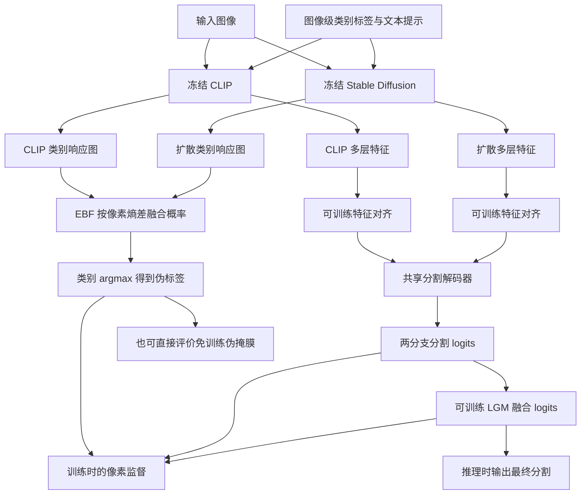
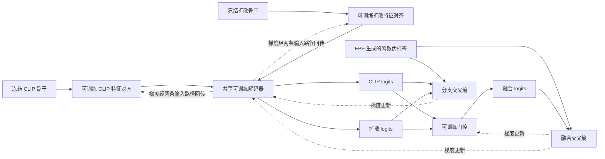

# 15 · ComCD：Method 回顾

ComCD 用图像级类别标签做弱监督分割：CLIP 和 Stable Diffusion 两个预训练骨干都冻结，先各自产生类别响应图，再融合成像素伪标签；随后训练特征对齐模块、共享分割解码器和融合门控，得到最终分割。核心想法很直白：**先让两种模型共同出一道更可靠的“参考答案”，再让分割网络学会怎样组合两种特征。**

本文覆盖 **Expert Systems with Applications 316 (2026), 131884** 正式期刊版，2026 年 3 月 1 日在线发表，卷期日期为 6 月 15 日。核查原文、出版记录及作者论文列表后，未找到明确的同工作会议前身，也没有证据把它认作 ExCEL 或 iSeg 的期刊扩展，因此按独立期刊工作讲解。[出版页面](https://www.sciencedirect.com/science/article/pii/S0957417426007979)

**实现边界：本次未找到可确认为作者发布的 ComCD 官方代码。** 以下根据本地正式论文第 3 节、第 4.1 节及图 2 独立梳理，代码块均是论文公式的解释性伪代码，不是源码摘录，也不是已验证的训练调用链。涉及背景标签、扩散采样、损失细节等未公开实现的地方会明确留出边界。

## 先看整体流程



这里有两个不同的融合位置。EBF 融合的是冻结模型给出的**类别概率**，负责生成监督；LGM 融合的是训练出来的**分割 logits**，负责形成最终预测。EBF 无需学习参数，LGM 则通过分割损失学习。不能把它们看成同一个模块换了名字。

论文把框架称作 single-stage，但理解时仍应分清“产生监督”和“学习分割”这两条数据路径。没有代码就无法确认伪标签究竟预先缓存，还是在训练循环里随图计算；这里的先后顺序指依赖关系，不宣称存在某个离线导出脚本。

## 对着原论文图 2 复习两条路径

结合下面的正式期刊版框架图，可以把前面的 Mermaid 与后面的公式接起来。先读左边如何提取信息，再读中间如何形成监督，最后沿右边的特征箭头回到三个分割输出。


图 2 为 ComCD 正式期刊版的整体框架，直接复用本地原论文笔记中的原图。图内同时给出雪花、火焰和数据流图例，下面按这些标记阅读。[原笔记图 2 所在方法节](../ComCD/ComCD_paper_notes.md#3方法论)

**先顺着橙色与绿色线找到两种信息出口。** 左侧图像同时送入 CLIP Image Encoder 和 Stable Diffusion，类别提示则送入 CLIP Text Encoder 与扩散分支。蓝圈 ① 接在 CLIP 特征上，经顶部橙色虚线路径送到右侧；蓝圈 ③ 把扩散特征经底部绿色虚线路径送到右侧。这两条长线把骨干特征交给 FAD。蓝圈 ②、④ 分别把 CLIP 类别响应与扩散注意力对应的类别响应送入黄色 EBF 区域，供生成伪标签使用。同一个冻结骨干由此服务于两条路径。

**再看黄色区域怎样给蓝色区域提供监督。** EBF 中上下两张热图分别来自 CLIP、扩散；中间灰框的两张 weight 图表达逐像素分配给两支的权重，彩色虚线把它们指向 Fused CAMs。融合响应经过类别选择得到右侧 pseudo-labels，黑色粗箭头标出它对预测的监督。图中的猫让这个依赖很好记忆，先由两支响应合成猫的参考轮廓，再用它要求分割输出学出相应轮廓。具体熵差方向、类别 softmax 和 argmax 可接着看“3. EBF”及第一段解释性伪代码。

| 图中位置或标记 | 接到本回顾的讲解 |
| --- | --- |
| CLIP、Diffusion 与蓝圈 ②、④ | “1. CLIP 分支”“2. 扩散分支”展开 CAM 来源，图中省略的注意力计算在这里说明 |
| Entropy-Based Fusion、weight、pseudo-labels | “3. EBF”及第一段伪代码对应固定熵差规则，产物为监督标签 |
| 右侧两个 Feature Aligner、单个 Decoder | “4. FAD”及第二段伪代码对应两路特征对齐、两次调用共享解码器 |
| LGM、三个 preds、Supervise | “5. LGM”“监督到底落在哪里”展开融合 logits、三项交叉熵与额外损失的已知范围 |

**最后从右往左读蓝色 FAD 区域。** 两条长虚线抵达右边的特征入口，各自经过带火焰的 Feature Aligner，再把对齐后的特征送向中间 Decoder。Decoder 的橙、绿箭头分别通向上、下预测，也各自送入 LGM；LGM 再向左输出中间的融合预测。这里只有一个 Decoder 方框，对应两路共用参数。火焰标在对齐器、解码器和 LGM，雪花标在预训练骨干处，配合“监督到底落在哪里”的 Mermaid 可确认论文描述的训练边界。

读图还要连着正文核对三个细节。图中的示例提示写作 `a photograph of cat.`，实施配置的固定模板在本回顾中另有记录。黄色 EBF 与蓝色 LGM 都画了融合，它们分别接 CAM 概率与分割 logits，训练属性也随各自路径区分。三个预测共用伪标签的监督关系需要结合损失公式展开，图上的粗箭头表达的是总体关系。复习推理时，再看“推理与两种输出要分清”区分免训练伪掩膜与训练后分割的产物。

本图提供论文层面的模块和数据依赖。后文两段代码仍按既有说明作为解释性伪代码阅读；缓存方式、背景构造、具体函数调用及自动微分写法继续以“对照实现：目前能写到哪一步”记录的核查范围为准。

## 顺着一张图走一遍

假设图里有人和一辆自行车，训练集只告诉我们这两个类别出现了，没有提供人的轮廓或车轮位置。图像标签先限制要生成哪些前景类别响应，再被转成文本提示。论文实施细节给 CLIP 使用固定模板 `a clean origami {}.`，不是为每张图训练提示词。

为避免混淆，下面把图像响应图的空间尺寸写作 $H\times W$，patch 数记为 $N$，扩散低分辨率位置数记为 $N_l$，解码器网格记为 $H_d\times W_d$。这些网格并非天然相同，需要插值和特征对齐。

### 1. CLIP 分支：先建立位置之间的关系，再和类别文本比较

这部分不是“先训练一个分类器，再从分类权重里取 CAM”。论文第 3.1.2 节直接使用冻结 CLIP 的 patch 特征，以及图像、文字之间的语义对齐。

图像特征投影得到 $Q,K,V\in\mathbb R^{N\times D}$，先计算三种位置关系：

$$
A_{QQ}=\operatorname{softmax}(QQ^\top/\sqrt D),\quad
A_{KK}=\operatorname{softmax}(KK^\top/\sqrt D),\quad
A_{VV}=\operatorname{softmax}(VV^\top/\sqrt D).
$$

每个矩阵都是 $N\times N$。softmax 沿每一行的**被关注位置维**进行：对当前位置来说，其他哪些位置更值得借信息？三个矩阵平均得到 $A$，再算 $\widetilde E=AV$。这一步让 patch 表征吸收与自己相似的位置，而不是直接拿一个全图向量去涂满整张图。

接着，把每个位置的表征和类别文本向量沿通道维做 L2 归一化，求余弦相似度，得到该类别的空间响应。人的头部、身体，自行车的车架等会分别和相应文本比较。论文称这类响应为 CLIP-based CAM；它在这里指“有类别含义的空间分数”，不意味着一定执行 Grad-CAM 反向归因。

这一支提供类别识别线索，但“最容易认出来的部分”未必等于整个物体。例如自行车车架有强响应，细轮辐却可能较弱。边缘更准是论文观察到的相对倾向，不是每个像素都成立的规则。

### 2. 扩散分支：用交叉注意力找类别，用自注意力连区域

冻结的 Stable Diffusion v2.1 接收图像的 latent 和类别提示。这里并不是从纯噪声生成一张新训练图，而是把已有图像编码、加噪，再通过**一次反向去噪步骤**读取内部表征和注意力。

交叉注意力的 query 来自图像位置，key 来自文本 token：

$$
A_{ca}=\operatorname{softmax}(Q_{img}K_{txt}^{\top}/\sqrt d)
\in\mathbb R^{N_l\times L}.
$$

$L$ 是文本 token 数。这里 softmax 沿**文本 token 维**，意思是“这个图像位置关注哪些词”。论文描述从多尺度收集交叉注意力，以固定权重聚合并插值到 $64\times64$ 网格。若一个类别名被分成多个 token，就取对应列的平均，得到这个类别的初始空间图。它尚不是后续 EBF 所需的类别概率分布：token 维和语义类别维是两回事。

然后读取自注意力 $A_{sa}\in\mathbb R^{N_l\times N_l}$。它回答“哪些图像位置在特征上属于同一个区域”。把某类别的初始响应展平成向量 $m_c$，论文式（3）给出的基本传播是

$$
\widetilde m_c=A_{sa}m_c.
$$

例如自行车某处有较强类别响应，和它相似的位置便能接到一些分数。传播后恢复二维网格、上采样并归一化，形成扩散分支 CAM。这样更容易连成区域，也可能把相似背景一起连进来，所以需要另一分支制衡。

论文对采样和传播有未完全展开之处：第 3.1.1 节讲固定采样配置及迭代细化，但式（3）只写一次传播；第 4.1 节说训练时随机取时间步、推理固定 $t=100$，传播迭代配置参照 iSeg。可确定的是**只取一次去噪步骤来抽特征**，注意力传播次数是另一个量；具体循环次数、噪声复用和随机种子不能由这几句话反推出。冻结参数、固定 $t$ 本身也不充分保证随机噪声下输出完全确定。

### 3. EBF：在每个像素比较两支各自有多犹豫

先把当前图像参与融合的 $K$ 个类别 CAM 堆成 $K\times H\times W$，沿**类别维**做 softmax，得到 $P^{clip}$ 和 $P^{diff}$。每个像素的类别概率之和为 1。随后分别计算熵：

$$
e^b(p)=-\sum_c P^b_c(p)\log P^b_c(p),\qquad
w(p)=\sigma\big(e^{clip}(p)-e^{diff}(p)\big).
$$

熵大表示分布较平，多个类别难分；熵小表示某一类更突出。**$w$ 是扩散分支的权重**：如果 CLIP 比扩散更犹豫，差值为正，$w>0.5$；如果 CLIP 更确定，扩散权重就下降。然后融合概率：

$$
P^{fuse}_c=wP^{diff}_c+(1-w)P^{clip}_c,\qquad
M(p)=\arg\max_c P^{fuse}_c(p).
$$

一个像素只有一个 $w$，向全部类别广播，并不是给“人”和“自行车”分别学习不同的融合权重。因为两支都已归一化，且权重互补，融合结果仍是类别概率分布。最终取最大概率类别，得到分割监督 $M$。

以一个车架附近的像素为例，假设人/自行车概率分别为 CLIP 的 $(0.4,0.6)$ 和扩散的 $(0.1,0.9)$。两者熵约为 $0.673$ 与 $0.325$，所以 $w\approx0.586$，融合后自行车概率约为 $0.776$。这体现的是温和偏向更确定的一支，并非看见熵稍低就彻底抛弃另一支。该数字例子只解释融合公式，不是论文测量结果。

熵只衡量确定程度，不衡量真伪。如果扩散很肯定地把草地当成自行车，它也可能得到较大权重；如果两支都错，融合没有额外的真值信息可以自动纠正。

还要留意背景：论文式（5）至（8）把候选集合写成图像中出现的类别，但没有明确给出背景分数的构造和阈值细节。若严格只放一个前景类别做 softmax，概率恒为 1、熵恒为 0，也无法凭这个 argmax 分离背景。因此这里不能自行补成“固定背景阈值 0.2”或“加入 background 文本”并冒充 ComCD 实现；**完整前景/背景处理仍需要官方代码才能核实。**

### 4. FAD：两种特征先说同一种“接口语言”

EBF 得到的是参考答案，而最终分割网络还要学习怎样使用特征。FAD 从两个冻结骨干的不同层取出特征，各自经过 Feature Aligner：统一空间网格、对齐通道，按通道拼接后通过 $1\times1$ 卷积，得到

$$
X_{clip},X_{diff}\in\mathbb R^{B\times256\times H_d\times W_d}.
$$

CLIP 的实施说明是使用 ViT-B/16 全部 12 层 patch 特征，投影到 256 维，再用 SegFormer 风格的 head 融合。扩散分支也对齐到共同的 256 通道空间，但具体取哪些 U-Net block、各层拼接顺序并未在本文中充分列出。

对齐不是把两个来源直接平均，而是让它们都能交给**同一个共享解码器**处理。解码器分别接收 $X_{clip}$ 和 $X_{diff}$，输出 $S_{clip},S_{diff}\in\mathbb R^{B\times C\times H_d\times W_d}$。这里 $C$ 是数据集类别数，不再是某一张图里仅有的几个前景类别。两次前向共用解码器参数；两种输入保留各自信息来源。

### 5. LGM：从预测里学习怎样组合两支

将两个分支的 logits 沿通道拼接，得到 $2C$ 通道，经过一个输出 1 通道的 $1\times1$ 卷积和 sigmoid：

$$
w'=\sigma\big(\operatorname{Conv}_{1\times1}[S_{clip};S_{diff}]\big),\qquad
S_{fuse}=w'S_{diff}+(1-w')S_{clip}.
$$

$w'$ 的维度是 $B\times1\times H_d\times W_d$，同样按像素产生、跨类别广播。但它和 EBF 的 $w$ 来源不同：EBF 是固定熵差规则；LGM 学习 logits 的哪些组合模式值得偏向哪一支。这里先融合原始 logits，再交给交叉熵所需的类别归一化，不等于先 softmax 两支再平均概率。

## 监督到底落在哪里

三个分割输出都用同一张伪标签监督：

$$
\mathcal L_{fuse}=\operatorname{CE}(S_{fuse},M),\quad
\mathcal L_{clip}=\operatorname{CE}(S_{clip},M),\quad
\mathcal L_{diff}=\operatorname{CE}(S_{diff},M).
$$

单独监督两支的意义是：即使门控暂时更偏爱某一支，另一支也仍然被要求产出能用的分割。共享解码器接收两路训练信号，而不是只从最终被选中的结果学习。

论文另加参照 ExCEL 的 diversity loss，给出的总目标为

$$
\mathcal L=\mathcal L_{fuse}
+0.1\mathcal L_{clip}+0.1\mathcal L_{diff}+0.1\mathcal L_{div}.
$$

原文描述 $\mathcal L_{div}$ 用于减少冗余、鼓励互补，但未在 ComCD 中写出其完整公式或操作张量。本次没有官方实现可追踪，因而不能把它具体化为 KL、余弦距离、负相关，或断言某个分支使用 stop-gradient。同理，ignore index、无效像素筛选及前景/背景损失归约方式均未核实。



图中只画公式明确的三项交叉熵。骨干冻结，梯度更新止于可训练模块；伪标签经过 argmax 是离散监督，分割损失并不会通过它训练 EBF。没有源码证据时，不能进一步声称某个函数里使用了 `torch.no_grad()` 或 `detach()`；“冻结”是参数更新边界，不等于已经核实了具体自动微分写法。

## 推理与两种输出要分清

论文实际上评价了两种产物。第一种是冻结骨干加 EBF 直接生成的伪掩膜，不训练 FAD；开放词汇实验也走这条直接出掩膜的路径，用 TagCLIP 预测的图像类别标签作为提示来源。不能把它写成已经训练了一个可任意换词表的 FAD 解码器。

第二种是用伪标签训练后的 WSSS 分割输出：保留两个骨干的特征抽取、特征对齐、共享解码器和 LGM，由融合 logits 得到结果。论文实施细节还使用多尺度测试和 dense CRF。此时无需为计算训练损失重新生成监督 $M$；但扩散分支仍需相应条件输入，测试时提示构造、是否采用类别筛选的具体接口没有公开代码可核实，不能默认可以读取测试图像的真值标签。

因此，ComCD 的最终模型并非“训练时有扩散，测试时自动删掉扩散”的蒸馏模型。融合解码仍依赖两个骨干提供特征。

## 对照实现：目前能写到哪一步

截至核查日，已检查论文内链接、出版页面、作者出版列表，并通过网页搜索和 GitHub 仓库/代码搜索查找完整标题、ComCD、CLIP 与扩散组合词，没有定位到可验证归属的完整官方仓库。论文只给出数据可按需获取的说明，没有可固定的 ComCD commit/tag。因此**入口脚本 → forward → loss → 推理函数的真实调用链没有核实成功**，不能用 iSeg、ExCEL 或其他方法的主分支代替。

下面两段是对论文式（5）至（14）的等价整理，只帮助检查维度与依赖；不是可执行复现。其中背景处理和 diversity loss 故意不作虚构补全。

```python
# 论文 EBF 的张量逻辑；非官方源码
# 两支已对齐，shape 均为 [K, H, W]
p_clip = softmax(cam_clip, dim=0)  # 类别维
p_diff = softmax(cam_diff, dim=0)
e_clip = -(p_clip * log(p_clip)).sum(dim=0)  # [H, W]
e_diff = -(p_diff * log(p_diff)).sum(dim=0)
w_diff = sigmoid(e_clip - e_diff)
p_fuse = w_diff[None] * p_diff + (1 - w_diff[None]) * p_clip
mask = argmax(p_fuse, dim=0)
# 类别索引映射及背景构造须由完整实现另行确认
```

这段对应原论文第 3.2 节，关键是三处不同操作：类别 softmax、类别求和得到熵、类别 argmax 得到标签。熵没有在空间维上求平均，融合权重保留每个像素的位置。[原论文 DOI](https://doi.org/10.1016/j.eswa.2026.131884)

```python
# 论文 FAD / LGM 的张量逻辑；非官方源码
x_clip = align_clip(frozen_clip_features)  # [B, 256, Hd, Wd]
x_diff = align_diff(frozen_diff_features)
s_clip = shared_decoder(x_clip)            # [B, C, Hd, Wd]
s_diff = shared_decoder(x_diff)
w_diff = sigmoid(conv_1x1(cat([s_clip, s_diff], dim=1)))
s_fuse = w_diff * s_diff + (1 - w_diff) * s_clip
loss_seg = CE(s_fuse, mask) + 0.1 * CE(s_clip, mask)
loss_seg = loss_seg + 0.1 * CE(s_diff, mask)
# 论文另有 0.1 * L_div；公式和具体输入未在 ComCD 中充分展开
```

这段对应第 3.3、3.4 节。mask 和 logits 的分辨率需匹配，但原文未给出具体在哪个函数插值，伪代码也不假装知道。论文可确认的优化设置是 AdamW、学习率 $10^{-4}$、weight decay $10^{-2}$；这些是报告配置，并非本次运行验证结果。

## 回顾时抓住这几点

- **两种先验各出一张类别图。** CLIP 用图文语义定位，扩散用文本注意力给类别、图像自注意力传播区域信息。
- **EBF 决定怎样出参考答案。** 对两支类别分布算熵，用熵差经 sigmoid 得到逐像素融合权重，随后生成硬伪标签。
- **FAD 决定怎样学习分割。** 多层特征先对齐，两路共用解码器，再由可训练 LGM 融合 logits。
- **骨干一直冻结，监督来自伪标签。** 三个分割输出共同学习，低熵并不保证正确，双分支也可能一起出错。
- **免训练掩膜与训练后分割是两种产物。** 开放词汇评价采用前者；最终 WSSS 网络的测试仍需要两路特征。

自检：EBF 和 LGM 都输出权重，为什么不能合并理解？前者由固定规则从 CAM 概率计算、用于造标签；后者从分割 logits 学习、用于出预测。扩散“只走一步”是不是只传播一次注意力？不是，去噪步数与注意力传播次数是两个不同超参数。

## 资料与实现版本

1. **正式原论文，主要方法依据**：[本地 PDF](<E:/Data/GitHubRepo/Deeplearning-notes-Obsidian/99_Assets (资源文件)/papers/Unveiling the complementary synergy of CLIP and diffusion models for weakly supervised semantic segmentation.pdf>)。独立读取第 3 节完整方法、第 4.1 节实施细节与评价协议，并渲染检查第 3 页图 2；出版日期取自第 1 页。未把译文或笔记作为实现证据。
2. **出版信息**：[Elsevier / ScienceDirect](https://www.sciencedirect.com/science/article/pii/S0957417426007979)，DOI [10.1016/j.eswa.2026.131884](https://doi.org/10.1016/j.eswa.2026.131884)。在线正文直接打开返回 403，出版信息及摘要可由搜索索引取得，方法全文由本地正式 PDF 补足。
3. **版本关系核查**：[第一作者 DBLP 记录](https://dblp.org/pid/204/4627-2.html)。与全文的引言、参考文献和完整标题检索交叉核对，未确认同工作会议前身；本回顾不把引用的方法或同作者的其他作品当作会议版。
4. **官方源码状态**：未找到能确认归属的 ComCD 官方实现，故没有 SHA、固定代码链接或已阅读源码文件；GitHub 检索命中不能替代官方性证明。未读取到单独补充材料，未运行训练或推理。本文完整覆盖可读到的论文机制，同时保留背景生成、具体采样循环、diversity loss、训练/推理入口等实现边界。
