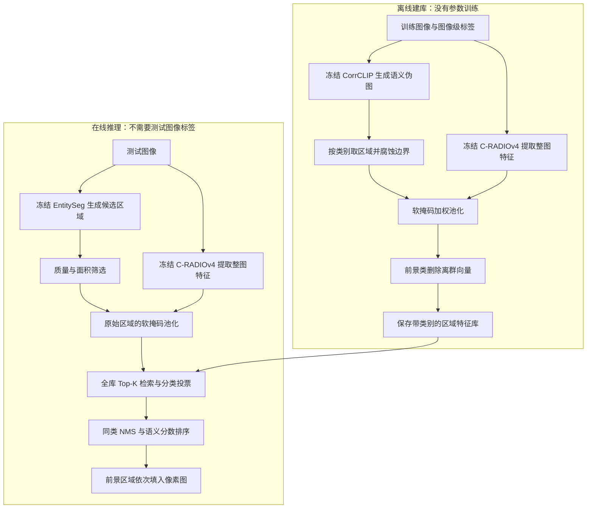
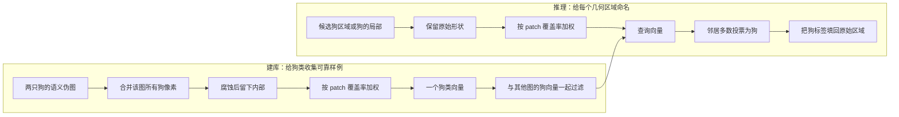

# 16 · ModuSeg：Method 回顾

ModuSeg 用训练图像的**图像级类别标签**建立一个带类别的视觉特征库，随后给测试图像中的候选区域查近邻、投票分类，最终输出像素级语义图。CorrCLIP、C-RADIOv4 和 EntitySeg 都作为预训练模型做前向计算，ModuSeg 不微调它们，也不再训练最终分割头。核心想法是：**区域边界交给专门的掩码模型，区域类别交给视觉样例检索。**

论文正式发表于 **ECCV 2026，LNCS 17028，629–646 页**，出版方记录的上线日期为 2026-09-17，DOI 为 `10.1007/978-3-032-37624-4_37`。arXiv 当前为 2026-06-29 更新的 v3 camera-ready。下文以原论文第 3 节为依据，执行细节按官方仓库固定提交 `f479b32afb4f9f6648e828ec4eb10310cc57fc01` 组织；截至核查日期，未找到可确认属于同一工作的期刊扩展。[出版记录](https://link.springer.com/chapter/10.1007/978-3-032-37624-4_37) · [arXiv 版本记录](https://arxiv.org/abs/2604.07021)

## 先看整体流程

这里的“离线阶段”会遍历训练集，但没有优化器和反向传播。它改变的是特征库里的样例，模型权重保持不变。下面以 VOC 为主线：背景为 0，前景为 1–20。



一个贯穿的例子是“草地上有两只狗和一个人”。建库时我们知道出现了狗、人和背景，借此约束语义伪图；测试时则只给图像，让候选区域分别去库里找相似视觉样例。草地在 VOC 中属于背景，其区域也可以靠背景样例识别。

### 对照原论文图 2，把两阶段接起来

结合下面原论文框架图，可以把前面的 Mermaid 和后面的七个步骤连起来。先读上半幅的离线建库，再读下半幅的在线查询。


图 2 来自 ModuSeg 会议工作，复用原笔记中的本地资源。图号及两阶段含义见原笔记“3.1 方法概述”。[原论文笔记](<../ModuSeg/ModuSeg_paper_notes.md>)

**上半幅从左向右读。** Training Set 分出两路，上路 Feature Extractor 产出彩色示意的空间特征，下路 OVSS Mask Generator 产出语义伪图。左侧 Logits Filtering 对应第 1 步的图像级标签白名单。伪图经过 Semantic Boundary Purification 后，图中鸟的掩码缩小，再与上路特征一起进入 SMFA。这里两根箭头分别传入特征和池化范围，汇合后才得到右侧的一列区域向量。Foreground 向量继续进入 Foreground Purification，圆点表示样例，星形表示均值中心，带叉圆点表示待移除的离群样例；Background 的箭头直接通往 Feature Bank。最终 Class 1 到 Class N 每类仍有多列样例。

**下半幅也从左向右读。** 测试图像分别进入 Feature Extractor 和 Class-Agnostic Mask Proposer。前者提供同一特征空间中的描述，后者提供彩色示意的类别无关区域，两路在 SMFA 汇合为查询向量。黄色、绿色带点小列是图例里的 Query Embedding，表示待分类区域。查询进入 Top-K Similarity Retrieval，取出库中邻居，再沿 Voting 箭头得到类别，最后经 Conflict Resolution 形成右侧语义图。下半幅再次画出的 Feature Bank 代表上半幅保存的库，跨阶段传递的是带类别向量。

| 原图位置 | 本文的展开位置 | 对应实现或代码整理 |
|---|---|---|
| OVSS → 缩边掩码 | 第 1、2 步 | `CorrCLIPSegmentation.predict()`、`region_extractors.py`；第一段伪代码的 `semantic_map` 与 `erode` |
| 两路输入 → SMFA | 第 3 步 | `feature_extractor.py`；第一段的 `weighted_mean`，第二段的 `radio_soft_pool_all_masks` |
| Foreground Purification → Feature Bank | 第 4 步 | `filter_stage.py`、`build_feature_bank.py`；第一段末尾的按类过滤 |
| Proposer → Retrieval → Voting | 第 5、6 步 | `predict_instances()`；第二段伪代码的筛选、全库检索与分层投票 |
| Conflict Resolution → 结果 | 第 7 步 | `nms_masks_per_class()`、`rasterize_instances()`；第三段伪代码 |

读图时把下面三处和当前实现一起记。

- **图中模块名表示职责。** 两处 Feature Extractor 都落实为冻结的 C-RADIOv4，OVSS 分支采用冻结的 CorrCLIP，在线 Proposer 采用冻结的 EntitySeg。两个阶段均按前向流程运行，“Offline”阶段更新的是样例库。
- **图例中的 Instance Embedding 要按代码的区域粒度理解。** 当前建库按每张图的类别合并像素，同图两只狗通常汇成一个狗向量。Foreground Purification 中的星形只帮助筛除离群样例，检索阶段使用留下的多列向量。
- **下半幅省略了上半幅的 SBP，正好对应建库缩边、查询保留原区域。** Conflict Resolution 是论文的汇总框，当前代码细化为同类 NMS、语义分数排序、跳过背景并填入空白像素；默认 EntitySeg 已输出互不重叠实体，实际作用还要结合第 7 步的说明理解。

拿前面的狗和人例子复述一次，上半幅先为狗、人及背景收集较纯的视觉样例，下半幅让每个候选区域用自己的查询向量去投票，最后将获胜类别贴回候选的原始形状。这样就能从图上的每根主箭头找到后文的操作位置。

## 顺着数据走一遍

### 1. 先准备带类别的区域，标签只约束允许出现什么

官方入口 `tools/run_pipeline.py` 先启动 `run_build_feature_bank.py`，完成后启动 `run_inference.py`。建库脚本优先读取事先生成的 PNG 伪图；没有伪图时，其设计路径是通过 `CorrCLIPMaskGenerator` 即时生成。两条路径最终都进入 `FeatureBankDataset` 和 `region_extractors.py`，因此缓存只改变计算时间，不改变后续区域处理。

伪图生成的独立入口是 `tools/generate_pseudo_masks.py`。它调用 `CorrCLIPSegmentation.predict()`，先获得 EntitySeg 的类别无关区域，再做滑窗 CorrCLIP 前向。当前配置使用 MetaCLIP 的 ViT-B/16 与 DINO ViT-B/8；DINO 的末层 Q、K 相加后归一化，供修改后的 CLIP 图像编码器计算相关性。滑窗重叠处平均 logits，恢复到原图大小，再做标签约束与后处理。

最关键的监督落点在 `postprocess_result()`：类别词对应的 logits 先乘 40，再把图像标签白名单以外的通道置为负无穷，然后**沿类别词通道做 softmax**。背景有多个词时合并其响应，之后取类别 argmax；EntitySeg 区域内部再通过众数统一类别。这里并没有把图像级标签变成某个损失，它们直接限制候选答案。

例如图像标签只有狗、人和背景，CorrCLIP 即使觉得某片毛发像猫，也不能输出猫。但它仍可能把狗的某部分误分成人或背景，所以白名单过滤并不能保证伪图内部正确。实现严格遵守 JSON 中的类别集合，`build_class_mask()` 不会额外自动放行背景；VOC 官方准备脚本把像素标注压缩成图像级类别集合时会保留存在的 0、去掉 255，此后建库使用的是类别集合与预测伪图。[伪图入口](https://github.com/Autumnair007/ModuSeg/blob/f479b32afb4f9f6648e828ec4eb10310cc57fc01/tools/generate_pseudo_masks.py) · [CorrCLIP 调用与过滤](https://github.com/Autumnair007/ModuSeg/blob/f479b32afb4f9f6648e828ec4eb10310cc57fc01/corrclip_segmentor.py) · [图像级标签准备](https://github.com/Autumnair007/ModuSeg/blob/f479b32afb4f9f6648e828ec4eb10310cc57fc01/tools/generate_voc_imagelevel_train_val.py)

### 2. 建库区域先缩边，留下更可靠的内部

对伪图中的类别 $c$，代码先取二值区域 $m_c=\mathbf{1}[S=c]$，再用全 1 的 $3\times3$ 核做 **20 次腐蚀**；腐蚀后面积小于 **300 像素**的区域直接不入库。VOC、COCO 的背景同样先腐蚀；ADE20K、Cityscapes 的区域提取函数不建立单独的 0 类背景样例。

这一步就是 Semantic Boundary Purification，简称 SBP。狗的边缘可能夹着草地，ViT 边缘 patch 也可能同时覆盖狗和草。先缩掉不稳定边界，可以让“狗样例”的向量更像狗的内部。但腐蚀会损失小物体与细长部分，它是一种精度与覆盖范围的取舍，不能保证留下的区域全都正确。

**当前实现是每张图、每个类别一个区域，不是每个实例一个区域。** `region_extractors.py` 没有做连通域拆分：两只狗即使相隔很远，其剩余像素仍在同一个 `mask_c` 中，最后汇成一个狗向量。论文把向量称为 instance-specific prototype 时，落到这份代码应理解为“这张图中该类区域的代表向量”。[区域提取与腐蚀](https://github.com/Autumnair007/ModuSeg/blob/f479b32afb4f9f6648e828ec4eb10310cc57fc01/src/region_extractors.py)

### 3. 整图只提一次特征，每个区域再做软池化

C-RADIOv4-SO400M 提取的是整张图的空间 token，不是把每个候选物体裁出来重新编码。`_preprocess_image()` 保留原分辨率，在右侧和下侧补黑边，使高宽成为 16 的倍数；图像除以 255，归一化由 RADIO 内部处理。配置中的 `img_size=512` 用于初始化时探测特征维度，**这里的实际图像预处理并不统一缩放到 512×512**。

设补齐后的图像大小为 $H'\times W'$，特征网格为 $h=H'/16,w=W'/16$，$N=hw$。正常前向返回空间特征 `[1,N,D]`；代码从模型输出取得 $D$，池化使用空间 token 而非全局 summary token。

掩码按同样方式补齐后，通过 `INTER_AREA` 投影到 `[h,w]`。得到的 $W_{x,y}\in[0,1]$ 表示该 patch 被区域覆盖的比例。它不是模型预测的概率，也不是在所有 patch 上做 softmax。

$$
v_c=\operatorname{L2Norm}\left(
\frac{\sum_{x,y}W_{x,y}F_{x,y}}{\sum_{x,y}W_{x,y}+10^{-8}}
\right).
$$

这就是 Soft-Masked Feature Aggregation，简称 SMFA。一个 patch 有四分之一属于腐蚀后的狗区域，就按约 0.25 的权重参与，而不是最近邻下采样那样整块算狗或整块丢弃。先沿空间维汇总，得到 $D$ 维向量，再沿特征通道做 L2 归一化；多个区域共享同一份整图特征。

需要分清：SBP 去掉原掩码边缘；SMFA 减少从像素网格投影到 patch 网格时的硬量化。SMFA 不会重新分离一个已经混合了前景与背景信息的 token，它只是调整这个 token 的贡献。[特征预处理与池化](https://github.com/Autumnair007/ModuSeg/blob/f479b32afb4f9f6648e828ec4eb10310cc57fc01/src/feature_extractor.py) · [C-RADIOv4 包装器](https://github.com/Autumnair007/ModuSeg/blob/f479b32afb4f9f6648e828ec4eb10310cc57fc01/src/feature_extractor_c_radiov4.py)

### 4. 按类删除外围样例，但保留很多向量供检索

所有图像处理完后，每类得到矩阵 $V_c\in\mathbb R^{n_c\times D}$。代码计算普通均值中心 $\mu_c$，再计算每个向量到它的欧氏距离，按距离从大到小删除 `floor(0.25*n_c)` 个前景样例。背景删除比例默认是 0。

$$
\mu_c=\frac{1}{n_c}\sum_i v_{c,i},\qquad
d_{c,i}=\lVert v_{c,i}-\mu_c\rVert_2.
$$

这里按代码的排序和整数取整理解即可，而不是必须实现成论文写法中的分位数阈值。类中心只是清理工具，**检索库仍保留每个被选中的区域向量，并没有把一个类别压缩成一个中心**。

狗类中异常混入大面积草地的向量可能远离中心，从而被删除；但如果某种少见姿态本来就远离主流外观，也可能被删。这依赖“类内可靠样例相对集中”的假设。背景含草地、墙、路面等多种外观，用一个中心删外围样例容易损失正常多样性，因此默认全部保留。[特征库保存](https://github.com/Autumnair007/ModuSeg/blob/f479b32afb4f9f6648e828ec4eb10310cc57fc01/src/build_feature_bank.py) · [离群过滤](https://github.com/Autumnair007/ModuSeg/blob/f479b32afb4f9f6648e828ec4eb10310cc57fc01/src/filter_stage.py)

### 5. 测试时先找区域，再用完整区域查特征库

`run_inference.py` 从清理后的 `.npz` 重新装载各类向量，拼成全库 `[L,D]`，再次按行 L2 归一化并建立统一 FAISS 索引。检索是跨所有类别共同竞争，不是每类各拿 25 个近邻。

几何分支由 `init_mask_proposer()` 调用 `get_entityseg()`。这里实际选中的是仓库 `CropFormer` 目录中的 **Mask2Former-HorNet EntitySeg 配置**；目录名不表示执行了 CropFormer 的多裁剪推理。配置启用 `ENTITY.ENABLE`、`INSTANCE_ON`，`MaskFormer.forward()` 因而走 `instance_inference_nonoverlap()`：在实体模型内部已经按查询分数解决重叠，再返回区域与分数。

外层 `predict_instances()` 仅留下返回分数不低于 **0.6**、面积至少 **300** 的区域。随后不腐蚀，直接把原区域送入 SMFA 得到查询向量。这种前后不对称很关键：建库宁可只取狗身体内部的可靠证据；预测时需要覆盖狗的耳朵、腿和轮廓，而且提议器可能已经把一个物体切成多个小块，继续腐蚀会丢掉更多信息。

同一图像的全部候选可批量池化：区域权重矩阵 `[M,N]` 乘空间 token `[N,D]`，得到 `[M,D]`。区域形状决定池化范围，语义归属由下一步的检索决定。[推理入口](https://github.com/Autumnair007/ModuSeg/blob/f479b32afb4f9f6648e828ec4eb10310cc57fc01/run_inference.py) · [实际实体分支](https://github.com/Autumnair007/ModuSeg/blob/f479b32afb4f9f6648e828ec4eb10310cc57fc01/CropFormer/mask2former/maskformer_model.py)

### 6. 先比票数，平票才比相似度

查询和库向量都已单位化，点积就是余弦相似度。默认取全库 **Top-25**；库不足 25 个时取全部。小库使用 `IndexFlatIP` 精确检索，超过 **100000** 个向量时使用 IVF 近似检索。这个分支由库大小触发，不是把“VOC / COCO”写死成两套算法。

每个近邻贡献一票。先选票数最多的类别；票数相同，再选支持样例相似度总和较大的类别。确定赢家后，用赢家近邻的**平均相似度**作为语义分数：

$$
\hat c=\arg\max_c\bigl(\operatorname{Vote}(c),\operatorname{SumSim}(c)\bigr),
\qquad s^{sem}=\frac{\operatorname{SumSim}(\hat c)}{\operatorname{Vote}(\hat c)}.
$$

括号表示按先后顺序比较，而不是相加。比如狗 13 票、人 12 票，即使人的平均相似度略高，也先选狗。这个分数是排序依据，不是经过概率校准的分类置信度。检索分类没有 softmax，也不把 EntitySeg 的分数与语义分数相乘：前者负责候选筛选，后者负责后续排序。

### 7. 区域贴回像素图时，背景有一个特殊处理

候选先按预测类别分组，各组按语义分数做掩码 NMS，默认 IoU 阈值 **0.4**，超过阈值的同类低分区域被抑制。剩余候选再跨类别按语义分数从高到低排序。

`rasterize_instances()` 创建全 0 画布，**跳过背景候选**，前景候选只填尚为 0 的像素。于是高分前景优先占位，未覆盖区域最后仍为背景。不能把这一步解释成“最高分背景区域先占位，阻挡后面的前景”；代码并不这样做。

论文给出了适用于重叠提议的冲突处理框架，但当前默认 EntitySeg 分支已经输出互不重叠的实体，后置 NMS 和跨类争抢在这条正常路径上通常不会改变它们。仍保留这些步骤，是实现的处理顺序；理解其实际作用要结合上游掩码是否重叠，而不能默认每张图都在进行大量冲突消解。[检索、NMS 与栅格化](https://github.com/Autumnair007/ModuSeg/blob/f479b32afb4f9f6648e828ec4eb10310cc57fc01/src/inference.py)

## 关键模块与“损失”应该怎样理解

这项方法没有需要搭配权重相加的 ModuSeg 训练损失。图像级标签作用于 CorrCLIP 白名单；SBP、SMFA、类内过滤与近邻投票都是前向或非参数计算。C-RADIOv4 显式设为 `eval()`、关闭 `requires_grad`；CorrCLIP 中 CLIP 和 DINO 也冻结，生成与推理使用 `inference_mode` 或 `no_grad`。

仓库包含基础模型原有的训练代码，EntitySeg 的 `forward()` 也存在 `self.training` 下的 criterion 分支，但本方法调用的是预训练预测器的推理路径。FAISS 的 `index.train(all_feats)` 则是在拟合 IVF 索引的聚类结构，不是反向传播更新视觉模型。因此“training-free”准确地说是**不为这项下游分割任务优化网络参数**，而不是不使用训练图像、不依赖预训练数据，或完全不做数据拟合。

另外，伪标签在这里的角色是给库中样例提供类别与池化区域，不是交给一个新分割网络做交叉熵监督。验证脚本读取的像素 GT 用于评估，未传入 `predict_instances()` 参与预测。

## 对照官方代码

下面三段是根据固定提交写的**等价流程整理**，省略设备、文件读写和异常分支，不是可直接运行的官方代码摘录。

第一段对应建库入口、`FeatureBankDataset.__getitem__()` 与 `_extract_class_regions()`；注意一张图中同类多个物体会合在一起。

```python
for image in train_images:
    semantic_map = load_cached_mask_or_run_corrclip(image, image_labels)
    tokens = frozen_radio(image)                 # [N, D]，整图一次
    for class_id in valid_dataset_classes:
        mask = erode(semantic_map == class_id, kernel=3, iterations=20)
        if mask.sum() < 300:
            continue
        weights = area_resize(pad_like_image(mask), patch_grid)
        vector = l2_normalize(weighted_mean(tokens, weights))
        bank[class_id].append(vector)
for foreground_class in bank:
    drop_farthest_from_mean(bank[foreground_class], ratio=0.25)
```

对应：[建库 main](https://github.com/Autumnair007/ModuSeg/blob/f479b32afb4f9f6648e828ec4eb10310cc57fc01/run_build_feature_bank.py)、[Dataset](https://github.com/Autumnair007/ModuSeg/blob/f479b32afb4f9f6648e828ec4eb10310cc57fc01/src/feature_bank_dataset.py)、[区域池化](https://github.com/Autumnair007/ModuSeg/blob/f479b32afb4f9f6648e828ec4eb10310cc57fc01/src/feature_extractor.py)。这里的 `valid_dataset_classes` 包括 VOC/COCO 的背景，而末尾过滤循环只描述默认会实际删除样例的前景分支。

第二段对应 `predict_instances()` 的查询与投票；区域不经过 SBP。

```python
proposals = entityseg(image)
masks = keep(proposals, score_at_least=0.6, area_at_least=300)
queries = radio_soft_pool_all_masks(image, masks)  # [M, D]
neighbors, similarities = search_global_bank(queries, k=min(25, bank_size))
for mask, labels, sims in zip(masks, neighbors.labels, similarities):
    winner = max_by_vote_count_then_similarity_sum(labels, sims)
    semantic_score = mean(sims[labels == winner])
    candidates.append((mask, winner, semantic_score))
```

对应：[候选检索与分层投票](https://github.com/Autumnair007/ModuSeg/blob/f479b32afb4f9f6648e828ec4eb10310cc57fc01/src/inference.py)。实现中还会做特征维度检查、再归一化，并在批量特征提取失败时尝试逐区域提取。

第三段对应同类 NMS 后的栅格化，强调前景占位规则。

```python
instances = per_class_mask_nms(candidates, iou_threshold=0.4)
instances.sort(key=semantic_score, descending=True)
semantic_map = zeros(height, width)
for mask, class_name, score in instances:
    if class_name == "background":
        continue
    semantic_map[mask & (semantic_map == 0)] = class_id[class_name]
```

对应：[nms_masks_per_class 与 rasterize_instances](https://github.com/Autumnair007/ModuSeg/blob/f479b32afb4f9f6648e828ec4eb10310cc57fc01/src/inference.py)。完整调用链是 `tools/run_pipeline.py → run_inference.main → init_mask_proposer / CRADIOv4FeatureExtractor → predict_instances → rasterize_instances`；结果随后用于评估和可视化。该入口没有把完整预测语义图另存为 PNG 的步骤，因此不能将“产生预测数组”与“默认保存预测标签文件”混为一谈。

## 用一张图记住为什么建库和推理不能照搬



两条路径共享特征空间与软池化，但对边界的要求不同。建库负责“这份样例是否够纯”，推理负责“这个候选区域应该叫什么”。最终轮廓仍受 EntitySeg 限制：如果它漏掉狗腿，检索不会凭空补出狗腿；如果它把狗和人混成一个区域，给整个区域一个标签也无法恢复两者的分界。解耦使职责清楚，并不消除每个模块的能力边界。

## 回顾时抓住这几点

1. **没有下游网络训练，但有离线数据准备。** 图像级标签通过伪图白名单进入特征库，测试预测不需要类别白名单。
2. **先净化像素区域，再净化区域向量。** 腐蚀处理边缘，软池化处理网格投影，按中心删外围样例处理库内离群点，三者作用位置不同。
3. **库里是一批带标签视觉样例。** 类中心只用于筛选，真正分类依赖全库近邻的票数。
4. **几何与语义分数分工不同。** EntitySeg 分数筛候选，近邻的平均相似度排候选；当前默认提议器还已在内部消解重叠。
5. **建库缩边，推理不缩边。** 获取类别证据时偏向纯净，形成最终区域时保留原始覆盖范围。

自检：同图两只狗是否生成两个建库样例？当前实现按类合并，通常一个。最相似近邻是猫就一定判猫吗？不会，默认先看 25 个邻居的类别票数。高分背景会挡住低分前景吗？这份栅格化实现跳过背景候选，不会主动占位。

## 资料与实现版本

- **论文正文**：已独立读取本地原文第 3 节、第 4.1 节并查看图 2；[本地 PDF](<E:/Data/GitHubRepo/Deeplearning-notes-Obsidian/99_Assets (资源文件)/papers/ModuSeg Decoupling Object Discovery and Semantic Retrieval for Training-Free Weakly Supervised Segmentation.pdf>)。[arXiv](https://arxiv.org/abs/2604.07021) 的版本记录确认 v1 为 2026-04-08、v3 为 2026-06-29 camera-ready。未读取独立补充材料，因此未将其作为依据。
- **正式出版信息**：[Springer 会议章节](https://link.springer.com/chapter/10.1007/978-3-032-37624-4_37)。出版页可读，正式排版全文需要订阅；方法阅读使用本地完整原论文，不以摘要代替 method。
- **官方实现**：[Autumnair007/ModuSeg 固定树](https://github.com/Autumnair007/ModuSeg/tree/f479b32afb4f9f6648e828ec4eb10310cc57fc01)。已检查 main 分支及提交历史；`f479b32`（2026-09-24）仅更新 README，其代码继承自 `49a77fffe716cef2ee4d0d09cc585edb987b9cae`（2026-07-06 的 open-source release）。没有将其视为期刊扩展实现。
- **核心阅读范围**：启动器、建库/推理入口、伪图脚本与包装器、CorrCLIP segmentor、区域提取、数据加载、SMFA 基类、C-RADIOv4 包装器和 forward、特征保存与过滤、FAISS 检索、NMS/栅格化，以及 EntitySeg 配置、加载入口和 `MaskFormer.forward()`。默认数值均来自[固定版本配置](https://github.com/Autumnair007/ModuSeg/blob/f479b32afb4f9f6648e828ec4eb10310cc57fc01/configs/config.py)。
- **运行边界**：本次做的是源码静态阅读，未下载权重、运行训练或推理。该提交的建库入口导入 `src.mask_generator_corrclip`，而仓库文件名为 `src/Mask_generator_CorrCLIP.py`；在大小写敏感环境中需要先对齐文件名/导入名才能执行，不能据本次阅读声称原样复现通过。上文已经明确区分可追踪的算法调用链与实际运行验证。
- **扩展版核查**：按完整标题、ModuSeg 与作者组合检索期刊/extension/TPAMI 等信息，并交叉检查 arXiv、出版页、官方仓库。未找到得到作者或出版方确认的同工作期刊扩展；arXiv 修订版与 Springer 会议章节属于本次会议工作，不另造一条期刊流程。
