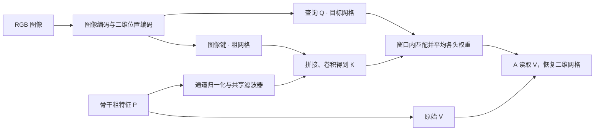

# AnyUp 源码学习笔记

**一张图像应当告诉模型在哪里分界，一张粗特征图应当告诉模型分界两边能填什么。** AnyUp 把前一件事做成「每个输出位置对附近粗格的注意力」，把后一件事做成「用同一组空间权重混合原始粗向量」。困难在于换视觉骨干以后，粗向量的通道数和分布都会变。作者让生成注意力的分支先用同一套空间滤波器处理各通道，把表示压成固定宽度；最终取值的分支则始终保留骨干原有通道。这样，同一个上采样器能给多种骨干输出稠密特征。

[ICLR 2026 论文](https://arxiv.org/abs/2510.12764v2) · [作者仓库](https://github.com/wimmerth/anyup) · [[AnyUp_Translation]] · [[AnyUp_paper_notes]]

| 先读哪里 | 要追的计算 |
|---|---|
| [anyup/model.py · AnyUp.forward / upsample](https://github.com/wimmerth/anyup/blob/351807a9c4287368732cc247f26c7c81c9139af4/anyup/model.py#L54-L93) | 一份图像表示分出 Q 和 K，粗特征同时进入 K 和 V |
| [feature_unification.py · LearnedFeatureUnification](https://github.com/wimmerth/anyup/blob/351807a9c4287368732cc247f26c7c81c9139af4/anyup/layers/feature_unification.py#L7-L42) | 怎样将可变骨干通道数变成固定宽度，以及与式 (1) 的轴次序差别 |
| [attention_masking.py · window2d / compute_attention_mask](https://github.com/wimmerth/anyup/blob/351807a9c4287368732cc247f26c7c81c9139af4/anyup/layers/attention/attention_masking.py#L6-L74) · [chunked_attention.py · CrossAttentionBlock / CrossAttention](https://github.com/wimmerth/anyup/blob/351807a9c4287368732cc247f26c7c81c9139af4/anyup/layers/attention/chunked_attention.py#L36-L111) | 在两个不同尺寸的网格之间划窗口，取多头权重并读原值 |
| [post_collate.py · BatchMultiCrop](https://github.com/wimmerth/anyup/blob/351807a9c4287368732cc247f26c7c81c9139af4/anyup/utils/dataloader/post_collate.py#L36-L85) · [train.py · 三项监督](https://github.com/wimmerth/anyup/blob/351807a9c4287368732cc247f26c7c81c9139af4/train.py#L179-L244) · [loss.py · Cosine_MSE](https://github.com/wimmerth/anyup/blob/351807a9c4287368732cc247f26c7c81c9139af4/anyup/loss.py#L6-L24) | 从同一幅图构造粗输入和局部目标，对齐坐标、方向和数值尺度 |

## 1. 先跟一次前向

一张经过 ImageNet 均值、标准差归一化的 RGB 图 `image=[B,3,H,W]`，以及与图像同视野、同方向的粗特征 `features=[B,C,h,w]`，就能作为推理输入。调用方负责提取粗特征。作者训练用的 ViT（视觉 Transformer）包装器请求 `output_fmt="NCHW"`，将空间特征和前缀信息分开返回；训练代码取前者。若自己拿到的是 token 序列，要先根据骨干的前缀数去掉非空间 token，再按实际 patch 行列还原为二维网格。[骨干封装](https://github.com/wimmerth/anyup/blob/351807a9c4287368732cc247f26c7c81c9139af4/anyup/backbone/vit_wrapper.py#L134-L164) · [推理输入说明](https://github.com/wimmerth/anyup/blob/351807a9c4287368732cc247f26c7c81c9139af4/README.md)



贯穿的数字例子取 `B=1`，图像 `224×224`，DINOv2-S/14 粗图 `[1,384,16,16]`，请求输出 `64×64`。默认匹配宽度 `D=128`，4 个头各用 32 维。记 `Nq=64×64=4096`、`Nk=16×16=256`。匹配用的 128 维和要保留的 384 维可以独立选择。默认省略 `output_size` 时，目标尺寸取图像的高和宽。[模块默认值](https://github.com/wimmerth/anyup/blob/351807a9c4287368732cc247f26c7c81c9139af4/anyup/model.py#L13-L52) · [输出尺寸](https://github.com/wimmerth/anyup/blob/351807a9c4287368732cc247f26c7c81c9139af4/anyup/model.py#L85-L93)

## 2. 两张图怎样组成 Q、K、V

图像在细网格上保存颜色和轮廓，在缩小后也给每个粗格提供外观线索。`image_encoder` 先生成 `[1,128,224,224]` 引导特征。行、列坐标分别用 `linspace(0,1,...)` 取样，`meshgrid(indexing="ij")` 产生 `[1,50176,2]`。二维旋转位置编码（RoPE）用 `coords @ freqs` 生成每个位置每个通道的角度，再做正弦、余弦混合。`freqs` 是可训练参数。位置写入图像特征后才分流到两套网格，因此两者仍有共同的坐标参考。[坐标](https://github.com/wimmerth/anyup/blob/351807a9c4287368732cc247f26c7c81c9139af4/anyup/utils/img.py#L3-L7) · [RoPE](https://github.com/wimmerth/anyup/blob/351807a9c4287368732cc247f26c7c81c9139af4/anyup/layers/positional_encoding.py#L9-L30) · [编码调用](https://github.com/wimmerth/anyup/blob/351807a9c4287368732cc247f26c7c81c9139af4/anyup/model.py#L85-L93)

以下节选自 `AnyUp.upsample`。[作者原始实现](https://github.com/wimmerth/anyup/blob/351807a9c4287368732cc247f26c7c81c9139af4/anyup/model.py#L64-L83)

```python
q = F.adaptive_avg_pool2d(self.query_encoder(enc_img), output_size=out_size)
k = F.adaptive_avg_pool2d(self.key_encoder(enc_img), output_size=(h, w))
k = torch.cat([k, self.key_features_encoder(F.normalize(feats, dim=1))], dim=1)
k = self.aggregation(k)
v = feats
```

- **Q 的每一行对应要填值的一个位置。** `adaptive_avg_pool2d` 根据指定的输出尺寸划分空间区间并取均值。示例中 Q 成为 `[1,128,64,64]`。空间分辨率可随调用改变，编码层参数维持固定。
- **K 的每一行对应可供读取的一个粗格。** 图像键池化至 `[1,128,16,16]`。同一粗格的骨干描述子先沿 `dim=1` 做 L2 归一化，再经特征统一层和残差块也成为 `[1,128,16,16]`。`cat(dim=1)` 把同一位置的两种描述并排放到 256 个通道里。`aggregation` 用 $3\times3$ 卷积降回 128 通道，再经两个残差块融合。因此键可以同时辨别 RGB 外观与骨干特征的局部变化。
- **V 保存最后要返回的数值。** `v = feats` 直接引用 `[1,384,16,16]` 原始张量。K 分支的归一化是生成匹配依据的操作，V 分支保留原特征的长度和通道定义。编码器中的残差块使用 GroupNorm、SiLU、卷积，并将结果加回捷径。整个上采样模块在跨网格加权读值后直接返回稠密特征。[编码器构造](https://github.com/wimmerth/anyup/blob/351807a9c4287368732cc247f26c7c81c9139af4/anyup/model.py#L29-L62) · [残差块](https://github.com/wimmerth/anyup/blob/351807a9c4287368732cc247f26c7c81c9139af4/anyup/layers/convolutions.py#L4-L24)

**迁移到自己的模型。** 按输出需求给两条支路定义接口。若最终还要使用已有线性预测头，让值分支一直保持它期望的 `C` 维坐标系；匹配分支就可以使用自己的宽度。支持新的通道数只解决张量接口，跨骨干时仍要看注意力能否把值混到正确位置。

## 3. 任意通道数怎样进入固定宽度的键

论文式 (1) 的直觉是把每个骨干通道视作一张小灰度图，用同一组 $M$ 个滤波器问它「附近哪一类结构变化更强」。每个通道在 $M$ 个响应之间先投票，再平均 $C$ 个通道的投票。这样每个粗格交给下游的都是 $M$ 个数。论文默认对应的代码配置中 `M=128`、`k=5`；`basis` 形状 `[128,1,5,5]`，共有 3200 个滤波权重，数量和 `C` 无关。[基底参数](https://github.com/wimmerth/anyup/blob/351807a9c4287368732cc247f26c7c81c9139af4/anyup/layers/feature_unification.py#L7-L26) · [模型配置](https://github.com/wimmerth/anyup/blob/351807a9c4287368732cc247f26c7c81c9139af4/config/model/anyup.yaml#L4-L11)

作者用分组卷积一次处理所有输入通道。`basis.repeat(c,1,1,1)` 把同一个基底按组复制，`groups=c` 使每组只看一个输入通道，并为这一组输出 $M$ 个响应。展开后的通道顺序是 `(c0,m0), (c0,m1), …, (c1,m0), …`。复制的核都来自同一个参数，因此反向时各组的贡献加到同一套核上。输入四周补零后，源码还用全 1 掩码和全 1 核计数，将每个响应除以该位置的有效样本数。对至少 $5\times5$ 的图，中心为 25，角点为 9；分母 `[1,1,h,w]` 会沿批和所有卷积输出通道广播。这个除法会改变后续 softmax 的分布，式 (1) 没有单列它。[边界与分组卷积](https://github.com/wimmerth/anyup/blob/351807a9c4287368732cc247f26c7c81c9139af4/anyup/layers/feature_unification.py#L34-L42)

### 直接读源码时，要留意 `view` 给两个轴起了什么名字

```python
x = self._depthwise_conv(features, self.basis, self.kernel_size).view(b, self.out_channels, c, h, w)
attn = F.softmax(x, dim=1)
return attn.mean(dim=2)
```

这三行是公开版 `LearnedFeatureUnification.forward`。实际尺寸从 `[B,C*M,h,w]` 变成 `[B,M,C,h,w]` 再变成 `[B,M,h,w]`，所以任意 `C` 都能通过。但 `view` 只重新解释线性顺序。卷积实际把第 `c*M+m` 个响应留给输入通道 `c` 的第 `m` 个核，而直接 `view(B,M,C,h,w)` 会把第 `m*C+c` 个响应放在新位置 `[m,c]`。这两种索引一般不同。公开版计算的固定宽度向量仍非负、在 $M$ 维上和为 1，但无法据此推出式 (1) 的逐通道投票或通道置换不变性。[官方三行及其前置操作](https://github.com/wimmerth/anyup/blob/351807a9c4287368732cc247f26c7c81c9139af4/anyup/layers/feature_unification.py#L28-L42)

**一个能看出差异的最小例子。** 单独调用这一层，设 `B=h=w=k=1`、`C=2`、`M=3`，两个输入通道取 `[1,3]`，三个核取 `[0,1,2]`。分组卷积依次给出 `[0,1,2,0,3,6]`，公开版把它看成三行 `[[0,1],[2,0],[3,6]]`，按列纵向做 softmax 再求每行的平均。下面是用 PyTorch 对公开类的最小数值核对。该例专门检查这一层的轴顺序。

| 输入通道 | 公开版 `view(B,M,C,…)` | 按式 (1) 保留 `(C,M)` 排列 |
|---|---|---|
| `[1,3]` | `[0.0209, 0.1310, 0.8481]` | `[0.0462, 0.1460, 0.8078]` |
| `[3,1]` | `[0.3539, 0.5130, 0.1331]` | `[0.0462, 0.1460, 0.8078]` |

**按论文轴语义写给自己的版本。** 以下两行沿用源码的有效面积归一化，`response` 是分组卷积并除以有效面积后的张量。对每个输入通道跨滤波器做 softmax，再跨输入通道平均。这个写法适用于自己从头训练一个有通道置换不变性质的适配器。读取作者已发布权重时应遵循权重训练所对应的实现，改轴会改变键和注意力。[公开实现以供对照](https://github.com/wimmerth/anyup/blob/351807a9c4287368732cc247f26c7c81c9139af4/anyup/layers/feature_unification.py#L28-L42) · [[Feature_Extraction#24. AnyUp 案例：用共享空间滤波器接收可变通道数]]

```python
response = response.reshape(B, C, M, h, w)
descriptor = response.softmax(dim=2).mean(dim=1)  # [B,M,h,w]
```

这一层的参数量虽不随 `C` 增长，中间响应仍有 `B*C*M*h*w` 个元素。例如 `[1,384,128,16,16]` 有 12,582,912 个数。若在自己的公式版适配器里需要控制峰值，可将输入通道分块，每块独立完成 $M$ 维 softmax，再跨块累计所有通道的和并除以总 `C`。这种分块依赖逐通道独立归一化的前提。

## 4. 局部窗口怎样落到两个尺寸不同的网格上

论文 §4.2 要求一个目标像素只从邻近的粗格取值。原始推理路径在算 softmax 之前构造布尔掩码，先用连续坐标划一个矩形，再换算为整数粗格索引。对长方形图也可以分别按高、宽换算，两张图需要覆盖同一视野。[窗口边界](https://github.com/wimmerth/anyup/blob/351807a9c4287368732cc247f26c7c81c9139af4/anyup/layers/attention/attention_masking.py#L23-L40)

取前面 `64×64` 的目标网格与 `16×16` 的粗网格。目标点 `(32,32)`（从 0 计）的行、列中心都是 `32.5/64≈0.5078`。默认 `window_ratio=0.1` 是**沿归一化坐标向每侧扩展的量**。沿高裁到 `[0,1]` 后，起点为 `floor((0.5078−0.1)×16)=6`，终点为 `ceil((0.5078+0.1)×16)=10`，取左闭右开区间 `[6,10)`。列的计算相同，这个点可选 16 个粗格。左上角 `(0,0)` 只可选粗行 `0,1` 与粗列 `0,1`，共 4 个。论文附录 B.1 将窗口整体宽度比例写为 $\sigma=0.2$；整数取整和边界截断会改变实际格数。这里对像素中心使用半格偏移，前面 RoPE 的 `linspace` 则含两个坐标端点，两处坐标用途不同。

```python
row_ok = (rows >= r0) & (rows < r1)
col_ok = (cols >= c0) & (cols < c1)
```

源码中的 `r0,r1,c0,c1` 各是 `[4096,1]`；`rows` 和 `cols` 分别枚举来源网格的一整条轴。广播后都得到 `[4096,16]`。把行判断扩成 `[4096,16,1]`，列判断扩成 `[4096,1,16]`，逻辑与即得 `[4096,16,16]`。展平为 `[4096,256]` 后取反，送给 `nn.MultiheadAttention`。此 API 的布尔 `attn_mask=True` 表示该来源被屏蔽。用 `(32,32)` 检查时，应看到行号 `32*64+32` 在粗格编号 `6*16+6=102` 处为 `False`，在编号 0 处为 `True`。[掩码构造](https://github.com/wimmerth/anyup/blob/351807a9c4287368732cc247f26c7c81c9139af4/anyup/layers/attention/attention_masking.py#L43-L74) · [[Attention_and_Affinity_Refinement#6.7 用归一化坐标限制跨网格注意力]]

### 只取多头注意力的权重，重新读取原始 V

`CrossAttentionBlock` 先给 Q 加一个保持分辨率的 $3\times3$ 卷积，使匹配能够结合目标网格近邻。接着用 `permute(0,2,3,1).view(...)` 把图的空间轴展平，得到 `Q=[1,4096,128]`、`K=[1,256,128]`、`V=[1,256,384]`。每行从左到右排列，列编号 `j=r*w+c` 既用来构造掩码，也用来取 V。若两个分支的展平顺序不同，所有 shape 可能都正确，读取的却是另一个位置。[头部卷积与展平](https://github.com/wimmerth/anyup/blob/351807a9c4287368732cc247f26c7c81c9139af4/anyup/layers/attention/chunked_attention.py#L89-L111)

```python
val = key
query = self.norm_q(query)
key = self.norm_k(key)
_, attn = self.attention(query, key, val,
                         average_attn_weights=True,
                         attn_mask=mask)
features = einsum("b i j, b j d -> b i d", attn, value)
```

这段是 `CrossAttention.forward` 的无分块路径。「送给 MHA 的第三个参数」和「最终要被加权的值」是两个变量。`val` 是归一化前的 128 维键，为内置多头注意力提供与其投影兼容的第三个输入。计算分数时，Q 和 K 各自先做 RMSNorm（沿末维按均方根归一化），再各自经过从完整 128 维到 128 维的线性投影，最后将投影结果拆成 4 个 32 维的头。每个头将查询与允许的粗键做缩放点积，在粗格轴上做 softmax；`average_attn_weights=True` 将四个头的概率矩阵平均。MHA 同时返回的投影输出被丢弃。真正参与读值的 `value` 为骨干的原始 384 维描述子。[RMSNorm 与头参数](https://github.com/wimmerth/anyup/blob/351807a9c4287368732cc247f26c7c81c9139af4/anyup/layers/attention/chunked_attention.py#L8-L22) · [权重与原值读出](https://github.com/wimmerth/anyup/blob/351807a9c4287368732cc247f26c7c81c9139af4/anyup/layers/attention/chunked_attention.py#L36-L53)

转换成下标，`einsum` 累加 `attn[b,i,j] * value[b,j,d]`，只消去粗格 `j`。若为便于手算，某一行只有两个非零权重 `0.75`、`0.25`，对应两个粗向量 `(2,0)`、`(0,4)`，那一个细位置得到 `(1.5,1)`。每个通道共享同一组权重，输出是附近粗向量的凸组合。由此还能做一个简单检验：把所有值都设为同一个向量，完整输出应在浮点误差范围内处处等于它。最后 `[1,4096,384] → [1,64,64,384] → [1,384,64,64]` 交给下游。更细的边界来自不同像素选择了不同混合比例；若附近所有粗向量相同，再精细的引导也无法在该处造出两个不同的描述子。

**窗口限定了信息来源，节省多少计算要看实现。** 标准 `anyup` 路径生成完整布尔掩码后调用稠密 MHA。指定 `q_chunk_size=L` 会按一维序列每 `L` 个查询切块，切对应的 mask 行，每块仍看到全部粗键。将各块输出按查询轴拼接即可。这样能压低推理中临时浮点分数的峰值，整张 `[Nq,Nk]` 布尔掩码仍会生成；开启可视化还会收集全部注意力权重。把分块加在 Q 的局部卷积之后可以保留块边缘的邻域信息。[查询分块](https://github.com/wimmerth/anyup/blob/351807a9c4287368732cc247f26c7c81c9139af4/anyup/layers/attention/chunked_attention.py#L55-L76) · [整张掩码与可视化](https://github.com/wimmerth/anyup/blob/351807a9c4287368732cc247f26c7c81c9139af4/anyup/layers/attention/chunked_attention.py#L91-L116)

**NATTEN 是另一个入口。** Hub 函数 `anyup` 默认加载 DINOv2-S/14 单骨干权重、`use_natten=False`；`anyup_multi_backbone` 对应多骨干训练权重。显式开启 NATTEN（Neighborhood Attention）且安装可用时，作者拷贝 Q/K 投影等参数，将 K/V 最近邻对齐到 Q 尺寸，在该网格上使用带 dilation 的 `na2d`。同一完整值向量供所有头读取，再对各头输出求均值。窗口核的奇数取整与边缘处理会使其结果不同，`q_chunk_size` 的单位也改为粗特征图的**行数**。附录 B.1 的性能分析明确提到 NATTEN 稀疏核；仓库 README 将标准窗口称为原论文模型，并另外介绍这个优化版本，不能把附录效率数字直接归给默认稠密 MHA。[模型入口](https://github.com/wimmerth/anyup/blob/351807a9c4287368732cc247f26c7c81c9139af4/hubconf.py#L7-L48) · [分支选择与回退](https://github.com/wimmerth/anyup/blob/351807a9c4287368732cc247f26c7c81c9139af4/anyup/layers/attention/__init__.py#L12-L52) · [NATTEN 值读出](https://github.com/wimmerth/anyup/blob/351807a9c4287368732cc247f26c7c81c9139af4/anyup/layers/attention/natten_attention.py#L48-L77) · [窗口与块单位](https://github.com/wimmerth/anyup/blob/351807a9c4287368732cc247f26c7c81c9139af4/anyup/layers/attention/natten_attention.py#L106-L161)

**非整数倍率下要检查输出高度。** 标准路径按目标网格生成查询，可请求非整数倍率。这个版本的 NATTEN 在真正按粗网格行分块时，用 `sh = hq // hk` 把每段上下界映射到查询网格。例如粗网格高 16、目标高 65、每块 4 行，最后一段的上界最多是 $16\times4=64$，第 65 行没有进入计算。要保留完整的目标网格，可以走标准分块路径，并在组合模块时检查实际输出尺寸。此处结论来自切片上下界。[分块源码](https://github.com/wimmerth/anyup/blob/351807a9c4287368732cc247f26c7c81c9139af4/anyup/layers/attention/natten_attention.py#L196-L221)

## 5. 裁局部图，为什么能监督全图上采样

同一块物体在缩小后的整图里只占很少几个 patch；直接把它所在的局部裁块交给同一个骨干，物体就会占更多 patch。局部视图的编码提供更密的参照。训练要解决的坐标问题是，局部目标应和**全图预测中覆盖同一块画面的区域**比较。

以配置中的 `448×448` 图像视野、`224×224` 处理尺寸为例，假定本批选到了 patch 边长 14 的 DINOv2-S。`BatchMultiCrop` 会为每图随机选择 4 个允许重叠的局部裁块，分别把其左上角对齐到 14 的倍数。[训练尺寸](https://github.com/wimmerth/anyup/blob/351807a9c4287368732cc247f26c7c81c9139af4/config/base.yaml#L33-L39) · [构造裁块与全局视图](https://github.com/wimmerth/anyup/blob/351807a9c4287368732cc247f26c7c81c9139af4/anyup/utils/dataloader/post_collate.py#L36-L85)

| 路径 | 实际输入与产物 | 它教给模型什么 |
|---|---|---|
| 全图路径 | 将整个 `448×448` 视野缩至 `224×224`，默认用这张缩图同时作为 `lr_image` 和 `guidance_image`。骨干给 `P=[B,384,16,16]`；上采样器以 `upsampling_size=448//14=32` 预测 `[B,384,32,32]` | 32 个目标格覆盖原始视野的一条边，每格对应 14 个原图像素 |
| 局部路径 | 直接从 `448×448` 图取 `224×224` 裁块，每块经相同骨干得到 `[384,16,16]`，堆成 `[4B,384,16,16]` | 这个 `16×16` 仅覆盖半幅图的边长，和全图预测中同位置的 `16×16` 相匹配 |
| 对齐路径 | 全图预测按图 `repeat_interleave(4,dim=0)` 以匹配裁块顺序，在对应的每张预测上切片并 `stack` | 对每个局部位置都有一对 384 维向量，可直接计算重建损失 |

假设一个裁块左上角在原图像素 `(70,112)`，保存的 `guidance_crop` 是 `(5,8)`。训练代码取 `pred[i,:,5:21,8:24]` 与该局部编码的完整 `16×16` 比较。源码里索引名 `x_i,y_i` 在这里分别索引张量的高、宽，因为 `coords` 按 `(top // patch_size, left // patch_size)` 生成。只切最终预测所得的片段用于主损失，整张预测仍保留给输入一致性项。这个默认实现中的全图引导是缩至 224 的视图；方法图中的高分辨率视野、喂给模型的引导图尺寸、希望输出的特征尺寸应分别读。[坐标与视图字段](https://github.com/wimmerth/anyup/blob/351807a9c4287368732cc247f26c7c81c9139af4/anyup/utils/dataloader/post_collate.py#L53-L85) · [repeat_interleave 与裁切](https://github.com/wimmerth/anyup/blob/351807a9c4287368732cc247f26c7c81c9139af4/train.py#L179-L215)

### 训练的三个比较对象

| 项 | 输入和目标 | 梯度及作用 |
|---|---|---|
| 局部重建 `anyup_hr` | 裁下的上采样预测，与冻结骨干给出的局部裁块特征 | 学生从相同位置的粗描述子里恢复较密的参考语义 |
| 自一致性 `anyup_reg` | 保持粗特征 `P` 相同，对增强引导与干净引导分别调用同一个 AnyUp，均指定输出 `224×224` | 增强分支可导。干净分支在 `no_grad()` 中计算，随后再 `detach()` 当靶值；没有额外移动平均教师。它抑制亮度、模糊、噪声等外观扰动对空间混合的影响 |
| 输入一致性 `anyup_down` | 全图预测用 `F.interpolate(..., mode="area")` 缩回 `P` 的网格，与 `P` 比较 | 梯度穿过面积重采样回到全图预测，鼓励区域汇聚后仍能找回原骨干的值 |

默认总损失是局部重建损失，加上 0.1 倍自一致性损失和 0.1 倍输入一致性损失。骨干在 `eval()` 下提取参考特征和输入特征，两个骨干前向都包在 `no_grad()`；优化器注册的是 AnyUp 的参数。多骨干版先为一批采样一种 patch 大小，再从匹配该大小的骨干中随机选一个；同一批的粗图、局部目标使用同一个骨干、同一特征空间。当前 `base.yaml` 列出五个骨干配置。论文主体多数比较及 `anyup` 原始权重对应 DINOv2-S/14；推理只需要输入粗特征与图像，无须再构造局部参照和增强对。[配置](https://github.com/wimmerth/anyup/blob/351807a9c4287368732cc247f26c7c81c9139af4/config/base.yaml#L10-L39) · [骨干模式](https://github.com/wimmerth/anyup/blob/351807a9c4287368732cc247f26c7c81c9139af4/train.py#L77-L94) · [优化参数](https://github.com/wimmerth/anyup/blob/351807a9c4287368732cc247f26c7c81c9139af4/train.py#L141-L149) · [三项的调用与合并](https://github.com/wimmerth/anyup/blob/351807a9c4287368732cc247f26c7c81c9139af4/train.py#L174-L244) · [引导增强](https://github.com/wimmerth/anyup/blob/351807a9c4287368732cc247f26c7c81c9139af4/anyup/utils/training.py#L48-L79)

### 式 (2) 中的 MSE 在代码里还按目标尺度加权

`Cosine_MSE` 将 `[B,C,H,W]` 排成 `[B*H*W,C]`，每一行是一对空间对齐的向量。`CosineEmbeddingLoss` 的标签全为 `+1`，在**原始**预测与目标上算 $1-\cos$，再平均各位置。均方误差（MSE）采用另一条路径，在每个位置跨 `C` 取目标最小、最大值，用同一对数值缩放预测与目标，再对所有位置与通道求均值。[损失实现](https://github.com/wimmerth/anyup/blob/351807a9c4287368732cc247f26c7c81c9139af4/anyup/loss.py#L12-L24)

```python
min_val = torch.min(target, dim=1, keepdim=True).values
max_val = torch.max(target, dim=1, keepdim=True).values
pred_normalized = (pred - min_val) / (max_val - min_val + 1e-6)
target_normalized = (target - min_val) / (max_val - min_val + 1e-6)
```

例如某位置目标是 `[2,6]`、预测是 `[3,5]`，按目标范围 4 缩放后，目标约 `[0,1]`，预测约 `[0.25,0.75]`，该位置的 MSE 约为 `0.0625`。两者减同一最小值，所以这一项等价于按目标通道极差的平方倒数对该位置的原始 MSE 加权（分母含 $\epsilon$）。余弦项关心方向，共用靶值范围的 MSE 则仍会惩罚幅值差异。若把它搬到近常量通道或单通道目标上，先检查极小极差对梯度尺度的影响。

## 6. 重读这份源码时，我会从哪里下手

| 想借用的机制 | 首先保留的约定 | 回看入口 |
|---|---|---|
| 让不同通道数的骨干接上同一匹配分支 | 滤波器参数共享，输入通道和滤波器是两个独立的轴；用通道置换小例子验证期望性质 | [LearnedFeatureUnification](https://github.com/wimmerth/anyup/blob/351807a9c4287368732cc247f26c7c81c9139af4/anyup/layers/feature_unification.py#L28-L42) · [[Feature_Extraction]] |
| 用细图像边界重采样粗空间值 | 查询、键和值共享空间参考；键与查询的头内宽度匹配，值通道数单独保留 | [AnyUp.upsample](https://github.com/wimmerth/anyup/blob/351807a9c4287368732cc247f26c7c81c9139af4/anyup/model.py#L64-L83) · [CrossAttention.forward](https://github.com/wimmerth/anyup/blob/351807a9c4287368732cc247f26c7c81c9139af4/anyup/layers/attention/chunked_attention.py#L36-L76) |
| 跨网格限制局部邻域 | 用目标中心到来源网格的映射固定窗口；单测中央和角点，再测常量值图。评估内存时分别数掩码、分数和输出 | [window2d](https://github.com/wimmerth/anyup/blob/351807a9c4287368732cc247f26c7c81c9139af4/anyup/layers/attention/attention_masking.py#L23-L40) · [[Attention_and_Affinity_Refinement]] |
| 用同一冻结编码器产生局部稠密监督 | 全图缩放、局部裁剪要共享原图视野，并把裁块起点换算成预测网格坐标；自一致性只让扰动侧获得梯度 | [BatchMultiCrop](https://github.com/wimmerth/anyup/blob/351807a9c4287368732cc247f26c7c81c9139af4/anyup/utils/dataloader/post_collate.py#L42-L85) · [训练目标](https://github.com/wimmerth/anyup/blob/351807a9c4287368732cc247f26c7c81c9139af4/train.py#L197-L240) |

