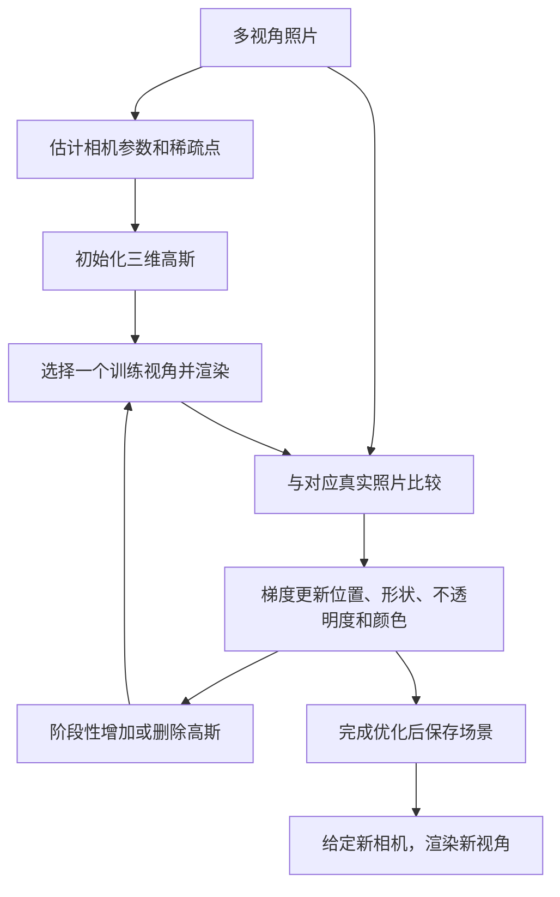

# 3DGS：从前置知识理解三维高斯泼溅

> [!abstract] 快速回顾
> 3D Gaussian Splatting（3DGS，三维高斯泼溅）用大量可调整的三维高斯表示一个场景。每个高斯记录位置、形状、不透明度，以及随观察方向变化的颜色。给定相机，把高斯投影到图像上，再按照前后顺序合成颜色，就得到一张图。
>
> 学习时，用渲染结果与真实照片之间的差异，反过来调整这些高斯，并在需要的地方增加表示单元。学好后，更换相机位置即可渲染新的视角。**主线是：怎样表示场景 → 怎样形成图像 → 怎样从照片中调整场景。**

本页围绕知识点建立理解，主体讨论原始静态场景 3DGS；后续方法只用于说明它与其他知识的联系。第一次阅读按顺序读，回看时可先读上面的摘要，再查对应小节。无需先读论文或运行代码。

## 1. 先明确任务：从照片中学到什么

假设绕着一张桌子拍摄了许多照片，希望在电脑里移动相机，从一个没有拍摄过的位置看到桌子。这里需要一个能够被不同相机共同观察的三维场景表示，而不只是保存这些照片。

**新视角合成（Novel View Synthesis，NVS）** 指根据已有观测生成另一个相机视角下的图像。“新”的是相机视角，不意味着图中每一块内容都从未被观察过。例如，新视角里的桌腿可能已经在其他几张照片中出现，因此有信息可以约束它的外观。

如果所有照片都只拍到桌子正面，完全没拍到背面，原始 3DGS 就缺少恢复背面的可靠依据。能够换视角，不等于能够准确补全任意未知区域。

需要区分三个对象：

| 对象 | 包含什么 | 在任务中的作用 |
|---|---|---|
| 观测 | 拍摄的二维照片 | 告诉模型图像应该是什么样 |
| 场景表示 | 空间中的高斯及其参数 | 保存可从不同视角观察的内容 |
| 渲染图像 | 场景在某个相机下的二维结果 | 与照片比较，或用于展示新视角 |

通常一个场景需要优化自己的一组高斯。原始 3DGS 并不是一个输入任意新照片就立即输出完整三维世界的通用预训练模型。其基本设定可参见[原始 3DGS 的方法概览](https://arxiv.org/html/2308.04079v1)。

## 2. 理解 3DGS 必要的前置知识

### 2.1 坐标系：同一个点可以有不同的坐标

空间中的一个点可以写成三维向量 $\mathbf{x}=(x,y,z)^T$。这里向量只是把三个坐标放在一起；上标 $T$ 表示转置，使它按列排列，方便与矩阵相乘。

**世界坐标系**是整个场景共用的参照，比如把房间的某个角落当作原点。**相机坐标系**则以当前相机为参照：相机移动后，同一个桌角在世界中的位置不变，但相对于相机的位置发生了变化。

从世界坐标换到相机坐标，可以写成：

$$
\mathbf{x}_{c}=R_c\mathbf{x}_{w}+\mathbf{t}_c.
$$

$\mathbf{x}_w$、$\mathbf{x}_c$ 分别是同一个点在两套坐标中的表示。$R_c$ 是 $3\times3$ 旋转矩阵，负责改变坐标轴朝向；$\mathbf{t}_c$ 是三维平移向量，负责改变原点。两者组成这里采用的世界到相机的**外参**。注意，$\mathbf{t}_c$ 并不直接等于相机在世界中的位置。

后面还会出现高斯自己的旋转 $R_g$：它改变椭球的朝向，和相机旋转 $R_c$ 是两件事。

### 2.2 透视投影：为什么物体越远通常看起来越小

相机把三维点转换到二维图像坐标，这一步叫**投影**。先用忽略镜头畸变的针孔模型理解它。设一个点在相机坐标中是 $(X,Y,Z)$，且 $Z>0$ 表示位于相机前方，则：

$$
u=f_x\frac{X}{Z}+c_x,\qquad
v=f_y\frac{Y}{Z}+c_y.
$$

$(u,v)$ 是图像中的像素坐标；$f_x,f_y$ 是以像素为单位的焦距参数，控制投影的尺度；$(c_x,c_y)$ 是主点位置，即光轴与图像平面的交点。这些参数属于**内参**。可以把内外参的分工记成：外参说明相机在哪里、朝哪里，内参说明它怎样把视线映射到像素。

这里最关键的是除以 $Z$。当横向距离 $X$ 不变、深度 $Z$ 增大时，$u$ 离主点的距离减小，物体的投影就会缩小。

**图 1：投影会丢失一部分深度信息。** 图中只画相机坐标的 $X$–$Z$ 截面。两个点虽然深度不同，但 $X/Z$ 相同，所以投影到相同位置。给定相机参数，一个像素对应一条从相机出发的射线；仅靠这个像素，通常不能确定物体位于射线上的哪个深度。

例如设 $f_x=800$、$c_x=640$，$(X,Z)=(1,2)$ 和 $(2,4)$ 都会得到 $u=1040$。换一个位置观察，同一个三维点在新图像中又产生一个约束，这就是多视角有用的原因之一。

### 2.3 从多张照片估计相机和稀疏点

**SfM（Structure from Motion，运动恢复结构）** 会寻找不同照片中对应的图像特征，联合估计相机参数和一些三维点。比如同一个桌角在几张照片里都被找到，就可以利用这些对应关系约束它的位置。

**COLMAP**是常用的重建工具，其 SfM 输出通常包括相机参数和稀疏点云。“稀疏”意味着这里只恢复了部分可匹配点，并没有得到每一处表面的完整几何。原始 3DGS 的常见流程用这些点初始化高斯，再通过图像监督继续调整。[COLMAP 官方说明](https://colmap.github.io/tutorial.html#structure-from-motion)

因此，照片给出的是外观监督，相机参数给出的是观察关系，初始点云给出的是空间起点。它们的作用不同，不能只保留照片而忽略相机信息。

### 2.4 高斯：从中心向外平滑衰减的权重

先看一维形式：

$$
g(x)=\exp\left(-\frac{(x-\mu)^2}{2s^2}\right).
$$

$\mu$ 是中心，$s>0$ 控制分布有多宽，$\exp$ 是指数函数。中心处 $x=\mu$，权重为 $1$；偏离中心 $s$ 时约为 $0.607$；偏离 $2s$ 时约为 $0.135$。$s$ 越大，同样移动一段距离，权重下降得越慢。

这提供了一种平滑的“影响范围”：一个位置不必只影响单个点，也可以影响周围一片区域。这里使用的是未归一化高斯权重，不要求整条曲线下的面积等于 $1$，也不用把它理解为“这个点存在的概率”。

**图 2：形状来自不同方向的衰减速度。** 各向同性意味着各方向的尺度相同；各向异性允许某个方向宽、另一个方向窄。图中展示二维截面，三维中相同权重的位置会形成球面或椭球面。

“半透明椭球”是方便想象的说法。高斯本身没有硬壳：越远的尾部影响越弱，实际渲染才会忽略足够小的贡献。因此，它不等同于一个边界清楚的实体小球。

### 2.5 协方差矩阵：把大小和方向放进一个描述里

一维高斯只用 $s$ 描述宽度，三维高斯需要知道不同方向有多宽，以及这些方向朝哪里。**协方差矩阵 $\Sigma$** 把这些信息放进一个 $3\times3$ 矩阵。

在统计学里，协方差描述变量的变化范围及共同变化关系；在这里，可以先把它理解为高斯的形状描述。当各轴互不耦合时，对角线上的数值对应各坐标方向的方差；更一般的矩阵还可以表示倾斜的椭球。若熟悉特征值分解，特征向量给出主轴方向，特征值对应沿主轴的尺度平方。

三维形式为：

$$
G(\mathbf{x})=
\exp\left[-\frac12(\mathbf{x}-\boldsymbol\mu)^T
\Sigma^{-1}(\mathbf{x}-\boldsymbol\mu)\right].
$$

$\mathbf{x}-\boldsymbol\mu$ 是相对中心的位移；$\Sigma^{-1}$ 是协方差的逆矩阵，用于按高斯的方向和尺度衡量这段位移。夹在中间的二次型最后得到一个标量，可理解为**经过形状校正的距离平方**。

一个具体例子是：

$$
\Sigma=\operatorname{diag}(4,1,1).
$$

$\operatorname{diag}$ 表示把这些数放在对角线上，其余位置为零。此时沿 $x$ 轴移动 $2$ 个单位，与沿 $y$ 轴移动 $1$ 个单位，得到相同的校正距离，所以权重相同。这就是“沿长轴可以走得更远”的数学含义。

### 2.6 渲染、可微分与优化：三个相连但不同的步骤

**渲染**是给定场景和相机，算出图像。**光栅化**是把投影后的图元转换成离散像素贡献的过程。**可微分渲染**进一步提供梯度，让我们知道：如果把某个参数改变一点，图像误差会怎样变化。

把场景参数统称为 $\theta$，渲染器写成 $\mathcal R$，相机参数写成 $\mathcal C$：

$$
\hat I=\mathcal R(\theta,\mathcal C),\qquad
\theta\leftarrow\theta-\eta\nabla_\theta\mathcal L(\hat I,I).
$$

$\hat I$ 是渲染图，$I$ 是真实照片，$\mathcal L$ 是衡量两者差异的损失函数，$\nabla_\theta\mathcal L$ 是损失对各参数的梯度，$\eta$ 是控制更新步幅的学习率。这个更新式用于说明梯度下降的基本想法。

例如某个区域渲染得太暗，梯度可能推动相关高斯的颜色变亮；边缘位置不对，也可能需要调整高斯的位置或尺度。实际更新会同时受到多个像素、多个视角和参数耦合的影响，不是简单地把错误像素颜色复制回去。

**可训练的对象不一定是神经网络权重。** 只要能计算误差并把梯度传回参数，就可以直接优化位置、尺度和颜色。3DGS 正是这种情形。排序、裁剪以及增加或删除高斯还包含离散操作，“可微分”并不表示整条流程在所有情况下处处光滑。

## 3. 表示：一个三维高斯记录哪些东西

理解上述背景后，可以把每个高斯看成一条带空间含义的参数记录：

| 参数 | 作用 | 直觉 |
|---|---|---|
| 中心 $\boldsymbol\mu\in\mathbb R^3$ | 决定空间位置 | 放在哪里 |
| 三个正尺度 $\mathbf{s}$ | 决定三个主轴的宽度 | 拉多长、压多扁 |
| 旋转 $R_g$ | 决定主轴方向 | 朝哪里倾斜 |
| 不透明度 $\alpha$ | 调节整体的遮挡与贡献强度 | 这一团有多明显 |
| 颜色系数 | 根据观察方向计算 RGB | 从这个方向看是什么颜色 |

为了使形状保持有效，可以先缩放再旋转：

$$
S=\operatorname{diag}(s_x,s_y,s_z),\qquad
\Sigma=R_gSS^TR_g^T.
$$

正尺度保证各方向都有合法宽度，旋转负责改变方向。实际可以用四元数保存旋转：它用四个数编码三维旋转，使用时需要归一化；这里不需要进一步推导四元数运算。

这样，桌面附近可以使用扁平的高斯，细长结构附近可以使用拉长的高斯。但一个高斯不一定对应一个真实表面点，更不天然对应一个物体或语义类别。它首先是一个帮助拟合多视角图像的表示单元。[原始 3DGS：高斯参数化](https://arxiv.org/html/2308.04079v1)

### 3.1 为什么颜色还需要观察方向

如果只为每个高斯保存一个 RGB，从左边和右边观察它就会得到同样的颜色。但反光物体的外观可能随视角变化，因此需要用一个方向到颜色的函数 $\mathbf c(\mathbf d)$。$\mathbf d$ 是按一致约定表示的单位观察方向。

原始 3DGS 使用**球谐函数（Spherical Harmonics，SH）**描述这种变化。理解它需要“基函数”的概念：预先准备一些形状固定的函数，通过不同的系数组合出目标函数。类似把常量、一次项和二次项组合成多项式，只是这里的自变量是球面上的方向。

可以把它简写为：

$$
\mathbf c(\mathbf d)\approx\sum_{k=1}^{K}\mathbf b_kY_k(\mathbf d).
$$

$Y_k$ 是固定的方向基函数，$\mathbf b_k$ 是可学习的 RGB 系数，$K$ 是使用的基函数数量。改变观察方向会改变 $Y_k(\mathbf d)$ 的值，从而改变组合出的颜色。

不必记住每个球谐函数的表达式，关键是理解：**存储的是描述方向变化的系数，渲染时才计算当前方向的颜色。** 它近似的是已观测到的视角相关外观，并没有自动分离出真实材质、光源和阴影，所以换一个照明环境并不一定得到物理正确的效果。

## 4. 渲染：怎样把这些高斯变成图像

渲染时，高斯参数已经给定。主要流程是：确定可见高斯 → 投影中心和形状 → 计算像素处的权重 → 按前后顺序合成颜色。

### 4.1 投影中心，也要投影形状

中心的位置可以用前面的相机公式投影。但是只投影中心仍然只是一个二维点，还需要知道高斯在图像中占多大的区域、向哪个方向展开。

透视投影包含除以深度的操作，是非线性的。三维高斯经过透视投影后，并不严格仍是二维高斯。3DGS 在高斯中心附近对投影作**局部线性近似**：对这一小片区域，用一个线性变换近似投影的变化。

这个局部变换由**雅可比矩阵 $J$**描述。它由偏导数组成，用于回答“三维坐标各改变一点，二维坐标会怎样改变”。如果用 $J\in\mathbb R^{2\times3}$ 直接表示三维到二维的局部投影，则：

$$
\Sigma_{2D}\approx J R_c\Sigma R_c^TJ^T.
$$

先由 $R_c$ 把世界坐标中的形状换到相机坐标，再由 $J$ 转为图像中的形状，最终得到 $2\times2$ 的二维协方差。相机平移会影响高斯中心和该处的 $J$，虽然不会直接以平移向量的形式出现在这个协方差公式里。

它的作用是得到一个二维椭圆状的高斯权重分布。这里把它称为高斯在屏幕上的**足迹**。实际渲染还会考虑滤波、有限覆盖范围等处理。[原始 3DGS：三维到二维的投影近似](https://arxiv.org/html/2308.04079v1)

### 4.2 Splatting：计算一个高斯对哪些像素有贡献

Splatting 可以想象为把一枚中心浓、边缘淡的椭圆印章盖到图像上。但渲染器做的是计算数值，而不是把整个椭圆涂成同一种不透明颜色。

设 $\mathbf p=(u,v)^T$ 是一个像素，$\boldsymbol\mu_i^{2D}$ 是第 $i$ 个高斯投影后的中心，则概念上的有效不透明度是：

$$
a_i(\mathbf p)=\alpha_i
\exp\left[-\frac12(\mathbf p-\boldsymbol\mu_i^{2D})^T
\Sigma_{i,2D}^{-1}(\mathbf p-\boldsymbol\mu_i^{2D})\right].
$$

这里要区分两个量：$\alpha_i$ 是高斯自身存储的不透明度参数；$a_i(\mathbf p)$ 是它在**这个像素处**的有效不透明度。像素离投影中心越远，通常得到的有效不透明度越低。

因此，两个像素即使受同一个高斯影响，也不一定得到相同贡献。代码中的数值截断等细节不影响这条基本理解。

### 4.3 前后叠加：为什么不能把所有颜色直接平均

如果前面的物体已经遮住视线，后面的物体就不应该继续以同样强度贡献颜色。**Alpha 合成**利用不透明度表达这种关系。

**图 3：每经过一个高斯，留给后面的贡献份额都会减少。** 假设同一像素处，前方红色的有效不透明度为 $0.7$，后方蓝色为 $0.5$，那么红色占 $0.7$，蓝色占 $(1-0.7)\times0.5=0.15$，最后还剩 $0.15$ 给背景。

推广到按近到远排列的 $N$ 个高斯，可以先定义**透射率**：

$$
T_i(\mathbf p)=\prod_{j<i}\left(1-a_j(\mathbf p)\right).
$$

$\prod$ 表示把各项相乘。$T_i$ 就是前面所有高斯处理完后，仍然留给当前及更后方内容的份额；第一个高斯前面没有遮挡，所以 $T_1=1$。像素颜色为：

$$
\mathbf C(\mathbf p)=
\sum_{i=1}^{N}T_i(\mathbf p)a_i(\mathbf p)\mathbf c_i(\mathbf d)
+T_{N+1}(\mathbf p)\mathbf c_{\mathrm{bg}}.
$$

$\sum$ 表示把各项相加，$\mathbf c_{\mathrm{bg}}$ 是背景颜色，$T_{N+1}$ 是穿过全部高斯后剩下的透射率。每个高斯的最终权重来自两部分：前面还留了多少，以及自己在当前像素有多不透明。

颜色之间有了前后依赖，顺序就很重要。原始 3DGS 使用高效的深度排序近似处理可见性，并不为每个像素精确求出所有椭球的几何相交顺序。这也是理解某些视角变化伪影的背景。[原始 3DGS：合成模型与光栅化](https://arxiv.org/html/2308.04079v1)

## 5. 学习：怎样从照片得到这些参数

渲染解决“给定高斯会看到什么”，学习则反过来利用照片约束“高斯应该是什么样”。

图中的循环是针对一个具体场景进行的；增加或删除高斯只在规定阶段执行，不是每次渲染都会改变它们的数量。

### 5.1 照片中的颜色和结构提供监督

常见的光度监督首先比较渲染图与真实照片的像素差异。原始 3DGS 的目标结合了 L1 误差和 D-SSIM：

$$
\mathcal L=(1-\lambda)\mathcal L_1+\lambda\mathcal L_{\mathrm{D\text{-}SSIM}}.
$$

L1 衡量像素颜色的绝对差异；SSIM 是比较局部图像结构相似性的指标，D-SSIM 是对应的不相似性损失。$\lambda$ 控制两部分的相对权重，原始方法取 $0.2$。

优化的目标是让同一组三维高斯在不同相机下都能解释对应照片。一个高斯对某张照片拟合得很好，却让其他视角变差，仍会受到这些视角的误差约束。不过，二维图像约束仍可能存在歧义，因此图像逼真不保证几何完全准确。

### 5.2 为什么高斯数量也要变化

初始稀疏点无法为所有细节提供足够容量。只调整现有高斯的位置和颜色，可能很难同时表示桌面、桌边和细小桌腿，因此还要调整表示单元的数量。

| 操作 | 基本想法 | 希望解决的问题 |
|---|---|---|
| Clone，复制 | 增加小高斯，随后继续优化 | 局部覆盖或表示容量不足 |
| Split，分裂 | 把大高斯替换成多个较小高斯 | 一个大范围难以贴合局部细节 |
| Prune，删除 | 清除贡献过低或尺度异常的高斯 | 无效表示、伪影和开销 |

原始方法用**视图空间位置梯度的统计量**和高斯尺度等信息决定如何加密。可以直觉地理解为：某些高斯的位置持续收到较强的修正信号，提示其附近值得增加表达能力。但这不是“误差大的像素自动生成正确高斯”，也不是按语义识别出桌腿后再添加桌腿。

这里的“密度控制”指空间中高斯的分布和数量，不能直接等同于 NeRF 中的体密度参数。梯度优化调整已有参数；密度控制则调整承载这些参数的表示单元。[原始 3DGS：优化与自适应密度控制](https://arxiv.org/html/2308.04079v1)

### 5.3 训练快和渲染快是不同的指标

训练要反复渲染、比较照片、计算梯度，并维护高斯集合。完成训练后，查看新视角通常只需要给定相机并渲染已有场景。

因此，“可以实时显示”说的是后者，不表示刚拍完照片就立刻完成了三维建模。相机估计、场景优化、存储和加载也有各自的成本。

## 6. 与 NeRF、点云和网格放在一起理解

### 6.1 先理解辐射场和经典 NeRF

**场**可以理解为“为空间位置分配某种属性的函数”。例如温度场把位置映射为温度。**辐射场**还考虑方向，用于描述从某个位置沿某个方向看到或发出的光。入门时可以先关注颜色与空间中的体密度，而不用展开完整的辐射度学。

经典 **NeRF（Neural Radiance Fields，神经辐射场）** 用神经网络表示场景。沿像素射线选取多个三维位置，查询这些位置的体密度及相应方向的颜色，再进行体积渲染合成。体密度描述空间中的衰减强度，结合采样间隔后才得到一段射线的不透明度。[NeRF 官方方法介绍](https://www.matthewtancik.com/nerf)

**显式表示**直接保存可操作的场景单元，如点、面或高斯；**隐式表示**则通过一个函数查询场景属性。经典 NeRF 主要通过网络参数保存场景，3DGS 主要通过一组高斯参数保存场景。二者都能形成连续变化的图像，“显式”不意味着只能画出离散的点。

### 6.2 计算路径的区别

**图 4：左边沿射线查询空间，右边把已有基元投向屏幕。** 左图用少量采样点示意经典 NeRF 的查询过程；右图用椭圆示意三维高斯及投影足迹。颜色、大小及数量仅用于解释计算方向，并非真实场景的渲染结果。

经典 NeRF 的主要工作发生在沿射线的多次查询和积分近似中。3DGS 则利用显式高斯直接确定屏幕上的影响区域，计算二维权重后进行透明度合成，减少沿射线逐点查询场景网络的需求。

原始 3DGS 还把屏幕划分为小块（Tile），让每块只处理可能覆盖它的高斯，利用 GPU 并行完成计算；当一个像素的剩余透射率已经很低时，可以提前停止继续累积。表示方式与渲染算法一起决定了效率。[原始 3DGS：快速光栅化](https://arxiv.org/html/2308.04079v1)

这个对比针对经典方法。NeRF 及高斯泼溅都有很多加速和改进版本，不能据此推出所有 NeRF 都慢、所有 3DGS 都快。这里更值得记住的是计算从哪里出发、需要重复哪些工作。

### 6.3 不同表示擅长保存不同信息

| 表示 | 主要保存什么 | 理解它时要注意什么 |
|---|---|---|
| 点云 Point Cloud | 三维离散点及颜色等属性 | 原始点集合不直接定义点之间的连续表面 |
| 网格 Mesh | 顶点、面及连接关系 | 显式描述表面，常用于建模、几何处理及传统渲染 |
| 经典 NeRF | 可查询密度与颜色的神经函数 | 图像通过射线采样和体积合成得到 |
| 原始 3DGS | 有形状、不透明度和方向相关颜色的高斯 | 便于快速外观渲染，但没有天然的面片连接关系 |

**几何**关注表面在哪里、形状怎样；**外观**关注相机最终看到的颜色。高斯可以分散在真实表面附近，仍然通过透明度和颜色组合得到很好的图像。因此，得到逼真的新视角图像，并不等于已经得到适合精确测量、碰撞检测或制造的网格。

## 7. 与二维分割和语义特征怎样联系

### 7.1 先分清颜色、语义和实例

RGB 告诉我们某处看起来是什么颜色；**语义类别**告诉我们它是椅子还是桌子；**实例身份**进一步区分“这一把椅子”和“另一把椅子”。原始高斯的颜色与空间参数本身并不会直接提供后两种信息。

**特征向量**是一组用来表达内容的数字，例如 $\mathbf f_i\in\mathbb R^D$ 表示第 $i$ 个高斯拥有一个 $D$ 维特征。它的每一维通常没有固定的人类可读含义，需要通过训练目标和相似度计算发挥作用。

如果为高斯增加特征，就可以沿用类似的可见性权重，把三维特征投影合成为二维特征图：

$$
\mathbf F(\mathbf p)=\sum_iT_i(\mathbf p)a_i(\mathbf p)\mathbf f_i.
$$

这是一种省略背景项的概念表达；是否归一化、怎样处理背景以及采用什么损失，取决于具体方法。与 RGB 合成的联系在于：负责回答“哪些高斯在这个像素可见”的权重，也可以用来组织特征的贡献。

这样便可以把渲染出的二维特征，与二维模型在照片上提取的目标特征或 Mask 进行比较。多个视角共同监督同一组三维表示，为跨视角语义一致性提供了约束。

### 7.2 二维知识怎样进入三维

**Mask**是标记图像中某个区域的掩码。SAM 可以提供区域分割；CLIP 通过图文训练，把图像与文字映射到可比较的特征空间。“开放词汇查询”利用文字描述来匹配内容，而不是只输出事先固定的少数类别。

二维模型提供的特征或掩码可以作为三维表示的监督信号。若让三维表示学习二维模型的特征，这与**知识蒸馏**有关：教师提供目标表示，学生尝试学习并重现它。

但二维 Mask 不天然具备跨视角一致的物体编号，CLIP 特征也不自动提供准确的三维边界。遮挡、匹配错误和二维预测噪声，都需要具体方法处理。不能把“用了 SAM 和 CLIP”直接等同于“得到了正确的三维语义”。

两个例子帮助定位这条联系：

- **Gaussian Grouping**为高斯增加身份编码，利用二维 SAM 掩码监督和三维空间一致性约束进行分组，用于三维分割与编辑。重点是把属于同一物体或区域的高斯联系起来。[论文摘要](https://arxiv.org/abs/2312.00732)
- **LangSplat**把 CLIP 相关特征组织到三维高斯上，借助 SAM 的层次区域信息与场景级自编码器，学习较低维的语言特征。自编码器通过“压缩后再重建”的训练学到编码和解码；查询时可以将渲染特征解码回语义空间，与文字匹配。[官方项目介绍](https://langsplat.github.io/)

当前只需建立“二维监督 → 三维共享表示 → 新视角特征与语义查询”的联系，不必展开每篇方法的模块和实验。

仓库内可关联已有的 [[clip_notes|CLIP 概念笔记]]、[[Distillation|知识蒸馏算子]]。如果联想到 [[Prototype_Construction|原型构建]]，要保留一个区别：原型主要服务于语义代表与匹配，高斯首先绑定空间位置、形状和可见性，一个高斯不自动等于一个语义原型。

## 8. 局限怎样引出后续方向

先记住问题，再在需要时查具体方法，有助于理解新名词为什么出现。

| 基础问题 | 为什么会出现 | 对应的探索方向 |
|---|---|---|
| 外观逼真但表面不够准确 | 图像误差不唯一确定真实表面 | 几何约束、表面表示；如 [2DGS](https://surfsplatting.github.io/) |
| 拉近、拉远或改变分辨率后出现闪烁、锯齿 | 连续表示与有限像素采样不匹配，涉及混叠和滤波 | 跨尺度渲染；如 [Mip-Splatting](https://niujinshuchong.github.io/mip-splatting/) |
| 物体运动后难以由一套静态参数解释 | 原始方法假设场景静态 | 时间与形变建模；如 [4D-GS](https://guanjunwu.github.io/4dgs/) |
| 三维场景没有物体类别或实例身份 | 外观优化没有显式提供语义监督 | 三维特征学习、语义和实例分割 |
| 场景存储与显存占用增长 | 大量高斯分别保存多种参数 | 压缩、剪枝与紧凑表示 |
| 从未拍到的区域出现缺陷 | 缺少观测约束 | 改善采集覆盖，或引入额外先验 |

**混叠**可以先理解为：细节变化比像素采样更快，有限像素无法稳定表示它，于是出现锯齿、闪烁或错误纹理。滤波先抑制当前分辨率无法可靠表达的细节，从而改善显示稳定性。

**2DGS 的“2D”指基元是嵌在三维空间中的二维定向圆盘**，它仍然描述三维场景。上述 4D-GS 则用带时间的结构和形变预测描述动态高斯；“加上时间”是任务层面的直觉，具体实现并非简单给每个高斯多存一个时间数字。

存储开销也可以做一个量级估算：使用最高阶数 $L=3$ 的 SH 时，每个颜色通道有 $(L+1)^2=16$ 个系数，RGB 共 $48$ 个。加上位置 $3$、尺度 $3$、四元数 $4$、不透明度 $1$，共保存 $59$ 个标量；四元数需要归一化，因此这不是 $59$ 个独立自由度。一百万个高斯若用每数 $4$ 字节的 FP32 存储，单纯这些参数约为 $236$ MB，尚未计入梯度、优化器状态及渲染缓存。

这些是理解后续工作的线索，不是一份必须逐篇阅读的论文清单，也不代表对所有最新研究的完整覆盖。

## 9. 回看时检查自己是否串起了主线

可以尝试用自己的话复述下面几个关系：

1. **照片与空间：** 一个像素通常只约束一条方向，多视角为深度和外观增加约束，相机参数连接二维与三维。
2. **位置与形状：** 中心说明高斯在哪里，尺度和旋转决定影响范围，不透明度再调节贡献强度。
3. **形状与图像：** 投影产生二维高斯足迹，像素位置决定局部权重，前后透射率决定最终颜色贡献。
4. **图像与学习：** 渲染误差通过梯度调整高斯；复制、分裂与删除改变表示容量。
5. **外观与语义：** 原始方法拟合可见外观，语义或实例理解需要额外特征及监督。

之后若实际遇到“为什么换视角会跳变”“为什么几何不准确”“二维掩码怎样跨视角关联”等问题，再沿对应小节深入。无需因为还有问题，就把整篇概览变成论文阅读或代码复现任务。

## 来源与图示说明

本页以提供的 AI 讲解为起点，按概念依赖重新组织，并对照下列原始资料核实关键机制。正文中的房间、桌子、数值和四张配图用于教学解释；配图为本笔记绘制的简化示意，不是论文实验图或实际重建结果。数学保留主干关系，未覆盖全部实现中的滤波、截断与数值稳定处理。

| 资料 | 用于核实的内容 |
|---|---|
| [原始 3DGS，2023](https://arxiv.org/html/2308.04079v1) | 高斯表示、投影、SH、合成、优化与密度控制 |
| [COLMAP 官方文档](https://colmap.github.io/tutorial.html) | SfM、相机参数与稀疏重建的分工 |
| [NeRF 官方项目](https://www.matthewtancik.com/nerf) | 经典神经辐射场的查询与体积渲染 |
| [LangSplat 官方项目](https://langsplat.github.io/) | 语言特征、SAM 与特征压缩的联系 |
| [Gaussian Grouping](https://arxiv.org/abs/2312.00732) | 身份编码、二维掩码监督与三维分组 |
| [2DGS](https://surfsplatting.github.io/) · [Mip-Splatting](https://niujinshuchong.github.io/mip-splatting/) · [4D-GS](https://guanjunwu.github.io/4dgs/) | 几何、跨尺度采样与动态场景的方向性例子 |

正文已包含本轮学习所需的解释；来源用于回查，不作为阅读前置要求。
